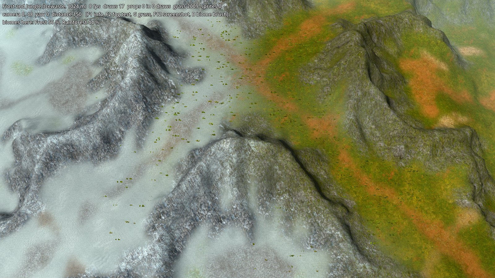

# Biomes: more than one landscape on a map

A remake upgrade (not in the original): the original gives a whole map one landscape **setting** (Jungle, Northland,
Savanna, Icewaste, Ashvalley, the caves) - its eight ground textures, its grass, its ambience. In the remake a map can
mix **any number of biomes** with soft, noisy transitions: a frost map whose east half turns into a rainforest, a
volcano in the middle of a savanna. An original map without a biome layer looks, sounds and plays exactly as before.



Biomes are **drawn and heard only**. The simulation never reads them: a skirmish on the demo map gives the same world
state hash as on its base map (BiomeTests.BiomesDemoMap). The world keeps using the map's setting where it did before
(the wood logs the workers carry `product_wood_<setting>`, the depleted stone model, the forest blocks' tree kinds), so
those stay per map.

```
src/Sim/Maps/Biomes.cs          Biome, BiomeSet (biomes.json), BiomeLayer (the per-map layer), GroundLayers, LayerPick
src/Sim/Maps/BiomeAuthoring.cs  Gradient (two biomes along a line), Split, Paint (a soft noisy blob)
src/Sim/Maps/MapFiles.cs        reading a map (the map format: its biome layer in map.lua + terrain/biomes/*.png - MAP_FORMAT.md)
game/maps/biomes.json           every biome (the original settings + the remake's own)
game/maps/*.pwmap.json          the remake's own maps' recipes + their .biomes.json (Prepare converts them: maps/Remake/)
game/src/View/Terrain           TerrainMesh (layers per vertex, palettes per tile), TerrainShader (texture array)
game/src/View/World/WorldView   GroundLayers, one grass layer per biome, RefreshBiomes
game/src/View/World/BiomeAmbience.cs   light / fog / sky, weather and ambience by the biome mix at the camera
game/src/View/World/MapViewer.Biomes.cs  the map viewer's biome brush
tools/biomes                    the authoring command line
tests/PwRemake.Tests/BiomeTests.cs
```

## A biome

A named bundle (`game/maps/biomes.json`):

| field | what |
|---|---|
| `id`, `name` | `"Jungle"`, `"Frost"`; the original settings' biomes have the setting's name |
| `ground` | the texture folder of its 8 ground materials: `assets/terrain/<ground>/scape_0..7.jpg` |
| `roles` | what each of the 8 materials is: `land` (the main open ground), `land2`, `dry`, `dirt`, `earth`, `seabed`, `stones`, `rock` (the steep), `path`, `shore`, `snow`, `ash`, `lava`, `tiles` |
| `grass`, `grassDensity` | the grass atlas (below `assets/terrain/`) and how much grass grows on each material (0..1) |
| `ambience` | the ambience template (`Audio/AtmoTemplates`: `jungle`, `icewaste` ...); null: silence |
| `look` | optional: factors of the renderer's light - `sun` (RGB), `ambient` (the sky light, RGB), `sky` (the sky's and the fog's colour, RGB), `fog` (the fog's distances) |
| `weather` | optional: `snow` and `rain` factors of the map's weather where the biome is (`"snow": 0`: no snow in the rainforest) |
| `setting` | optional: the original setting whose **building textures** the buildings take where the biome dominates (`icewaste`, `savanna` ...; default: its `ground` folder - Frost `icewaste`, Rainforest `jungle`) - "Setting textures" below |
| `snowCover` | optional: shader snow on the buildings without an Icewaste texture where the biome is, 0 .. 1 (Icewaste and Frost 1; default 0) - "Setting textures" below |
| `snowTexture` | optional: the texture of that snow, below `assets/terrain/` (default `Icewaste/scape_0.jpg`, the Icewaste's open snow) |
| `original` | one of the original settings |

The **original settings are the first biomes**, one per setting, with what the remake drew before (the grass densities
the JS's `GRASS_DENSITY` table had, the setting's grass atlas, no light of their own); `BiomeSet.Original()` makes them
and `tools/biomes biomes --write game/maps/biomes.json` writes them again (keeping the file's other biomes). An original
map's ambience stays its own `material_atmos`. The roles come from the textures and from what the multiplayer maps
use the materials for (`tools/biomes materials`: the most used flat ground is `land`, what lies under the sea
`seabed`).

The remake's own biomes so far: **Frost** (the Icewaste ground and grass, colder light, a little haze, more snow, rain
mostly off) and **Rainforest** (the Jungle ground, a little more grass, warm greenish light, no snow, more rain). New
biomes are only data: an entry in biomes.json, using the game's own textures, grass atlases and ambience templates.

**From one biome to another**: the map's own ground (its 4 m material cells, indices into its setting's 8) is turned
into each biome's material **of the same role** (`BiomeSet.Remap`; a missing role takes the nearest: `RoleFallback`).
The Icewaste demo map's snow (`land`) becomes the jungle's green ground, its sea floor the jungle's sea floor, its icy
rocks moss-covered rock. A layer file can override this per biome (`remap`).

## A map's biome layer

A grid of 8 m cells over the map (map coordinates: x east, y south, metres from the north-west corner - the editor's,
the co-op definitions'), one byte (0..255) per biome per cell, read bilinearly between the cell centres and normalised.
Any number of biomes. A map with a layer of only its own setting at 100 % gives exactly the weights it has without one
(BiomeTests.BiomesUnchangedMaps).

```json
{ "format": "pw-biome-layer", "version": 1,
  "biomes": ["Frost", "Rainforest"], "cell": 8, "x0": 0, "y0": 0, "w": 128, "h": 128,
  "weights": "<base64: w x h x biomes bytes, row by row (y), the biomes of a cell together>",
  "remap": { "Rainforest": [0, 1, 7, 3, 4, 5, 2, 4] } }
```

## Files

* **In a map of the remake's format** (docs/MAP_FORMAT.md): `map.lua` `terrain.biomes` (the names, the cell, the
  corner, the remaps) and one 8-bit picture per biome, `terrain/biomes/<biome>.png` (its weights) - paintable in an
  image editor. This is what the game reads.
* **Next to an original map**: `<name>.biomes.json` beside `<name>.ula` (the format above) - any map of the
  installation or a community map gets its layer without changing the .ula; Prepare's converter takes it into the
  converted map.
* **A remake map recipe** (`game/maps/<name>.pwmap.json`): an original map of the player's installation plus what the
  remake adds. Prepare converts each recipe whose base map the installation has into `content/configs/<config>/maps/
  Remake/<name>/`; the skirmish list shows them in the folder "Remake" (after the installation's maps). The remake
  ships no original data: the base map comes from the installation.

```json
{ "format": "pw-remake-map", "version": 1,
  "base": "Base/Maps/Multiplayer/multi_4_ice_601.ula",        (below the installation's Data folder)
  "name": "Frost and Jungle", "description": "...", "author": "...",
  "biomes": "frost_to_jungle.biomes.json" }                   (a file beside it, or the layer itself)
```

A setup addresses it as `Remake/<file>` (`--skirmish frost_to_jungle` finds it too; the id finds the converted map). `game/maps` is found like
`game/coop` (from the program's folder upwards; `PW_MAPS` overrides; an exported executable copied elsewhere: `maps\`
beside it).

## Drawing

* **Ground** (`GroundLayers`, `TerrainMesh`, `TerrainShader`): every biome's 8 materials are layers of **one
  Texture2DArray** (layer 8 b + m). The weight of layer (b, m) at a point = the map's material weights there (the
  noise-warped 4 m cells, `MapSource.Splat`, and the cells buildings painted) of the materials that become m, x the
  biome's weight - so the soft noisy material borders stay as they were, and the biome border is a second soft blend
  over them. A vertex keeps its **strongest 8 layers**; every tile of 8 x 8 cells (16 m) gets **one palette** of 8
  layers its vertices' weights refer to (`LayerPick.Palette`: the tile's strongest 8, padded with its biomes' other
  materials, in order - a tile inside one biome gets that biome's 8, so neighbours share it). The palette is a vertex
  attribute (CUSTOM2, two layer indices per float); the vertex shader decodes it and looks up the layers' scales (flat
  varyings), the fragment shader samples 8 slots as before - **the cost per pixel does not grow with the number of
  biomes**. A chunk whose tiles have different palettes gets its vertices per tile (a tile border's samples twice);
  elsewhere vertices are shared as before. An original map has 8 layers: the palette is 0..7 everywhere and every
  vertex carries the same 8 weights as before. At most 128 layers (16 biomes) per map: `TerrainShader.MAX_LAYERS`.
* **Grass**: one grass layer per biome with grass (its atlas), density = its materials' densities x the layer weights;
  each biome's clumps from its own random numbers (seed), so two biomes' grass mixes in a transition. The map's own
  setting's layer keeps the JS's random numbers.
* **Light, fog, sky, weather, ambience** (`BiomeAmbience`, every frame): the biome mix at the camera target (the point
  and four around it at 24 m) blends the biomes' `look` factors (`WorldRenderer.SetBiomeLook`: sun, sky light, sky and
  fog colour, fog distances; the fog of war pass and the particles follow the fog), scales the map's snow and rain by
  the biomes' `weather` factors, and picks the ambience of the biome that dominates there (switching only when another
  leads by 20 %; `Atmo.Switch` cross-fades the beds over 1.5 s), its ground material numbered as that biome's.
* **Setting textures** (`GroundLayers.SettingAt`, `DominantBiome`): the original repaints the buildings' atlases per
  setting (snow on the Icewaste's roofs, sand in the Savanna, moss in the Jungle, soot in the Ashvalley:
  docs/VIEW.md "Setting textures"). A building, wall or built object takes the variant of the setting of the biome
  that dominates where it stands (the biome's `setting`, default its ground's): an original map its setting everywhere,
  as the original; "Frost and Jungle" a snowy village in its frost half and a mossy one in its rainforest. Units keep
  their textures. Option "Setting textures on buildings".
* **Shader snow** (`GroundLayers.SnowCover`, `AnySnow`, `SnowTexture`): for buildings that have no Icewaste texture
  (the base game's SEAS, the sequel's houses, content prepared without the setting textures), the biomes' `snowCover`
  by their weights at a point - the view lays it over the map as a texture and those buildings' materials put the
  biome's snow on their upward faces, so a snowy village looks the same throughout (docs/VIEW.md "Shader snow").
* The minimap and the map list's preview still use the map's setting's colours (a later step).

## Authoring

**Command line** (`tools/biomes`, no Godot; `--install <ParaWorld>` or `PW_INSTALL` finds maps by name):

```
cd tools/biomes
dotnet run -- gradient --map multi_4_ice_601 --from Frost --to Rainforest --split east --band 220 --noise 120 \
    --out ../../game/maps/frost_to_jungle.biomes.json \
    --pwmap ../../game/maps/frost_to_jungle.pwmap.json --base Base/Maps/Multiplayer/multi_4_ice_601.ula \
    --name "Frost and Jungle" --description "..."
dotnet run -- paint --layer <x.biomes.json> --biome Ashvalley --at 300,700 --radius 120     (a blob of a third biome)
dotnet run -- info --layer <x.biomes.json>          (the biomes' shares and a small picture)
dotnet run -- materials --map <map> --to Rainforest  (the map's materials, their use, what they become)
dotnet run -- remap --from Icewaste --to Jungle      (the role table)
dotnet run -- biomes [--write ../../game/maps/biomes.json]
```

`gradient`: `from` on one side, `to` on the other: `--split east|west|north|south` (the transition `--band` metres wide
across the middle) or `--line x0,y0,x1,y1` (`from` at the first point, `to` at the second, the blend between); the
transition line wanders by up to `--noise` metres (two octaves of value noise, `--seed`). Without `--pwmap` the output
can be put beside a .ula as its `<name>.biomes.json`. (The tool reads `.ula` and recipes through the converter; run
Prepare after it to convert the result.)

**Map viewer brush** (`res://scenes/MapViewer.tscn`, `--map=Remake/frost_to_jungle.pwmap.json` or any map; `--brush=<biome>`
starts with the brush on; `--biomes=<file>` draws a map with another layer): **B** brush on / off, **[ ]** the brush's
biome (every biome of biomes.json), **- =** its radius (20 .. 400 m), **left mouse** paints (a soft round brush with a
noisy edge, 30 % per stroke step), **Ctrl+S** saves (`--biomes-out=<file>`, else into the map itself - its `map.lua` and
`terrain/biomes/*.png`; a `.ula` opened by its path: `<map>.biomes.json` beside it). A biome the map has not got yet is added and the map drawn again (a second or
two); then only the ground and grass under the brush are redone. The info line (F1) shows the mix at the camera.

## The demo map: Frost and Jungle

`game/maps/frost_to_jungle.pwmap.json` on `multi_4_ice_601` (Icewaste, 1024 m, 4 players): Frost in the west,
Rainforest in the east, a noisy 220 m transition through the middle. Two start locations lie in each (the north-west
and south-west ones in the frost, the east ones in the rainforest). Skirmish menu → map list → folder "Remake", or
`--skirmish frost_to_jungle`.

## Tests and measurements

`BiomeTests`: `BiomesOriginalSettings` (biomes.json's original settings = the old look), `BiomesLayerPick` (the
strongest 8 per vertex, palettes, packing), `BiomesLayerFile` (gradient, paint, the file read back), `BiomesUnchangedMaps`
(every multiplayer map: no layer, the setting's textures, the same weights array; with a layer of its own setting the
same numbers and grass), `BiomesDemoMap` (listed, its biomes west / east, both biomes' ground in the transition, the
weights' sum kept, and a 20 s skirmish with the same state hash as on its base map).

2026-11-11, container (llvmpipe), multi_2_jun_001 (no biomes): the map viewer's picture before and after is the same
but for an animated corner (1009 of 1.44 million pixels, all in one small spot of moving effects; the ground identical);
`--skirmish multi_2_jun_001 --perf 120`, the old build and the new one one after the other: wall time with rendering
960 / 948 ms per frame, the frame's own work 1.32 / 1.27 ms median - no regression. The terrain build of an original
map takes about the same; the demo map (16 layers) builds its ground in ~0.9 s on this machine.
