# Co-op campaign (for players and developers)

The campaign missions played together, in the spirit of StarCraft II's co-op missions. The agreed design is
docs/COOP_DESIGN.md; this file is how it is built, the definition schema with its final meaning, the trigger mapping,
the AI commanders and the scaling. The network layer underneath is docs/MULTIPLAYER.md.

```
src/Sim/Coop/                    the co-op core (no Godot types)
  CoopDefinition.cs              a mission's co-op definition: game/coop/<config>/<NN>.lua (+ common/<NN>.lua) -> JSON -> typed
  CoopStart.cs                   GameStart.Coop (seats, heroes, co-op difficulty, the definition); CoopPlan (slots, hero split)
  CoopRuntime.cs                 the seats in the world, starts, hero split, scaling, the seat mapping of the triggers, transfers
  CoopScaling.cs                 the enemy scaling factors and their defaults
  CoopCommander.cs               the AI commander: TribeAI + the humans' general commands
  CoopCommands.cs                CoopCommand (to an AI commander), CoopGiveCommand (units to a seat)
  CoopMapHook.cs                 the seam to the map work (extend / resources: src/Sim/Maps/MapExtension.cs, branch port/coopmaps)
  World.Coop.cs                  Player.CoopDamage / CoopHealth / CoopPopBase, World.CoopHeroBlocked
src/Net/Lobby.cs                 LobbyState.CoopMode ("shared" | "campaign"), CoopLobbyState, LobbyStart (-> GameStart.Coop)
src/Net/NetHost.cs, NetClient.cs "coop-seat", "coop-tribe", "coop-army", "army-cancel" messages; the lobby state "armies"
game/coop/<config>/<NN>.lua      the definitions (common/: both configurations)
game/src/UI/CoopLobby.cs         the lobby (online: Multiplayer; offline: the campaign menu's "Co-op …")
game/src/UI/Hud/CoopHud.cs       the co-op panel in the game; GameSession.Coop.cs
tests/PwRemake.Tests/CoopTests.cs, MultiplayerTests.cs (CoopCampaign*, CoopShared*)
tests/PwRemake.Tests/CoopPhaseTests.cs  the hero phase, the gift dealing, mission 13's second gate, the fairness of the bases
```

## How to play

**Online**: title screen → Multiplayer → game type *Campaign (co-op)* → Host. In the lobby the host picks the mission
and the **mode**:

* **Shared** - every human commands the mission's own player: the same army, the same base. Nobody takes over a
  computer ally any more (that was the first co-op version's "split"; taking a slot of its own is mode 2's).
* **Co-op campaign** - 2 or 3 **seats**. Seat 1 is the mission's own human player, seats 2 and 3 are co-op players.
  Each seat is a **human**, an **AI commander** or (seat 3 only) **empty** - a game of two seats. Each seat picks its
  **faction** (Norsemen, Dustriders, Dragon Clan; MIRAGE also SEAS); each has its own base, economy, population, tech and
  epochs. The **story heroes** are split among the humans (the lobby shows the split, the host changes it). The host sets
  the **co-op difficulty** (Normal / Hard / Brutal) on top of the mission's difficulty. Missions without a co-op
  definition are greyed out in this mode, and so are the missions whose definition says `campaign = false`: BoosterPack
  1 (4-1, 4-2, 4-3) and MIRAGE's SEAS missions (20-23) are not reworked with the main campaign's redesign of
  2026-11-03 yet ("Co-op campaign: not reworked yet" - Shared mode stays available for them; their definition files
  stay in place, unused, for later).

Joining players take a free human seat ("Take this seat") and pick their own faction and **colour**; the host sets the AI commanders'
factions and aggression. With MIRAGE the host also sets MIRAGE's game options in *Settings*: **Sixth stage** (on by
default, MIRAGE's MaxEpoch 6), **No titans**, **Flying units** (FlyingEnabled), **Portal termini** (Portals) and
**Building limit** (BldgMaxCapacity; the last four off by default) - every player sees them, they go into the mission's
`GameStart.Gameplay` (both modes, Shared too) and every player of the mission gets them: the seats (seat 1, the new
players of seats 2 / 3, an ally a seat takes over - its tree made again in the seat's tribe keeps them) and the co-op
enemies (docs/CAMPAIGN.md "MIRAGE's game options"). Two instances on one PC: `--host 1905 --mp-mode coop --mp-mission 3 --coop-mode campaign
--coop-seats human,human,ai --coop-tribes Hu,Aje,Ninigi --coop-difficulty 1 --mp-autostart 2` and `--join
127.0.0.1:1905 --mp-ready` (docs/MULTIPLAYER.md "How to play").

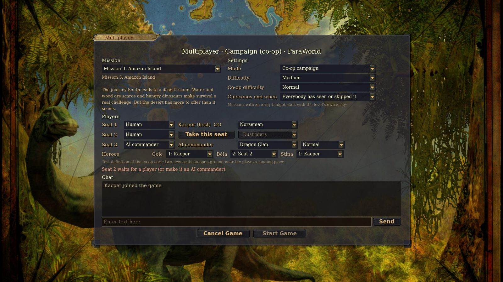

**Offline**: campaign menu → **Co-op …**: you on seat 1 with one or two AI commanders, no network. The same lobby
without the network parts (MIRAGE's game options too: the campaign menu's stored choice to start with).

**In the game** the co-op panel (right edge, below the quest notices) lists the seats (faction icon, whose heroes) and every AI
commander with its current command and its buttons: **Attack** / **Defend** (then click the place or an enemy in the
world or on the minimap), **Follow** (the selected units), **Economy**, **Retreat**, **Clear**, and its **aggression**.
With two AI commanders a **Both AI commanders** block follows them (what both do when they do the same, the same
buttons and the aggression - "Mixed" while theirs differ): each press is one command to both, picked the same way (a
click in the world or on the minimap; an enemy of either of them is attacked as an object), with the same answers
("Nothing to do that with" ...). With one AI commander the block is not shown.
**Give N to 1/2/3** hands the selected units to another seat. Resources go through the top bar's **Diplomacy** window
(in a co-op game it lists the seats, for the tribute only - the mission's diplomacy is its triggers'). Objectives,
quests, dialogues and cutscenes are everybody's; the mission is won or lost for everybody. A cutscene's actors of "the
player" are the units of any seat (they go where the scene leaves them: docs/GAME_SESSION.md "Cutscenes"); the co-op
panel hides while a cutscene shows.

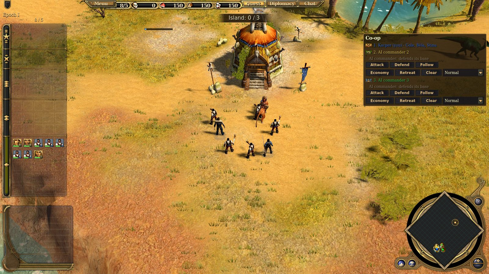

## The definition (schema v1, final semantics)

The remake's own missions (`game/missions/<name>/`, docs/OUTBREAK.md) carry their definition in their folder:
`coop.lua` (used when `game/coop` has none for the id). One Lua file per mission and configuration, `game/coop/<config>/<NN>.lua` (NN = the mission id of index.json), and
optionally `game/coop/common/<NN>.lua` for both configurations; the configuration's file is laid over the common one
(its keys replace the common's, tables merged key by key). The file runs in the maps' sandbox and returns a table; it is
turned into JSON and **travels inside GameStart** (`GameStart.Coop.Definition`): the other machines, a saved game and a
replay use that copy, not the files of the machine that loads it.

| key | meaning (core) |
|---|---|
| `version` | 1 (another version: a warning) |
| `nobuild` | a hero-party mission: no main buildings for the seats, the heroes divided evenly; no enemy scaling ("Enemy scaling") |
| `heroes` | the story heroes split among the humans: classes of the mission (`Stina_s0` also matches her sabre-tooth `special_eusmilus`, the remake's unit for her) |
| `extend`, `resources` | **the map work's** (plain data, handed to `CoopMapHook`) |
| `seats[n]` (n = 2, 3) | `start = { x, z, dir }`: the original map's map coordinates in metres (x east, z = the map's y south, from its north-west corner - as the mission's own positions, world.lua and the triggers; the map hook turns them into game coordinates of the possibly extended map, "Maps" below), dir a map heading in radians; `army`: `"default"` (seat 1's start army of the mission without its heroes, in the seat's tribe by the tribe swap; in a building mission the tribe's start workers when it has none), `"none"`, or a list of classes (another tribe's class is swapped); `ally = id`: the seat takes that existing ally's slot; `start_resources = { food, wood, stone, iron }` (default: seat 1's of the mission; -1 = the tribe's default stock); `base = false`: no main building (default: one unless `nobuild`); `extend` / `resources` **the map work's**, only for seats in use |
| `allies.usable` | the allies a seat may take (a seat's `ally` must be listed) |
| `scaling` | `count`, `health`, `damage` per extra seat (defaults below), `exclude = { ids }` players left as they are, and `garrisons` / `spawns` / `waves` / `production` = false to switch a kind of "more units" off |
| `triggers.give_to` | the seat that receives what the original gives "the player" (default 1) - in the base phase; in a hero phase and a no-build mission the gifts are dealt ("Hero phase and gifts") |
| `phase` | `{ hero = true / false, base_when = "trigger:<name>" / "quest:<name>", gifts = "deal" / "seat1", attack = "<region>" }`: the hero phase ("Hero phase and gifts"); default: automatic. `attack`: the phase's objective, a region of the mission whose enemies the AI commanders' fighters attack (no command) until the phase ends (mission 8: the barbarian camp "rescamp") |
| `seats[n].hero_army` | units seat n gets beside seat 1's start when a hero phase begins (mission 1: a Norse warrior each) - the mission's classes, in the seat's tribe |
| `seats[n].reach` | `{ x, z }`: where this seat must be able to walk to (tests; default seat 1's start or the top-level `reach`) |
| `map_objects` | `{ { name, seats = 2, attr = { k = v } } }`: attributes of the mission's own map objects changed in the co-op game (mission 1: the beach nest's `spawn_max = 2`) - on a copy of the map data |
| `gates` | `{ { seats = 3, class, replaces = { names } } }`: a gate of the mission's class in place of wall pieces - in their line (`CoopRuntime.GatePlace`: along the line from the pieces' outer ends, its footprint's middle at the line's middle, turned as the mission's own gate stands to its walls), the pieces' names and GUIDs stand for the gate (the triggers' conditions on them watch it). It gets the pavement of the mission's own gate (`CoopMapHook.Maps` `PaveGates`, on a copy of the map: the ground material of that gate's opening painted where it lies round that gate, in the gates' own frames - 13: material 5, the paving stones; the original has no road object) and, for a gate class, a 7 m lane in the map's land grid from the gate to the first walkable ground on both sides (not under houses) - 13's second gate in MIRAGE: 31 m into the city's street, 13 m outside. Base's `hcl13_gate` is no gate class: shut like the mission's own |
| `reroute` | `{ { seats = 3, near = { x, z, r }, to = { {x, z} ... }, every = 2, from = { x, z, r } } }`: scripted wave paths (WYPT) of the enemies that end near `near` end at `to` instead - every `every`-th wave and those starting in `from` |
| `start_split` | `{ { for = 3, at = { x, z, r }, to = seat, classes = {...}, max = n, move = { x, z } } }`: seat 1's placed objects in an area given to another seat at the start of a game of exactly `for` seats (moved: made again at `move`) |
| `deal_start` | true: seat 1's start fighters (not heroes, not workers) are dealt round the seats at the start |
| `mortal` | names of mission objects the triggers may not make invulnerable in co-op (MIRAGE 13: the gate tower `ninigi_small_tower_121`, kept whole by the original until the main attack is over, dealt to a seat - destructible from the start; also clickable and targetable from the start, a trigger's flags cannot lock it again) |
| `campaign`, `reason` | `campaign = false`: mode 2 not offered for the mission (greyed out in the lobby with `reason`) |
| `notes` | shown in the lobby |

Slots: seat 1 is the mission's human player; a seat with `ally` takes that slot; the others take the first player ids
no mission player uses (8 and up when a mission uses all eight - the campaign world holds 12). `CoopPlan.Resolve` makes
that choice in the lobby; the result is in `GameStart.Coop.Seats[].slot` and `GameStart.Seats[].player`.

An **ally seat**: the ally gets the seat's faction (its objects become the faction's equivalents, as the player's in a
swapped mission), no mission brain (`CreateBrains` skips seats; the mission's AI actions on its slot warn "no brain"),
and - when it owns nothing at the start - a start like a new seat at the definition's `start`, else at its own start
location of the map. A seat that is not used (an empty seat 3) changes nothing: an ally it would have taken stays the
map's computer ally with its brain, nothing of it is placed, the scaling and the hero split count the seats in use.

New seats are allies of all other seats both ways and stand to every other player as seat 1 does (and everybody to
them); the mission's filters (AntiActions) of seat 1, unit limits and population limit apply to them in their tribe.

## The map hook (for the map branch)

`src/Sim/Coop/CoopMapHook.cs` declares two partial methods that `MissionSession.Create` calls; the map branch implements
them in a file of its own (no merge conflict):

```csharp
namespace PwRemake.Sim.Coop;
public static partial class CoopMapHook
{
    static partial void BeforeWorld(CoopMapContext ctx) { /* MapExtension.Apply: ctx.Extend, ctx.SeatParts, ctx.Map */ }
    static partial void AfterWorld(CoopMapContext ctx)  { /* resources placed in ctx.World, if any */ }
}
```

`CoopMapContext`: `Definition`, `Extend`, `Resources` (the definition's), `SeatsInUse`, `SeatParts` (per seat in use:
its `extend`, `resources`), `Starts` (the seats' start points), `Map` (the MapSource before the world is built),
`Rules`, `Models`, `Config`, `Campaign`, `World` (after the build), `Problems` (shown as load problems). `BeforeWorld`
runs after the map source is read and before `WorldBuilder.Build`; `AfterWorld` after the seats, heroes and scaling.

## Maps (the map work: src/Sim/Maps)

Most missions have no room for two more bases, so the co-op definition **extends the map** at one or more edges and
**grows the mission's landmass** there (style `grow`, the default): the island continues outward along a broad front
of the old coast, made of **the map's own land** - patches of the original map ("stamps": its heights, ground, plants,
rocks and trees, turned and mirrored) melted into one new region with hills, valleys and forest, whose outer edge is a
natural coast. A co-op seat's base lies in that new territory, part of the same land as seat 1's - no lone island, no
land bridge. The old coast sector the land grows from becomes inland (its shallow sea becomes land, its beaches
meadow); nothing of the old map changes near its buildings, units, start locations, walls and gates, and the new land
opens no way round a gate, a wall or a scripted choke (each definition's `notes` say why its joins are safe;
CoopWorldTests checks it). The setting's own **resources** are topped up at each base. Islands joined by isthmuses or
fords (style `island`) remain for missions where they fit (mission 10's cliff-ringed coast, mission 12's sea lanes).
The definitions can also **grow the enemy bases or add new ones** ("Enemy bases" below). Single player never sees any
of it: the original map is read as before, the extension is made on top of it at load, in the co-op game only.

```
src/Sim/Maps/MapExtension.cs      Apply(MapData, CoopMapPlan) -> the extended MapData; PlaceResources; the material roles
src/Sim/Maps/MapExtension.Stamp.cs  the stamps: AutoStamp (choosing a patch), StampInfo (the turn), the patch's content
src/Sim/Maps/MapExtension.Grow.cs   style "grow": the lobes of grown land (GrowStamp, GrowLand), the join, the protection
src/Sim/Maps/MapExtension.Joins.cs  style "grow": graded paths to the sites' land where the walk grid leaves it cut off
src/Sim/Coop/CoopEnemies.cs       `enemies`: grown and new enemy bases, the new players, their brains and waves
src/Sim/Maps/CoopMapPlan.cs       the map part of a definition as plain data (CoopExtend, CoopBridge, CoopResource, CoopSite)
src/Sim/Maps/CoopMapHook.Maps.cs  the core's map hook (BeforeWorld): extends ctx.Map, turns the seats' starts into game coordinates
src/Sim/Maps/MapData.cs           OffX / OffY: the grids' corner in map coordinates (negative after an extension to the north / west)
src/Sim/Maps/MapSource.cs         Half (the half extent; Origin = the centre in map coordinates), Rebuild, CopyFrom
game/coop/common/NN.lua           every mission's definition (missions 0-16, 41-43); base/NN.lua, mirage/NN.lua: what differs
game/coop/mirage/20..23.lua       MIRAGE's SEAS missions
tests/PwRemake.Tests/CoopMapsTests.cs  the checks below; CoopMapsSurvey, CoopMapsDump (+ tools/coop/render_dump.py): design aids
tests/PwRemake.Tests/CoopWorldTests.cs the grown maps' gameplay, the enemy additions, a short game of every mission
```

### Coordinates

Everything in a definition is in the **original map's map coordinates**: x east, z = the map's y (south), metres from
its north-west corner - the coordinates of the mission's own world.lua, regions and triggers. An extension keeps them:
the new land to the north or west lies at negative coordinates, to the south or east beyond the old size
(`MapData.OffX` / `OffY` are the grids' corner, `MapSource.Origin` the extended map's centre, so `Campaign.ToGame` /
`ToMap` stay right for every old position and the triggers need nothing). This is also why a definition does not use
game coordinates: the world is centred on the map, so the game coordinates of everything move when an edge is added -
and they would differ between the 2-seat and the 3-seat game when only seat 3 extends the map. The map hook turns the
seats' `start` into game coordinates after the extension (`CoopSeatDef.X / Z`).

### What the extension does (MapExtension.Apply)

* **Size**: `extend.north / south / east / west` metres (rounded up to 32 m, the forest squares'); the world, nav grid,
  fog, minimap, play area and camera bounds follow from the bigger map (square world as always; the ground keeps the
  map's 2 m samples however big the map grows - docs/TERRAIN.md "Terrain").
* **The old map and its edge**: the old samples are kept, except its 32 m frame at an extended edge (the editor's
  border outside the playable area - a step or a flat band, which would now lie in the middle of the map), made again.
  Beyond the edge the old ground goes on **mirrored** (its ridges, coves and shelf, not a ramp drawn straight out) and
  fades into the sea over 40 .. 200 m (noise): a wandering coast where the old map's land reaches its edge (4-1, 4, 10,
  15); the sea floor goes over into the old map's own open-sea depth. That edge land is walkable only where its mirror
  image in the old walk grid is (no new ways round the map's edge). The seam is continuous.
* **The old map's objects keep their ground**: the map gives every object and plant its height (the editor's z; the
  decoration, stairs and plateaus are drawn at it). What the extension clears is what stands where the ground moved
  by more than 0.5 m; what stays where it moved less (a beach risen under a lobe, a smoothed join, the remade frame)
  moves with its ground - a copy of the object with its height changed by the ground's (`MapExtension.Apply`, after
  the clearing). Before, the ground came through them: reeds and stones sunk on the old beaches, mission 15's SEAS
  fortress stairs 0.2 m in the ground. (Mission 13's "yellow ground coming out of the metal stairs" of the SEAS
  fortress was the 4 m terrain mesh of maps above 1400 m: docs/TERRAIN.md "Terrain".)
* **Grown land** (style `grow`, MapExtension.Grow.cs): every co-op seat's base site (a lobe of radius `start.land`,
  default 190 m) and every lobe of `extend.grow` (`{ x, z, r }`) is a round piece of land made of a patch of the old
  map (`GrowStamp`: land all round, gentle, varied ground and plants, no buildings or start locations; a base site's
  patch with a flat spot at its centre; turned by a seeded direction, or `stamp = { x, z, rot, mirror }`, or
  `stamp = false` for generated hills). The lobes' land weights (noise-bent discs) make one landmass: overlapping
  lobes average their heights (relative to the water), a lobe's own coves and lakes are filled to low land, high
  ground is lowered by half above 6 m and the result is smoothed (rolling ground to build on), the outer edge fades
  into the sea as a beach. Near the old coast the new heights go over into the old land's own (its heights carried
  out over 110 m): the old shallow sea there becomes land, old beaches under a lobe rise a little and become meadow.
  The old map's land above the shore (2.5 m over the water) never changes; nothing changes within 40 m of its
  buildings, walls, gates and placed pieces and within 20 m of its units, start locations and nests (the setting's
  own decoration - rocks, craters, steam - is landscape and not protected); `extend.keep = { { x, z, r } }` zones
  stay exactly as they are and get no new land (an islet stays an islet, a channel stays open; the shelf leaves their
  water as deep as it was). Where the old coast is a cliff, a **path** (`bridges = { { points = ..., width = 16,
  cut = 10, shape = "path" } }`) grades a walkable way from the site through the new land and up the coast (cutting
  at most `cut` m: a pass). Lobes are placed on the old coast where seat 1's ground reaches the water by a beach (the
  design aid below lists those beaches), and the new land touches no part of the old map that single player keeps
  apart from it.
* **Base sites** (style `island`: each co-op seat's `start` in the new land or in the old map's open sea; build radius `r`, default
  56 m) are **stamps**: a round patch of the old map (radius 160 m) put at the site, turned in 64 steps and maybe
  mirrored (`StampInfo`, plain arithmetic). Chosen automatically (`AutoStamp`) unless the definition gives one: a spot
  of the site's size that is land, gentle and walkable, with no building or start location on it, a walkable way to its
  own coast (the patch is turned so that this coast faces the site's land bridge), much water on the patch's rim (a
  coastal piece: little land cut off), land around the spot (an island, not a disc), varied ground and plants; another
  seat's patch is not used again (a looser pass allows steeper ground and buildings nearer, a last one another seat's
  patch, turned differently). Its heights (relative to the water) fade into the sea along a noise-bent ellipse (bays
  and capes; the long axis across the land bridge; a beach where land fades) - never within 28 .. 72 m of the old map's
  land, at the map's border or from the old map's frame. The build area is then levelled (95 % of the relief out over
  0.7 `r`, fading out by `r` + 36 m; the sea under it raised). Seats with `stamp = false` or without a fitting patch get
  generated land of the same shape (the setting's gentle hills).
* **Land bridges** (`extend.bridges = { { points = { {x, z}, ... }, width = 20, cut = 6, shape = "isthmus" } }`, from the
  site to a landing point on the old coast): the line is bent into a natural curve (none at its ends) and continued 24 m
  past the landing onto the land; around it an **isthmus** - low land 2 .. 4 m above the water with dunes and beaches,
  about 3.2 `width` wide, its width wandering and flaring out where it meets the land - or, `shape = "ford"` (naval
  maps), a narrow sandy strip 0.9 m above the water. The spine (`width`) is graded: the ground where it is gentle, ramps
  not steeper than 0.3 where it is not (a third cut into the higher ground, two thirds filled below), the site's level
  on its build area; it cuts at most `cut` m into higher ground (a pass through coastal cliffs). In the old map the
  isthmus only covers water and shore; the old map's trees, stones, bushes, plants, forest squares and solid scenery on
  the spine or on ground that rose or sank are removed; the spine is walkable.
* **Shelf**: the sea floor rises towards the new coasts as it does round the old map's islands (the old map's mean depth
  by distance from its coasts, measured per map): the same light shallow water.
* **Ground materials**: old cells keep theirs unless their ground changed; a stamp's ground keeps the patch's own
  materials (paths, grass, rock, sand as the original has them) where it is still the patch's ground; the rest by what
  the old map uses its materials for (`MaterialRoles`: under water, shore, beach, the flat land's three most used in
  patches, steep ground); the first 24 m beyond an edge mixed with the old edge cell's. Then **the ground follows the
  final slope** (after levelling, grading and smoothing): `RockSlopes` finds the old map's rock materials (those it
  keeps for steep ground: median slope 0.45 or more, a fifth of them above 0.2) and the slope it uses each from (its
  20th percentile, at least 0.3); a recomputed cell keeps a rock material only where its slope (over ~12 m) reaches
  0.75 .. 1.25 of that (dithered by noise per cell - soft borders, no hard-edged blobs), else it gets the flat land's
  mix (never a rock material, even where a map paints much rock on flat tops); ground steeper than the old map's
  typical rock (the steep material's median, 0.5 .. 0.8, dithered) gets the steep material. (Before, a patch's cliff
  rock stayed on the land the growth had lowered or levelled: rock texture on flat ground.)
* **Smooth joins** (after the sites are levelled and the bridges graded): a site's levelling fades towards the old
  land the join carries out (no plateau meeting the old coast in a step) and leaves land next to a coast low (its
  beach, not a wall; the old rule raised low land and not the water beside it); a bridge's cut and fill come down at
  0.6 (steeper only where `cut` needs it to stay within reach: a path 16 m beyond its spine, a ford 18, an isthmus
  34), their edges bent by noise; an isthmus' body has the spine's height only along the spine and comes down at 0.5
  to its low land (an embankment, not a plateau ending in a wall at the old shore); a sample nearer to another bridge
  but outside that one's strip is still graded. Then `SmoothJoins` relaxes every steep (above 0.5) or sharply bent
  spot of joining ground (levelled or graded, within 20 m of the old land the join carries, the old edge's remade
  frame) over 16 m around it (12 passes of a 3 x 3 mean): land stays land and water keeps its depth (no new coast or way, no shallower sea lane),
  nothing is dug below the ground before, the old map's land above the shore (in style island: all its land) only
  where a bridge cut it, its protected ground and the keep zones not at all.
* **Walk grid** (the editor's PaFi): copied; new cells and changed cells: dry and not steeper than 24 degrees.
* **Joins** (style `grow`, MapExtension.Joins.cs; 2026-11-12): lobes are noise-bent discs whose edges fade into the sea,
  and where two patches meet their heights are averaged - two lobes that touch only with their beaches leave a strait,
  two patches of different height a ridge too steep to walk. On the walk grid (and so for the computer players'
  islands, `World.LandIsland`, by which the AI decides that a wave needs a ferry) such land is an island of its own.
  After the map is made, every seat's base site and every enemy base whose waves walk (a new player whose brain
  attacks: `CoopSite.Waves`) is checked: is its part of the walk grid (4-neighbourhood, as `LandIsland`) joined to the
  old map's land (a part with 2000 cells of it or more)? If not, a search from the joined land that walks the land for
  free and pays for every cell of water or steep ground finds the way that crosses least - through the lobes between -
  and every crossing gets a graded **path** (`shape = "path"`, width 12, cut 8: a causeway 1.2 m above the water over a
  strait, a pass through a ridge), beginning up to 20 m inside the land on the site's side and going on 24 m into the
  land beyond; not through the old map's land above the shore nor the keep zones, 160 m of crossing at most. The map is
  made again with those paths (at most three rounds); `MapExtensionInfo.Joins` and the log list them (`join: enemy site
  (1785, 855) cut off - a path across 46 m ...`). A lobe with nothing on it may stay an island (scenery: 03, 04, 08 and
  15 have such lobes in some seat counts), and so may an enemy base without waves (15's SEAS battery on its islet, 04's
  towers on the bay). The only map that needed joins in 2026-11: mission 6 with 3 seats (both configurations), whose
  raiders' cove stood on three lobes cut off from seat 3's land by a strait and two ridges (its waves found no way by
  land and never left: `CoopSmoke`). (Not the 2 m ground of main af44116: the walk grid is the extension's own, and
  the islands were the same with the 4 m ground.)
* **The land's content**: a stamp brings the patch's own trees, stones and fruit bushes, its forest squares, plants and
  decoration of the setting (rocks, plateaus, shrubs, flowers - by name: nothing people built, no walls, ruins, houses,
  bridges, waterfalls, nests, units or mission objects), turned with it; rocks and plateaus only where the ground is
  still exactly the patch's. The land no stamp made (isthmuses, generated land) gets forest squares with the item bytes
  of the old map's own (or clumps of its tree classes on maps without squares); the map's own plants (on maps that keep
  them as objects: its VGTN) are scattered in clusters of one kind there, on the levelled build areas and (less) on the
  patches, as dense as on the old map's land, shore plants on the shore.
* **Resources** (`resources`, `seats[n].resources`): map objects like the editor's (TREE / STON / FRUI), so MapSource
  makes them resources as any other: `kind = "wood"` (trees, `count`, area `r`), `"stone"`, `"food"` (fruit bushes),
  `"fish"` (shoals in the water), `"kit"` (what a base still needs beside what its land brought: up to ~30 trees
  towards the most open side until 26 stand within ~95 m, two stones, six bushes - keeping 22 m free for the main
  building), or `class = "..."` at a point / in an area. Classes are the map's own (its placed trees, stones, bushes),
  else the setting's (`<Setting>_Tree_0N`, `Resource_Stone_<set>`, `<Setting>_Fruit_Bush`; the volcano caves the Ash
  Valley's). ParaWorld has no iron deposits (a map's "iron" is skulls).
* **Determinism**: seeded (`extend.seed`), only `+ - * /`, `sqrt` and `floor` (sin / cos by their series, the stamps'
  turns from a table of 64 directions): the same map on every machine; the definition travels in GameStart, so saves and
  replays rebuild the same map. The log says which patch each seat got (`seat 2: auto stamp from (592, 880) r 160,
  turned 326.3 deg`): copy it into the definition to keep it when the map or the chooser changes.

### Seats in use (2 or 3 seats)

Each co-op seat's own land and resources go under the seat: `seats[n].extend` (merged with the top-level `extend`: the
larger edge, the bridges and land of both) and `seats[n].resources`. The hook builds the plan from the seats in use
only (`CoopMapPlan.FromJson(def, ctx.SeatsInUse)`), so with seat 3 empty its edge, lobes, base site, enemy additions (`seats = 3`) and resources
are not made. Every definition gives seat 2 a place that stands on its own (its own join to seat 1's land, not through
seat 3's). An ally seat (`ally`) stays the map's computer ally when its seat is empty (the core).

### Writing a definition's map part

```lua
return {
  version = 1, nobuild = false, heroes = { "Cole_s0", "Bela_s0", "special_eusmilus" },
  extend = { seed = 102 },                             -- shared: the seed (style "grow" by default; edges per seat below)
  seats = {
    [2] = { start = { x = 500, z = 1430, dir = 0 }, army = "default",       -- (start.land: the site's lobe, 190 m)
            extend = { south = 352,
                       -- lobes of new land on the old coast (where seat 1's ground reaches a beach) and between it and the
                       -- site; each a patch of the map (optional `stamp = { x, z, rot, mirror }` or `stamp = false`)
                       grow = { { x = 400, z = 1150, r = 160 }, { x = 600, z = 1150, r = 160 }, { x = 500, z = 1280, r = 150 } } },
            resources = { { kind = "kit", x = 500, z = 1430 } } },
    [3] = { start = { x = 1010, z = 910, dir = 0 }, army = "default",
            extend = { east = 352, grow = { { x = 700, z = 880, r = 150 }, { x = 850, z = 900, r = 150 } },
                       keep = { { x = 745, z = 725, r = 60 } },            -- the Dustriders' landing islet stays an islet
                       -- where the coast is a cliff: a graded path (a pass) from the site up to the old ground
                       -- bridges = { { points = { { x = 1010, z = 910 }, { x = 760, z = 880 } }, width = 16, cut = 10, shape = "path" } }
                     },
            resources = { { kind = "kit", x = 1010, z = 910 } } },
  },
  enemies = { ... },                                   -- "Enemy bases" below
  -- map-only keys the tests read: reach = { x, z } (where the seats must be able to walk to, if not seat 1's start),
  -- naval = true (a way by sea counts)
  ...
}
```

* `stamp = { x, z, r, rot, mirror }`: `x, z` the patch's centre in the old map (it lands on the site's start: a flat
  spot), `r` its radius (160), `rot` degrees it is turned clockwise seen from above (north up; without it: so that the
  patch's coast faces the land bridge), `mirror` true / false (without it: alternating by seat and seed, so two seats on
  one side never look like mirror images).
* `bridges[k].shape = "isthmus"` (default) or `"ford"`; `width` the walkable spine, `cut` how deep it may cut (a pass).
  More points bend it (the last segment decides how it meets the landing, e.g. through a pass).

The recipe the grown definitions follow: find the beaches where seat 1's ground (every enemy gate closed) reaches the
water, away from the mission's objects (`CoopMapsDump` + `tools/coop/render_dump.py --comp` draw the map with the
ground seat 1 reaches and the parts every gate closed keeps apart; a beach is walkable ground within 6 m of the sea and
less than 3 m above it); put a lobe (r 130 .. 170) centred on that stretch of coast, one or two between it and the
site, the site 250 .. 450 m out (in the old map's open sea or beyond its edge, the edge extended so that about 200 m of
the map lie beyond the site); `keep` the islets and channels nearby that must stay apart; where no beach is in reach
(a cliff coast) a `path` with `cut` up to it; the seats on different sides or at clearly different distances.
CoopMapsTests and CoopWorldTests say whether the seats reach seat 1 and whether the old map's parts stay apart.
The island recipe (style `island`): the base site 180 .. 420 m from its landing on the old coast, at least 150 m from
the old map's land, a land bridge to a landing on ground seat 1 walks to. `PW_COOP_SURVEY=1 dotnet run --project tests/PwRemake.Tests --
CoopMapsSurvey` lists, per mission and edge, landing points with the bridge's length, the distance to the nearest enemy
and neutral object and the walk from seat 1's start (`PW_COOP_SURVEY_DIR=<dir>` also writes a picture of the nav grid;
`PW_COOP_SURVEY_SEATS=2|3` of the co-op map: seat 1's ground light, a seat's that does not reach it orange). The map
viewer shows a co-op map: `--map=single_02 --coop=base:2[:3] --overview --shot=x.png`.

### The missions

Redesigned with the user on 2026-11-03 (the mockups' review: fair base places, hero phases, gifts dealt round the seats;
BoosterPack 1 and MIRAGE's SEAS missions are not reworked yet: mode 2 is greyed out for them, Shared mode stays). No ally
is taken over in any mission: every ally with a base is steered by its mission or is no tribe. The no-build missions (5,
11, 16) change nothing on the map; the seats start beside seat 1 with no army and get their share of the heroes. The
definitions of 0-16 were written by a script during the redesign (edit the Lua files themselves now); both
configurations use the same `common/NN.lua` (MIRAGE's maps of missions 0-16 are the base game's: no MIRAGE override
was needed). Positions are the original maps' coordinates;
each definition's `notes` say which coast the land grows from, why that join is safe (it touches only ground seat 1
walks, no gate, wall or fenced part) and how the objectives treat the enemy additions. "n+ seats": the addition appears
from that many seats on. The distances are `CoopFairness`'s (see "Fair bases"; 3 seats, base game).

| mission | kind | seat 2 | seat 3 | enemy additions | nearest enemy building: seat 1 (D1) / 2 / 3; seats 2 / 3 from seat 1 (m) |
|---|---|---|---|---|---|
| 0 "Tutorial" | hero phase, then base | (985, 180), grown land | (1000, 620), grown land | - | 268 / 642 / 557; 400 / 325 |
| 1 "Stranded" | hero phase, then base | (790, 185), new land (site 150 m), graded path | (530, 180), new land (site 110 m), graded path, isthmus | Barbarian watchtowers (player 2 grows, 2+ seats); Barbarian raiders (new, 3+ seats) | 190 / 202 / 206; 306 / 218 |
| 2 "Druid Island" | base | (775, 1160), new land (site 110 m), graded path | (317, 974), new land west of seat 1 (site 130 m) | Poachers' towers (player 1 grows, 2+ seats) | 690 / 788 / 723; 336 / 161 |
| 3 "Amazon Island" | base | (472, 133), new land north of seat 1 (site 120 m) | (592, 113), new land north of seat 1 (site 110 m) | Amazon war camp (new, 3+ seats; its land joined to island 2 as before) | 456 / 549 / 476; 114 / 184 |
| 4 "The Dustriders" | base | (420, 1295), new land (site 130 m), graded path | (549, 956), the old map's land west of the village | Barbarian lookout (new, 2+ seats) | 191 / 199 / 233; 439 / 116 |
| 5 "The Holy City" | no-build | with the heroes | with the heroes | - | - |
| 6 "Pirates and Hostages" | base, naval | (1460, 375), new land (site 115 m) | (1610, 545), new land (site 120 m), isthmus | Pirate raiders' cove (new, 3+ seats, at (1785, 855)) | 288 / 364 / 307; 242 / 382 |
| 7 "The Water Temple" | hero phase, then base | (714, 1110), the old map's land | (425, 1005), the old map's land | - | 205 / 268 / 364; 243 / 163 |
| 8 "Valley of the Gods" | base for seat 1; hero phase for seats 2 / 3 until the barbarian camp is cleared | (480, 1180), the old map's land | (45, 880), new land (site 125 m), isthmus | Barbarian outriders (new, 2+ seats); Barbarian war camp (new, 3+ seats) | 101 / 175 / 161; 226 / 366 |
| 9 "Perilous Path" | hero phase, then base, naval | (640, 1005), the old map's land | (520, 1085), the old map's land | Barbarian base 3 reinforced (player 3 grows, 2+ seats); Barbarian base 1 reinforced (player 1 grows, 3+ seats) | 198 / 307 / 231; 191 / 252 |
| 10 "The Prophet" | base, islands kept | (690, 1285), an island of new land, land bridge | (-40, 815), an island of new land, land bridge | SEAS east outpost guns (player 2 grows, 2+ seats); SEAS west outpost guns (player 1 grows, 3+ seats); SEAS landing camp (new, 3+ seats, at (-50, 555)) | 215 / 375 / 222; 402 / 558 |
| 11 "Arena" | no-build | with the heroes | with the heroes | - | - |
| 12 "Sea Battles" | base, naval, islands kept | (505, 365), the old map's island, ford | (755, 500), the old map's island | - | 344 / 437 / 350; 194 / 238 |
| 13 "The Rush" | base | (930, 370), the old map's land inside the compound | (850, 390), the old map's land inside the compound | SEAS forward post (new, 2+ seats); SEAS assault camp (new, 3+ seats) | 191 / 233 / 216; 184 / 102 |
| 14 "Prisoners" | base | (700, 1310), grown land | (1075, 840), new land (site 110 m), graded path | SEAS patrol post (new, 2+ seats) | 175 / 238 / 304; 325 / 362 |
| 15 "New World Order" | base, naval | (790, 1015), the old map's land | (390, 1045), the old map's land | SEAS gun battery (new, 2+ seats); SEAS west base reinforced (player 3 grows, 3+ seats) | 227 / 229 / 229; 235 / 166 |
| 16 "Showdown!" | no-build | with the heroes | with the heroes | - | - |

Where the implementation left the reviewed plan (the plan's place failed a map test):

* 0: seats 2 and 3 stay where the co-op tutorial had them (land grown from the start pen's north-east and east coast):
  the north lagoon and the village's south-east coast lie inside the village's fence - land there joins the pen to the
  village round the tutorial's gates.
* 1: seat 3's lagoon land reaches the prison camp's inside by a short isthmus over the bay's corner (the plan's land
  touched only the camp's palisade).
* 4: seat 3 builds on the old land west of the village (2026-11-11: south of it the war camp stood 160 m away; the war
  camp and the land grown for it below the village are gone).
* 8: seat 2 builds on the old shore east of the start (the bay is full of ice floes the growth must keep clear of); the
  outriders stand on the land east of the bay; seat 3's island joins the west coast by an isthmus.
* 9: both seats on the village's island (land at the inner sea's mouth would close the ships' way); the enemy additions
  grow barbarian bases 3 and 1 instead of new camps.
* 12: seat 3 builds on the telescope island's south side (the north-east islet is bare rock without trees), 25 m
  further north since 2026-11-11 (D1 from the enemy's bay).
* 2, 3, 6, 7, 10, 13, 14 (2026-11-11, the fairness rule above): 2's seat 3 on new land west of seat 1 (the hunting
  camp behind the south-east seats is gone); 3's seats both on new land north of seat 1 (the scouts' outpost is gone;
  the war camp keeps its land joined to island 2); 6's lookout between the seats is gone, the raiders' cove moved
  south-east on its own grown land (joined to seat 3's by three paths since 2026-11-12: "Joins"); 7's seat 2 on the open ground east of Taslow's home (the old place had a third of
  its ground free); 10's seat 2 15 m nearer, the landing camp's islet 110 m further north of seat 3; 13's seats inside
  the compound behind the wall east of seat 1 (the compound's east edge lost its base - all but the palisade - to the
  first waves: "a single tent"); 14's labour camp south of seat 3 is gone (136 m from seat 3; moved, it was cut off
  from the seats' land).
* 14: seat 2 builds south of seat 1's beach (the co-op mission's earlier place: the west coast leaves no dry build area
  between the island prison's keep zone and the old bay).
* 15: both seats on the base island's old land (the south-east island and the land south-west were 1.8x / 2.2x seat 1's
  way); the SEAS west base grows instead of a new strike base; the SEAS support's helicopters, which stand over the base
  island, are not scaled.


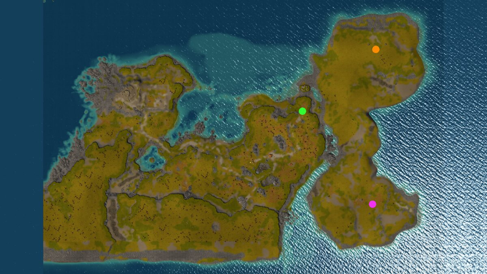

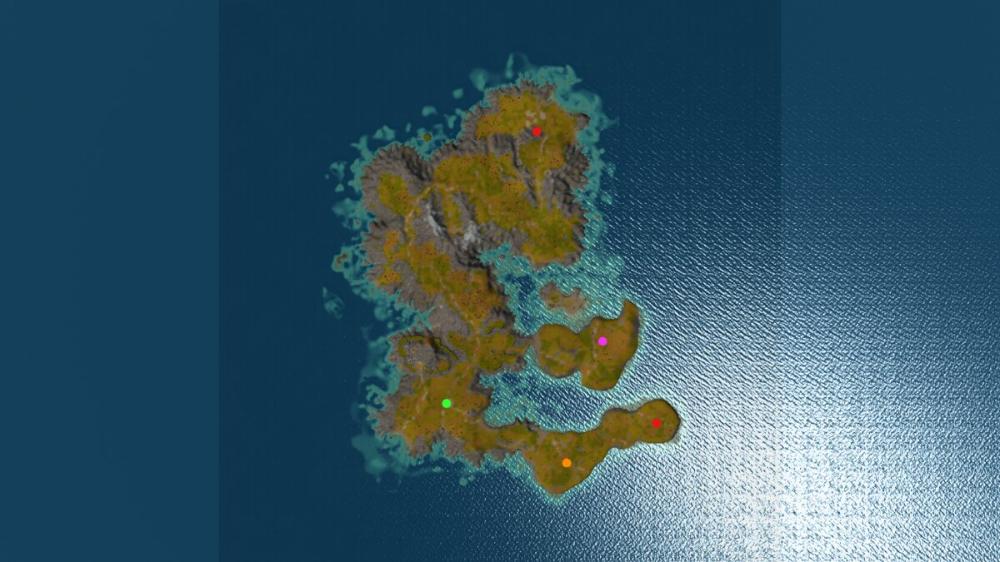

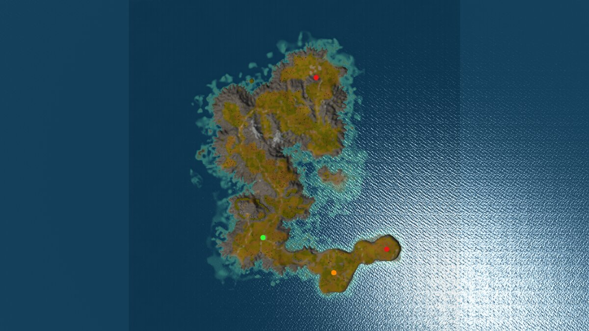

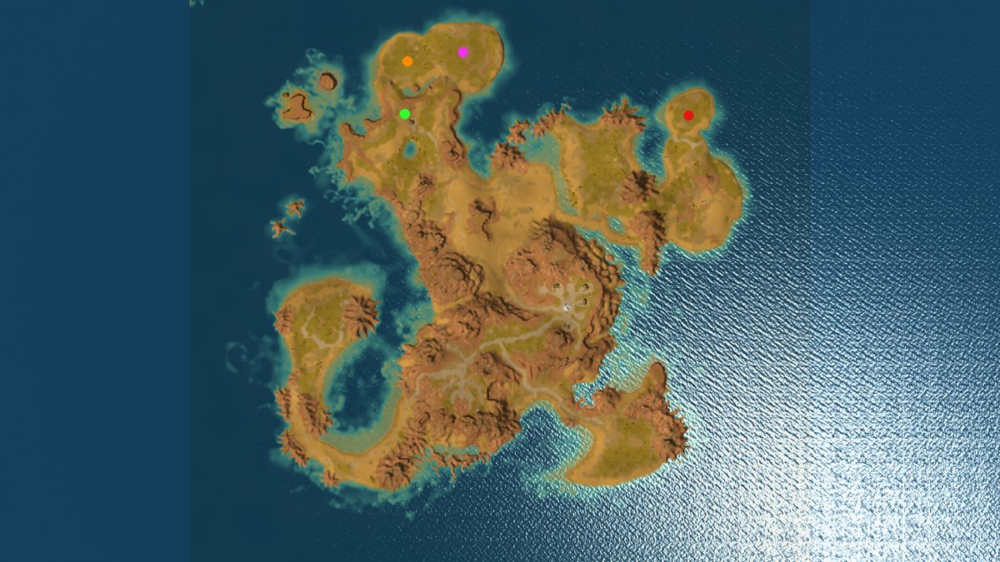


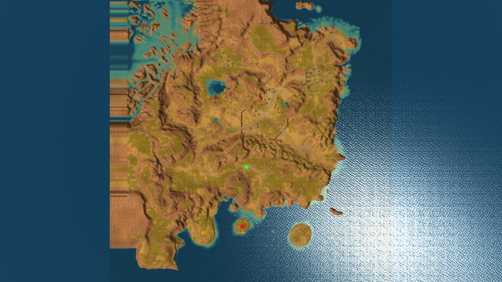

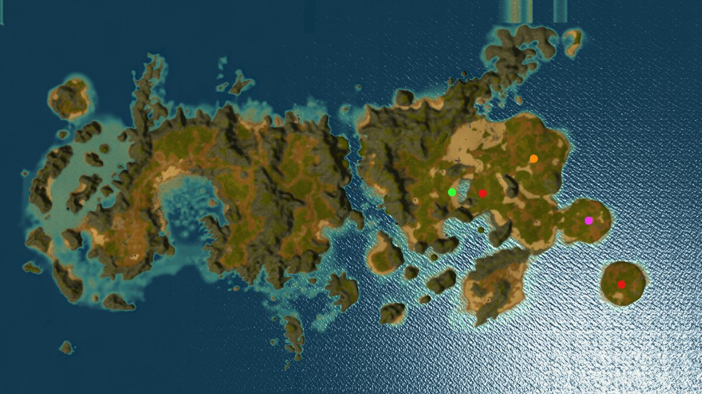

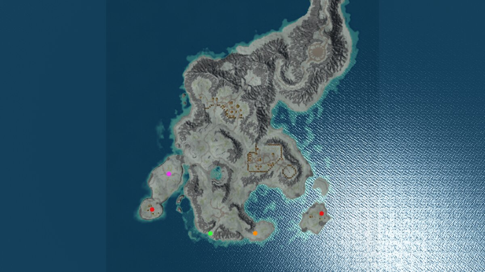

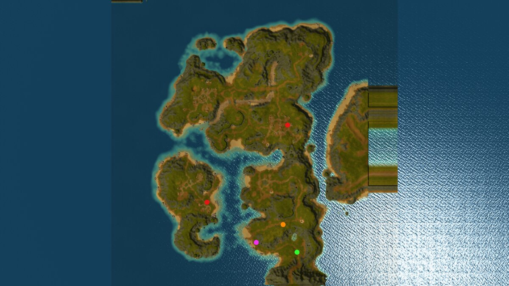


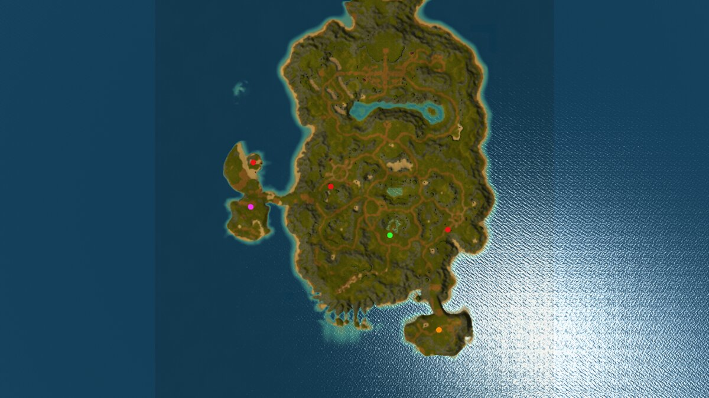

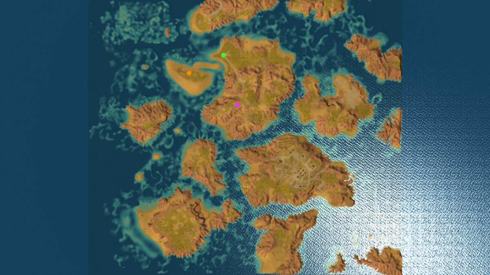

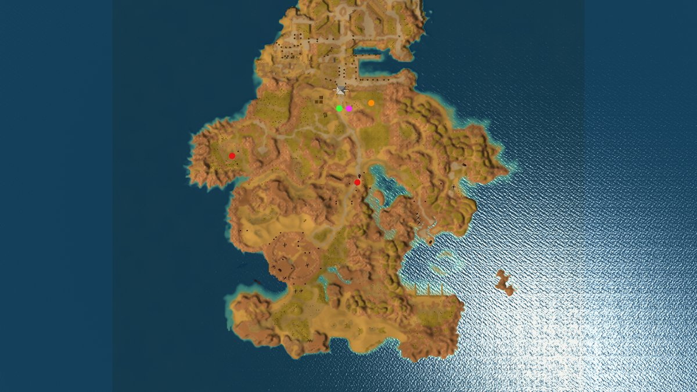

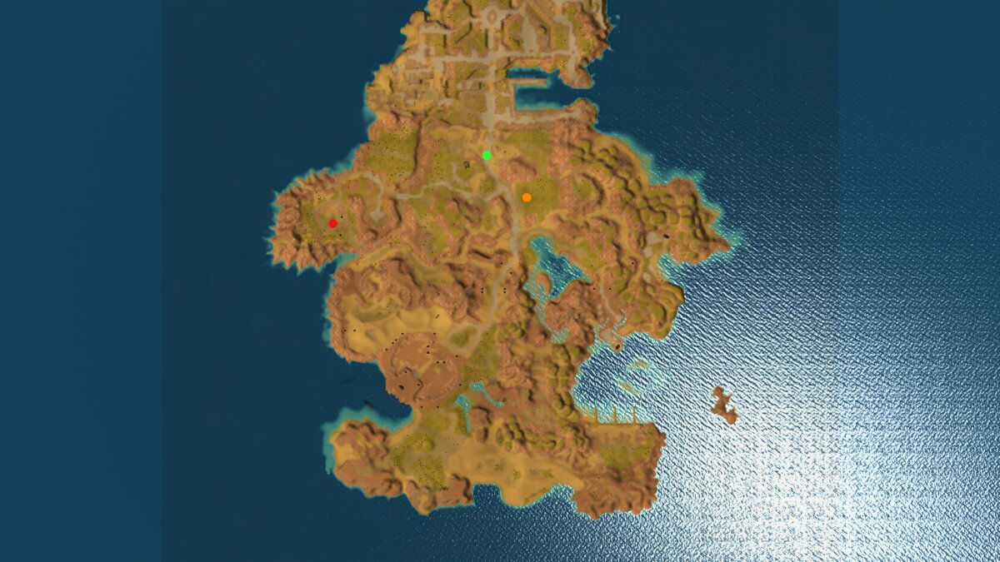

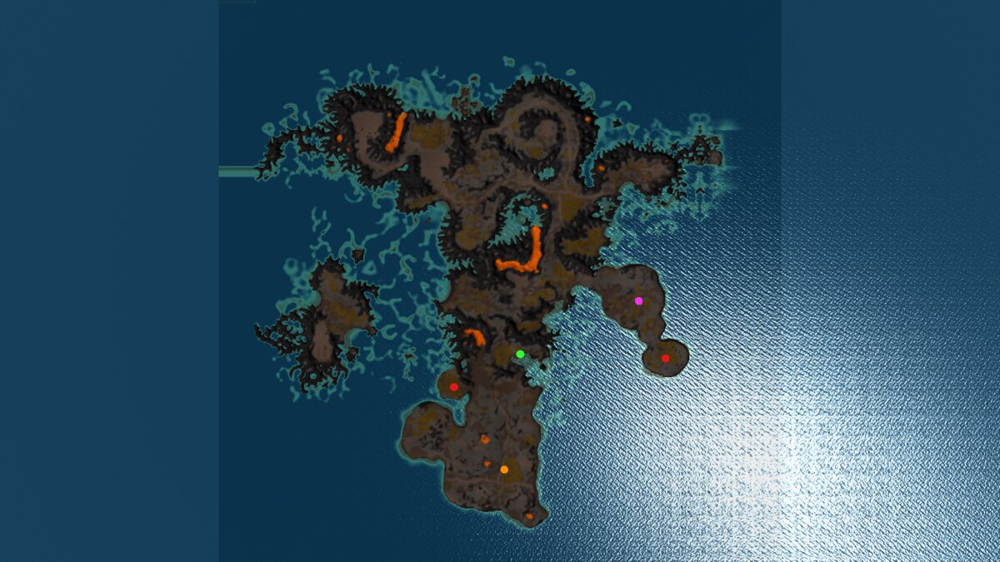

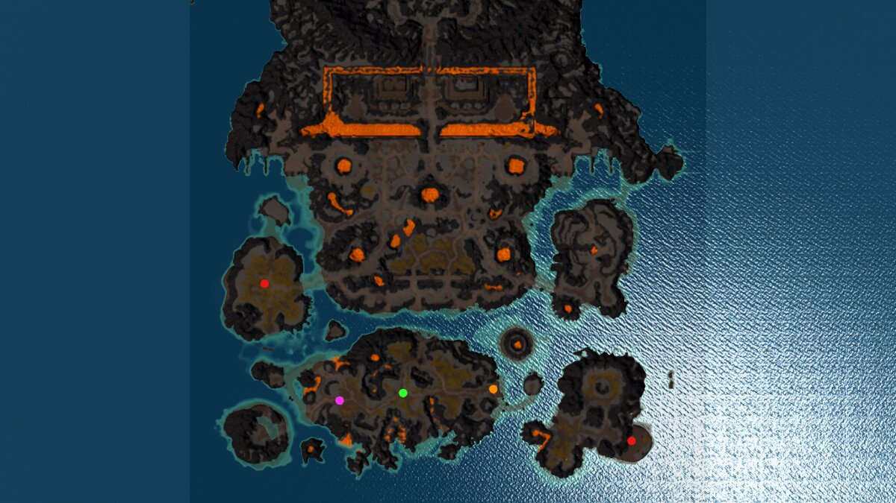

### Fair bases (CoopPhaseTests.CoopFairness)

Revised 2026-11-11 with the user ("the enemy camps are just too close to the allies; keep them near the original
start"): straight-line distances on the co-op map, 2 and 3 seats, both configurations, after the start or the hero
phase's hand-over.

* **D1** = seat 1's base (`CoopPhaseTests.Fair`) to the nearest enemy building of the mission itself (hostile at the
  start; plus the enemy bases `Fair` lists, which the story turns hostile later - mission 1's barbarians; not mission
  13's targets, which are the gates the seats defend: `TargetsNotEnemies`).
* Every other seat's base is **at least D1** from every enemy building, the definition's additions included; no
  addition stands nearer than D1 to seat 1's base (the additions were moved or dropped where they did).
* Every seat's base lies within **`NearShare` = 0.4 of the map's width** (single player's: 410 m on a 1024 m map,
  550 on 1376, 680 on 1696) of seat 1's base. Named exceptions (`NearExceptions`):

| mission, seat | why |
|---|---|
| 10, 3 | islands kept: the cliff ring leaves no sea for an island nearer than the west edge's (558 m) |

(The old rule - a seat's walk to the nearest enemy base 0.6 .. 1.6 times seat 1's - pushed seats towards the enemy.)
`CoopMapsTests.SitesSurvey` (PW_COOP_SITES=1, PW_COOP_SITES_MAP=1 for a text map) lists D1, the seats and additions
against the rule and places near seat 1 that keep it.

The pictures: `godot --path game res://scenes/MapViewer.tscn -- --map=single_02 --coop=base:2:3 --overview --grass=off
--shot=x.png` (xvfb as in docs/TESTING.md, PW_CONTENT for the headless co-op start that places the seats' main
buildings and the enemy bases); seat 1 green, seat 2 orange, seat 3 magenta, enemy additions red. The close-ups: `--cam=<x>,<z>,<yaw>,230`
at the seat's start in game coordinates (map coordinates minus the extended map's centre). `--mapcam=<x>,<z>,<yaw>,<distance>` takes the definitions' map coordinates instead.

### Tests (CoopMapsTests)

* `DefinitionsValid`: every definition of both configurations loads with the core's loader without problems; known keys,
  types, heroes that are classes of the mission, seats 2 and 3 with a start (or a listed ally), the map part's fields,
  resource kinds, `scaling.exclude` players of the mission; the plan of 2 and of 3 seats.
* `DefinitionsValid` also checks the bridges' keys and `shape`, and `stamp` (a table of numbers and `mirror`, or false).
* `DefinitionsValid` also checks `grow` / `keep` (`{ x, z, r }`), `style` and `enemies` (known keys, an owner that is
  `"new"` or a computer player of the mission, `like` a computer player of it, a tribe, classes that exist, seats 2 /
  3, notes).
* `ObjectsKeepTheirGround` (every mission, 2 and 3 seats): every object and plant of the old map the extension keeps
  stands as high above its ground as in the original map; the world's ground of mission 13 (1696 m) and of co-op
  mission 2 with 3 seats (grown past 1400 m) has the map's 2 m samples.
* `ExtensionSeamAndDeterminism` (every mission, 2 and 3 seats): the original MapData is not changed, the same plan gives
  the same map (hash of heights, materials, walk grid, forest, objects, plants), grid sizes and corner; style `grow`:
  the old map's land above the shore keeps its heights (away from paths and bridges), nothing changes near the
  mission's objects (40 m of buildings and placed pieces, 20 m of units, start locations and nests, 6 m tolerance) or
  in the keep zones, and no new land comes into a keep zone; style `island`: the old map's land inside its frame
  unchanged away from the land bridges, new land in its sea at least 20 m from its land; no step at the seam (the pair
  across it no steeper than the ground beside it, or than the old map's own ground where a patch of it lies there);
  another seed gives another landscape.
* `BaseSitesLook` (every base mission, 2 and 3 seats): each base site in new land has a build area (0.8 `r`) that is
  flat (heights within 7 m), walkable (92 %) and dry; an irregular coast (the distance from the start to the water in
  64 directions, those of its land bridge left out, varies by at least 8 % - a made disc is about 3 %); at least three
  ground materials (3 % each; as many as cover an eighth of the old map's land each, if fewer) within 160 m; and plants or decoration (15) and trees (15) within 160 m.
* `GroundFollowsSlope` (every mission, 2 and 3 seats): on new and changed land no rock material (`RockSlopes`) covers
  most of its 3 x 3 cells where none of them is as steep as 0.6 of the slope the old map uses it from (the old map's
  own painting where its ground moved less than 0.5 m aside); on the joins (changed samples within 12 m of unchanged
  old land or 24 m of a spine's edge) at most 12 % of the neighbouring pairs steeper than 0.6 where the old ground
  was not nearly as steep, none steeper than 3.5 (5.9 before), creases (a bend above 0.5 between three samples) at most
  3.5 %.
* `SeatsBaseStart` (every base mission, 2 and 3 seats, human and AI seats of every tribe - MIRAGE: SEAS too): after the
  start or the hand-over each seat has its tribe's main building, three workers or more and two thirds of the ground
  within 40 m walkable.
* `ExtendedMapBounds`: single player's source is unchanged; the extended source's origin, half size, play area, the
  height / walk grid at old and new points through game and map coordinates, the world's nav grid and fog cover it.
* `LandIslands` (every mission, 2 and 3 seats, after the start or the hand-over): every seat's start is on a land
  island (`World.LandIsland`, not -1); every co-op seat's start on seat 1's (naval missions: by land or sea, below);
  every new enemy camp whose brain sends waves on the island of the seat they go for. Lists every violation and the
  joins the extension made.
* `SeatsReachAndResources` (every mission, 2 and 3 seats, started as the lobby does: seat 2 a human, seat 3 an AI
  commander, through the map hook): each co-op seat's start where the definition puts it, inside the play area, on
  walkable ground, with a way by land (by land or sea on naval missions) to seat 1's start or `reach`, its main building
  placed, no enemy building within 160 m and at most 3 enemy units within 120 m, and (base missions) at least 15 trees
  within 110 m, a stone within 120 m and food (3 bushes or a fish shoal).

## Enemy bases (`enemies`, src/Sim/Coop/CoopEnemies.cs)

A definition can grow the mission's enemy bases and add new ones - StarCraft II co-op style, the co-op seats fight
their way past hostile outposts towards the action. Each entry appears from a number of seats on (`seats = 3`: only
with three seats), so a 2-seat game gets less. Coordinates are the original map's, as everywhere in a definition.

```lua
enemies = {
  { name = "Poachers' towers", seats = 2, owner = 1,                 -- grows player 1's base (its brain, its triggers)
    at = { x = 700, z = 330, r = 40 },
    buildings = { { class = "aje_small_tower" }, { class = "aje_medium_tower", x = 690, z = 310, rot = 0 } },
    army = { { class = "aje_warrior", count = 3 } },
    notes = "L02MQ03 (player 1 defeated) counts them: they stand in the base the quest sends the player to destroy" },
  { name = "Poachers' hunting camp", seats = 3, owner = "new", tribe = "Aje", like = 2,
    at = { x = 940, z = 750, r = 44 }, preset = "camp",
    brain = { behaviour = "Dodo", attack = true, first_attack = 660, interval = 330, wave = "SuicideAttack", target = 3 },
    resources = { food = 500, wood = 500, stone = 500 },
    notes = "a player of its own: no objective counts it" },
}
```

| key | meaning |
|---|---|
| `owner` | a computer player of the mission (its base grows: the buildings and units are its, its brain and triggers drive them, its objectives count them) or `"new"`: a new computer player in a free slot (8 .. 11 first - the campaign world holds 12 -, then the mission's unused ones) |
| `like` | (new) the mission's player it stands as: the same relations to everybody (and everybody's to it), team and colour (not its tech bans: the new player climbs its tribe's tree as its brain does); allied with `like`. Its relations follow `like`'s whenever the diplomacy changes - barbarians that are neutral until the story turns them hostile take the new camp with them |
| `tribe` | (new) Hu, Aje, Ninigi, SEAS (MIRAGE) - default `like`'s |
| `at` | the base's centre and radius; in new land its ground is levelled like a base site (`CoopMapPlan`: an enemy site) and the resources keep away |
| `preset` | `outpost` (towers, a production building), `camp` (main building, production, towers, houses; workers and fighters), `town` (more of everything) - the classes the original missions use for that tribe's bases (`CoopEnemyDef.PresetClasses`) |
| `buildings` | `{ class, x, z, rot }` (x / z optional: round `at`); each at its point if it fits, else at the nearest spot that does (CanPlace, a 4 m spiral), on dry ground - centre and rim 0.5 m above the water, not on a smoothed coast's waterline (a harbour by the shore) |
| `army` | classes or `{ class, count }`, placed round `at`; fighters scaled like the mission's garrisons of a scaled player |
| `brain` | (new players) the remake's AI (TribeAI, level 4 / 6 / 8 by the co-op difficulty, `behaviour` default Dodo): it builds up from its camp (no attack of its own before its first wave); its waves (`attack`) go for `target` (a seat; default the nearest seat in use it is at war with) from `first_attack` s every `interval` s (15 % / 30 % sooner on Hard / Brutal): a scripted attack of the tribe's `wave`_N army (N grows with the waves), spawned at the camp; a scaled player's waves are bigger. `brain = false`: a static base (outposts). For an existing owner, `brain = { ... }` adds the waves to its own brain |
| `seats` | 2 (always) or 3 (only with three seats) |
| `notes` | what it is for and how the mission's objectives treat it |

**Objectives.** A new player is named by no trigger: "destroy all buildings of X", "player X defeated" and the region
counts of a mission player ignore it. Buildings added to a mission's player join its counts - only where destroying
them is part of what the objective asks (they stand in that player's base, reachable by seat 1); the definition's
`notes` say which objectives count them. CoopWorldTests.EnemyAdditions checks it: the placement, the owner, the
relations (a new player stands as its `like`), no trigger naming a new player's slot, no "anybody" region count over
it, and an owner's additions reachable by seat 1.

### Waves that cannot walk (CoopRuntimeEnemies.WaveWay; 2026-11-12)

A wave is a land army spawned at its camp, and a camp is meant to stand on its seat's land (the map's joins above;
`CoopMapsTests.LandIslands`). Where its land (`World.LandIsland`) is not the seat's all the same - a definition that
puts a camp on an islet, a map change -, the brain would take the wave across in its own transports, which a new camp
does not have: the wave ended "no transports" and never left (base 06's raiders' cove until 2026-11-12). Each wave
now asks first, and goes:

1. **by land** (`land`) - as meant;
2. else to **the seat's buildings on the camp's own land** (`building`: an outpost the seat built there), on foot;
3. else **by boat** (`boat`): a scripted landing as the original's (`ship_land`, SP:476-487): transports of the
   tribe's class are spawned with the wave at the water nearest the camp and sail to the water off the seat's coast
   nearest its start (`TribeAI.WaveLanding`: the brain's own landing search, no enemy tower or water mine within 30 m);
   the wave lands, the boats are gone, and it walks on to the seat - when the tribe has a transport and one water joins
   the two coasts;
4. else it **comes ashore on the seat's land** (`beach`): spawned at the seat's land nearest the camp (4 m free every
   way), as if it had landed.

Why this order: the docs' promise is that every wave of a camp reaches the seat it is meant for (StarCraft II co-op
style pressure, "Enemy bases"), and that a camp is the pressure of its own coast. A building of the seat on the camp's
land is the nearest thing the wave can reach on foot; the boats keep the fiction - pirates and raiders from across the
water come by boat, as the original's scripted landings do (mission 2's turtles, mission 12's carriers) - and cost the
camp nothing (the original spawns its landing ships too); coming ashore is the last resort for a map without water
between the coasts or a tribe without transports. Targeting another seat instead was not chosen: the definitions set
`target` on purpose (the fairness of the bases: "Fair bases"). `CoopEnemyRun.Way` and the log say which way each wave
took (`wave 1 (SuicideAttack_1) at seat 3, boat`).

### Tests (CoopWorldTests: the gameplay of the grown maps, the enemy additions, a game of each mission)

* `GrowthKeepsGameplay` (every base mission, 2 and 3 seats): the walkable parts of the ground with every gate closed
  (gates, walls, cliffs and the sea keep them apart) - no co-op part joins two parts of the old map that single player
  keeps apart (no way round a gate, a wall, a fenced region; trigger regions in a part seat 1 does not reach stay out
  of reach); the old map's open water (deep enough for ships) stays one water (no sea lane cut).
* `EnemyAdditions` (every addition, 2 and 3 seats): made for the seat counts it names, its buildings placed (within its
  radius + 60 m, not in the water), owned as the definition says; a new player in a slot no mission player or seat
  uses, standing to everybody as its `like`, named by no trigger, in no region a trigger counts for anybody; an
  existing owner's buildings reachable by seat 1 (its objectives count them).
* `CoopSmoke` (every mission and configuration, 3 seats - seat 1 and two AI commanders - and 2 seats, co-op difficulty
  Hard): the game starts with every brain and trigger and runs 150 s (PW_COOP_SMOKE_SECONDS) without an exception or a
  trigger error; every new enemy player with a brain has built, trained or spent something; every AI commander seat
  of a base mission (past its hero phase) has new buildings or construction sites (mission 13's compound edge left one
  with nothing standing but the palisade); then the enemies' waves are called and each one launches.
* `WaveCannotWalk`: base 06 with the raiders' cove moved onto the islet south of seat 1 (old land, a keep zone): its
  first wave goes by boat (transports with the wave aboard) and comes ashore on seat 3's land.

## Hero phase and gifts (CoopRuntime: HeroPhase, GiftSlot, HandOver)

Agreed with the user on 2026-11-03 ("for every step of the mission each player has control of a unit that can be used";
"do not increase the amount of units players get and do not increase the amount of enemies for that segment").

* **Hero phase**: a building mission whose seat 1 starts with neither a worker nor a building (missions 0, 1, 7, 9 of
  the main campaign) - or whose definition says `phase = { hero = true }` - begins with a hero phase. Seats 2 and 3
  have **no base, no workers, no start army and no stock** then; their start location is seat 1's (the camera), their
  land (grown or old) stands empty with its resources. They get the definition's `hero_army` beside seat 1's start
  (mission 1: one Norse warrior each, the user's wish).
* **Its end**: the moment the triggers give seat 1 its base - the first building, worker or main building (the
  Dustriders' resource collector is a unit) seat 1 owns - or the definition's `phase.base_when` (`trigger:<name>`: that
  trigger fired; `quest:<name>`: that quest shown). Then (`HandOver`) seats 2 and 3 get their base starts as a base
  mission gives them at the start (main building, army, start resources at their `start`), the enemies' extra garrison
  units are placed, the count scaling of their waves, spawns and population begins, and the definition's enemy bases
  are placed (their first wave `first_attack` s after the hand-over). The event `coopBases` is emitted.

  | mission | hero phase | it ends when |
  |---|---|---|
  | 0 Tutorial | chapter 1: Cole, Stina, Béla | Ada hands over the village (Gba02: workers, town centre) |
  | 1 Stranded | Cole alone, then the rescues | Béla frees the workers (bela_worker_ready: the prison camp and its workers) |
  | 7 The Water Temple | the chase to Taslow | the heroes reach Taslow's farm (Gd03: his workers, resource collector, tents, Tesla towers) |
  | 8 Valley of the Gods | seat 1 has its base; seats 2 / 3 with their share of the start spearmen (`deal_start`) | the barbarian camp on the plateau north of the start (player 1's, region rescamp) is cleared: D02#ds_2592 "the plateau is ours" (`base_when`) |
  | 9 Perilous Path | the heroes' path | the Dragon Clan village joins (Gd04 after sc_3030) |
  | 5, 11, 16 (no-build) | the whole mission | - (no bases) |

  Every other main-campaign mission starts with seat 1's workers or buildings: the bases are there from the start
  (mission 8 included: its hero phase is the definition's, `phase = { hero = true, ... }`, for seats 2 / 3 only).
* **Gifts are dealt** (in a hero phase and in a no-build mission; `phase.gifts = "seat1"` switches it off): what the
  triggers give "the player" (OCPY, SPGR at a point, COBJ) goes round the seats - within one action (`IMissionHost.
  GiftBatch`) **one unit to each seat in turn**, starting with the seat with the fewest units (heroes count, workers
  not; ties: seat 2, 3, then 1), the rest continues the round; a single gift goes to the seat with the fewest units. So
  every seat gets a unit of every group the story hands out. Groups are **split, never copied**. AI commander seats are
  dealt units like humans, never a hero.
  * a **story hero** of the definition goes to its seat (the lobby's split); a hero the definition does not list (Taslow,
    Darwin, Lovelace when they join) to the human with the fewest units;
  * what a **base** is made of - buildings, workers, builders, a main building - goes to the `give_to` seat (it ends the
    hero phase); in a no-build mission buildings are dealt too (mission 16's turret towers);
  * what is already a seat's stays its seat's when the triggers give it to "the player" again (the tutorial re-occupies
    the player's workers to mark them).
* **No enemy scaling** in a hero phase and in a no-build mission (Kacper 2026-11-20: "no enemy scaling during no-build
  missions" - the players have no base and control only heroes and units): neither the enemies' numbers (no extra
  garrison copies, spawns, wave units or population) nor their health and damage are scaled - the mission's enemies are
  the single player game's (`CoopRuntime.EnemyScaling`). A hero phase's hand-over switches the whole scaling on.
* Mission 1 (the user's example), 3 seats: Cole → 1, a Norse warrior each → 2, 3; the beach nest sends its two
  Dilophosaurs together (`map_objects`: `spawn_max = 2` - the original has two in all, one after the other); the
  village's 4 warriors → 2, 3, 1, 2; the 4 spearmen → 1 each and the 4th to the seat with the fewest; Stina → 2, Béla
  → 3; Béla's 3 archers → 1 each; Béla frees the workers → the prison camp and its workers are seat 1's and the bases
  are handed out. 2 seats: the groups 2 + 2, Béla → seat 1.
* Mission 8 (user, 2026-11-11: "the ally bases shouldn't become active until the initial barbarian camp is cleared
  and ai should help with that clear"): seat 1 starts with its base as in single player; `deal_start` deals its four
  start spearmen round the seats (3 seats: 2 to seat 2, 1 to seat 3, 1 stays seat 1's - the fewest units first; 2
  seats: 2 / 2); the heroes go to the humans, Kleemann (schliemann_s0, a story character: `deal_start` keeps `*_s0`)
  and the workers stay seat 1's. No base, stock or extra enemies for seats 2 / 3 until the camp is cleared (D02: no
  player 1 character, animal or building left in rescamp); the AI commanders' fighters attack it (`phase.attack`).
  Then the bases, the outriders / war camp and the count scaling.
* Mission 13 (base from the start, `deal_start`, `start_split`): seat 1's placed defence is split (the east palisade,
  towers and traps seat 2's; with three seats two towers and two traps moved to the second gate as seat 3's), its start
  fighters dealt round the seats; seats 2 / 3 get a main building and 4 workers of their own.

## Triggers: "the player" (docs/TRIGGERS.md)

The trigger engine speaks of players by slot; the mission's human player is seat 1's slot (0 in every original
mission). `CoopRuntime` maps it in `MissionHost` (the IMissionHost the engine goes through) and in `Registry` (the
object queries); the engine's own code changed in three places only (`IMissionHost.OwnerMatches`, `IsHumanSide`,
`SpawnOptions.Replace / NoScale`). Rules:

* **Conditions** that ask about "the player" count **every seat**: a query with `obj_owner` = seat 1's slot finds the
  objects of all seats, with each seat's class equivalents (a Dustrider seat's `aje_worker` is a `hu_worker` of the
  player). A seat's own slot (an ally seat's id) still means only that slot.
* **Actions that give** (units, resources, objects) go to the seat `triggers.give_to` (default 1) - in a hero phase and a
  no-build mission the units are dealt round the seats ("Hero phase and gifts"); a story hero goes to the seat it is
  assigned to (an AI seat's to the first human).
* **Actions that set something for the player** (relations, filters, limits, reveals) apply to **every seat**; the
  seats always stay allies.
* The mission ends for everybody (one engine); a hero's death loses it as in the original (the triggers watch the hero
  by name, whoever owns it).

| type | player parameters | in co-op |
|---|---|---|
| `TIME`, `RTME`, `TIMR`, `TRUE`, `CVAR`, `QUES`, `SQEN`, `DSEN`, `WAYR`, `CKGR` | none | unchanged |
| `REGN`, `DEAD`, `DYIN`, `OBJP`, `ITEM`, `SGHT`, `GREG`, `UNTT` | the query's `obj_owner` | the player = every seat (Registry.Select / Matches), classes by each seat's swap |
| `ISFG` | the query, `B_obj_owner` | every seat (`OwnerMatches`) |
| `BLDG` | `owner` | finished objects of every seat (`CountFinished`); "missing class" only when no seat's tribe has the role |
| `PLYR` | `player_id` | food / wood / stone / iron / units: the seats' sum; max_* / rescap_*: the `give_to` seat's |
| `TECH` (condition) | `player` | true when any seat's tree has the filter (each in its tribe) |
| `PLDE` | `player_id` | the player is defeated when its last object of **all** seats is lost |
| `DIPL` (condition) | `plyr1`, `plyr2` | seat 1's relation (the seats share their relations) |
| `CHCK` | Lua (`api`) | through the host: as above |
| `SPGR`, `COBJ`, `CPLX` | `owner` / `obj_owner` | to the `give_to` seat; a story hero to its seat; a scaled enemy's units more often (CPLX passengers not) |
| `OCPY` | `new_owner` | to the `give_to` seat (a hero to its seat); a seat of another tribe gets the equivalent (Convert) |
| `REPL` | the object's owner | the same owner, no scaling |
| `RSRC` | `player_id` | the `give_to` seat |
| `TECH` (action), `POPL`, `BLSL`, `PLCP`, `SNFA` | `player` / `player_id` | every seat (a filter in each seat's tribe); a scaled enemy's POPL keeps its raise |
| `DIPL` (action) | `changes` lines | a line with the player: every seat (the seats stay allies) |
| `SFOW` | `owner` | every seat sees it; a cutscene's `disable_fow` reveal too |
| `MPNG` | `owner` | markers for the human side ("trigger obj": an object of any seat) |
| `PSND` | `player` | played for the human seats |
| `AIBV`, `AIST`, `AIFT`, `AIDA`, `AILU`, `AIRG`, `AICM` | `player_id` | unchanged for computer players; a seat has no mission brain ("no brain"); scripted waves of scaled enemies are bigger |
| `AIAM`, `ACDO`, `WYPT`, `TRSP`, `UNIT`, `OBAP`, `DELO`, `ADGR`, `RMGR`, `EFCT`, `ARGN`, `MRGN` | none (objects) | unchanged (they act on the objects the query finds - every seat's for the player) |
| `TRIG`, `ACND`, `QUIT`, `GAOV`, `BONI`, `FDBK`, `SQNZ`, `DGSC`, `QUES`, `QMRK`, `INBA`, `TIMR`, `VARS`, `MUSI`, `WTHR`, `SCRP` | none | unchanged (everybody's) |

## Heroes

* The story heroes (`heroes`) go round the human seats in the definition's order (seat 1 first): 3 humans one each,
  2 humans and 3 heroes: seat 1 two; the host changes it (`CoopStart.Heroes`, `CoopPlan.FixHeroes` keeps them on
  humans). No-build missions: the same even split. They are moved to their seats at the start; one the mission gives or
  spawns later goes to its seat too.
* An AI commander never holds a hero: none is assigned to it, none can be given to it, it builds none.
* Other (buildable) heroes: whoever builds one first has it - while a seat has or trains a unique hero class the other
  seats cannot train it (`World.CoopHeroBlocked`, Production's "unique").
* Heroes can be given between humans (Give to).

## Enemy scaling (CoopScaling)

`factor = 1 + per_seat × (seats in use - 1) × difficulty`, difficulty Normal 1.0, Hard 1.5, Brutal 2.0.

| kind | default per extra seat | 2 seats Normal | 3 seats Normal | 3 seats Brutal | where |
|---|---|---|---|---|---|
| units (`count`) | +50 % | ×1.5 | ×2 | ×3 | placed garrisons (extra copies beside each placed unit of the player: not heroes, workers, hidden units outside a group; in its group, with its stance and appearance), trigger spawns (SPGR / COBJ / CPLX / out of buildings), scripted waves (`TribeAI.WaveScale`: the table's counts), the population limit (`production`) |
| health | +20 % | ×1.2 | ×1.4 | ×1.8 | the damage the player's objects take ÷ factor (Combat.Damage; the bars show the original numbers) |
| damage | +10 % | ×1.1 | ×1.2 | ×1.4 | the damage they deal × factor |

**Only while the seats can build**: a no-build mission (`nobuild`: 5, 11, 16, 42 "A Cold Day In Hell" and MIRAGE's SEAS version 21) scales nothing, a hero
phase nothing until its hand-over ("Hero phase and gifts"); tests `CoopHeroPhase01`, `CoopGiftRules` (mission 5).

Scaled are the players hostile to seat 1 at the start and whoever becomes hostile later (re-checked on every diplomacy
change; a player that is no longer hostile gets its own values back), not the seats, not `exclude`, not wild animals.
Fractions of units carry over per player (×1.5 on single spawns: 1, 2, 1, 2 ...). Everything is a function of
GameStart: the same on every machine.

## AI commanders (CoopCommander)

An AI seat is a computer player of the remake's AI (`TribeAI`, behaviour Giraffe, level 4, no mission brain, no hero):
it builds its base and army, gathers, expands and defends. On top of it the commander layer (thinking once a second of
game time) carries out the humans' general commands (`CoopCommand`, a lockstep command recorded in saves):

| command | what it does |
|---|---|
| attack (point or target) | the army attack-moves there; **reached** when half of it stands within 20 m; then it holds the point; a target object is followed and attacked |
| defend (point) | the army stands within 25 m of the point and fights what comes within 45 m |
| follow (units) | the army stays within 12 m of the first living unit (escort); all dead: no command |
| economy | the army stays home and defends; no attacks, nothing joined |
| retreat | the army walks (does not fight) home; there the command ends |
| none (Clear) | it defends its base, expands, **helps an attacked ally** (2 or more enemy fighters within 45 m of another seat's main building, checked every 5 s: a support squad of up to 4 / 6 / 8 pool units - the original's answer to a chat "help" request, `TribeAI.SupportAlly`; one at a time, 2 minutes at its targets at most (4 in all); the remake's own: the original's computer allies helped only when asked) and **joins the humans' attacks**: when 3 or more fighters of the human seats fight 60 m or more from their bases, its free army attack-moves there. **In a hero phase** (no base yet): its fighters attack the phase's objective (`phase.attack`: the nearest enemy object in that region - mission 8's barbarian camp) until it is cleared; without one (or defensive) they escort the humans' first living hero (seat 1's first) instead of standing idle at seat 1's start (missions 0, 1, 7, 9) |
| aggression | 0 defensive (joins nothing, no own attacks), 1 normal (joins the humans' attacks), 2 aggressive (also the brain's own attacks) |

While a command holds the army, the brain's attacks and guards leave those units alone (`TribeAI.LockUnits`).

The brain of an AI commander is marked `TribeAI.CoopAlly`; the remake's improvements for allies apply to it
(docs/AI.md "Co-op allies and stalls"): the larger standing army from the third epoch on, hunting for food, and a
skull a think when it has no prey to hunt (the Dustriders pay their epochs with skulls).

**Both at once** (the panel's "Both AI commanders"): one `CoopCommand` whose `Seats` lists the seats (`[2, 3]`); each
commander carries it out in the order listed, in the same step. It is one command, not one per seat, so it travels in
one lockstep turn, is one entry in a saved game or replay and both commanders can never get it in different turns;
`Seats` empty (and every older save) means `Seat` alone. All or none: a seat in the list that is no AI commander refuses
the whole command (`commander`); the giver must be a human seat (`seat`); the first commander's refusal (`target`) is
the answer (the checks are the same for each).

**The hero phase's end**: an AI commander's brain sees only its hero-phase units (at seat 1's start) until the bases
are handed out, and its census took their place as its start. At the hand-over (`CoopRuntime.HandOver`) the commander
is re-based (`CoopCommander.Rebase` → `TribeAI.Rebase`): the brain's start and home are the seat's site, the census is
taken again, a command from the hero phase is dropped (no command: it builds up, defends its base and joins the humans'
attacks by its aggression). Before (user report 2026-11-05, mission 1): the Dustriders' home is the start (their main
building, the resource collector, is a vehicle), so the collector drove back to the landing at the south of the map
and built the base there; the other tribes kept the wrong start for expansions and mines.

## Transfers

`CoopGiveCommand`: the giver's own units (not buildings) to another seat; heroes only between humans. Resources: the
diplomacy window's tribute (`TributeCommand`) to a seat; an AI commander thanks for it.

## Colours (2026-11-21)

Every human seat picks its own colour in the lobby (the seat row's colour cell: the skirmish palette and RGB picker;
"As in the mission" on seat 1, "Automatic" on seats 2 / 3) - not one of the mission's other players (enemies, allies,
neutral players: map.lua's players, `MissionSlot.Color`) nor one another human seat chose (`CoopLobbyState.TakenFor`,
`MissionColors.ForSeat`); those are greyed out ("used by <name>"). Online the choice goes to the host (`coop-color`,
network protocol 8), which refuses a taken one; taking another seat clears the colour of both seats. It is remembered
(settings.json `campaignColors` "coop") and offered again once per mission and seat when it is free. **Shared** mode:
the host's row has the colour of the shared player (`GameStart.Color`). The start carries them (`CoopSeat.Color`,
`GameStart.Color`); the world checks again (`CoopRuntime.AddPlayers`, after seat 1's in `Campaign.Build`): a seat whose
colour another player has keeps its own, and the automatic colour of a new seat (the first free palette colour) avoids
the colours the human seats chose. AI commanders get the automatic one. docs/CAMPAIGN.md "Your colour".

## Network, saves, replays

Everything is a command (CoopCommand, CoopGiveCommand, TributeCommand ...). `GameStart.Coop` carries the mode's whole
setup: the seats (kind, faction, slot, aggression), the hero split, the co-op difficulty and the definition. The lobby
(`LobbyState.CoopMode`, `LobbyState.Coop`: seats, factions, heroes, difficulty, the definition and the mission's players
- so the dedicated server needs no game data) makes it in `LobbyStart.Make`; the network protocol is version 2 (7 since
the seats' own armies, "Armies"; 4 since MIRAGE's game options of a mission: `LobbyState.Campaign.Gameplay` -> `GameStart.Gameplay`, test
`MirageGameOptionsPathsTests.CoopLobby` / `CoopAllyTribeSwap`). In
`GameStart.Seats` each human is on its seat's slot (the host first). A saved co-op game (host or offline) is GameStart +
the commands and replays to the same world (test `CoopSaveLoad`); the networked games compare hashes as always.

## Tests

`dotnet run --project tests/PwRemake.Tests -- Coop` (data: as CampaignTests):

* `CoopDefinitionSchema` (the loader, per-seat map parts, the JSON round trip, the test files, the scaling factors),
  `CoopHeroSplit`;
* `CoopThreeSeatsFreeSpots` (mission 3: 2 humans + an AI commander on free spots: slots, factions, relations, bases,
  armies, heroes, scaling, garrisons, 30 s without trigger errors), `CoopAllySeatTwoSeats` (mission 2: seat 2 on the ally
  3, as AI and as human, seat 3 empty; an ally an empty seat would take stays the computer's), `CoopNoBuildHeroes`
  (mission 11: heroes one each, 2 humans + AI: two / none / one; a hero's death loses for everybody);
* `CoopTriggerMapping` (queries, BLDG, PLYR, PLDE, RSRC, spawns, DIPL, POPL, SFOW, scaled spawns, REPL);
* `CoopTransfers` (units, heroes only between humans, buildings stay, tribute), `CoopCommanderCommands` (attack point
  reached, defend holds, follow, aggression, an AI seat gives no commands, retreat), `CoopCommanderBoth` (mission 3,
  one human and two AI commanders: one command to both - both attack the point in the same step and get there, both
  defend, the aggression of both; refusals: a human seat in the list, an AI seat giving; a command to one leaves the
  other alone), `CoopBothSaveReplay` (both commanders' commands saved as one command each, the replay and the loaded
  world the same, the same game twice; the JSON keeps the seats, an older command without them is one seat's);
* `CoopSaveLoad` (save, load, the same world, 20 s on), `CoopDeterminism`;
* hero phase and gifts (CoopPhaseTests): `CoopHeroPhase08` (mission 8: base with 1 human + 2 AI commanders and 2
  humans, MIRAGE with AI SEAS + Hu: seat 1's base from the start, seats 2 / 3 with spearmen only - no hero to an AI,
  Kleemann seat 1's, the 4 spearmen dealt not copied -, no extra enemies; 60 s on the AI commanders' fighters attack
  the camp; the camp cleared, D02 ends the phase: the bases at the definition's sites, the commanders rebased, the
  enemy additions and scaling, 30 s on the mission goes on; and mission 1 with two AI commanders: their warriors
  follow Cole), `CoopHeroPhase01` (mission 1 in both configurations, 3 seats, 2 seats, an AI
  commander, other factions: the hero phase's start - one warrior each, no bases, no stock, no extra enemies -, the
  archers dealt one each, the workers to seat 1, the hand-over: bases, stock, scaling, enemy bases), `CoopGiftRules`
  (mission 9's village: buildings and workers to seat 1, the 15 fighters dealt evenly; mission 5: a helper to the seat
  with the fewest units), `CoopSecondGate13` (the second gate with 3 seats, the wall pieces it replaces watched, the
  placed defence split not copied, in the wall line between pieces 77 and 81 turned like the mission's gate, its
  pavement, a way through for its side in MIRAGE and none for the attackers, no gap at its ends, the gate falling loses), `CoopFairness` ("Fair bases"), `CoopPlay01` (PW_PLAY=1: the
  mission 1 playthrough bot in a 3-human co-op game: the hand-over, every group dealt to every seat, the bases built,
  the mission won), `CoopHandOverAiBases` (missions 0, 1, 7, 9 with two AI commanders - base: Aje + Ninigi, Hu + Aje;
  MIRAGE: SEAS + Aje -, 30 s of hero phase first - mission 9: its Barbarians attacking the village beaten, as the story
  has it before the village joins -: at the hand-over the main buildings, workers and start locations at the
  definition's sites; two minutes on the main building still there, the buildings and workers at the base (towers and
  harbours up to 150 m out, nothing nearer the hero phase's place), no worker lost away from it, nothing killed by an
  enemy away from it, no command, the brain's start at the site - without the fix mission 1 fails: the Dustriders'
  start stays at seat 1's landing);
* lockstep (MultiplayerTests): `CoopCampaignTwoHumansAndAi` (2 clients + an AI commander, a command and a transfer over
  the network, the same world), `CoopCampaignBothCommanders` (1 human + 2 AI commanders: a "both" command over the
  network as one command that comes back with its seats, both commanders defend), `CoopCampaignTwoSeats` (2 humans, seat 3 empty, the ally's slot), `CoopCampaignArmies` (each human's own army: "Armies"), `CoopSharedHostRule`
  (Shared: no ally takeover), `CoopSharedMission`.

## The test definitions

The core branch's minimal test definitions (`02.lua` with an ally seat, `03.lua`, `11.lua`) were replaced by the real
definitions of every mission ("Maps" below). Mission 2's real definition uses no ally (the holy mammoths are no tribe
and the triggers hand objects to and from player 3), so `CoopAllySeatTwoSeats` and the lockstep test
`CoopCampaignTwoSeats` keep the ally definition inline (`CoopTests.AllyDef02`); `CoopThreeSeatsFreeSpots` now places
seats 2 and 3 of mission 3 on the extended map's new land; `CoopDefinitionSchema` checks a mission without a definition
with 23 in the base game (MIRAGE's only), as mission 5 has one now.

## Not done / later

* A hero assignment change in the running game other than by giving units; the AI commander's own choice of targets
  beyond "join the humans" (it does not scout for the humans).
* Health scaling as more maximum hit points (now: less damage taken).

**Objects given to a seat in another tribe** (2026-11-11): an object of seat 1's swapped tribe given to a seat - `start_split`, `deal_start`, OCPY - becomes the receiving seat's tribe's equivalent (`CoopRuntime.SeatClass`; MIRAGE 13 played as SEAS: the Dragon Clan allies got SEAS walls and towers before). `start_split` classes match seat 1's swapped classes too. Captured or third-party objects stay as the mission gives them. Test: CoopPhaseTests.CoopSplitKeepsSeatTribe.

**Your own start army** (2026-11-11): offline co-op opens the army screen as single player does for a mission with an
army budget (`CoopLobby.Start` -> `CampaignMenu.StartWithArmy`: seat 1's tribe, the campaign's credits); the bought
army stands at seat 1's start (`GameStart.Army`), the AI commanders' seats keep their `army`. Test:
CoopPhaseTests.CoopBoughtArmy. Online: "Armies" below.

## Armies (online, a mission with an army budget; 2026-11-20)

In the co-op campaign mode **every human buys the army of its own seat on its own machine**:

* **The budget is the host's**: the mission's `point_buy` makes `CoopLobbyState.ArmyBudget`, the host's campaign
  credits of the mission `Credits` - every machine opens the same army screen (`CampaignArmy.ForCoopSeat`: the
  mission's shop and preset, max(credits, min_credits, the preset's cost)). Seat 1's is the mission's own (its story
  heroes included - the hero split hands them out at the start). **Seats 2 and 3** buy in their faction with the same
  budget, **without the story heroes** (neither in the preset nor in the shop: they are seat 1's and the lobby's hero
  split decides who gets them; a copy would be a hero twice). The army screen's debug "Free" is off online.
* **In the lobby** each human seat's row shows its army ("bought (n)", "the level's", "not chosen", "choosing ...") and,
  for your own seat, **My army ...** (the army screen; Done sends the army to the host - `coop-army`). A change of the
  seat's human, its faction or the mission drops the choice (the host keeps the armies: `NetHost.SyncArmies`).
* **Start**: when every human seat has chosen, the game starts at once. Otherwise the lobby enters the state
  **`armies`**: every machine shows whom the host waits for and the seconds left (`LobbyState.ArmyWait`), the army
  screen opens by itself on the machines still choosing (Back there = the level's army), the host's Start button
  becomes "Back to the lobby" (`army-cancel`). The host starts when every human seat has its army or after
  **120 s** (`NetProtocol.ArmyTimeout`) - the seats still choosing play the level's army. A player leaving in the
  meantime brings everybody back to the lobby.
* **Deterministic**: the armies travel in the GameStart (`CoopSeat.Army`; seat 1's also `GameStart.Army`, which the
  campaign places as in single player), so every machine - and a save, a replay - places the same units:
  `CoopRuntime.PlaceStart` puts a seat's bought army round its start (`PointBuy.Place`) instead of the definition's
  `army`, with the army's resources (skulls: the mission's iron); an Aje army that bought its resource collector card
  brings the main building itself (no second one). In a hero phase it is placed at the hand-over. AI commanders keep
  the definition's `army`, and so does a seat on an ally's slot (`seats[n].ally`: it plays on with what the mission
  gives the ally - no army screen for it, `CoopLobbyState.BuysArmy`). The armies are not checked against the budget by the host (a dedicated server has no game
  data; the army screen keeps to it - as single player).
* Offline co-op: unchanged (seat 1's army screen before the start). Shared mode: the level's army.

Network protocol 7. Test: `MultiplayerTests.CoopCampaignArmies` (headless host + two clients).
