# Effects: particles, effect models, drawn effects

`game/src/View/Fx` draws the game's visual effects from the original game's own data: the particle emitters inside
the models (fires, smoke, torches, chimneys, sparks, the spray of waterfalls, the flashes of guns, the damage fires
of buildings, the explosions of the ruins' collapse), the game's effect models for what happens in the world (hits,
deaths, level-ups, spawns, buildings placed / finished / damaged, inventions, poison, ice, heal and item glows, the
rocket launchers' smoke, fireworks, tornado, quicksand, the spirits, the MIRAGE moves) and the camera shakes of the
original's effect classes. Where the browser remake drew effects of its own (destruction, damage smoke, muzzle
smoke, fireworks, dust, the resin fire, the spirits' glimmer) the port uses the game's models instead - the user's
rule: the game's own assets wherever it has them; the drawn sprites remain only as a fallback for data that lacks a
model (below). Everything here is view-only: it reads the simulation (its events and its state) and never writes
it; `src/Sim` stays engine-free.

| JS (remake/src, pw-exporter 98c7703) | C# (game/src/View/Fx) | what |
|---|---|---|
| engine/particles.js | Particles.cs, ParticleBatch.cs, EmitterDef.cs | the models' emitters (particle source 3 of PWClient.exe) |
| engine/modelfx.js | ModelFx.cs | effect models placed / attached / flying for a time |
| ui/gamefx.js | GameFx.cs | which effect model the original client scripts pick for an event |
| engine/fx.js (FX) | DrawnFx.cs | the remake's drawn sprites (glow, fire, smoke, dust, blood, sparks) and scorch marks - a fallback only |
| ui/feedback.js handle (effects), itemGlow, healGlow; world.js damageFx / spiritTick (drawing); buildings.js resin fire; entities.js readyFx; campaign/engine.js effectTick; ui/mission.js question marks (models); ui/cutscene.js fx items; ui/logs.js leafBlast | WorldFx.cs | the effects layer of a game: what feeds the three above |
| main.js (G.fx / G.mfx / G.particles, the 'effects' draw step) | game/src/App/GameSession.Effects.cs | the session's part |
| game/animfx.js ANIM_FX, entities.js (the merge into the clips' events) | src/Sim/World/AnimFx.cs; WorldFx.AnimEffect | the clips' effect events: camera shakes |
| (none: the toolkit's export leaves these models out) | tools/prepare/effect_models.py; View/Models/ModelManifest.cs (manifest_fx.json) | the original effect models the port needs beyond the export |

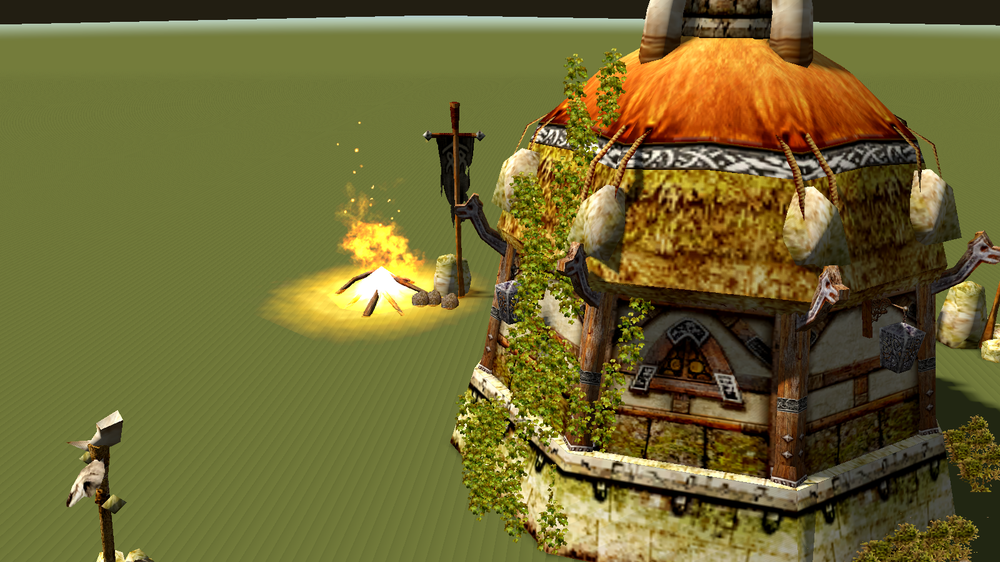

## The models' emitters (Particles)

The converter writes one glTF node per emitter (GSF chunk type 2) with its data in the node extras
(`{kind: 'particles', attr, emitter: {src, scale, max, spread, tiles, params, anims}}`). `ModelLibrary` reads it once
per template into `PartRef.Emitter` (`EmitterDef`) and lists the template's `Emitters`; the node keeps its part state
(epoch, construction level, damage stage, night: `PartStates`), so an emitter sprays exactly when its node shows -
the fires of a damage stage, the chimney smoke of an epoch, the night's fireflies.

* **Tracking.** `ModelLibrary.OnInstance` (set by `WorldView` to `Particles.Track`; assets.js `Assets.onClone`) hands
  every new instance of a model with emitters to the particles: units, buildings, ruins, projectiles (arrow trails),
  attached parts (weapons' flashes), effect models. Landscape objects (the map's waterfalls - `jng_waterfall_01`,
  `northland_waterfall_*` are emitter-only models with no mesh) are `PropField` instances: `PropField.Add` places
  the template's emitters with the instance's transform (`Particles.AddStatic`, props.js), `Remove` drops them.
* **Simulation** (particles.js, from PWClient.exe InitPart 0x709740 / ProcPart 0x707e30 / Process 0x704a10): every
  slot of a source each frame, on the CPU; start on a disk / sphere / hemisphere / ring, velocity along the emitter's
  axis tilted by spread, drag, gravitation (world down or the emitter's -z), centre suction, rotation about the axis,
  size increase, fade in / out (colour, alpha or both), tile animation (forward, back, ping-pong), bursts (0x80),
  emission timers, emission per metre moved (wakes, trails), particles in the world (0x80000, inheriting half the
  model's speed), sprites along their flight (0x20000000) or lying on the ground (0x40000000). Real frame time,
  at most 1 s per step.
* **When an emitter sprays**: its node is shown (in the tree, visible; `ModelInstance.Sprays` true - a placement
  preview's model is false), the place is explored (fog of war: `Particles.Seen`), it is within 160 m of the camera
  target and in the view (15 m sphere), its clip plays when it has `anims` (an effect's "anim", a finishing move's
  blood), its wielder attacks when it carries the weapon bit 16 (muzzle flashes of turrets and guns) or hangs on a
  bone only attack clips move (MIRAGE's exo flamethrower) or on the root of a character or of a fire weapon in its hand
  (an item with a weapon-bit emitter: the SEAS flamethrower's flame stream and black smoke, the flamer's drip -
  they flamed at rest). "Attacks": the clip playing is an "attack" / "shoot" clip or one of the weapons' clips of
  the rules (`Rules.WeaponClips` -> `Particles.WeaponClips`: `seas_flamethrower_0`, `seas_gunner_0`, `marksman_gatling`). The clip asked is
  `AnimController.Running` - the clip the player runs however it was started; in a game the units follow the
  simulation's clip through `Start` (EntityView.SyncAnim), which leaves `CurName` empty: the flamethrowers' fire (and
  every emitter gated by its clips, e.g. the Dragon Clan flamethrower trike's) never showed in a fight. FxTest
  "VisualFixes" fights with units of the simulation through that path. **A steady flame** (2026-11-11): a stream weapon
  (a line-of-fire weapon without a projectile, 10 m or more: the flamethrowers, the trike, the exo flamethrower, the
  fire boat) burns from its first strike until the attack ends (`Unit.Spraying`: a living target, the last strike within
  one attack's time -> `AnimController.HoldFire`, set by EntityViews each frame) - between the attack clips the unit
  stands in its fight pose, and the flame went on and off with every strike. FxTest checks it: no look without fire
  while a unit sprays. Hidden nodes go to a dormant list looked at in slices
  (thousands on maps with walls); emitters of freed models are dropped when their particles are gone.
* **Wall pieces** (a wall archive: `hu_palisade`, `seas_fence`, MIRAGE's SEAS wall `hs_re_enforced_wall` ...): the
  emitters are parts of the archive's components like its meshes - the variants G - J of "3b", "x05" ... (smoke of
  damage stages 1 and 2, fire of stage 2; the engine switches on every variant A - P of the components the piece's
  BuildName names, PWClient 0x4f9100). The exporter names them by their GSF name (`particles_3bG`) and writes no
  "part" extra for them, so they had no component: every wall piece sprayed the emitters of all components - a half
  destroyed MIRAGE SEAS wall piece 98 smoke emitters (15 sprites of size 5 each) in one place, a ball of smoke far
  larger than the wall (Kacper 2026-11-12, mission 13); a palisade 81. `ModelLibrary.TagWallArms` now gives each
  emitter its component (`PartBits.WallComp`, from the "part" extra or the node name), and `PartStates.ApplyState`
  shows it only on the pieces naming it: 6 - 8 smoke emitters at damage 1 on a straight piece. An emitter of no
  component is never shown (hu_palisade's `particles_x35H`, no state flags: it smoked on every palisade piece).
  Gates and towers are single models (their `dest01_*` emitters as on any building). Test: ViewPartsTests
  `WallEmittersByComponent`.
* **Level of detail** (0x703e40): all slots within 120 m of the camera, fewer up to 220 m, fewer still when the last
  frame drew more than half the sprite limit; sprites fade into the scene fog (260 - 620 m) and are not drawn beyond.
* **Drawing**: one `ParticleBatch` (a `MultiMeshInstance3D` of one quad) per sheet, atlas grid and blending - a
  draw call each, typically 3 - 10 in a scene. The CPU fills the instance buffer (position; colour and alpha;
  height, rotation, cell + ground flag, pivot in the custom data) and the vertex shader turns the quad to the camera
  (or lays it on the ground), sizes it (a quarter of "size" high, never larger than half the screen - that limit is
  applied on the CPU: in Godot's Compatibility renderer `PROJECTION_MATRIX[1][1]` read 0 in this MultiMesh vertex
  shader, and the sprites came out huge), hangs it at its
  cell's pivot and picks its cell. Additive sheets ignore the texture's alpha (the flames of gore.tga have alpha 0).
* **Brightness: the original's colours and blending** (2026-11-18, Kacper: "this is how healing area effect looks in
  original game, I feel like in the remake it is less visible"). The original (PWClient.exe renderer 0x704d40,
  Direct3D 9, no sRGB conversion anywhere) draws a sprite as texel x vertex colour in the screen's sRGB values and adds
  an additive one to the screen's sRGB value: additive particles get alpha 0 and the colour, the others colour x alpha
  (premultiplied) - one blend, ONE / INVSRCALPHA, so alpha 0 adds. Three things made the port's additive sprites
  fainter:
  * **The colour decoded twice.** The port copied the browser remake's look (three.js wrote the texture's linear value
    unencoded): the shader decoded the colour once more, and Forward+ (the renderer on Windows) had decoded the
    texture already - so a texel of 0.6 (sRGB) came out as 0.08 of linear light. Now the sheets are sampled as their
    sRGB values (no `source_color`), multiplied by the colour as the texture stage did, and written once.
  * **Blending in linear light.** Forward+ / Mobile blend in a linear HDR buffer; the original added sRGB values.
    Light added in linear is much fainter on the screen (a heal ray's 0.6 over ground of 0.3: 0.66 instead of 0.9).
    `Fx/GammaBlend.cs` (`pw_gamma_add`): what a `blend_add` shader writes so that the screen shows ground + light as
    the original - exactly in the Compatibility renderer (it blends sRGB values: measured, 0.3 + 0.4 = 0.70 in both
    renderers now), and in the linear renderers exactly over ground of `GAMMA_ADD_BASE` 0.3 (the median of Kacper's
    reference shot: 71 / 82 / 48 of 255), brighter over darker ground (0.1 + 0.2 shows 0.43, the original 0.3) and
    fainter over brighter ground (0.4 + 0.6: 0.93 for 1.0). Mixed (alpha) sprites are written as their sRGB colour
    and mixed in linear light as before.
  * **The additive colour is squared** (0x705329: c x c x the party colour >> 16): a colour fade goes with the square
    of the fade, an emitter's colour deepens (fx_heal_area's dots 200 / 150 / 0 -> 157 / 88 / 0). The fog's fade
    scales an additive sprite's colour (the others' alpha). The original does not use an additive particle's alpha at
    all; the port keeps the emitter's alpha and an alpha-only fade (0x4000): 173 of the 1164 additive emitters of the
    export have an alpha below 255 (some 0: aje_temple, ninigi_teahouse, domination_flag - invisible here, perhaps
    shown in the original) and 16 fade only their alpha (the death pings' vanish, SEAS buildings) - not checked
    against the game.
  On the heal rays (fx_heal_area: 50 sprites of rays.png cell 1 - brightest texel 156 / 125 / 66, mean 49 / 41 / 17 -
  colour white, size 50 - 100, 3 s, fade in and out 0.4 each, on a disk of 23.7 m) the brightest texel over ground of
  0.3 now adds 0.6 as in the original (before: 0.13 in Forward+, 0.32 in Compatibility); the faint body of a ray
  (texel 0.2) 0.2 (before 0.01 / 0.03). Every additive particle got brighter the same way - the level-up's rays, the
  healing wells (`seas_healspring`, `healing_well_01`), the unique item's glow (`fx_unique_pickup`), fires, sparks,
  muzzle flashes, the pings; the mixed ones (smoke, dust, steam) show their sheets' colours (before darker and more
  orange). The same blending was given to the additive meshes (GSF flag 0x4: `ModelMaterials` GlowShader), the
  models' additive sprites (`ModelSprites` glow: lantern halos) and the range markers (HUD.md). Unchanged: the
  sprites' size (the original's half extent is W / 8 x size / w pixels - a quarter of "size" high at 4 : 3 with the
  game camera's 38 - 40 degrees; on a 16 : 9 screen the original's sprites are about a fifth taller), the drawn
  fallback sprites (DrawnFx: the browser remake's own).
* **The "Particles" setting** (`AppSettings.Particles`, the in-game Options' "Particle effects"): off (nothing, no
  drawn effects either), low (800 sprites, 3 screens of fill), on (3000, 8 screens), high (6000, 16 screens) - the
  JS's levels; the fill budget stops sprites close to the camera from covering the screen many times.
* **Only the view counts** (a difference from the JS): every emitter within 160 m of the camera target steps, also
  those out of the view (their smoke is there when the camera turns), but only the sprites in the camera's view are
  drawn and count against the sprite and fill limits and the load, and the emitters nearest the camera are drawn
  first (when the limit is reached, the farthest are left out, not whichever came last in the list). The JS drew
  every live particle of the 160 m about the target: on a dense map (MIRAGE mission 16, the SEAS base on lava - user
  report) the emitters behind and beside the camera took most of the limit, the ones in the view were cut from
  frame to frame as the totals changed - their fires, smoke and steam came and went - and the load fell to nothing
  (the far sources down to 2 slots, then back). FxTest `OutOfView`: 300 sprayers around, four teahouses in the view
  at 165 Hz - before: their sprites 0 .. 400 per frame, 2930 sprites drawn of which most off the screen, load 0.1;
  now: 400 in every frame, 1145 drawn, load 1. A limit that is really reached by what is on the screen (the "low"
  setting in a big base) still leaves the farthest emitters out.
* **Sprites along their flight** (flag 0x20000000; `SpriteAngle`, PWClient.exe ProcPart 0x7085a9 and the renderer
  0x7061b1): the client projects pos and pos + v, takes `atan2(dx, dy)` of the step on the screen and adds "rotate";
  its sprite corners are built with the screen's y pointing down (a pivot at a cell's top edge gives corners at
  y 0 .. 2h) and turned counter-clockwise. In the port's view space (y up): `rot = atan2(dx, -dy) + rotate`. With
  "rotate" pi - the healing area's rays (`fx_heal_area`, the healing wells `seas_healspring` / `healing_well_01`, the
  colosseum's blood fountains), the level-up's, the spirits' and the unique item's rays, the splashes of water hits,
  blood spritzers and the hits' streaks, their pivot at the cell's foot (mid_y 237 - 249) - the cell's top points the
  way the particle flies, so a ray rising from the ground stands on its foot; with 0 (the impact sparks) it trails
  behind. The browser remake and this port until 2026-11-05 used `atan2(-dx, dy) - rotate`, the same for the
  gatlings' muzzle flashes (rotate -1.61, the case it was checked on; 0.08 rad apart now) but half a turn off for 0
  and pi: every ray and splash with rotate pi hung from its foot into the ground - the user's report "the healing
  area around the [SEAS fortress] is missing parts of its particles, it should have yellow vertical lines" (only the
  ray tips poked out of the ground; the yellow dots showed). Tests: ParticleAngleTests, FxTest `HealAreas`. Sprites
  lying on the ground (0x40000000: ship wakes) keep the heading on the ground plus "rotate"; the client adds pi there
  too (0x7085ee) - not compared with the original yet.

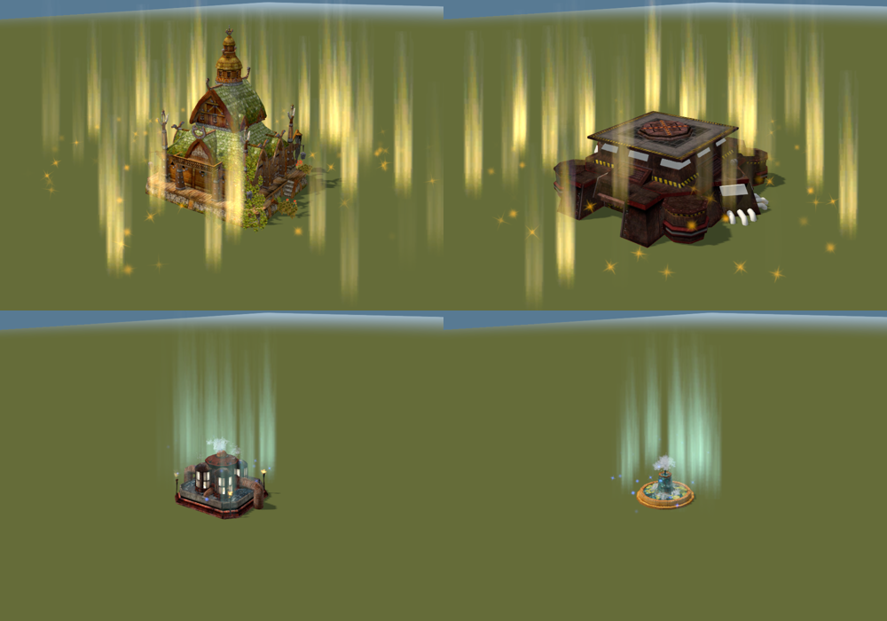
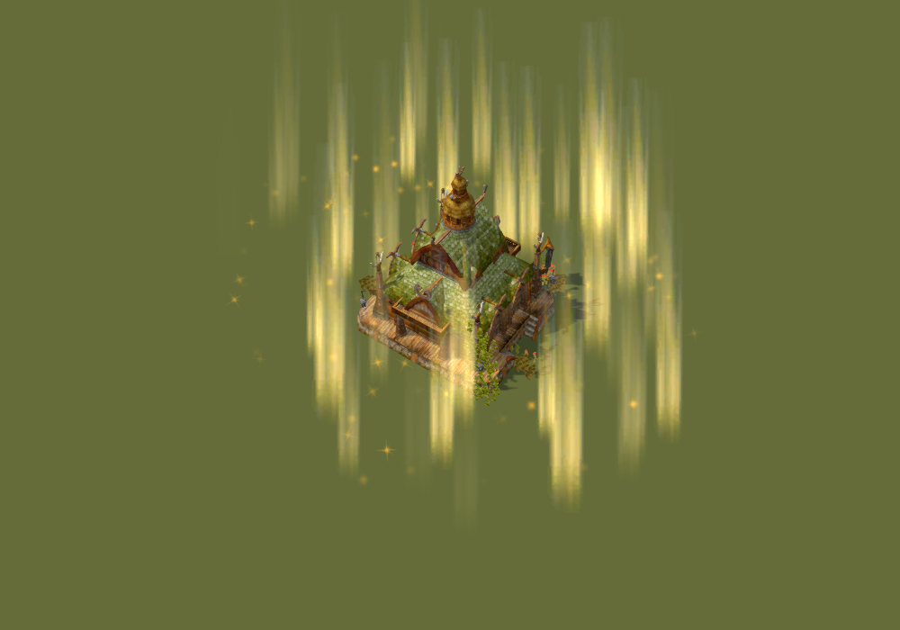

* **Bursts on a timer** (emit_timer with flag 0x80): the slots that died start again together only when the timer
  runs out, so such an emitter comes and goes by design (PWClient.exe Process 0x704a10, checked again 2026-11-02:
  the timer counts up and restarts at FRand * emit_timer_var * emit_timer). In the Base data only the SEAS
  headquarters' two fires (`EP_02_fire`, `fire_hit`), the stone deposits' twinkle, effect models and arrows have it;
  a model whose fires blink on that timer does so in the original too.

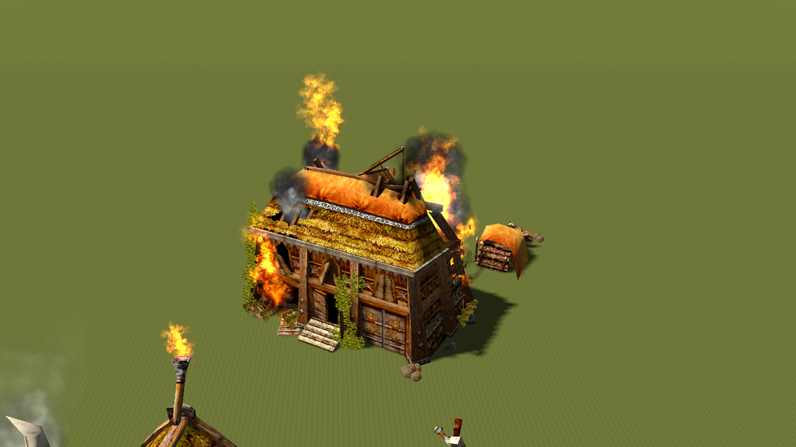
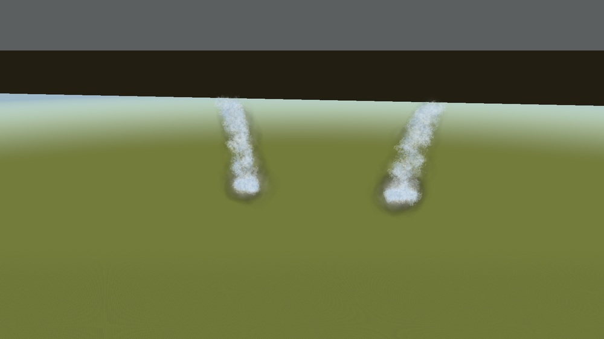

## Effect models (ModelFx, GameFx)

The original's effects are models of `all_effects.gsf` placed for a fixed time (Effects.usl `CEffect`: `SetGFX`,
`SetAnim("anim", 1)`, `SetDieInterval`); their emitters do the drawing, some play their clip `anim`.
`ModelFx.At(gfx, pos, life, yaw, party, anim, loop)`, `Attach(follow, gfx, life, key, offset)` (follows a unit's link;
a key replaces / stops it), `FlyTo(gfx, from, to, T)`; `Update(dt)` advances their clips and frees them when their
time is up (`Made` / `FreedCount` for the checks). Their clock is the game's, the frame's while a cutscene stands the
game still (the JS timed them on the world's clock, so a cutscene's effects stood until the scene ended).

`GameFx` picks them as the client scripts do (the browser remake's docs/GAME_EFFECTS.md):

| world event | effect |
|---|---|
| impact (projectile) | `hit_<creature/object/land_<setting>/water>_[tribe_]<type>` by the projectile's model (EvaluateProjectile, E:164-274), 4 s; `fx_impact_proj_0[12]` on units; its sound `FX_<model>` instead of the drawn effect's |
| hit (melee) | `hit_creature_sharp_sml` at the `Blfa` link (characters) / `_med` beside the body (others) + `fx_impact_0[1-6]` |
| levelup | `levelup_char_fx` (owner colour, its clip) |
| trained, spawnfx | `spawnping_char_<res/nat/tec>_fx` by caste, `spawnping_animal_fx` |
| placed / built / upgrade | `placeping_building_fx` + camera shake / `readyping_building_fx` / `readyping_invent_fx` |
| died | `deathping_animal_<small/med/big>_fx` by radius (characters small), `vehicle_explosion` |
| damagestage (50 % / 25 %) | `explo_logcannon_building` (buildings), `hit_object_<tribe>_blunt_big` (ships) + shake |
| healfx, itemTaken / itemDropped | `fx_heal_passive` (2.5 s, longer while healed), `fx_unique_pickup` while carried |
| poisoned, iced (state) | `fx_poison` / `fx_poison_big` while poisoned, `fx_ice_freeze` 5 s |
| fx / fxAt / fxFly / blast / camshake (MIRAGE moves) | the named model attached / at a point / flying; `hit_land_*_explo_big` + shake; the shakes of Effects.usl |
| a felled tree's crown lands | `leave_blast` 8 m away in the fall direction + shake |
| mission EFCT | the particle database's model, its clip `anim`, for its loops (`MissionHost.Effects`) |
| question marks | `questionmark_red / _green / _yellow`, `exclamation_yellow` (only where explored) |
| cutscene `fx` items | the item's model at its place for its length |
| a finished temple / SEAS fortress | `fx_heal_area` on the building (Building.ReadyFx; Building.usl CTemple / Mirage.usl CSeasFortress SetReady: AddFX). MIRAGE's SEAS healing well (`seas_outpouring`, CSeasWell, model `seas_healspring`) and the maps' wells (`healing_well_01`) draw their healing glow with their own emitters |
| destroyed (a finished building, not a wall piece) | its ruin `<gfx>_dest` (Construction.RuinOf) plays its clip `destroy` once from the destruction (BuildingCorpse.PlayAnim; EntityViews) - the collapse, and its emitters: blast, comets, debris, puffs, rings, shockwaves, then the ruin's fires and smoke; its turret's ruin `<turret>_dest` too (World.RuinPartsOf, CTower.CreateBuildingCorpse: the SEAS machine-gun nest's and small cannon's whole collapse is in theirs - docs/VIEW.md "Destruction"); `hu_temple_dest` / `hu_small_wall_gate_dest` also start `hu_temple_dem_fx` / `hu_wall_dem_fx` (4 s; the GSF event table: CHu_Temple_Dem_Fx / CHu_Wall_Dem_Fx at frame 1) |
| damaged building (state) | its own damage-stage emitters (the `DEST_01` / `DEST_02` nodes: smoke at 50 %, fire at 25 %) - the part states show them |
| burning resin field (Building.Burning) | the model `ninigi_resin_field_fire` while it burns (CImpResinField.StartBurning: `SetGFX`; EntityViews) |
| shoot (seas_rocketman, ninigi_mortar) | `fx_seas_rpg` at the shooter's link `Proj`, turned with it, 2.5 s (FightingObj.CreateProjectileAndShoot: event 36 -> CRocketLauncherSmoke); other guns have no scripted muzzle effect - their weapon models' own emitters fire |
| Ninigi fireworks (move) | `ninigi_fireworks` at the unit, its clip `anim`, 10 s (Fireworks.usl: CFireWorkObj) |
| Aje tornado / quicksand (moves) | `aje_tornado` (its clip `swirl` looping while the tornado's ticks come; CTornadoObj) / `aje_quicksand_trap` for its 30 s (CQuicksand) |
| spirits (state) | `fx_ghost_big` at every spirit while one of the player's own `aje_shaman` is selected (MainController.UpdateSpirits -> ShowSpirits; the client's spirit object `BSpiritObj` / `SPRT` names `fx_ghost_big` in PWClient.exe) |
| the clips' effect events | `CBrachioWalking` (the brachiosaurus' footfalls: walk_1 / walk_2 / walk_left / walk_right), `CBrachioDying` (its fall, frame 58), `CPlaceBuildingFX` (the mammoth's stomp, frame 52): the camera shakes of Effects.usl; the fall and the stomp also show `placeping_building_fx` (1.55 s) |

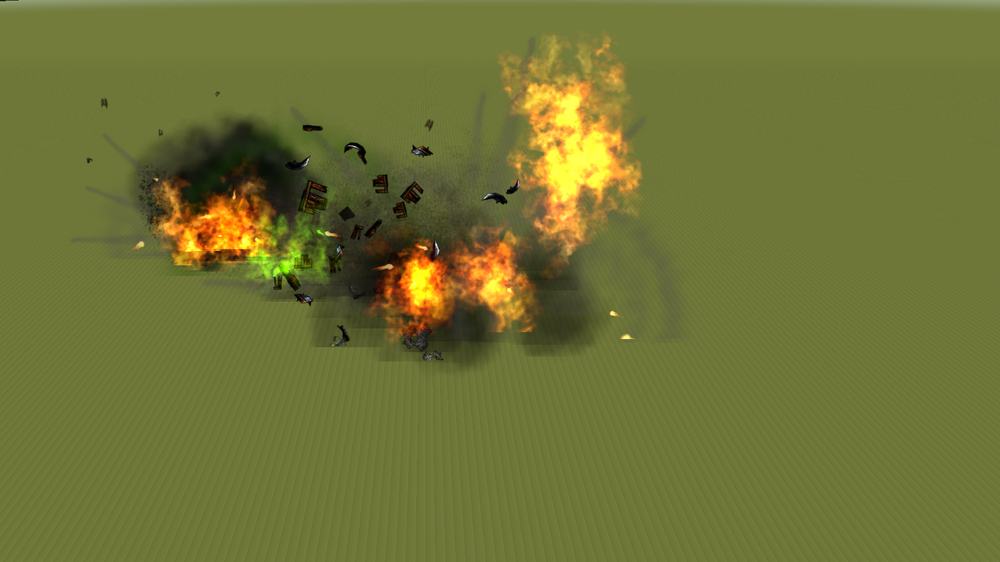
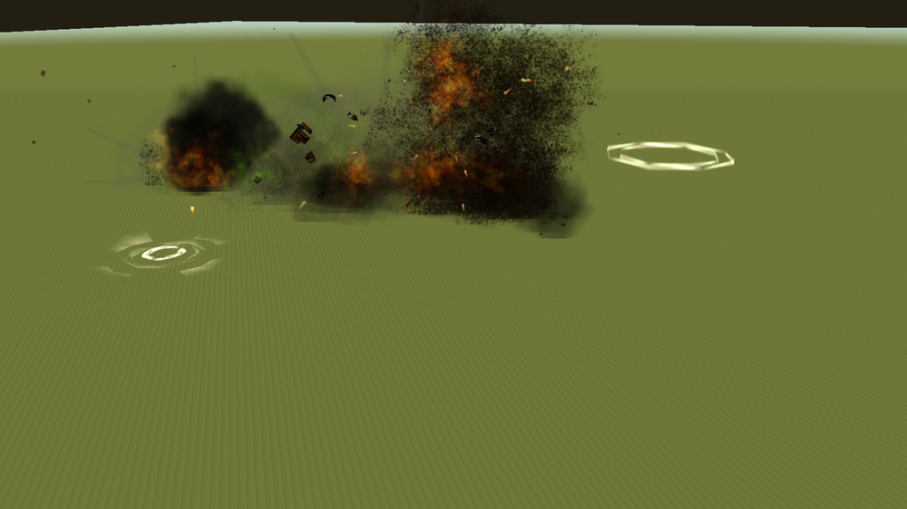

The game's effect models (`GameFx.GAME_FX_MODEL`, main.js) are loaded with the map; the MIRAGE moves' and the
missions' own load when they first show.

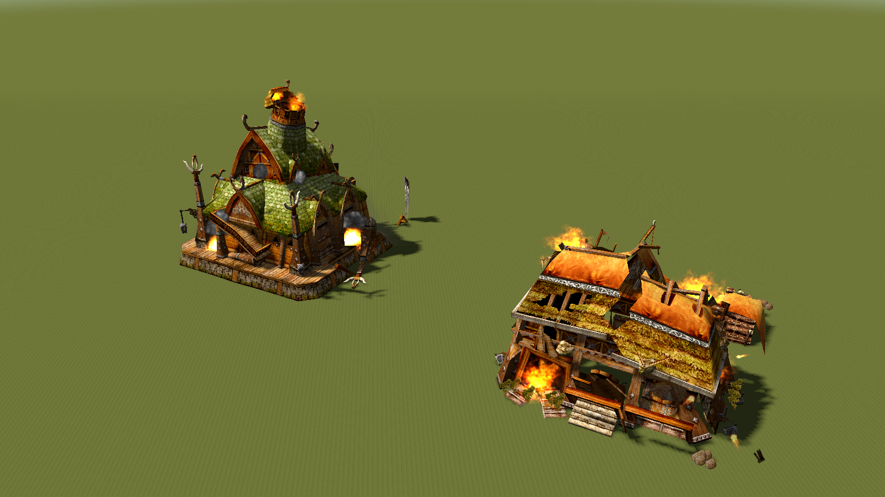
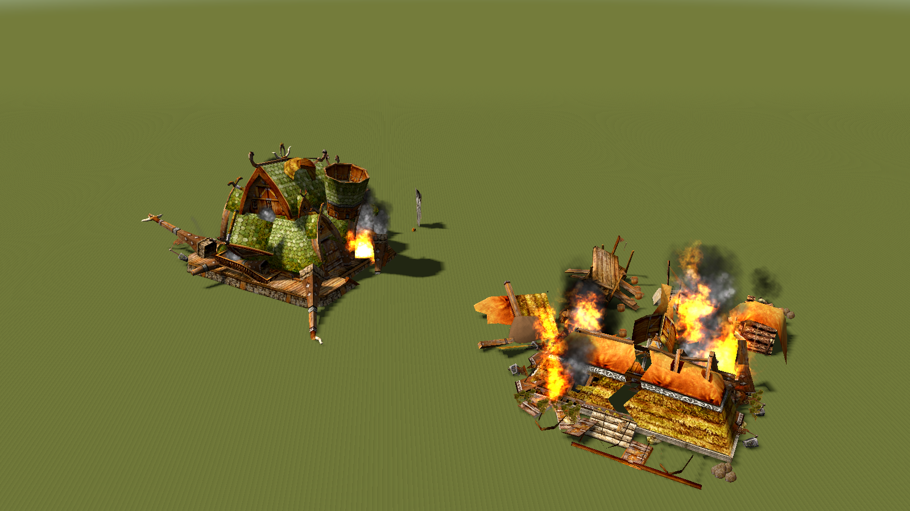
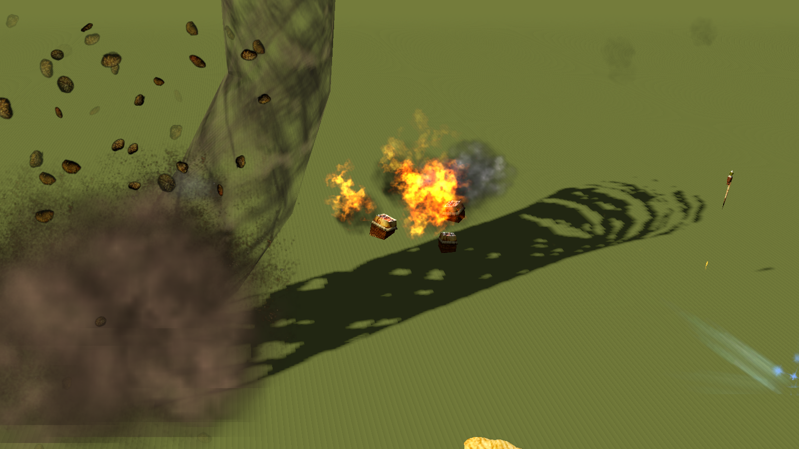

### The effect models the export leaves out (tools/prepare/effect_models.py)

The toolkit's remake export (pipeline/build_assets.py) takes the effect models the browser remake uses; the ones the
port uses beyond it are converted from the installation's GSF archives with the toolkit's converter
(`pwexport.gsf.Archive.export`) by `tools/prepare/effect_models.py`, which `prepare.py` runs for each configuration:

| model | archive | for |
|---|---|---|
| `hu_temple_dem_fx`, `hu_wall_dem_fx` | all_effects | the dust of the temple's and the gate's collapse |
| `fx_seas_rpg` | all_effects | the rocket launchers' smoke |
| `fx_ghost_big` | all_effects | the spirits |
| `ninigi_fireworks` | ninigi_products | the fireworks |
| `aje_tornado` | aje_products | the tornado |
| `aje_quicksand_trap` | aje_buildings | the quicksand |

They go to `content/configs/<id>/overrides/assets/models/`, their textures to `overrides/assets/tex/` (only those the
converted data lacks, e.g. `effects/twister.tga`), and `overrides/assets/manifest_fx.json` lists them in the format of
the export's manifest; `ModelManifest.Load` merges it (the main manifest's entry wins, so a later export that has
them takes over). Image and emitter texture paths are rewritten to `../tex/<name>.png` as build_assets does. The
surfaces of GSF material 65535 ("none") are dropped: `ninigi_fireworks` has a whole mesh of them, which showed as a
white figure (an assumption that the game draws no such surface). Incremental: a model already converted is kept
(`--force` converts again). Without this step (data prepared earlier) the drawn fallbacks stand in.

## Drawn effects (DrawnFx)

engine/fx.js: soft round sprites made in code (glow, fire, smoke, dust, blood, sparks) in a pool of 1500, one
MultiMesh per kind, and up to 40 scorch marks on the ground. The JS drew them for the destruction, damage smoke,
muzzle smoke, the resin fire, the fireworks, the quicksand / tornado dust and the spirits' glimmer; the port shows
the game's models for all of those (above). What is left is a fallback for data without the game's model - the game
has the asset, the data at hand does not (a configuration prepared before tools/prepare/effect_models.py, or a
converted data set without a model):

| drawn | when | why not the game's |
|---|---|---|
| explosion / dust | an impact of a projectile whose `hit_*` models are all missing; a MIRAGE blast without `hit_land_*_explo_big` | the data lacks the model |
| blood | a character's death without `deathping_animal_small_fx`; a melee hit without the target's model | the data lacks the model |
| explosion | a vehicle's death without `vehicle_explosion` | the data lacks the model |
| glow | a level-up without `levelup_char_fx`; a fireworks move without `ninigi_fireworks` | the data lacks the model |
| dust | a quicksand / tornado without `aje_quicksand_trap` / `aje_tornado` | the data lacks the model |

Nothing is drawn where the game itself shows nothing: an impact of a weapon without a projectile, the shots of
other guns (only their weapon models' own emitters), a building without a ruin model (the original's corpse would
have no model either). The synthesized sounds of fx.js are not ported (the game's own sounds play: View/Audio).

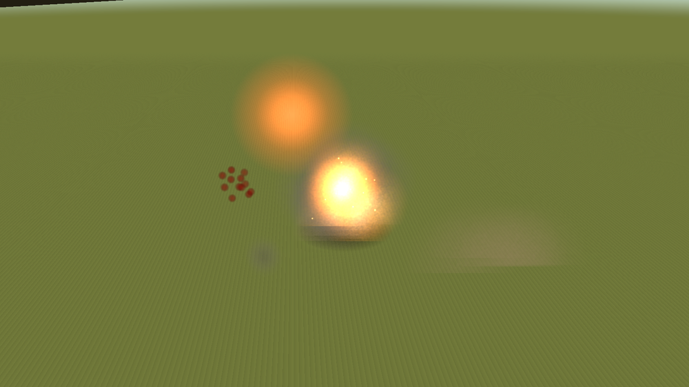
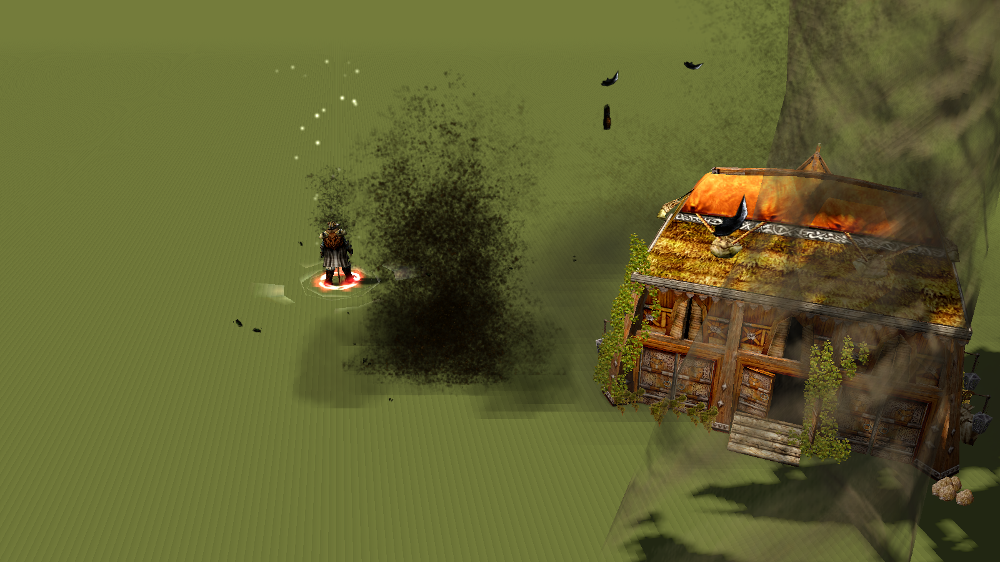
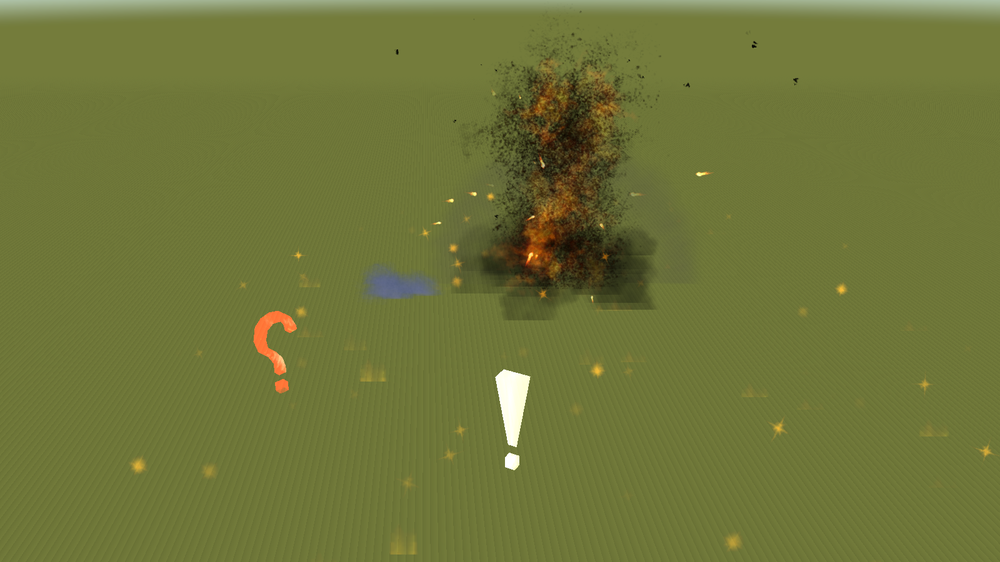

## In the game

`GameSession.Effects` (`WorldFx`) is made with the entities; `HandleEvents` runs first in the session's event
handling (an impact whose effect model played gets that model's sound, `ImpactPlayed`), `Step` once per frame after
the entities moved; the particles update last in `WorldView.Step` (their nodes are where this frame draws them).
`GameSession.SetParticles(level)` applies the Options' choice at once. The map viewer gets the waterfalls and the
models' emitters through its `WorldView` too.

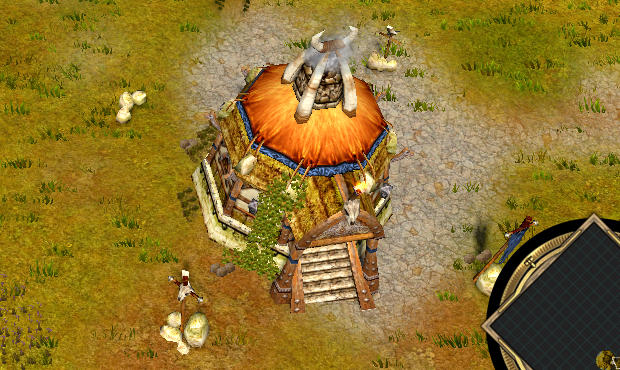

## Test

`res://src/View/Tests/FxTest.tscn` (`xvfb-run -a -s "-screen 0 1600x900x24" godot --path game --rendering-driver
opengl3 res://src/View/Tests/FxTest.tscn -- --shots=<dir> [--data=<folder>]`): the emitter data as in the files,
instances tracked and spraying, a warehouse's damage-stage fires, emitters of freed models dropped, a preview spraying
nothing, the waterfalls as landscape objects (placed and removed), every kind of hit model, the pings with their
clips, attached / flying / keyed effects, the world's events through `WorldFx.HandleEvents` (impacts on ground, unit
and building, melee, level-up, spawn, placed, built, invented, damage stage, heal, item, fxAt, blast, tornado,
fireworks, camshake) with no drawn sprite, poison and ice, deaths and destruction; the game's own effects (the ruins'
clip `destroy` and their spray, the temple's dust, the burning resin field, the rocket smoke and no muzzle effect for
other guns, fireworks once per move, tornado kept up by its ticks, quicksand, a spirit shown only while a shaman is
selected, the clips' effect events: shakes and the stomp's ping - none of it drawn); the drawn fallbacks, a
mission's effects, question marks, a cutscene item, the healing areas (`HealAreas`: a temple through
`WorldFx.ReadyFx`, the SEAS fortress' `seas_hq_bunker` with `fx_heal_area`, `seas_healspring`, `healing_well_01` -
their rays standing up, the temple also from the original's high camera, `fx_heal_temple_top.png`; the level-up's
rays and a water hit's splashes: `fx_heal_*.png`, `fx_rays_levelup_splash.png`;
models the data lacks are skipped), the setting (off / low / on / high), the emitters in the view
drawn steadily with 300 sprayers out of the view at 165 Hz (`fx_out_of_view_0..5.png`), and 100 Norse fireplaces
for the cost; every effect model made is freed again. Screenshots `fx_*.png`. `--only=HealAreas,Drawn` runs only
those groups. Diagnostics: `--debug --models=a,b [--at=<s>] [--dist=<m>]` shows models one by one (their sprites'
heights in the log).

## Performance (container: llvmpipe, shared CPU - relative numbers)

FxTest `perf:` - 100 Norse fireplaces (74 emitters each; 311 active, 7100 dormant: other epochs and damage stages),
2960 sprites drawn (the "on" cap 3000): 2.3 ms per particle update on the CPU (8.3 ms in a run while the machine was
loaded by other jobs). A frame of a mission has a few hundred sprites. The CPU work is per live slot of
the emitters near the camera (within 160 m); dormant and far emitters cost a look every 2 s or a slice of the
dormant list per frame. The draw calls are one per sheet / grid / blending.

## The Compatibility renderer and MultiMesh shaders

The particles' first shader built their quads in view space (`skip_vertex_transform`) and limited their size with
`PROJECTION_MATRIX`; in the Compatibility renderer the sprites came out huge (`PROJECTION_MATRIX[1][1]` read 0 there),
so ParticleBatch builds the corners in the world and limits the size on the CPU. The other MultiMesh shaders were
checked for the same problem by rendering them in both renderers (Forward+ - the default on Windows - and
Compatibility / opengl3) next to marker spheres at the instance origins: `WeatherFx` (snow: `skip_vertex_transform`,
`VIEW_MATRIX * MODEL_MATRIX`), `GrassLayer` and `FoliageField` (`skip_vertex_transform`, view-space quads),
`ModelSprites` (`MODELVIEW_MATRIX`, `POSITION = PROJECTION_MATRIX * mv`). Both renderers drew them identically and at
the markers: none is affected (none of them reads `PROJECTION_MATRIX[1][1]` in the vertex stage; ModelSprites'
`PROJECTION_MATRIX *` works in both), so nothing was changed. (Instance colour and custom data are half floats in
Compatibility: FoliageField's atlas rectangles in `COLOR` are exact to about 1 / 2048 there.)

## Not done / differences

* The ruins' explosion emitters (the `fx_blast` / `fx_comets` / `fx_debris` / `fx_puff` / `fx_ring` group of the
  `_dest` models) sit 2 - 10 m below the model's origin in the GSF (their positions and animation keys say so, e.g.
  `hu_warehouse_dest` -8 m); with the port's particle motion most of their sprites stay under the ground, only the
  higher debris, the collapse and the ruins' fires show. Not checked against the original game.
* `Big_Explo_01_Fx` / `Big_Explo_02_Fx`, `Med_Explo_*`: classes exist (CBigBuildingExplosion, CAjeStoneImpact,
  CMedExplo01/02) but nothing in the original scripts or the GSF event table starts them - not used.
* `Aje_Tent_Dem_Fx` (aje_dimension_gate_dest's event) names no class (no `C`) - nothing plays, as in the original.

* The hit animations' blood and debris of the GSF "dusttrail" table (`_dusttrail`: bloodcount / stonecount of
  hit_front, hacking, sowing ...) - not in the JS either.
* Of the GSF event table only the brachiosaurus' and the mammoth's stomp are played (as the JS's animfx.js); the
  others with an effect (CBBrachioHarvestFX, CMammothRageFx, CAllosaurus_Sm_Scrunch_Fx, CShipWaterSpray*,
  CNinigiMetzlerHarvest ...) are not.
* The spirits show for the original's condition only (an own `aje_shaman` selected); MIRAGE units that resurrect
  under another class name do not show them.
* Particle source types 0-2 (USL classes, 9 of 10439 emitters) are drawn like type 3 (as the JS).
