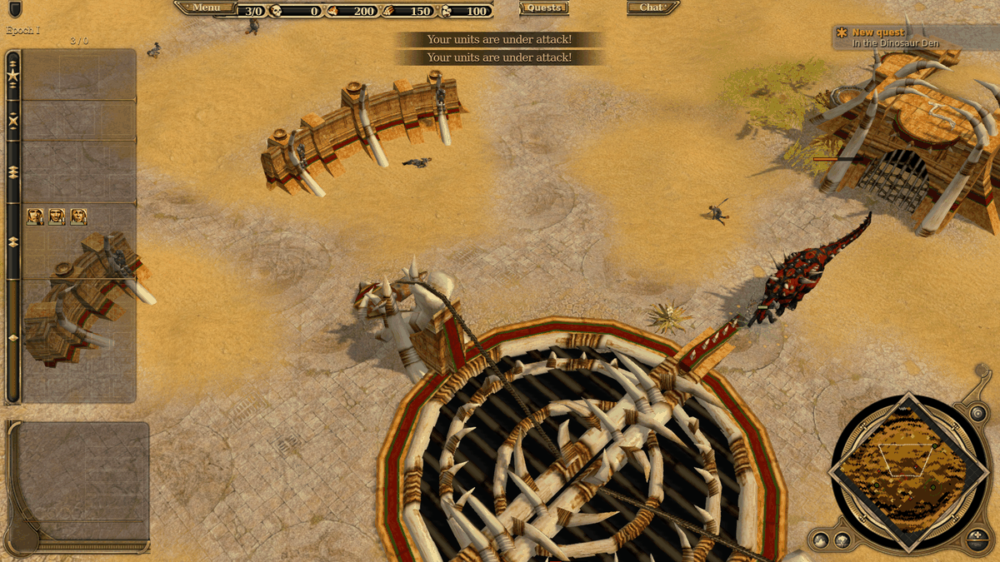
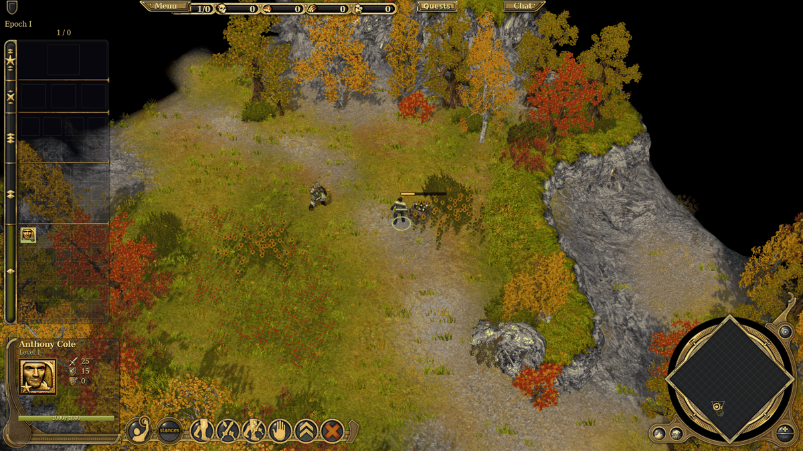
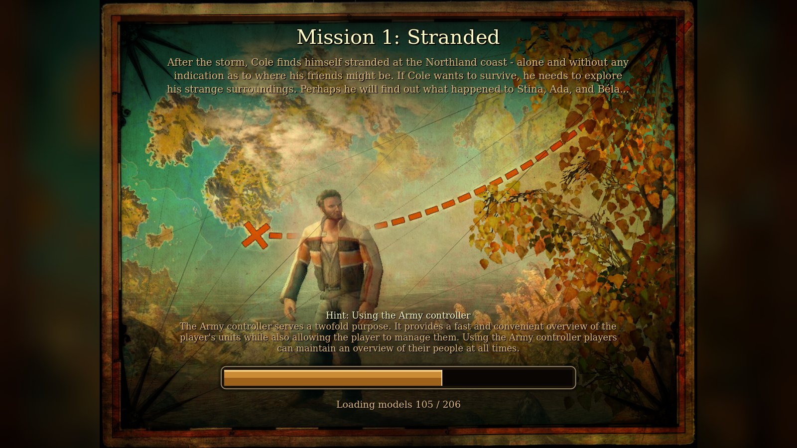
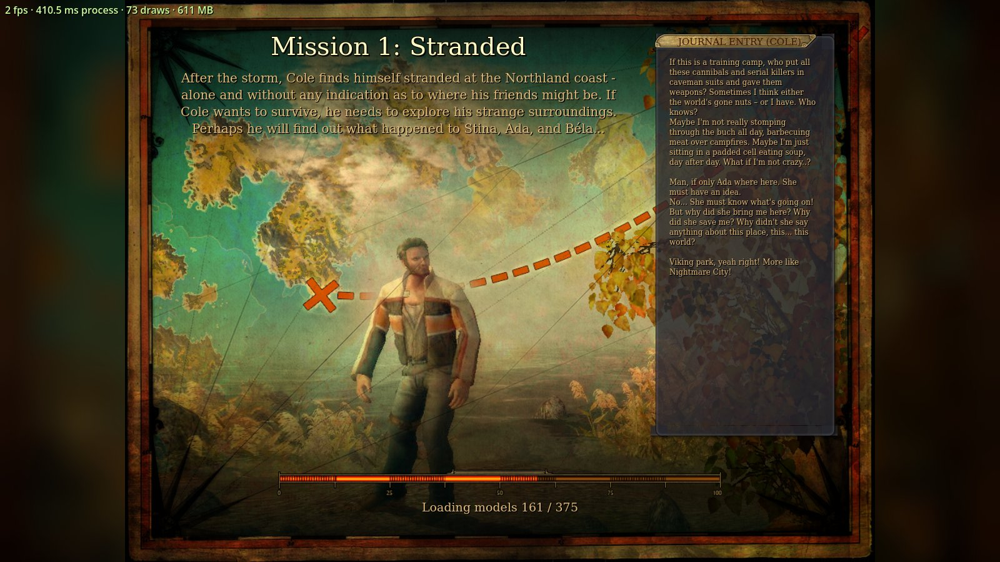
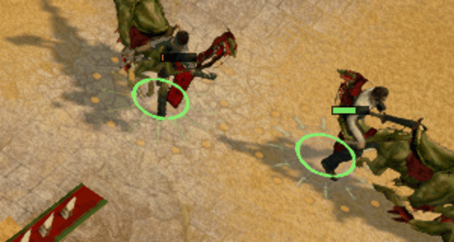
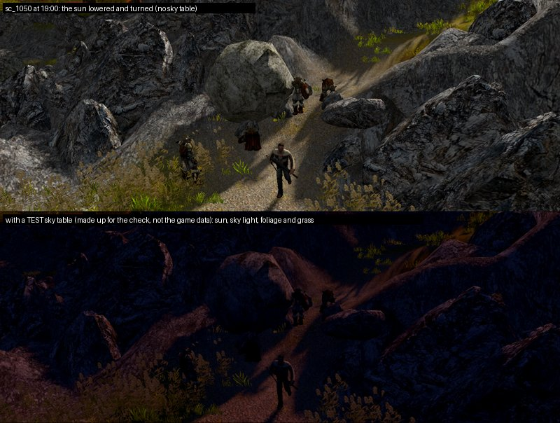
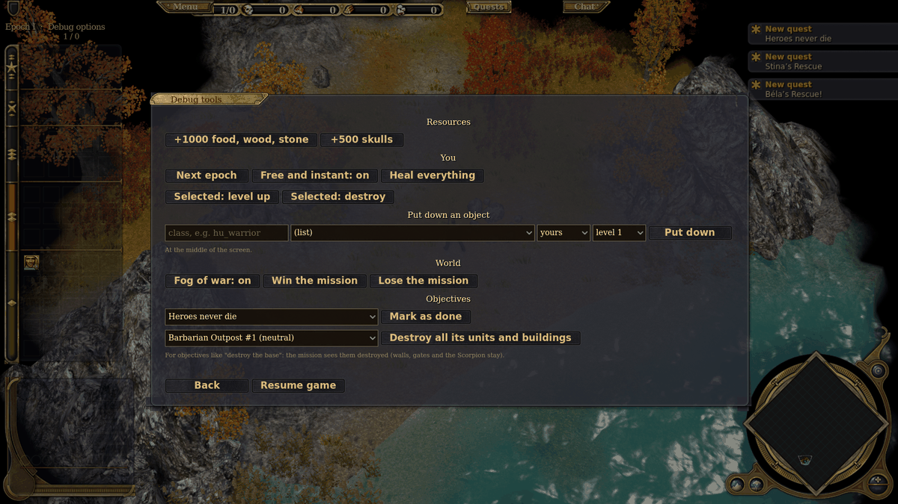
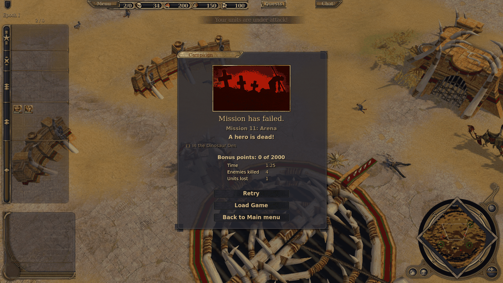

# The game session

A running game: the simulation (`src/Sim`, a `MissionSession`), the view of it (`game/src/View`: the map's world view,
every entity's model, the fog of war, the overlay), the player's input (`game/src/UI/Input`), the mission UI
(`game/src/UI/Mission`), the HUD (`game/src/UI/Hud`, docs/HUD.md), the pause menu with the debug tools
(`game/src/UI/Game`), and the clock between them. Port of the browser remake's `main.js` (startGame for a campaign,
buildWorld's game part, loadModels, simulate, draw, updateFow, cullUnits / freezeStill, G.endMission and the `G.*`
game API), `ui/input.js`, `ui/overlay.js`, `ui/decals.js`, `ui/logs.js`, the sound part of `ui/feedback.js`, the
camera / actors part of `ui/cutscene.js` and the in-game part of `ui/menu.js` - pw-exporter 98c7703.



```
game/src/App/GameSession.cs              the node: Load() steps, the clock (50 ms steps), the frame, fog of war, the end
game/src/App/GameSession.Api.cs          the input's and menus' part of main.js G.* (the HUD's part is HudGame)
game/src/App/GameSession.Feedback.cs     ui/feedback.js, the sound part: world events -> Sfx.Feedback; fallen trees, reveals
game/src/App/GameSession.Models.cs       main.js loadModels / mapModels: the models loaded while the loading screen shows
game/src/App/GameSession.Autoplay.cs     test runs: --autoplay, --shots, --menu-at, --spawn, --cine (+ PlacementCheck: --test-placement)
game/src/App/GameSession.Settings.cs     the Options window's settings applied to the game (at its start and on every change)
game/src/App/GameSession.Editor.cs       the map editor's Test map: a skirmish on the edited map from memory, its end back to the editor
game/src/App/GameSession.Saves.cs        saved games: recording, save / quick save / autosave, loading (replay), the view after loading (docs/SAVES.md)
game/src/UI/Loading/                     the loading screen (LoadingScreen, LoadingBar; Logic/LoadingInfo: picture, texts, hints;
                                         Logic/Journal: the campaign's journal entries, the ready button)
game/src/App/MissionPresenterAdapter.cs  IMissionPresenter (src/Sim/Campaign) -> MissionPresenter (game/src/UI/Mission)
game/src/App/SessionHudHost.cs           IHudHost (game/src/UI/Hud) on the session
game/src/App/SessionSequenceStage.cs     ISequenceStage: the cutscenes' camera tracks, shakes, actors, lip sync, day time, hidden region
game/src/View/Entities/EntityViews.cs    every unit, building, prop, projectile drawn; felled trees, used-up resources
game/src/View/Entities/EntityView.cs     one entity: model, clip sync, weapon / tool / load, attached parts, states
game/src/View/Entities/SelectionOverlay.cs  rings, markers, rally flags, hero rings and buff decals; bars, arrow, box
game/src/UI/Input/                       Selection, GameInput (+ Picking, Orders, Placement), Cursors, IGameHud
game/src/UI/Game/                        PauseMenu (Options: game/src/UI/OptionsPanel.cs), DebugTools (+ DebugToolCommand)
```

A skirmish runs through the same session (`GameStart.Mode = Skirmish`, docs/SKIRMISH.md): `s.Sim` is what is played
(`IGameSim`: a `MissionSession` or a `SkirmishSession`), `s.Mission` is null in a skirmish and `s.Skirmish` null in a
mission; `GameSession.Skirmish.cs` has the skirmish's creation, its end (main.js checkEnd) and the end screen's buttons.
The map editor's **Test map** (docs/MAP_EDITOR.md) is such a skirmish whose setup's map is a key of the editor
(`editor:<n>`, `EditorPlaytest`): the map source comes from the editor's snapshot instead of a file
(`GameSession.Editor.cs`), and "Back to Main menu" / the pause menu's "Quit to the map editor" return to the editor
(`s.EditorTest`).

## The API (for the HUD and other UI)

Everything goes through `GameSession.Current` (null outside a game; namespace `PwRemake.App`). Layers: the overlay's
2D canvas 5, the HUD 10, the mission UI 20, the pause menu 30.

```csharp
var s = GameSession.Current!;
// ---- what is played
s.Start            // GameStart (mission, tribe, difficulty, debug options, seed)
s.Sim              // IGameSim: .World, .Map (MapSource), .Built, .Human, .StartCamera, .Title, .Step(), .Over
s.Mission          // MissionSession (null in a skirmish): .Campaign, .Engine (TriggerEngine), .Host (MissionHost), .Map
s.Skirmish         // SkirmishSession (null in a mission): .Setup, .Resolved, .Ai, .PB (PointBuy)
s.World            // PwRemake.Sim.World.World
s.Me               // the human Player
s.Rules            // PwRemake.Sim.Rules.Rules (Text, Ui, ActionsOf ...; s.Rules.Extra: the GameData tables)
s.Assets, s.Models // AssetSource of the configuration; ModelLibrary (the view's model templates)
// ---- the player's view and state
s.Selection        // Selection (below)
s.Camera           // RtsCamera: X, Z, Yaw, Dist, TDist, Target; s.LookAt(x, z), s.CenterOn(entity)
s.Fog              // FogGrid of the human player (also World.Fow): Visible, Explored, RevealAll, Version
s.Presenter        // MissionPresenter (quests, markers, question marks, cutscenes, end screen)
s.HudView          // the Hud (docs/HUD.md); s.Hud: the same as IGameHud; s.Game: HudGame (main.js G.* on commands)
s.Input            // GameInput: Mode, SetMode(mode, data), Hover, Groups, SelGroup, GroupButton, OrderOn, ViewCorners(),
                   // MinimapPress / MinimapDrag / MinimapRelease, MoveGroup(units, x, z, type, queue, patrol)
s.View, s.Renderer // WorldView (MapSource Source, Ground, Grass ...), WorldRenderer (Camera, Sun, Settings)
s.Entities         // EntityViews: ModelOf(e), Shown(e), OnScreen(e), PosOf(e) (the interpolated position)
s.Overlay          // SelectionOverlay: Marker(x, z, colour)
s.Paused, s.PausedByPlayer, s.MenuOpen, s.Cinematic, s.Over, s.Pings
// ---- commands (everything the player does: a Command of src/Sim/Commands through the session's ICommandSink)
s.Submit(cmd, why => { ... });   // cmd.Player = Me.Id; the callback gets the result after the step (null = done)
// ---- events
s.SelectionChanged += sel => ...;                 // (also s.Selection.Changed (sel, silent))
s.FrameEvents      += evs => ...;                 // once per frame: the world events of the frame's steps
s.MessagePosted    += (text, kind) => ...;        // s.Message(text, kind): the HUD's message line
s.MinimapMarker    += (kind, x, z) => ...;        // s.Minimap(kind, x, z): the HUD's minimap marker
```

The world's events are drained once per frame (`World.DrainEvents`) and given to everybody who needs them: the
session's sounds (`GameSession.Feedback.cs`), the HUD (`Hud.OnEvents`: the message lines, the minimap's markers,
the selection losing the dead - its `NewsFeed`), `FrameEvents`. One source per thing: messages and markers are the
HUD's, sounds the session's.

### Selection (`game/src/UI/Input/Selection.cs`)

`Items` (in order), `Count`, `Contains`, `Own`, `OwnUnits`, `First`; `Set(list)` (G.select: the own entities of the
list, else its first one), `Replace(list, silent)` (as given: the HUD), `Add`, `AddRange`, `Remove`, `Toggle`,
`Clear`, `Modify(hovered, shift, ctrl)`; event `Changed(sel, silent)`. The dead, removed and parked leave it by
themselves (each frame). A selection by the player plays the selection's speech.

Shift / Ctrl clicks and boxes (`Selection.Combine`, GameInputController.usl MT_MouseLBtnUp, base and MIRAGE alike):
one object clicked (or boxed) - **Shift adds it** (one already selected stays: Shift never takes out), **Ctrl adds it
or takes it out**; a box of several - Shift: the boxed ones, then the selection; Ctrl: each boxed one in or out. The
result is then sorted out: with any of the player's own in it only his own stay; with any unit (character, animal,
vehicle, ship, the Aje floating harbour, MIRAGE's SEAS carrier) only the units, else with any building only the
buildings, else everything. So Shift+click (or Shift+box) gathers several buildings, of one class or of several; a
building Shift+clicked to selected units is left out; a unit Shift+clicked to selected buildings replaces them (units
win). A Shift / Ctrl click on the ground keeps the selection. A plain box takes the own units in it, without any the
own buildings (no wall pieces). Test: `ShiftSelectTests`.

### The game API

The HUD's part of main.js's G.* (producerActions, buildActions, moveActions, moveState, useAction, unqueue,
changeLevel, levelUp, killSelected, select) is `HudGame` (game/src/UI/Hud/Logic, on commands): `s.Game`. The session
adds what the input and the menus use: `CanRally`, `KillSelected`, `LevelUp` (to HudGame), `SelectIdleWorker(how)`,
`SetSpeed(key)`, `TogglePause()`, `OpenMenu()` / `CloseMenu()`, `HomeEntity()`, `MapPing(x, z)`, `Sees(p)`,
`VisibleToMe(e)`, `Reason(why)`, `ToScreen(p)`, `GroundAt(screen)`, `EndAction("next" | "retry" | "menu" | "exit")`.

### `IGameHud` (`game/src/UI/Input/IGameHud.cs`, namespace `PwRemake.UI.PlayerInput`)

What the keys need of the HUD: `Armed`, `ArmRow(kind, row)`, `Disarm()`, `PressArmed(i)`, `TogglePyramid()`,
`Message(text, kind)`, `IsOverHud(screen)`, `Visible`. `Hud` implements it. (The namespace is not `...UI.Input`: that
would hide Godot's `Input` class in every `PwRemake.UI.*` namespace.)

## Keys and mouse (input.js onKey; docs/spec/formations.md)

Q / A / Y build or produce rows (A with units selected: attack; the middle row also on F), X stances, E / D / C special
moves (armed in the HUD; then 1..0 press), V / A attack, G the last placed building again (a worker selected), B move, N attack-move, S stop, R rally point, W next idle worker (Shift: add, Ctrl: all), H / T headquarters, Z U I O P
L K the next barracks / farm / machine maker / harbour / temple / weapon smith / tavern, Space last alert, Home
centre, Del self-destruct (Shift: all), Ctrl+digit assign a group (nothing selected: a camera view), digit select
(twice: go there; Shift: add), Ctrl+A all units on screen, Ctrl+U level up, J quest log (the mission UI), Tab
pyramid, F2 / F3 follow / free camera, Ctrl+Shift+R the attack ranges of the own shooting buildings and the range
markers of the selected objects shown / hidden
(the option "Show attack ranges", a line on the message bar; the original's key for its range markers, Keys.srf
ToggleRangeMarkersAttack - docs/HUD.md "Attack ranges"), Pause / Numpad / pause, Numpad + - * game speed, Backspace hide the HUD, Esc
disarm / leave the mode / the pause menu. F9 the performance line (Boot's line + the session's: game time, steps,
ms per part, units drawn), F10 log, F12 screenshot.

Mouse: left click / drag box (units first by their pick volume along the ray, then the nearest small figure, then
buildings by their visible surfaces, resources by their standing cylinders; double-click: the same class on screen,
Ctrl the same type, Shift all; Shift+click / Shift+box adds - buildings too -, Ctrl+click / Ctrl+box adds or removes: see Selection above), right click the order by the cursor's logic (cursorFor:
harvest_food / wood / stone, attack, attack_walk, attack_harvest, attack_area_weapon_invalid, build, load, trade,
healing -> special, no at the map's edge) with the original cursors (assets/ui/cur), right drag the formation arrow,
Shift queues waypoints, Ctrl patrols; the modes' clicks (move, attack, attack-move, rally, place, target, lay,
repair, mapping); building placement with the ghost (green / red; a shooting building shows its attack range round
the ghost, RangeRings), the 2 m placement grid snapping within 8 m, towers
/ gates / traps on their wall tile, harbours on the shore, the wheel turns it; wall lines (press, drag, release; Shift
a corner, Ctrl stay). The camera: RtsCameraInput (docs/TERRAIN.md).

Placement rules (one rule for the dots, the ghost and the server; src/Sim/Systems/WallPreview.cs, Coastal.cs):
* the dots are `World.PlaceGridOf` - per dot `PlaceSpotOk` = `PlacementOf(...).Ok`, what `StartConstruction` checks
  (footprint: map border, nav cells blocked by slopes / water / buildings / trees, reserved cells, enemy units,
  resources); the ghost of a gridded building stands on the dots (2 m), so its colour is the colour of its dot; the
  only input-side rule is the unexplored ground (dots and ghost alike). Test `PlaceGridIsThePlacementRule`.
* wall-map objects (towers, gates, traps) and ladders: the wall placer per 8 m tile - an own wall piece is green for a
  tower or a gate (`EveryTribesWallMountedBuildings`).
* wall lines: before the press one tile under the cursor, then the line - a ghost per tile with the parts it will show
  and the own pieces next to it with their new arms (`World.WallPreviewOf`, PreviewWall: green / yellow too dear /
  cyan a gate would fit / red); without the parts a wall model shows nothing (PartStates: named wall parts).
* shore buildings (every tribe's harbour, the floating harbour, the SEAS carrier): on the shore line, part land and
  part water (landward cells on land, seaward cells in water, the sea end at least 1.5 m deep), turned with the dock
  (a moving harbour: the bow) along the coast normal; a click snaps to the nearest green dot (`CoastalAt`,
  `CoastalSnap`; `Sys2CoastalTests`).
* a gate's end pieces: render flags 7 / 11 (attr 0x80 / 0x800) are no epoch bits (`PartBits.GATE_ENDS`): bit 11 read
  as an epoch bit hid the -x end outside epoch III, one side of the gate stood apart from its wing.
* placing ends (ghost and dots freed) on a cutscene, film, the mission UI pausing the game, the pause menu and the end
  screen (`GameInput.Step` / `CancelMouse`).



## Loading (`GameSession.Load()`, steps for the LoadingScreen)

`Load()` is a coroutine the loading screen (`game/src/UI/Loading/LoadingScreen.cs`) steps once per frame; it yields
(progress 0..1, what it does). Each step is at most 50-250 ms of main-thread work (four times what a frame of the
screen takes, so the screen costs at most ~20 % of the time), the window stays responsive and the bar shows the real
stages - rules 0-5 %, the mission and its world 5-33 %, the models 35-90 % ("Loading models
n / m"), the terrain 90-97 %, the objects (mission 1 on a fast PC: ~2 s, ~10 s, ~20 s, ~2 s, <1 s):

1. On a worker thread (pure simulation, no Godot objects): the rules and the model manifest, then
   `MissionSession.Create(start, config, { Presenter = adapter, Progress })` - the mission, the map, the world, the
   debug options, the computer players, the trigger engine (main.js startGame). `SessionOptions.Progress` reports
   Create's own stages (reading the mission, planning, reading the map, building the world, the computer players).
   An exception there fails the loading as before (the screen shows it with a way back to the campaign menu).
2. The models (`GameSession.Models.cs`, main.js loadModels): `--preload need` (default) the map's models, its animals
   and nests, `Campaign.Need` (everything the mission's objects and spawns use), the entities standing at the start,
   their attached parts and the animation sources; `all` also every model of the tribes (the JS); `start` only what
   stands on the map at the start. In every mode also the models of the buildings the player's tribe can build (every
   level's), with `need` / `all` those of its units too (the model each comes out with) (the first placement of a building, the first unit of a
   kind, hitched while its model loaded: user report). Models whose file (or animation source) is not in the data are
   left out. Main thread (Godot's glTF import); as many models per frame as fit that budget.
3. `WorldView` on the world's own height field and ground brushes; `World.AdaptTerrain` / `ClearVegetation` also
   repaint the view (the world levels the ground, the view redraws it: docs/TERRAIN.md "Ground under buildings"); the fog grid (`World.Fow`); the entity views.
4. In the tree: `WorldRenderer`, `RtsCamera` at `MissionSession.StartCamera`, the overlay, the input, the mission UI
   (bound to the engine, its stage, its pause), the HUD (its minimap from the map and the setting's colour table),
   `GameAudio.StartGame(levelName, atmos, tribe)`, the title card. The warm-up (`GameSession.WarmUp`,
   `GameInput.WarmUpPlacement`): the ghost (green and red) and the building itself of everything the player can build,
   with the placement dots, drawn in the first three frames behind the camera with a cull margin that keeps them from
   being culled (the draw calls compile the shaders and pipelines; no pixel shows), then removed; the card sheets of
   the build menus read and their locked (grey) cards made. The first placement of a building is then as quick as the next (`--ghost-rounds`).
   A mission with infected objects (the Outbreak) prepares their look out of sight in its first seconds and draws each
   look once behind the camera the same way (docs/INFECTED_LOOK.md "Performance"); the models of the classes a Lua
   mission's custom.lua names and of the animals breeding buildings breed are loaded with the mission (step 2).

### The loading screen



As the original: the mission's loading picture (`UI/menue/decoration/loadbg_singleNN.jpg`, converted by the toolkit's
step "menu" to `assets/ui/menu/menue__decoration__loadbg_singleNN.jpg`) whole and centred, the sides of a wide window
filled with the same picture blurred and darkened; the mission's title and description over its top; a hint from the
original help book's "Hints" chapter (`help.json`, `h_tipps.seml`) over its bottom; the original loading display
(`loading_display_off` / `_on.png`, 609 x 66 as in the browser remake's CSS; only the game's own art - without it
there is no bar, a warning in the log) and the current stage under it. Everything is anchored in the picture's 4:3 rectangle and the fonts
follow its height, so it looks the same in any window size.

`LoadingInfo` (no Godot types, tested in `tests/PwRemake.Tests/LoadingScreenTests.cs` for every mission of every
configuration) picks the picture - the map's file name (`single_03.ula` -> `loadbg_single03`, the add-ons'
`single_b41(_seas)` -> `loadbg_single_b41...`), then the mission number, then the setting's multiplayer picture
(`loadbg_mp_jungle` ...), then `loadbg_static` - looked up in the configuration's data and then in the other
configurations' (a mod's data folder built without the menu art still gets the pictures). The add-ons' placeholder
texts ("!boosterpack1.ltf load failed!") are never shown: the map's name instead, no description.

#### The journal entry and the ready button



In the original, every campaign mission's loading screen shows a page of one of the heroes' journals, read aloud by
its character, and waits for the player when loading is done (Scripts/Game/UI/LoadScreen.usl). The remake does the
same instead of the hint (`game/src/UI/Loading/Logic/Journal.cs`, no Godot types):

| | the original | the remake |
|---|---|---|
| which entry | `Scripts/Game/misc/LoadingScreens.txt` `Levels/<level>`: `title`, `text` (string table keys), `audio` (a sound event), `image`; the level is the map's LevelName (lower case, blanks -> `_`) | the same file of the installation (the last of the configuration's Data folders that has one: Base: `single_01` - `16`; BoosterPack 1 / 3: + `single_b41` - `b43`, texts only; MIRAGE: + the `_seas` variants and `single_seas_01` / `02`), found by the mission's key, then its map's file name; its `image` is the first loading picture tried |
| texts | `_ds_JOURNAL_1070_title` "JOURNAL ENTRY (COLE)", `_ds_JOURNAL_1070_text` (lines broken by `\{br}`) in the language's string tables | `GameTexts` (the installation's `.ltf` of the configuration's language, add-ons included); `\{br}` a line break, other format tags dropped; a placeholder or empty text: no window (the tutorial's entry is empty) |
| window | `CLoadInfoWindow`: a 340 x 680 frame window with the title as caption, 5 % from the screen's right edge, vertically centred | the same frame (`PwWindow`, the original's window art; a caption longer than the title tab widens the tab), 340 px wide at a 1024 px high screen, 5 % from the picture's right edge, from the picture's frame down to the loading display (centred it would cover the display in a 4:3 picture); the text 14 px at 1024 px, a little smaller (to 70 %) when a long entry would not fit, else it scrolls; the title and description move to the left of it |
| voice | `ActivateJournalSound`: the sound event (`dialogsounds.txt`: `ds_1070_JOURNAL_ENTRY_(COLE)_01` -> `../SeqSounds/Journal_Entry/1070_JOURNAL_ENTRY_(COLE)_01.mp3` below `Audio/Sound`) as a global sound, once; the music's Loading switch ("JOURNAL_MUSIC") on with silence meanwhile; stopped by the ready button or when the screen closes | the same file (the language's own `Data/locale/<lang>/Audio/...` first, then the configuration's folders), on the **Speech** bus (Cutscene volume); `Music.Journal(true)` silences the menu music until it ends or stops |
| ready button | when loaded, a single player level that is no saved game shows `loading_display_startbutton` with the button `_CampaignMapWnd_StartBtn` ("Start Mission") on the loading display and waits (Enter too); macros go on by themselves | the same (Enter / Space too) for every mission of the original campaign, the tutorial included; test runs (`--quit-after`, `--screenshot`, `--shots`, `--autoplay`, `--quit-when-done`) go on by themselves; `--journal-wait` waits anyway |
| saved game | the entry without voice and no button ("suppress audio on loading game because there is no continue button") | the same |
| multiplayer | the map's info instead | skirmish: as before (map, mode, tribes, a hint) |
| co-op | - (none in the original) | the entry without voice, no button: one player reading must not hold the lockstep start of the others (the game starts when every machine has loaded) - by the original's own rule, no button means no voice |
| the remake's own campaigns | - | as before (title, place, briefing, a hint) |

The texts, the table and the sounds are read from the installation when the screen opens, as the menus' texts and
the mission speech are: nothing to prepare (docs/CONTENT.md). `LoadingScreenTests` checks the table, the mapping per
kind of loading (new / saved / co-op / skirmish) and every mission's entry of the test installation.

## The frame and the clock

Real time × game speed is cut into steps of 50 ms (`MissionSession.Step` + `MissionPresenter.Tick`), at most 8 per
frame; the rest of a slow frame is dropped (the game slows down instead of spiralling). Paused (the Pause key, the
pause menu, cutscenes / the quest log / the end screen through the mission UI): no steps. The fog of war is the
world's (`World.Fog`, updated in its steps every 0.2 s of game time - main.js updateFow: own and mutually allied units,
finished buildings, watchers, the mission's reveals, oracle reveals); the view takes it when it changed. The world's
events reach the view through its own copy (`World.ViewEvents`), the scenes' ends reach the mission as commands
(`SceneEndCommand`): nothing the frames do changes the course of the game (docs/SAVES.md). Then: events, the input, the camera (or the cutscene's), the entity views (positions
between the last two steps, the clips, the looks), the world view, the sun, the sound's listener and ambience
(GameAudio.UpdateWorld with the map's sound material), the overlay. `Log.GameClock` is the world's time. A frame far
longer than the usual is logged with where its time went ("slow frame").

### Entity views

A view per entity of `World.Units` / `Buildings` (made when it appears, freed when it is removed) and per prop of
`World.Props`; per frame (only when shown and in the view or its shadow - main.js cullUnits): the model (a ruin after
a destruction; the class file's model / a stand-in when the tech tree's has no file), the position interpolated
between the steps (a jump of more than 10 m is not interpolated), the turn, `SinkY` of the dead, the party colour, on
`LookVersion` changes the weapon in hand / tool / load (`WeaponsVisible`), the attached parts (`Comp.Parts`, the
trailer, the passengers, buildings' turrets and cranes: each on its link of its parent part, turrets turned by `Yaw`,
their own clips), the animal / vehicle render mask and tint, the script visibility flags, the building state (level,
damage, epoch, night, wall arms and parts, gate ends). The clip follows the simulation's `AnimCtl`: a new `Serial`
starts its clip part with its fade at the simulation's time; the model then advances on the frame's game time and is
put back on the simulation's time when it drifts more than 0.25 s (or after it was off screen). What the player sees
(main.js updateFow): own and seen-through objects always; others' units where the fog is visible now and not hidden
(camouflage, stealth); others' buildings where it was ever explored; boarded and parked never. Projectiles: the
weapon's projectile model (a thin shaft without one) along the flight. Felled trees: the map's tree goes, the stump
stays, the log falls with its chop_down clip (ui/logs.js); used-up stones and bushes go.

### The overlay (ui/overlay.js, ui/decals.js)

Selection rings by relation, the mission's highlight rings, the attacked target's pulsing ring, the hover ring, the
order markers, the formation arrow's places, the rally flags (`<tribe>_rally_point[_harbour]`), the hero rings
(heroring.png in the owner's colour, 3 m) and buff decals (unitdecals.png tiles), the health / construction /
production bars (selected, hovered, damaged, all with Alt), the arrow and the drag box.



## Cutscenes (`SessionSequenceStage`)

The mission UI plays the scenes (docs/MISSION_UI.md); the stage does the world's part of a timeline scene: the cut's
camera with its position / turn / field-of-view tracks evaluated as the client does, the shake items, the actors put
where the scene has them for drawing (bound units: position, heading and their animation items on the scene's clock -
the stage's own AnimCtl per actor; the world's result of the scene is `SeqActors.Finish` at its end; actors
without a world object drawn for the scene with their attachments - the model of their class, else the model of the
class's name, `SeqActors.ModelOf`; attribute items hide them); a line scene eases the
camera to its point in 1.6 s; at the end the camera is the player's again. **Binding in a co-op game**: an actor bound
to "the player" (owner 0) takes a fitting map object of any seat, and a seat of another tribe's equivalent, as the
triggers' "the player" does (`CoopRuntime.OwnerMatches`, `Registry.ClassIs`) - mission 1's freed spearmen, dealt to
the seats, ran to Stina's side of the rockfall in sc_1040 only when seat 1 owned them (2026-11-05; tests
`CutsceneActorTests.Mission1RockfallSplit`, `CoopActorsBindEverySeat`: mission 4's sc_2040 had the same gap). The
co-op panel hides with the HUD while a cutscene shows (`OnCinematic`). The effect items play (docs/EFFECTS.md).
Films play when the prepare tool converted them to Theora (tools/prepare/films.py), else the mission UI's card shows.

* **Facing and turning** (`SeqActors.PoseAt`, 2026-11-11, "characters didn't turn to the person they were talking
  to", sc_3080): a recorded path's turn keys (`rots`) play on their own times, the shorter way round at an even pace
  (`RotAt`; the original slerps the keys' quaternions). They were read at the time of the path's last *position* key
  and stepped from key to key: a path with one position key and a 0.6 s turn (Stina turning to the warden) never
  turned - 188 turns in 35 base scenes (the same in MIRAGE) ended facing the wrong way. A walk turns into its first
  direction (when it starts where the actor stands) and from leg to leg over `SeqActors.TURN` = 0.3 s instead of
  snapping at each waypoint (`WalkHeading`); its clip runs at the walk's speed over the clip's gait speed
  (`SceneClips.WalkTs`, 0.4-1.8 as the world's walks) so the feet do not slide. Test
  `CutsceneActorTests.TurnKeysOnTheirOwnTimes`.
* **The actors' clips** (`src/Sim/Campaign/SceneClips.cs`): every bound actor with clips gets one of the scene's -
  a unit an empty one (its animation items, its walks, else its idle), any other object (a building: a gate, the
  Scorpion, a carrier) a copy of the world's clip of the moment, which the scene runs on and whose animation items it
  plays. The world's clip stands still while the scene plays (the world is paused); a bound building used to be
  drawn with it, advanced by the frame's real time (an actor is "live" for `EntityViews`) and put back on the world's
  time whenever the two were 0.25 s apart: mission 16's end boss gates, opening at the start of sc_7050, jumped back
  four times a second ("the gates keep opening and closing", 2026-11-02; the same for every bound building whose clip
  runs: mission 13's carriers in sc_4070 / sc_4081, the Scorpion in sc_7050 / sc_7054). At the scene's end the world's
  clip goes on from the scene's (`SeqActors.Finish`: the last animation item's pose, else the clip that much further -
  the gates are open after sc_7050, closed after sc_7052). Test `CutsceneGateTests` (below).
* **ItemAnim frame ranges** (docs/SEQUENCE_FORMAT.md §8.1; `SeqActors.FrameTime`): an "anim" item plays frames
  `f0..f1` of its clip at 25 per second, `rep` times (0: once), and holds the last one; a single frame is a pose. The JS
  played the whole clip: mission 16's gate 0 holds frame 0 of "close" (open) for 37 s in sc_7052, then closes over
  frames 0..50 - played whole it closed at the scene's start. The stage sets the held clip's time each frame (the view
  keeps the pose).
* **Actors drawn for the scene only** (`SeqActors.Look`): their class - in a mission played with another tribe, an
  actor of the human player is the player's tribe's equivalent, as the world swaps the player's objects
  (`Campaign.OwnClass`: mission 2's Norse transport ship in sc_1089 is the Dustriders' transport turtle with its shell,
  the Norse warriors Dustrider warriors with their weapons) - and the models on their links with their clips: the
  scene's attachments (the actor state's; a rider on "Ride" plays "ride_idle_0": the state's clip, exported as a third
  element by `tools/prepare/seq_actors.py`, else the composite table's, else ride_idle_0 - mission 2's ankylosaurus
  had a man standing on its back), a swapped class its own weapon and the composite parts it shows without upgrades.
  The scene's **start links** (the actor block's embedded ItemLink, exported as `links` by the same prepare step) hang
  one actor on another's link: sc_1082's Macrolemys_Land_0 carries the transport turtle's shell at "con" (the
  Dustriders' turtle; without the link a plain giant turtle walked ashore and the shell stood alone); also riders and
  gunners (sc_0416, sc_4080, sc_7040), sb4103_aje's catapult, sb4201's turret. Drawn for two actors drawn for the
  scene only; a link with a world object is logged and left. The ankylosaurus of sc_1082 has no catapult in the
  original either (its attachments: the rider on Ride; the catapult is an upgrade). Test `CutsceneActorTests`.

* **Bound props play their animation items** (2026-11-12, mission 13's opening sc_4070: "the hull of the ship doesn't
  open"): the scene's carrier seas_carrier_10 binds (owner -1: an ownerless object of the class, SEQUENCE_FORMAT.md §9.3)
  the map's seas_carrier_7, which the map places as scenery - a `Prop`; only entities had clips of the scene, so its
  ItemAnim "unload" (frames 0..100 from 44.6 s: the bow opens while the marksmen walk out onto the pier) never played.
  `SceneClips` gives bound props a copy of their clip too, the view draws a prop with the stage's clip
  (`EntityViews.PropAnimOf`, advanced by the frame's real time) and `SeqActors.Finish` leaves the world's prop on the
  scene's last pose (the hull stays open). The base scenes have 4 animation items on bound props, all played now. In normal play the original plays no clip when a transport unloads (CSwimmingHarbour.RemChar /
  DismountAll set no animation; "unload" - on `seas_carrier` and `seas_hovercraft` - appears only in the sequence);
  the carrier's hull opens for a ship it built (`work_finished`, Production). Test `CutsceneMission13Tests.CarrierHullOpens`.
* **Lip sync** (cutscene.js lip / jaw; the toolkit's docs/original/LIP_SYNC.md): when a speech item starts, the .lsd
  next to its .mp3 (the installation's Audio/SeqSounds) is read (`UI/Mission/Logic/LipSync.cs`: gzip, 25 fps records
  of phoneme weights); the phonemes on frame 1 of the speaker's `faceanim` clip (IY, IH, h, y: Setup.ini's table) are
  layers whose weights add up; after the body clip the jaw bone (`bone_8924f02c`, the first turn track of faceanim)
  is turned by slerp(identity, frame 1, weight) - at most 4.8° per unit of weight, as in the original: a small
  closing twitch, almost invisible. The converted faceanim keys are zeros (the toolkit does not decode that chunk),
  which the JS left out (no lip sync at all); here the shipped clip's frame 1, read from the GSF and documented in
  LIP_SYNC.md, takes their place. The pose before the turn is put back first each frame (a clip without a jaw key
  would otherwise turn it again and again). The curve holds its last value after the line, as the original's.
* **Only the speaker's mouth moves** (2026-11-12, sc_4070: "Bela moving his mouth when Cole was speaking"): what shows
  of a mouth is the body clip - the talk gestures (talking_*, seq_talk_*, all_talk_*) open and close the jaw by 6-15°,
  the lip sync adds at most 4.8° - and the scenes run those gestures past the actor's own line (Bela's talking_a
  34.88-38.96 s over Cole's line 33.4-37.24 s; 274 such stretches in the base campaign). The original plays them so; the
  remake holds a talk gesture's jaw at its rest pose (the closed mouth of idle_1) while its actor does not speak, easing
  over 0.15 s at a line's ends (`UI/Mission/Logic/SceneSpeech.cs` `Mute`). The speaker of a line is its character: a
  line the scene put on another named character goes to that character when the scene has it (mission 1's sc_1050:
  Stina's lines on Cole's actor -> Stina on her sabre-tooth), else to nobody (an off-screen voice: sc_8011's Stina and
  Bela lines on Cole, sc_7052's Babbit line on Stina; sound effects); a line of an unnamed speaker (a lieutenant, the
  Norsemen) stays on its actor. 62 scenes, 249 lines: 4 go to another actor, 22 to nobody. Test
  `CutsceneMission13Tests.OnlySpeakersTalk`; `--cine` logs each jaw's lip weight and mute.
* **Day time items** (cutscene.js dayItems): the latest item begun sets the scene's time of day (held for its length,
  then running on at 144 game seconds per second) and weather (type 0: none - every shipped item -, 1 snow, 2 rain at
  intensity / 100). The JS put that clock on top of the world's (`dayStart`); here the world is not touched (saved
  games, docs/SAVES.md): `Stage.Day` is read by the session for the ambience's day / night (unless a mission scripts
  the night), for the weather drawn and for the **light**, while the scene plays.
* **The scene's light** (`GameSession.UpdateDayLight`, `View/World/DayLight`, `src/Sim/Content/SkyGradient.cs`): the
  original's client lights its world by the time of day (PWClient.exe CSkyMgr, read for the remake): the sun moves -
  azimuth 2 pi f + 3 pi / 2, elevation 0.4 - 0.2 cos(2 pi f) rad for the day's fraction f (0.6 at noon, 0.2 at
  midnight: it never sets) - and the colours come from the landscape setting's table
  `Texture/Scape/<Setting>/skygradient_day.tga` (else `skygradient.tga`): columns the day from midnight, rows the
  sky's colour (0), the ambient light (1) and the sun's light (2), read linearly between columns. The prepare tool
  converts the tables (`tools/prepare/sky.py` -> the configuration's `overrides/assets/terrain/<Setting>/sky.json`).
  While a cutscene's day time item sets a time, the renderer's light is the remake's daylight (calibrated against the
  JS: docs/TERRAIN.md "Light, sky, camera") times the table's colour at that time divided by its colour at noon - noon
  looks as the game always does -, except the sky (background and fog), which is the table's own sky colour at that
  time: row 0 is the original's fog colour (the sky renderer sets it, alpha forced to 255, next to the fog's start and
  end: PWClient 0x7308f3-0x730a0c); a factor on the remake's blue-grey pushed channels up to 3x and turned mission 1's
  sc_1050 (19:00) into a flat bright yellow (2026-11-05; the sky dome of rows 3.. is still not drawn) -, the sun's direction turned about the vertical by the original sun's turn since
  noon and lowered as its elevation drops (`WorldRenderer.SetDayLight`; the sequel's own night stays under it); the
  unshaded sprites of the trees' foliage and the grass take the mean of the sun's and the sky light's factors
  (`WorldView.SetSpriteLight`; the buildings' own sprites - lanterns, banners - keep their light); after the scene the
  game's light comes back. Without a table (the container's test data has none) only the sun's
  direction changes, and the log says so ("no sky table for <Setting>"). The game's own clock does not change the
  light (the remake keeps its daylight, as the JS). The table is read top-down as the picture shows it, as the client's
  TGA loader does (0x59ab50: a bottom-up file - descriptor bit 0x20 clear - is flipped; bytes B, G, R, A; CSkyMgr's
  rows are the bitmap's rows in that order, 0x821ff0). Open point: the client prefers `skygradient_day.tga` - if that table
  holds the day's colours only, a night scene keeps the daylight colours there too, as in the original; the prepare
  tool's log says per setting whether the light changes over the day.

  
* **Hidden objects**: with the sequence's flag 4 (`play.hide_region`) the units inside its region that are not actors
  are not drawn while it plays; a bound world actor or prop that an attribute item hides is not drawn either (the
  JS hid them; this port hid only the actors drawn for the scene). Both through `EntityViews.Hide`.

Check: `--mission 1 --reveal --cine sc_1040` logs `CINE` lines once a second: the scene time, the day time, how many
objects are hidden and each speaker's jaw weight and pose (Cole 0.21 after "Stina? You okay?", Stina up to 1.0; sc_1050:
19:00, night ambience). (`--reveal` is no longer needed for the picture: a cutscene draws no fog of war, below.)
* **No fog of war in a cutscene** (2026-11-21, Kacper on mission 16's sc_7050: "in the original's cutscenes the scene
  is fully visible"): while an in-engine cutscene plays (its timeline camera: `SessionSequenceStage.NoFog`, from
  `Begin` to `End`) the fog of war pass is off (`FogOverlay.Suspended`, set every frame by GameSession) and the
  entity views, wrecks, props, effects and particles treat every place as seen (`EntityViews.NoFog`,
  `WorldFx.Visible / Explored`, `Particles.Seen`) - terrain, objects and the far scene drawn normally. At its end the
  fog is drawn again as the world has it (gameplay unchanged; the world's fog grid is not touched, so saves and
  replays are the same). Line scenes (dialogues whose camera eases over the game's view) keep the fog. The scene's
  `disable_fow` circle (next point) still reveals that area in the world's fog, as in the original. In the original's
  client the sequence start (0x501670 ff.) keeps `GetFOWEnabled()` (0x5017ac -> 0x8df360) and switches the occlusion
  renderer off (app+0x2d670, restored at the end), and the server keeps the FOW map at the start and puts it back at
  the end (PWServer 0x465890 / 0x465960); a plain "fog of war off" switch was not found - the rule follows Kacper's
  observation of the original. Before: mission 16's opening showed the crater rim beyond the 250 m its trigger reveals
  black (for a while blue-grey, with a gameplay mist that was taken out again - the heroes faint silhouettes in it: they
  are actors and are drawn, so it looked like distance fog; it was not - the scene fog starts at 260 m and was never
  black). The gameplay fog of war is now drawn as the original's: clouds over what is not seen now (docs/TERRAIN.md
  "Fog of war: how the original draws it").
* **The area a scene shows** (`disable_fow`, `fow_pos`, `fow_radius` of its SQNZ): seen while it plays, for the human
  (and every human seat of a co-op game), gone at its end (`MissionHost.PlaySequence` / `SequenceFinished`). Whatever
  the position - the original's client stamps the circle whenever the flag is set (PWClient 0x44eb81), so mission 12's
  sc_4030 and sc_4038 (`0.0, 0.0, 0.0`, radius 1000, every camera inside) show their island (this port skipped a zero
  position until 2026-11-21). Test `CutsceneFogTests.SequenceRevealsItsArea`.

## Pause menu and debug tools

Esc: Resume, Debug tools (a game with debug options), Save game, Load game (docs/SAVES.md), Options (the same window as
the title screen's, docs/MENUS.md: every change applied at once - `GameSession.ApplySettings` for the renderer, grass,
particles, weather, the HUD, the minimap, edge scrolling, mentor hints and subtitles -, settings.json written when it
closes), Help, Controls, Restart mission, Quit to the campaign menu, Exit game (each confirmed). The debug tools (docs/DEBUG.md) apply as a `DebugToolCommand` of the player (the game stands
still while the menu is open: the session runs one step for it): +1000 food / wood / stone, +500 skulls, next epoch,
free and instant on / off, heal everything, selected: level up / destroy, put down an object (any class of the tech
tree, yours / enemy / wild, level 1..5, at the middle of the screen), fog of war on / off (the player's view), win /
lose the mission, mark an objective as done (the quest's mark only: the C# engine has no skipQuest yet), destroy a
player's units and buildings. The end screen's buttons: next mission / retry / main menu (`EndAction`).




## Command line (tests)

`--mission <n>` and the options of docs/DEBUG.md, plus:

| option | |
|---|---|
| `--autoplay` | every 20 s of game time: all own units selected, attack-move to the nearest enemy unit (else building) through the input's own path; the camera looks at them |
| `--shots <dir> --shot-every <s>` | screenshots during the run (real seconds) |
| `--log-every <s>` | a line per player (units, buildings) with the performance line |
| `--menu-at <game s> [--debug-tools \| --menu-page save\|load\|options [--options-tab n]]` | opens the pause menu (or the debug tools, the save / load window, the Options at tab n) for a screenshot and closes it |
| `--cine <sequence> [--cine-at <game s>]` | the mission plays that sequence (file name or id, e.g. `sc_1040`) as its trigger would; `CINE` lines: scene time, day time, hidden objects, the jaws' lip-sync weights |
| `--test-placement <game s>` | with `--shots`: a wall line placed through the input (ghost before the press and along the drag), a tower over it (its dots), gates straight and diagonal, the straight gate (and one of the map's own two-tile gates of the player, in a campaign mission) destroyed and a new gate put into its gap through the ghost, a harbour on the shore where there is water, a placement cancelled by the pause menu; `placement_NN_*.png` and `PLACEMENT ok / FAIL` lines |
| `--test-placement <game s> --ghosts-only` | only the ghosts of every building the player can build: `PLACEMENT ok / FAIL` per ghost with something more than the building (emitters, sprites, lights, shadows, a clip: docs/VIEW.md "The placement ghost"); `placement_NN_ghost_<name>.png` of the first two with emitters |
| `--test-placement <game s> --ghosts-only --ghost-rounds 2 [--no-warmup]` | the ghosts twice: `BUILDLAG` lines per ghost (its set-up time, its model loaded then or before, the worst and the median frame while it showed) and per round; then the greyed build cards twice, a card sheet's read-back, the unit models not loaded yet (their load time). `--no-warmup`: without the warm-up and the preloaded buildings and units (the costs as they were) |
| `--test-amphib <game s>` | a baryonyx, a transport turtle and a hovercraft put down on the nearest shore, sent into the water and back: `AMPHIB` lines once a second (depth, medium, the simulation's clip, the clip and model drawn) and `AMPHIB ok / FAIL` per class (no swimming on land, no walking in the water where the model has the other clip: docs/VIEW.md "Amphibians"); `amphib_N_*.png` |
| `--input-check <game s>` | mouse events pushed into the viewport: a left click on an own unit selects it, a right click on the ground 8 m away orders it there, a box drag selects it; `INPUT ok / FAIL` lines (mission 11: all ok) |
| `--speed <x>`, `--max-steps <n>` | this run's game speed (not saved) and steps per frame (slow machines) |
| `--preload need \| all \| start` | which models load before the start (above) |
| `--skip-cine` | cutscenes and dialogues end at once |
| `--cam x,z[,yaw deg[,dist]]`, `--reveal` | camera start; no fog of war |

```
cd game && PW_CONTENT=/home/claude/testcontent xvfb-run -a -s "-screen 0 1600x900x24" godot --path . -- \
  --mission 11 --autoplay --speed 4 --max-steps 40 --preload start --shots /tmp/m11 --shot-every 25 --quit-after 200
```

## Results (container: llvmpipe software rendering, 2 shared cores)

* Mission 11 (Arena): loads in 6 - 14 s (66 - 166 models), the film card, the quest "In the Dinosaur Den", the
  arena's animal waves out of the gates, the heroes fight (autoplay and their own stance), "A hero is dead!" ends it
  with the end screen. Mission 1: 66 units, 107 buildings, 1589 resources; the dialogues ds_1021 / the mentor's hints,
  three quests, Cole at the nest. No errors in the log (the warnings: sound and music files the container lacks).
* Frame time of the session's own work: 3 - 9 ms (simulation ~0.3 ms per step on mission 1, entities ~1 ms, view
  ~1 ms); the frame rate (1 - 3 fps here) is llvmpipe's rendering.
* Memory: a character's template with its clips takes ~10 - 30 MB; `--preload need` on mission 11 (156 models)
  reached 3.5 GB and the container's other processes got the game killed - hence `--preload start` for the tests.
