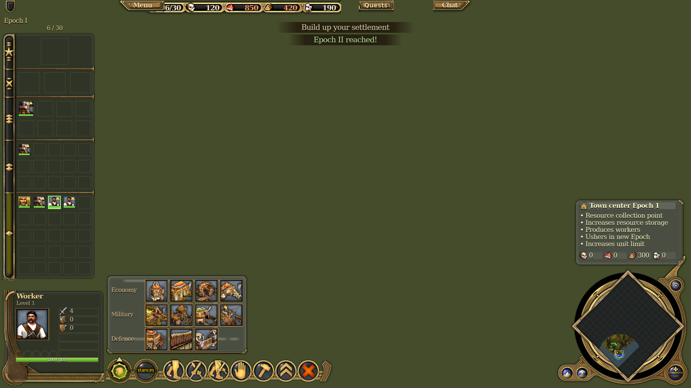
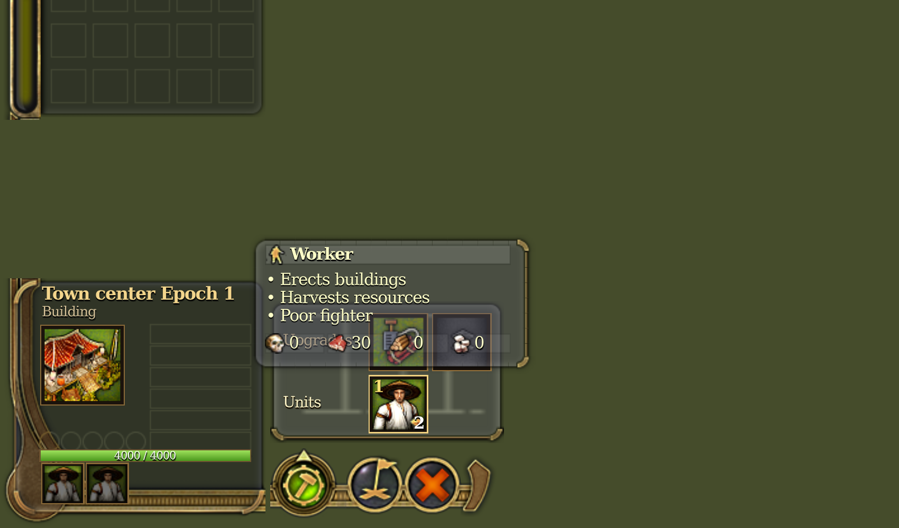
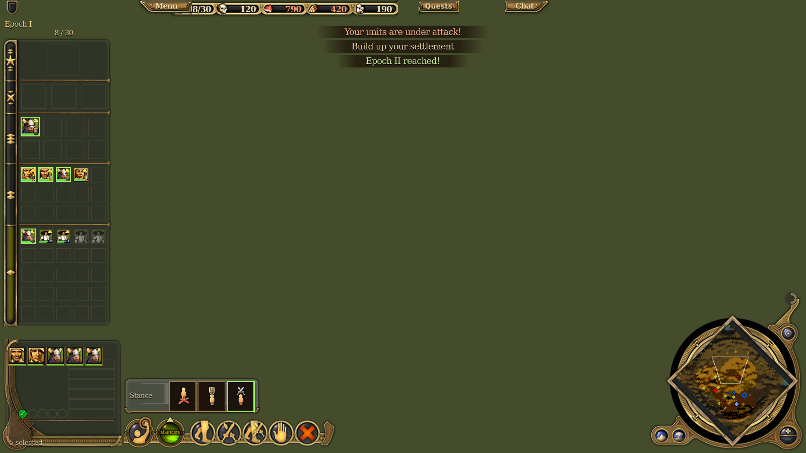
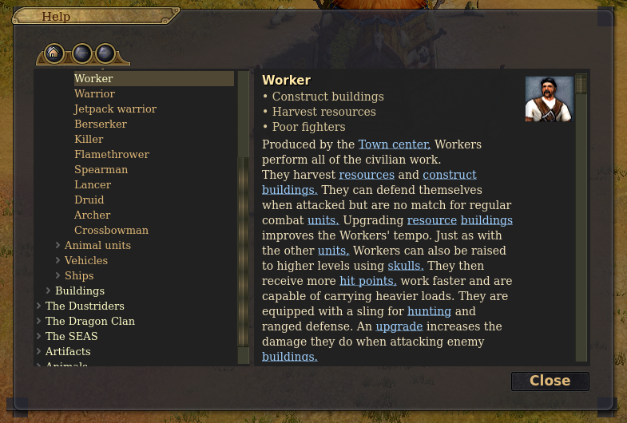
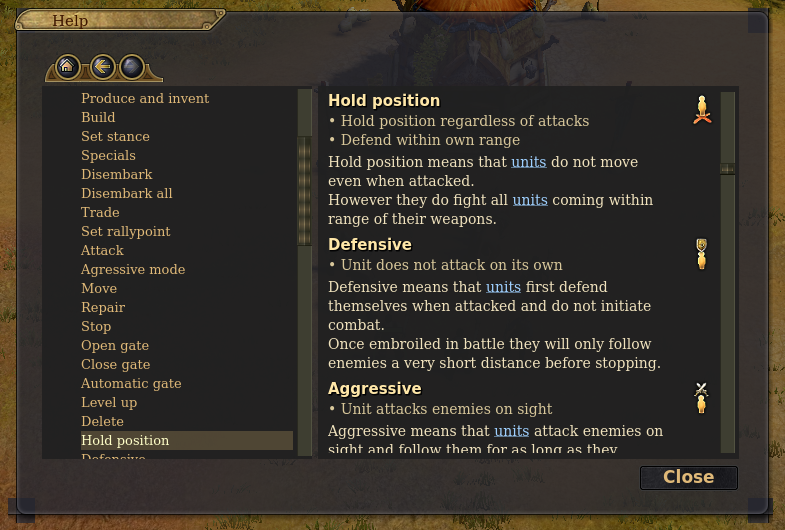
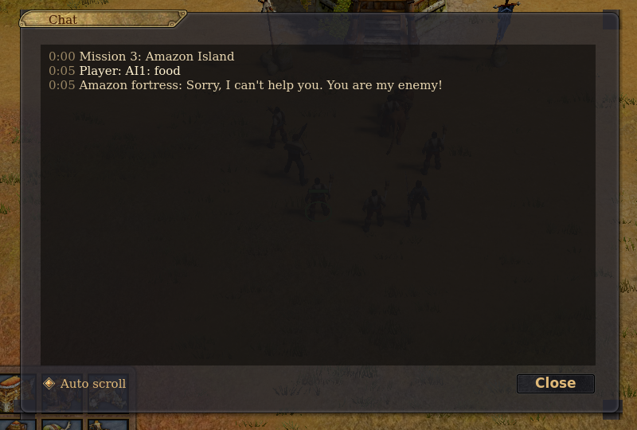
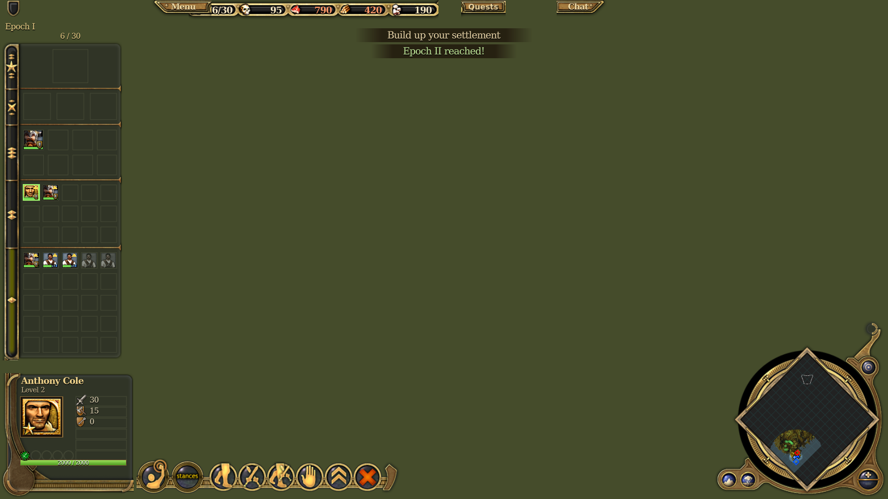
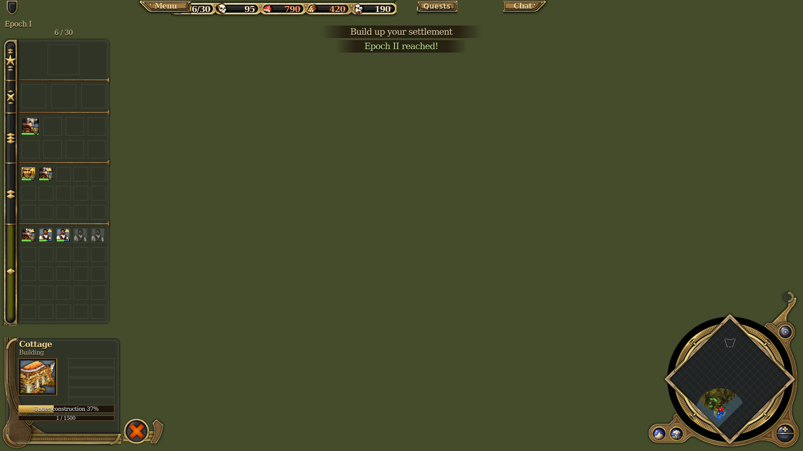
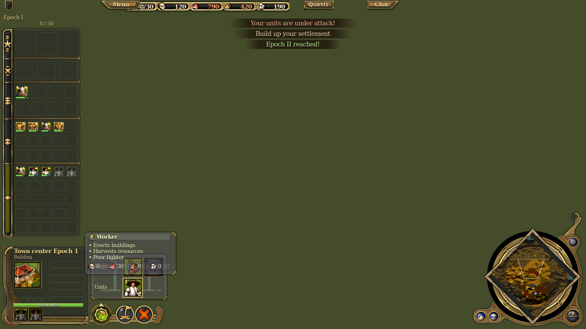
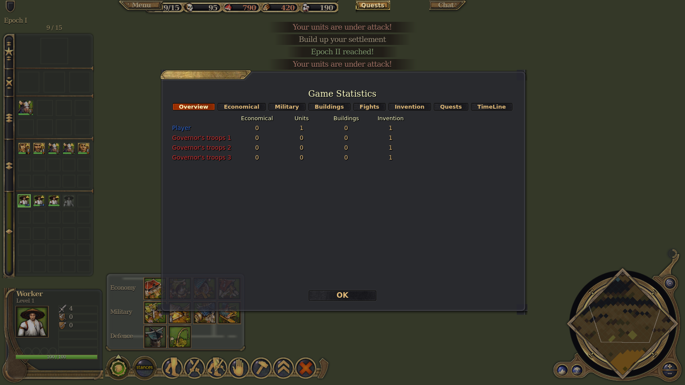

# The HUD

The in-game interface with the original's art and layout: the top bar (control groups, menu, resources, quest /
diplomacy / chat), the timers, the army pyramid with the epoch bar, the info window, the command bar and its flyout,
the minimap and the tooltip window, the message lines; the statistics screen and the diplomacy window. Port of the
browser remake's `ui/hud.js`, `ui/minimap.js`, `ui/tooltip.js`, the message part of `ui/feedback.js`, `ui/stats.js`,
`ui/diplomacy.js` and the HUD part of `main.js` (pw-exporter 98c7703; the JS's own descriptions:
`remake/docs/ARCHITECTURE.md` "Interface", `remake/docs/MINIMAP.md`, `remake/docs/TOOLTIPS.md`). Originals:
`Game/UI/IngameScreen.usl`, `GroupBar.usl`, `Info.usl`, `CommandBarEx/*.usl`, `Flyout.usl`, `NewPyramid.usl`,
`PyramidCard.usl`, `MiniMap2.usl`, `ToolTipWindow.usl`, `StatisticScreen.usl`, `DiplomacyWindow.usl`.



## Files

```
game/src/UI/Hud/
├─ IHudHost.cs              what the HUD needs of the game (the session implements it) - + Logic/IHudContext.cs
├─ Hud.cs                   the CanvasLayer: parts, layout and UI scale, the 4-a-second refresh, the session's API;
│                           HudMessages (the message lines)
├─ HudPanel.cs              HudSprites (atlas regions, HUD pictures, greyed cards, the flyout frame, MSDF fonts);
│                           HudPanel (a self-drawn part with hit regions: tooltips, clicks, drags)
├─ HudTopBar.cs             group bar, menu button, resource bar, epoch line, diplomacy / chat (places:
│                           Logic/TopBarLayout.cs); HudTimers
├─ HudInfo.cs               the info window
├─ HudCommandBar.cs         the command bar; HudFlyout (the menus' rows, the passengers' menu)
├─ HudPyramid.cs            the army pyramid and the epoch bar (clicks, drag & drop level up, box selection)
├─ HudMinimap.cs            the minimap window (picture, mission markers, buttons, mouse)
├─ HudTipWindow.cs          the tooltip window
├─ HudWindows.cs            HudStatsWindow, HudDiplomacyWindow (menu windows over the game)
├─ HudChat.cs               the chat bar (Enter) and the history of the message lines (the chat button's right click)
├─ Logic/                   no Godot types
│  ├─ IHudContext.cs        the Godot-free part of IHudHost
│  ├─ HudGame.cs            main.js's game API of the HUD (producerActions, buildActions, moveActions, moveState,
│  │                        useAction, unqueue, changeLevel, levelUp, killSelected, select ...) on commands
│  ├─ HudCommands.cs        SetStanceCommand, UnloadCommand (commands src/Sim/Commands does not have yet)
│  ├─ TopBarLayout.cs       the top bar's places (IngameScreen.usl; the pictures' visible shapes)
│  ├─ HudModel.cs           hud.js without the DOM: resources, groups, timers, epoch bar, info, command bar, flyout
│  │                        rows and keyboard rows, pyramid places / cards / task icons / drops
│  ├─ Tooltips.cs           tooltip.js: Tip, HelpTip, ObjectTip, ActionTip, ButtonTip, TextTip
│  ├─ MinimapModel.cs       minimap.js: area, relief / water / forest / fog cells, dots, camera, pings - rasterised
│  │                        into a 256 x 256 RGBA picture; MinimapSource (map rectangle, ground, setting)
│  ├─ NewsFeed.cs           feedback.js without sounds: world events -> message lines, minimap markers, selection
│  └─ StatsModel.cs         stats.js: tabs, columns, the time line
└─ Tests/HudTest.tscn       the test scene (HudTest.cs: a mission world, a fake host, checks, screenshots)
```

The HUD reuses the mission UI's art loader (`HudArt`: textures through the configuration's `AssetSource`, the
tooltip nine-patch) and atlas (`UiAtlas`: `assets/ui/atlas.json`), and `PwTheme` / `PwWindow` for its menu windows.

The statistics screen (`HudStatsWindow`) opens from the end screen's **View Statistics** - of a skirmish and of a
campaign mission (`GameSession.EndAction("stats")`, docs/SKIRMISH.md).

## The contract: `IHudHost`

The HUD reads the world and the selection and orders only through commands. What it needs of the session:

| member | what (the JS it replaces) |
|---|---|
| `World`, `Me` | the simulation, the human player (`G.world`, `G.me`) |
| `Campaign`, `Multiplayer` | a campaign mission (owner names, allies' vision); a skirmish game (the diplomacy button) |
| `Submit(Command)` | the session's command sink; the HUD sets `Command.Player`. Results are read back from `World.CommandResults` (messages: "Not enough resources" ...) |
| `Selection`, `SetSelection(list, silent)` | `G.sel` in order; set as given (the HUD applies `G.select`'s own-entities rule itself); silent: no selection speech |
| `Camera`, `MoveCamera(x, z)` | `G.rtscam` x, z, yaw; the minimap's click / drag, a card's double click |
| `ViewCorners()` | the camera's ground footprint (input.js `viewCorners`): the minimap's trapezoid |
| `Fog`, `FogVersion` | the human player's fog (`FogGrid`: `Visible` / `Explored`, `Version`); null = all visible |
| `InputMode`, `SetInputMode(mode, action)` | `G.input.mode` / `setMode`: move, attack, amove, repair, rally, place (a building: the action), target (a move), lay (a mine), mapping (the minimap ping) |
| `Group(k)`, `SelectedGroup`, `GroupButton(k, how)` | the control groups (`G.input.groups`, `selGroup`, `groupButton`: click / assign / double) |
| `OrderOn(target, shift, ctrl)` | Alt + right click on a pyramid card: the selection's right-click order on it |
| `Mission` | the `MissionPresenter` (minimap markers, the quest button) or null |
| `MapToWorld(mx, my)` | map coordinates of the mission's markers -> game x, z (`Campaign.ToGame`) |
| `UiSound(names)`, `ErrorSound()`, `Ordered(type, units)` | interface sounds (feedback.js `ui`, `error`, `ordered`) |
| `OpenMenu()`, `OpenChat(history)` | the menu button; the chat button (right click: history) |

## What the session calls

```csharp
var hud = new Hud(host) { UiScale = settings.UiScale };          // host: an IHudHost (below); Layer 10
session.AddChild(hud);
hud.SetMap(MinimapSource.From(mission.Map),                      // the minimap's map and the setting's colours
    MinimapModel.LoadTable(assets.Resolve($"assets/terrain/{mission.Map.Setting}/setting.json")));
// the Options window's settings (GameSession.ApplySettings, at the start and on every change; docs/MENUS.md):
hud.UiScale = settings.UiScale; hud.Relayout();                  // interface size
hud.TipNear = settings.TipNear;                                   // tooltips next to the mouse / above the minimap
hud.Model.AutoMenu = settings.AutoMenu;                           // the build / produce menu opens by itself
hud.Model.ShowIncome = settings.IncomePerMinute;                  // the income per minute under the resources
hud.Minimap.Rotate = settings.MinimapRotate; hud.Minimap.PlayerColors = settings.MinimapPlayerColors;
// every frame, after the steps:
hud.OnEvents(world.DrainEvents());   // messages, the minimap's attack / production markers, the selection
// when the selection changed (G.selChanged):
hud.SelectionChanged();
// keys (input.js): Q/A/Y, X, E/D/C arm a row, then 1..0; Tab; Esc
hud.ArmRow("build", 0); hud.PressArmed(3); hud.Disarm(); hud.TogglePyramid();
// anything else:
hud.Message("Paused", "");  hud.MapPing(x, z);  hud.Minimap?.AddMarker("Finished", x, z);
hud.ShowStats(back, engine.Quests);  hud.ShowDiplomacy();  hud.IsOverHud(screenPoint);  hud.Visible = false;
```

`Hud` has the members of the session's `IGameHud` (game/src/UI/Input/IGameHud.cs on the session's branch: `Armed`,
`ArmRow`, `Disarm`, `PressArmed`, `TogglePyramid`, `Message`, `IsOverHud`, `Visible`) with its signatures: after the
merge the class line becomes `public partial class Hud : CanvasLayer, IGameHud` and `GameSession.Current.Hud = hud`.

**Events: one of two.** `hud.OnEvents` makes the message lines and the minimap's markers of ui/feedback.js itself
(`NewsFeed`). The session's own feedback (GameSession.Feedback.cs) makes the same messages; use either `OnEvents`
or forward the session's `MessagePosted` to `hud.Message` and its markers to `hud.Minimap.AddMarker` - not both.

**The game API twice.** `HudGame` (Logic) is main.js's HUD API on commands, so the HUD runs without the session
(the test scene); the session has the same in GameSession.Api.cs. After the merge either can stay; the HUD only needs
`IHudContext`.

An adapter on the session's API (docs/GAME_SESSION.md; the names as the session documents them - adjust when they
differ):

```csharp
sealed class SessionHudHost : IHudHost
{
    readonly GameSession s; public SessionHudHost(GameSession s) { this.s = s; }
    public World World => s.World;  public Player Me => s.Me;  public bool Campaign => true;  public bool Multiplayer => false;
    public void Submit(Command c) => s.Commands.Submit(c);
    public IReadOnlyList<Entity> Selection => s.Selection.Items;
    public void SetSelection(IReadOnlyList<Entity> l, bool silent) { s.Selection.Clear(); s.Selection.AddRange(l); }
    public (double X, double Z, double Yaw) Camera => (s.Camera.X, s.Camera.Z, s.Camera.Yaw);
    public void MoveCamera(double x, double z) => s.LookAt(x, z);
    public IReadOnlyList<(double X, double Z)>? ViewCorners() => s.Input.ViewCorners();
    public IFogOfWar? Fog => s.Fog;  public int FogVersion => s.Fog.Version;
    public string? InputMode => s.Input.Mode;  public void SetInputMode(string? m, ActionDef? a) => s.Input.SetMode(m, a);
    public IReadOnlyList<Entity>? Group(int k) => s.Input.Groups[k];  /* SelectedGroup, GroupButton, OrderOn: s.Input */
    public MissionPresenter? Mission => s.Presenter;
    public (double X, double Z) MapToWorld(double mx, double my) => s.Mission.Campaign.ToGame(mx, my);
    /* UiSound, ErrorSound, Ordered: the session's sound feedback; OpenMenu: s.OpenMenu(); OpenChat: the chat */
}
```

## Layout and scale

The numbers are IngameScreen.usl's (as hud.js and remake/index.src.html have them), in HUD pixels × the scale `S`:

| part | place |
|---|---|
| group bar / menu / resource bar / quest / diplomacy / chat | top, x 11 / 235 / 330 (its picture; y −4) / 720 / 789 / 880 - Logic/TopBarLayout.cs, "The top bar" below |
| epoch line | 8, 34 under the bar |
| timers | top right, 65 × 25 pills one under the other |
| army pyramid + epoch bar | x 0 (bar 32 px) and 32 (pyramid 177 × 545), y 74; its own scale `min(S, (height − 74 − 205 S) / 560)` |
| info window | bottom left, 209 × 197 |
| command bar | right of the info window, 4 px in and up, 59 px high; the flyout above it |
| minimap | bottom right, 270 × 270 (the map control 230 px at 30, 32) |
| tooltip window | its bottom left 35 px right of the minimap's left edge, 241 px above the corner's bottom (closed tab at 232) - or next to the thing under the mouse (`TipNear`, the browser remake's default) |
| messages | centred, 44 px from the top, at most 4 |

### The top bar

IngameScreen.usl puts the resource bar control (CRessourceBar) at x 295, 460 × 23, and gives it hud/resource_bar.tga
(390 × 32) as its bitmap; the engine draws a control's bitmap centred in it, so the picture is at **330, −4** (its top
4 rows - only the end caps' tips - are above the screen). The five counters are at 35 + 78 i in the control (330 +
78 i, one field of the picture each). The menu button (95 × 32) at 295 − 60 = 235 ends where the picture begins; the
quest button (69 × 32) at 295 + 460 − 35 = 720 begins where it ends; diplomacy (91) and chat (80) follow. The plates'
pictures are 32 px high with transparent rows under them; their visible shapes (the opaque pixels):

| picture | visible x | visible y |
|---|---|---|
| menu_menubutton | 5 - 94 (left end slanted) | 0 - 22 |
| resource_bar | 0 - 389 | 4 - 25 (drawn at −4: 0 - 21) |
| menu_questbutton | 0 - 68 (left edge hollowed round the bar's cap) | 0 - 21 |
| menu_alliesbutton | 0 - 90 | 0 - 21 |
| menu_chatbutton | 0 - 74 (right end slanted) | 0 - 21 |

So the menu plate, the bar and the plates right of it have one top and one bottom and meet edge to edge. The remake
shows the quest button only in a campaign mission and diplomacy only with other humans or co-op seats (the original
had all of them, disabled where they do nothing); the shown ones follow each other from the bar's end at 720.
`TopBarLayout` has the places (tests: `HudLayoutTests`); HudTopBar draws the row in one control at 0, 0 scaled by
`S`, and Hud.Layout puts the mission UI's quest button at the same transform, so the edges meet at any scale.

Until 2026-11-05 the picture was drawn at the control's place (295, 0): its visible part 4 px lower than the plates'
(the "Menu" plate higher than the bar), its first 35 px (the units icon) under the menu plate, and the buttons
after it from 685 - 35 px onto the bar's right cap.

`S` = `UiScale` when set (AppSettings `uiScale`), else `clamp(height / 780, 1, 1.6)` and, on screens higher than
1440 px, × height / 1440 (what a browser at 150 - 200 % zoom does): 1.15 at 900 px, 1.38 at 1080p, 2.4 at 4K. The
fonts are the original's: every font of UI/VisDef_GAM2.vis is Trebuchet MS bold (sizes 16 - 24; Segoe UI / DejaVu Sans
where it is missing; the browser remake's Palatino page font is gone from the HUD and the menus, Kacper 2026-11-11), as
multichannel distance fields, so the text stays sharp at any scale.



## The parts

* **Resource bar**: units / limit, skulls, food, wood, stone on hud/resource_bar.tga; light red when the storage is
  full; with `ShowIncome` the income per minute under each; tooltips `_tb_unitlimit`, `_tb_skulls`, `_tb_food` ... with
  the numbers (stock / storage, + per minute).
* **Info window** (Info.usl): one object - portrait card (atlas level 4), name, level / owner line (ally / neutral /
  enemy, the owner's name in a campaign; "wild"), hit points, up to six value rows (attack - the kind of damage as the original's icon, info_attack / info_rangeattack with
  _pierce / _poison / _area, the text only the damage - range,
  armour, shield; passengers, gate state, warp gate time, the skulls an enemy is worth, the load carried), five buff
  icons (Buffs.VisibleBuffs), the item slot, a site's progress, the queue (a click cancels that entry); a group - up to
  24 member cards with hit points (click: select it, Shift: remove it), "N selected", the leader's buffs; a resource -
  amount and gatherers; an item - its help text; a healing well - its fill; MIRAGE's SEAS healing well (a building) -
  its energy, a row "energy / maximum" (Info.usl "energystate" / "maxenergyamount").
  MIRAGE's item stat display (mirage_item_stat_display): the skulls row of a unit the player may kill (not his own or an
  ally's) adds the difference to what the kill pays, `World.ScalpsFor` - the flowerpot of insanity's modifier ("10 +2"
  with the base game's × 1.2, "10 +5" with MIRAGE's × 1.5), Schliemann's aura, the skull protector, a young animal's
  share (`HudModel.ScalpsText`); the armour row's tooltip lists the defence bonus per attacker type, "Against animals:
  +10" with the bony amulet (`HudModel.DefenceLines`, `InfoModel.StatLines`, `World.DefenceBonusVs` - the rule
  TakeDmg applies). The shield row has none: the rules give ranged attacks no such bonus. Test:
  `CrossoverFixesTests.InfoShowsSkullAndDefenceBonuses`.
* **Command bar** (CommandBar.usl): menus Build (whatever can build), Produce, Special, Stances, Slots; actions walk,
  attack, aggressive walk, stop, unload, repair, level up (skulls, "No Level-Up possible"), harbour move, tower aim,
  rally point (MIRAGE: also on a portal terminus - its destination, the units go through it - or on a Tesla machine -
  the units come out there; `GameInput.RallyTargetId`; a portal terminus has one from its site on), bunker unload, kill.
  MIRAGE's portal terminus: a right click of characters, animals and vehicles on a finished terminus of their side
  sends those that may go (own, an ally's with locked diplomacy) through - or to it, when it has no working destination
  - and the rest of the selection on with the click (order "portal", the "load" cursor: GameInputController.usl
  EnterPortal); the SEAS / Norse mines show the "harvest_stone" cursor (docs/SIMULATION.md "The MIRAGE classes"). Every selection the player makes (click, box, double click, control group, the
  pyramid or the info window - the same selection again too; IngameScreen.usl OnChangeSelection -> the command bar)
  opens its main menu by itself: the first of Build, Produce, Special it has (Stances and the slots stay closed). A site
  opens Produce when it is finished; a menu closed by hand stays closed until the selection changes; a selection that
  only shrinks by itself (deaths, a loss) keeps the menu as it is; a key's row (ArmRow) wins (`Model.AutoMenu`, the
  options' "Open the build / produce / special menu when selecting"; tests/PwRemake.Tests/HudMenuTests.cs).
  An upgrade of the object itself (a local result: the Dustriders' clay wall, the remake's SEAS fence -> SEAS wall,
  the farm modes) with several objects of that class selected is queued at each of them that offers it, each paying its
  price (`HudGame.UseAction` -> `QueueActionCommand.Also`); a wall piece's upgrade sits in Produce -> Upgrades
  (docs/SIMULATION.md "Wall upgrades and overbuilding").
* **Flyout** (Flyout.usl): Build rows Economy / Military / Defence / Special (MIRAGE) / More, Produce rows Modes /
  Upgrades / Extensions / Research / Conversions / Units / More, Special rows Commands / Hero moves / Special moves,
  Stances; cards sorted by `menupos` (fixed places, −1 first free, −2 at the end); the level a unit comes out at
  (menucmd_lvl*_ovl), the queue count, the cooldown, grey (requirements, done) or dimmed (costs, limit ...); left click
  uses it (Shift: 5 times), right click takes one out of the queue; the keyboard's armed row shows its digits. The
  passengers' menu: a card per passenger (click: out) and the empty places. MIRAGE's flyers (docs/SIMULATION.md
  "MIRAGE: flying units") have "Land" (`fly_land`, icon `jetfly_off`: the next click on the ground chooses the spot) and
  "Take off" (`fly_takeoff`, icon `jetfly_on`: at once) in Special moves (SPEC / UFOC, places 1 and 2), as the jetpack
  warrior's flight has; only a unit that flies now offers them (`World.MovesOf`).
* **Tooltips** (ToolTipWindow.usl, CmdButton.usl; the original's font, VisDef_GAM2.vis Fonts.ToolTip: Trebuchet MS
  bold; its frame hud/tooltip_*.tga, the inside 80,80,96 at alpha 112): title with the class icon, the heroes' level
  lines, the help text, "Inventions required" / "Buildings required" / "Requires level" / "Already inventing" /
  "Unit/Level maximum reached", MIRAGE's building limits ("You've reached the maximum quantity of this building class."
  when a card is at its limit - dimmed -, and "Current count: n/max" on every card whose building or upgrade product has
  a limit: placed and queued upgrades counted, docs/SIMULATION.md "Building limits"), the strengths row (the qualities at the row picture's tabs: the original's four
  columns at 23, 72, 121, 169; MIRAGE's five - with ships - at 19, 59, 97, 137, 175), the cost row (light red what is missing); the help items of `gamedata.json` texts, the
  lines of its ui strings.
* **Army pyramid** (NewPyramid.usl, PyramidCard.usl): cards by level (the units, the floating harbour, the queued units
  greyed), hit points, task layers (food / wood / stone, buildup, repair, fight, transport, idle after 2 s), the level
  up mark; the debug options' extra places beside it and the compact rows - drawn like the original's own places: the
  original has no art for a place (CPyrSlot's "slot_background" layer is fully transparent), only pyramid_open.tga's
  translucent panel with a thin grey frame per place, so HudPyramid builds the panel from that picture (its frames
  erased, widened by repeating an inner column so the separators and the rounded edge run on as far as the places reach)
  and draws every place's frame into it; click / Shift / Ctrl, double click (camera;
  Alt: the class on the row), right click (level up; Alt: the order on it), drag onto a free higher place (level up for
  the skulls of the levels passed - down: "A unit keeps the level it has reached"), box selection; the epoch bar (the
  epoch's levels lit, the next epoch orange when it can be started, growing while it is researched); click on the bar
  or Tab: open / closed.
* **Minimap** (docs: remake/docs/MINIMAP.md): the playable area in 4 m cells in the setting's colour table (relief by
  the slope to the south-east, shallow / deep water, forest), fog (unexplored left out, explored half transparent),
  dots (resources, buildings in the owner's colour lightened and kept dimmed once seen, units; no wild animals; an
  enemy hidden in the 3D view - camouflaged Aje shaman, disguised ninja, entrenched unit, smoke - has no dot either:
  `World.HiddenFrom`, as `EntityViews.Visible`; the original's unit loop skips hide flag 0x800, which camouflage sets;
  `CrossoverFixesTests.MinimapHidesCamouflagedEnemies`; MIRAGE 2.6.8: the holy city's `hc_` rally buildings - hc_rodeo,
  hc_huge_farm, hc_weapons_builder - and its tavern hc_taverne have no dot on any minimap but their owner's, the hide
  flag MIRAGE's exe fix gives buildings too: `World.HiddenOnMinimap`, src/Sim/Systems/MirageMaster268.cs), the
  camera's footprint, the pings (Attack red 3.2 s, Finished blue, Ping), the mission's markers (a ring running out),
  turned to the level's default camera snapped to a diagonal (`Minimap.Rotate`: follows the camera); buttons
  landscape, resources, map ping, zoom 1 .. 7; left click / drag: camera, right click: move / rally there; with an order mode armed (M move, A attack, N attack-move, rally) a left click gives that order at the point - attack and attack-move fight their way there, Shift queues and keeps the mode (`HudMinimap.ModeOrder`, 2026-11-12).
* **Messages**: feedback.js's lines - "… completed", "… researched", "Epoch II reached!", "Your base / units are under
  attack!" (at most every 10 s), "… destroyed", "Storage full", the newsticker lines of the world's `msg` events (with
  their arguments, a computer player's name), traps, wars, warp gates; and the reasons of commands that failed.
* **Statistics** (stats.js): Overview, Economical, Military, Buildings, Fights, Invention, Quests (campaign), TimeLine
  (a category, the players ticked, the graph) from `World.GameStats`.
* **Diplomacy** (diplomacy.js): a row per other player - team, colour, my opinion (Friend / Neutral / Enemy,
  `DiplomacyCommand`), theirs, tribute (`TributeCommand`); locked with "Lock diplomacy settings", Domination, Defender.
  More than eight players (the remake's games of up to 16, docs/SKIRMISH.md "16 players"): the rows in a scroll box; the
  statistics window's table likewise, its graph's player boxes in more lines. Chat lines and computer players' lines
  show the sender's name in its player colour.



### Selection circles and question marks

* **Selection circles** (`src/Sim/World/SelectionRing.cs`, drawn by `SelectionOverlay`; also the hover ring and the
  health bar's width): the original's engine sizes the circle by the object's own geometry - no tech tree or class
  file has a value for it (Building.usl: "non visible links corrupt selection circle and health bar rendering"). Here
  it goes round the model's extent on the ground from its origin (`ModelManifest.SelReach`: the drawn box - a skinned
  model's in the GSF frame, x / y on the ground - else the GSF pick volumes) + 5 % + 0.15 m, never smaller than the old
  ring (a unit's body radius x 1.25 + 0.2, a building's footprint x 1.05, a field's plot), a unit's at most 16 m, a
  building's at most 1.6 x its footprint radius. Infantry keep about their old ring; walkers, dinosaurs, titans, wide
  buildings get one round them (`dotnet run --project tests/PwRemake.Tests -- SelectionRing` prints old / new).
  Every ring is a **circle** (2026-11-12, Kacper: "make everything a circle" - the stadium of long buildings is gone). A
  **long building** (footprint at least 1.5 x as long as wide: walls, gates, harbours, carriers, long halls) gets its
  circle round its footprint's middle, just big enough for the footprint's corners (+ 5 %), not the circle round its
  model's reach from its place (`SelectionRing.Shape`; `SelectionRingTests.LongBuildings` lists them).
* **Question / exclamation marks** (QMRK, `game/src/UI/Input/GameInput.Marks.cs`): the original makes them selectable
  and hitable (QuestionMark.usl); hovering one shows the text its trigger's QMRK action gave it (`questiontooltip`, a key
  of the mission's string tables such as `_TTQ_G_01`; IngameScreen.usl OnTick) - here in the tooltip window beside
  the mark (`IGameHud.WorldTip`); a click selects it (the rest deselected, a neutral ring round it) and keeps the
  tooltip, titled "Quest" (`_UI_IngaScre_Button_Quest`, as the original's info panel names it), at the window's own
  place until the selection changes; the cursor stays the standard one. A hidden or unexplored mark, one without a text
  (or whose key is in no table: `_TTQ_LB42_21` of single_b42) shows nothing. Tests: `QuestionMarkTip`; in the game
  `--mark-check <game s>` (docs/DEBUG.md).

### Attack ranges

The remake's own (Kacper 2026-11-13: "when I place a building that can attack, show its radius while it is being
placed; a built one shows its radius unless the setting is turned off"; `game/src/View/Entities/RangeRings.cs`):

* **placing** a shooting building (towers, turrets, cannons, the SEAS big / great cannon, bunkers, the machine-gun
  nests; towers on a wall tile too): its range round the ghost, strong, in the player's colour, and its minimum range
  dashed where the weapon has one (the rocket ramp 50 m, the big cannons 100 m, MIRAGE's small / shore cannon 15 m);
* **built**: a faint circle round each of the player's own finished shooting buildings while the option **Show attack
  ranges** is on (Options > Gameplay, settings.json `showRanges`, default on; **Ctrl+Shift+R** toggles it in the
  game with a line on the message bar - the original's own key for its range markers, Keys.srf
  ToggleRangeMarkersAttack, otherwise unused). Chosen over "only the selected ones": the circles show at a glance
  what the base covers and where it is open, and stay thin and faint enough not to clutter;
* a **selected or hovered** shooting building (also another player's) shows its circle strong, option on or off.

The radius is the simulation's own (`World.TowerRange` / `TowerRangeOf` for the ghost): the weapon's range with the
tribe's upgrades + half the building's radius, from its centre to the target's surface - what `Combat.TowerUpdate`
fires at (a unit's centre may be its own radius further). A bunker shoots only with characters inside; its circle
shows anyway. Drawn as one thin band per circle on the ground, like the selection circles (`GroundRings`: the
owner's ring colour, a dark edge either side, depth-tested, a little towards the camera), widening with the
camera's distance; a built building's band is made once (again on an upgrade of its range), the ghost's when it
moves; pooled, no allocation per frame, culled off screen by Godot. Test: `BuildingRuinTests.TowerRangeIsTheFiringRange`
(every shooting building of both configurations, its ghost's range the same).

### Range markers of the selected objects (MIRAGE)

MIRAGE's `CRangeMarkerMgr` (Scripts/Game/mgr/RangeMarkerMgr.usl), with the two fixes made for MIRAGE's exe
(`mirage_ref/rangemarkers_README.md`): every selected unit and building (anyone's; types CHTR, ANML, VHCL, SHIP, BLDG)
shows up to five rings on the ground while **Show attack ranges** is on (the same option and **Ctrl+Shift+R**; off: no
markers, as MIRAGE's ClearAll; `game/src/View/Entities/RangeMarkers.cs`, a child of RangeRings):

| marker | colour 1 / colour 2 | width | range (`World.MarkerRangesOf`, src/Sim/Systems/RangeMarkerValues.cs) |
|---|---|---|---|
| attack | red 255,0,0 / 255,150,100 | 0.3 m | the attack range (range + 2 for characters, + the radius for others, + 0 for projectile weapons; a shooting building: its tower reach) |
| alarm | violet 140,0,255 | 0.3 m | clamp(attack range + 8, 32, FOW) |
| fog of war | cyan 0,255,255 | 0.3 m | the sight radius |
| healing | yellow 255,216,0 | 0.3 m | the heal ability's radius |
| aura | green 0,255,0 / 0,255,100 | 0.3 m | the aura's radius (a hero's RangeEffect, the aura table of Effects.cs) |

* **Light added to the ground** (2026-11-18): the markers' colours have alpha 0 (`{{255,216,0,0}}` ...) and the
  engine's ground rings add them (debris renderer 0x6be370, the additive copy of Effects/Selection.tga, material
  0x704): a glowing band that keeps the ground's own colour - in Kacper's reference shot a temple's healing ring adds
  about 150 - 175 / 120 - 140 to red / green and keeps the ground's blue. The port mixed the colour at 0.9 (an opaque
  line); now `blend_add` through `Fx/GammaBlend` (docs/EFFECTS.md "Brightness"). Not ported: the original's ring was
  drawn over the tower in front of it in that shot (no depth test?) - the port's band is hidden by buildings.
* **Animation by real time**: the dashes (1.5 m of each colour) run round the rings at 0.03 rad/s and pulse, by the
  shader's TIME - the same for 1 or 100 markers, at any frame rate, on in the pause too (the original advanced it per
  drawn ring: 60 rings ran 60 times faster).
* **Merged outlines**: rings of the same type that overlap become one outline (`View/Entities/Logic/RangeOutline.cs`,
  MIRAGE's merge patch: a segment - the engine's 64 + 1.5 x range per ring - whose middle lies more than 0.05 m inside
  another ring of the type is left out; a ring inside a bigger one disappears; types never hide each other).
* **Cheap for 100 selected units**: one mesh per type (five draw calls); a type's outline is worked out only when one
  of its rings moved more than 0.2 m, changed or came / went, at most 10 times a second (up to 12 rings of a type
  follow their objects every frame) (from the arcs the rings cover:
  O(rings² + segments), about a millisecond for 100 rings of 35 m); nothing allocated per frame.
* A selected shooting building with the option on shows its attack marker instead of its RangeRings circle (its
  dashed minimum range stays). Tests: `FirstStrikeMarkersTests.RangeOutline*`, `RangeMarkerValues`.

## The help book, the chat, the controls

* **Help book** (`game/src/UI/Help`: `HelpWindow.cs`, `Logic/HelpBook.cs`, `ControlsList.cs`; the original's
  `HelpMenu.usl` / `HelpMenu.srf`, the browser remake's `ui/helpbook.js`): the game's own help (`Texts/Help/index.txt`
  and its `*.seml` files, converted by the toolkit to `help.json` - the file the loading screen takes its hints from).
  A 765 × 515 frame window 95 px above the centre of the screen (scaled with the screen height); the row of the
  original's navigation buttons Home / Back / Forward (`hud_helpnavigation`: the atlas' `helpbtn_*_idle / _hover /
  _down / _disabled`, Back and Forward greyed when there is nowhere to go); under it the index (270 px) and the page;
  Close (the string `_PlayersWindow_Button_Close`) at the bottom right; the menus' text-box tile behind the index and
  the page, the menus' scroll bar art (`scrollbar_vrt_rail_idle`, `scrollbar_vrt_mover_*`).
  * The **index** is the original's (BuildIndex): every topic of index.txt and under it the topic tree of its file -
    chapters, sections, help items -, then its sub-topics; a topic without a file opens the next one that has one. So
    the encyclopaedia pages of the Norsemen, Dustriders, Dragon Clan and SEAS (Units: infantry, animals, vehicles, ships;
    Buildings), the heroes, artifacts, animals and the world have an entry per unit and building (733 entries).
  * A **page** is a whole help file: its chapter and section headings and its help items - title, the short text
    (the tooltip's), the long text, the picture at the right (the class card `bunit:<class>`, an interface sprite
    `bres:<level>;layer+<sprite>`), the pictures inside the text (sprites, the mouse pointers `pics/*.tga` =
    `assets/ui/cur/*.png`) and the links (`{ref:file#key|label}`: blue, underlined, a click goes there). The page
    scrolls to the item; the index selects and opens its entry.
  * **History** as the original's: a page shown again is not added; Back is possible with two pages or more;
    following a link clears Forward. Home: `H_Intro.seml`.
  * **F1** (Keys.srf ShowHelp; `GameSession.OpenHelp`, `GameSession.Help.cs`) opens it at the help item of what the
    player points at, in StartHelpNav's order: the HUD's tooltip shown (the card under the mouse: `Tip.HelpKey`), the
    building being placed, the first selected object, the object under the mouse (GetObjHelpitemKey: the tech-tree
    description `_aje_tent`, `_lovelace` ..., else the class) - the first the index has; else the introduction. Keys
    are found with or without the leading `_` (the command bar's `cb_*`, `mm_*` have none) and a numbered key falls
    back to its stem (`_ninigi_fireplace_1` -> `_ninigi_fireplace`: the original's `-nodisplay -redirect` items, which
    help.json leaves out). The pause menu's **Help** opens it at Home; Esc / Close go back (to the menu, or to the
    game after F1). The game stands still meanwhile (the pause menu's `MenuOpen`), as the original's (CGameWrap.Pause).
  * Missing art (no `help.json`, no atlas entry) leaves the part empty and logs a warning; the MIRAGE test data have
    no help.json of their own: the base game's is used (as the loading screen does).
* **Controls** (the pause menu's **Controls**; ui/menu.js `help`): the keys and mouse of a game in one table.
* **Chat** (`HudChat.cs`; ChatWindow.usl CIngameChatBar, ui/chat.js): Enter opens the bar to all, Ctrl+Enter to the
  allies, Shift+Enter to the enemies (550 × 50 px at 1 - 1/3.5 of the screen height: target, a line of 150
  characters, Send - the string table's texts); the top bar's Chat button opens it, its right click the history of
  every message line of the game (HistoryWindow.usl: 765 × 515, auto scroll; the game runs on). A line to all
  `AI<n>: help | food | wood | stone | gift` asks computer player n (`AiRequestCommand`, src/Sim/Commands - a command,
  so a replay has it; the answer is the computer player's news line, src/Sim/Ai/Chat.cs). MIRAGE 2.6.8 (ChatWindow.usl
  DirectMsg / GroupMsg; `Logic/ChatRouting.cs`): the target list also holds every computer player by name ("To
  <name>": the line is its request - "help", no prefix), and the computer players read the lines to the allies and to
  the enemies (each one of that side gets the line as its request: "help" to the allies brings each allied computer
  player's support squad; an enemy's request is refused). The original's chat has no cheats.
* Checked in a game: `--help-at <s> [--help-select <class>] [--help-page <file#key>]` (GameSession.Autoplay: selects
  the unit, presses F1, logs `HELP ok`, shoots help.png; then Enter, a line "AI1: food", the history: `CHAT ok`,
  chat_history.png into `--shots`).
* **Diplomacy window**: Request (a computer player sends 100 of the chosen resource when it can) and the thanks for a
  tribute go as `AiRequestCommand`s.





## Tests

`xvfb-run -a -s "-screen 0 1600x900x24" godot --path game res://src/UI/Hud/Tests/HudTest.tscn -- --shots=<dir>
[--mission=11] [--size=3840x2160 (with a 3840x2160 xvfb screen)] [--scale=<ui scale>] [--prefix=hud_]`
(`PW_CONTENT`, default /home/claude/testcontent). The scene builds the mission headless (`MissionSession`), steps
it, adds a few units, a main building and a site, and plays through a fake `IHudHost`: 27 checks (mission 1; 26 on
mission 11), exit code 0 when all pass:

* against the JS (values of the remake's code run in node): the pyramid's places (`slotRects` of rows 1, 3, 4, 5 with
  extra places and compact rows), the minimap's `reliefCells`, `snapDiamond`, `paintCells` (fog states, forest over
  the ground, rounding);
* on the real tech tree: a worker opens the build menu with Economy first, a build card's tooltip (title, help text,
  costs), a producer opens the produce menu, a unit queued from the card arrives in the building's queue (a command
  through the world), a row armed by key, a stance (`SetStanceCommand`) and a level up by the pyramid (`ChangeLevel`)
  reach the units, the info window of a site and a resource;
* mouse input pushed into the viewport: the mouse over a flyout card shows its tooltip, a click on a pyramid card
  selects the unit, a click on the minimap moves the camera; `IsOverHud`.

Screenshots: images/hud_*.png (mission 1 and 11 at 1600 × 900, a 4K detail).

`dotnet run --project tests/PwRemake.Tests -- HudLayout`: the top bar's places (the original's numbers; the shown
buttons after the bar; the visible shapes with one top and bottom, edge to edge, at the UI scales 1 - 3).






## Not ported / differences

* ui/gamefx.js is the game's 3D effect models for world events (hits, deaths, level-ups, camera shakes) - the world
  view's, not the HUD's. The sound part of feedback.js is in game/src/View/Audio (SoundFeedback).
* The sequel campaign's power plant icon and electricity costs are drawn only as far as the data has them.
* The minimap scales its cells to the zoom without smoothing (the canvas smoothed them when zoomed).
* The command bar's hover uses the original's own hover pictures (actbtn_back_hover, menubtn_back_hover) where the
  remake brightened the idle one; grey / dimmed cards are made once per card as greyed copies (the CSS filters).
* `SetStanceCommand` and `UnloadCommand` (Logic/HudCommands.cs) belong in src/Sim/Commands; they are here until they
  move there. A queue entry is cancelled with the computer player's `AiCancelQueueCommand` (src/Sim/Ai/Hands.cs).
* The test scene draws the HUD over a plain background (no world view): the camera's footprint is a trapezoid made
  by the fake host.

**Long buildings' rings and animated buildings** (2026-11-11): a long building's ring is centred on its footprint's middle, not on its place (`SelectionRing.Shape` returns the offset: the SEAS carrier's ring lay beside its hull); a sailing building gets the circle (its boxes are those of its last stop). Clicking a building hits its skinned parts too, by their bounding box (`GameInput.PickHit`: the carrier's animated hull could only be clicked on its few unskinned parts).
