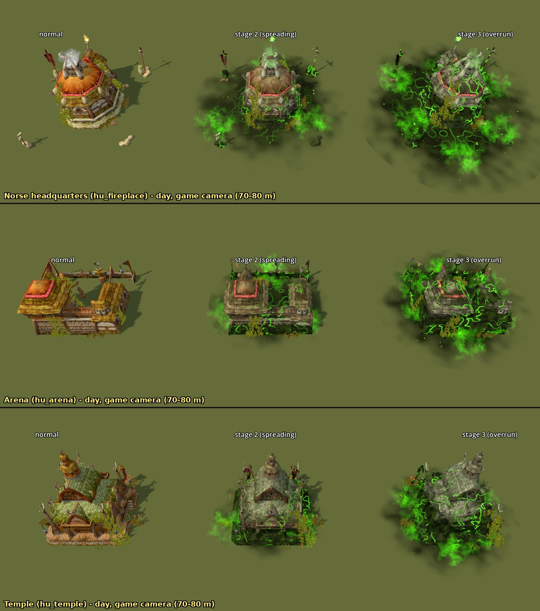
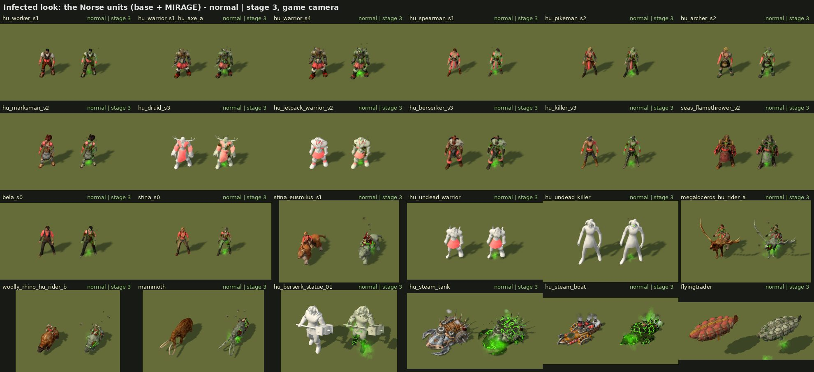
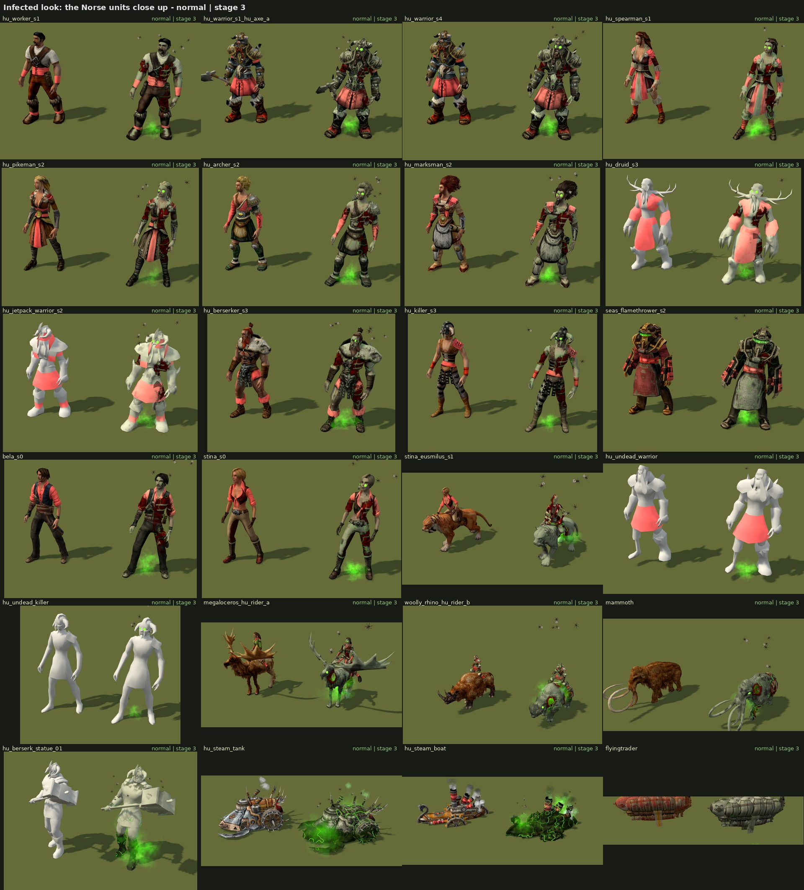
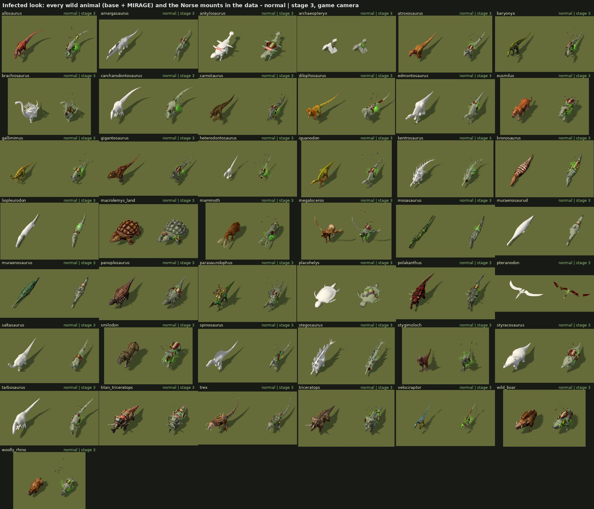
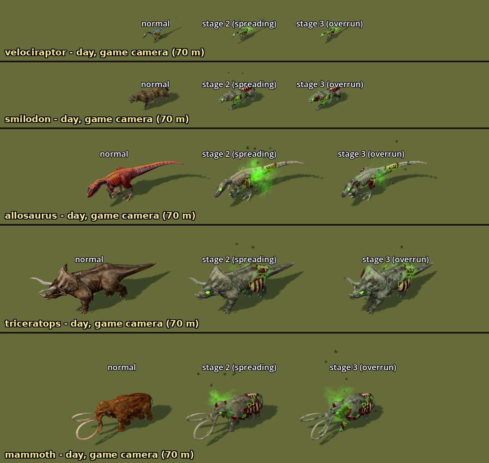
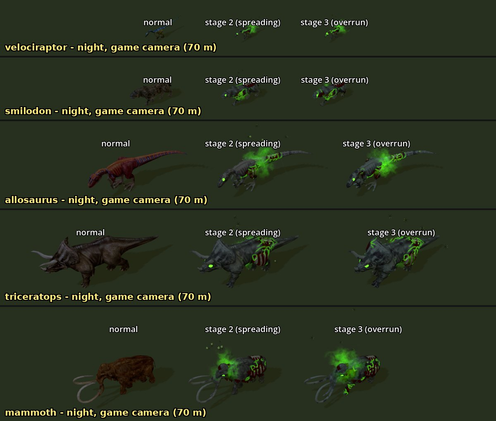
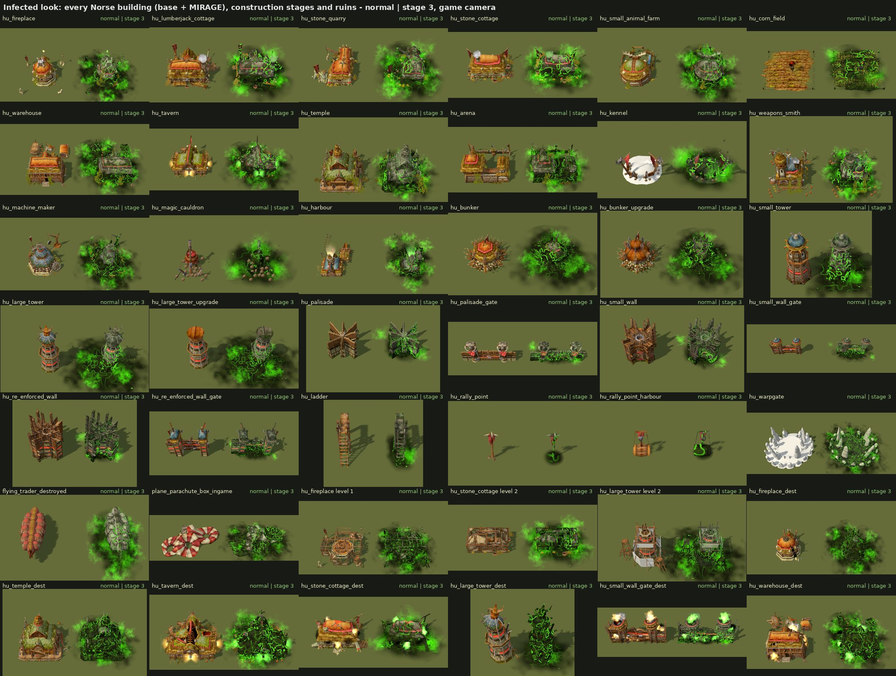
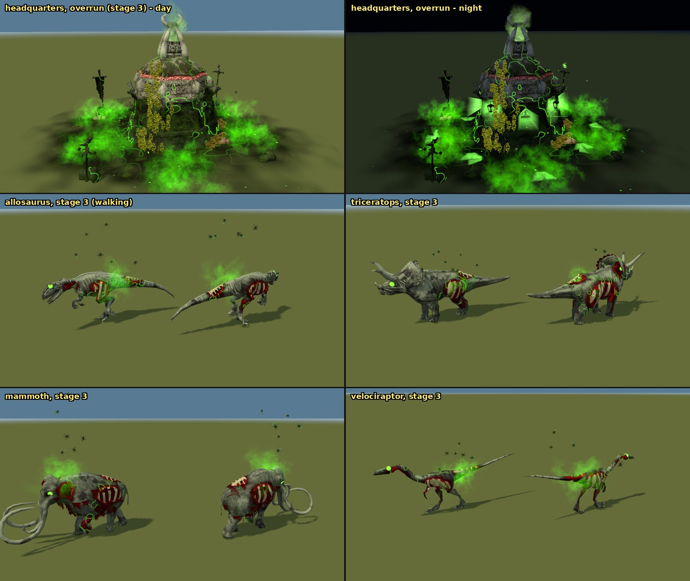
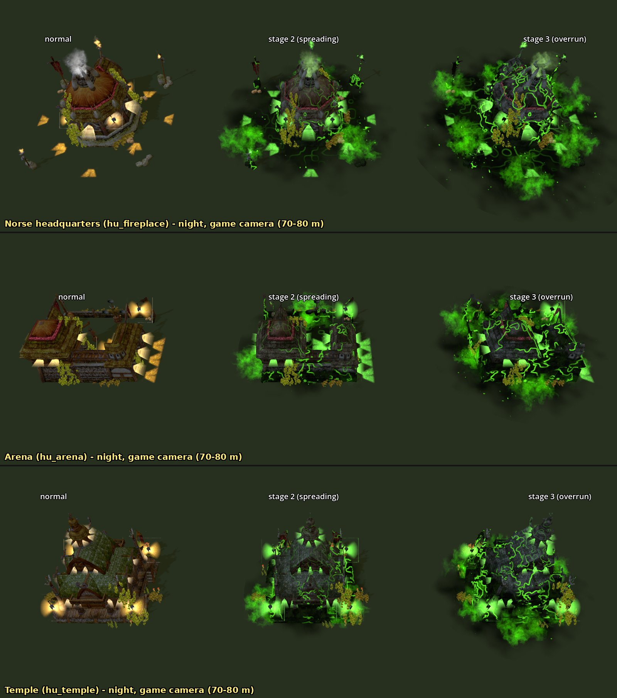

# The infected look (buildings, units and animals)

A view-side overlay that draws a building, a unit or an animal as **infected** - for a mission in the spirit of StarCraft 2's
"Outbreak" (by day the players burn infected nests, by night infected waves attack). Kacper 2026-11-19: "give a new
texture/effects for infected buildings/units ... some green/decay effect like in Warcraft 3 ... For animals make them
look like having parts of their body torn off, seeing the bones/blood, different colour than usual."

Kacper (23:45, the same day): "also add other buildings units too" - every Norse building of both configurations
(base and MIRAGE: houses, farms, tavern, harbour, towers, walls, gates and palisades, smithy, storehouse, lumberjack,
the special buildings, MIRAGE's additions, their construction stages and ruins), the Norse units (workers, warriors,
archers, spearmen, the heroes Bela and Stina, riders and their mounts, vehicles and ships, the undead) and every wild
animal.

Only the look: nothing in the simulation changes (no state, no saves, no lockstep). A mission or a tool switches it on
per drawn model.



## How to switch it on

```csharp
ModelInstance m = ...;           // a building, unit or animal (EntityViews' model of an entity, a prop, a test model)
m.SetInfected(2);                // 0 healthy .. 3 fully overrun; applied only when it changed
m.Infection;                     // the stage drawn
m.InfectionKind;                 // the look it wears: Building, Vehicle, Animal, Character, Undead, Item
m.GreenFire;                     // its fires, lights and particles are green (stage 2 and 3)
```

The stage can change at any time (spreading: 1 -> 2 -> 3, or back to 0 when the nest is burnt). Attached parts follow
in the look `InfectedLookData.ChildKind` gives them: a building's turrets and cranes (the building look), a mount's
rider (the character look) and build-ups / turrets (the moving building look), a character's weapons and tools (an
item: rot only); a part attached later (a rider after a level-up, a new weapon) takes the stage at once (`Attach`,
`AttachTo`, `AttachAtOrigin`). Not followed: the passengers of a transporter (`Composite.SyncPassengers` marks them,
`MarkPassenger`: their own entities) and characters or animals standing on a building. An attached part makes no
clouds, flies or blight of its own (the model's are about it). The game's world view has everything it needs:
`ModelLibrary.OnEmitter` (the flies) and `InfectedLook.GroundHeight` (the blight lies on the terrain) are set by
`WorldView`. The mission (another agent's "outbreak") calls `SetInfected`; the API is unchanged.

## The looks (`InfectedLookData.KindOf`)

| look | models | what it shows |
|---|---|---|
| Building | fourcc Bldg, Wall, Fiel, Deko, a Misc that does not move (props, the special box) | rot, slime from the ground, moss, veins, green fires, clouds, flies, the blight - tuned per family (below) |
| Vehicle | Vehi, Ship, a Misc that moves (MIRAGE's zeppelin `flyingtrader`), the walking statues (`hu_berserk_statue_*`, MIRAGE's `golem`), an animal's build-ups | the building look from the model's bind positions (it moves and turns with it): rotting wood, slime from the keel / wheels; clouds and flies, no blight |
| Animal | Anim | pale skin, bruises, torn wounds cut in the bind pose (ribs, spine, bone, blood), green eyes |
| Character | Char | pale grey-green skin, rotting clothes, bruises, torn cloth over painted wounds (per skeleton), green eyes |
| Undead | `hu_undead_*`, the zombies (`schliemann_zombie`, `schliemann_zombix`, MIRAGE's zombie archer `hx_archer_*`) | they look undead already: only the green eyes (from stage 1), a small cloud, flies - no second rot |
| Item | a character's weapon, tool or load | rot and veins (70 %), no slime, no effects |

## The stages (`InfectedLookData.Stage`)

| | 0 healthy | 1 freshly infected | 2 spreading | 3 fully overrun |
|---|---|---|---|---|
| rot (surfaces towards the undead's grey-olive) | - | 0.35 | 0.65 | 0.9 |
| slime from the ground (m, at most 45 % of the building's height) | - | 1.2 | 3 | 6 |
| moss on upward faces | - | 0.15 | 0.45 | 0.8 |
| glowing veins / cracks | - | 0.35 | 0.7 | 1 |
| fires, lights, glows, smoke green | - | no | yes | yes |
| poison clouds round a building (`fx_poison` / `fx_poison_big`) | - | 1 small | 3 big | 6 big |
| fly swarms | - | 1 | 2 | 3 |
| blight radius (x the building's half size) | - | 0.9 | 1.2 | 1.5 |
| animal / character skin pale / bruises | - | 0.45 / 0.35 | 0.8 / 0.7 | 1 / 1 |
| animal / character wounds (from the table) | - | the first | 2-3 | all (4-5) |
| green eyes | - | no (the undead: yes) | yes | yes |
| clouds / flies on a vehicle | - | - / 1 | 1 / 1 | 2 / 2 |
| clouds / flies on a character | - | - / - | - / 1 | 1 small at the feet / 1 about the head |
| clouds / flies on the undead | - | - / - | 1 / - | 1 / 1 |

The building rows are scaled by the building's tune (slime, clouds, flies, blight: `InfectedLookData.Effects`,
`SlimeOn`, `BlightRadii`) and the clouds by its size: all of them round the headquarters (half width 9 m), fewer round
a smaller building (x 0.3 .. 1), the big clouds only from a half width of 7 m - six big clouds hid a cottage at the
game's camera.

## The layers

**Buildings** (`InfectedLook.Material`, building shader; vehicles the same from their bind positions):

* **Rot**: the texture desaturated and darkened towards the grey-olive of the original's undead (spec_hu_undead_killer:
  moss-green on grey stone), rotten patches darker (value noise). Party colour parts (GSF 0x1000, already
  colour x 2) rot half as much: the owner stays readable (the red band of the headquarters, the arena's cloth).
* **Slime**: green-black slime creeping up from the ground - the height above the model's origin, its edge broken by
  two noises, wet green highlights.
* **Moss**: on the upward faces (roofs, ledges) above the slime.
* **Veins**: glowing green lines (the iso-line of a noise, a few pixels wide at any zoom: `fwidth`), denser and wider
  low on the walls, softly pulsing (`TIME`); glowing specks in the slime. Emissive: they light the night.
* **Fires and lights** (stage 2+): the model's particles (fires, torches, chimney smoke, night lights - not its insects,
  dust, flying stones, splinters or the harbour's water: `InfectedLook.TurnsGreen`, by the emitter node's name:
  `ParticleBatch` custom data + 512, `InfectedLook.GreenGlsl` - the colour's brightness and white core kept), its
  additive glow meshes (GSF 0x4: light cones on the ground - `InfectedLook.GreenGlow`) and additive sprites (lantern
  halos: `ModelSprites` uniform `green`). Smoke turns a sickly green-grey. Additive light keeps the original's
  blending (GammaBlend).
* **Poison mist**: the original's `fx_poison_big` (stage 1, and walls, the field, rally points: `fx_poison`) on a ring
  (an ellipse from the footprint) round the building's foot.
* **Flies**: the original's meat flies - the emitter `particles_aje_Schlachthaus_lecker_Fleischfliegen_01` of the Norse
  lumberjack cottage (six dark flies of particle_01.png buzzing on a sphere), hung on nodes about the building
  (`Particles.TrackNode`), its swarm 2.4 x as large.
* **Blight** (`Fx/InfectionBlight`): a dark green-black patch on the ground with a torn edge, darker cracks, wet slime
  pools and green specks that twinkle (Warcraft 3's undead blight). An ellipse from the footprint (`BlightRadii`: the
  stage's share of each half width, at least the tune's `BlightMin`, at most 2.5 x the other) laid on the terrain
  (`InfectedLook.GroundHeight`), alpha-blended, no shadow; not a Godot Decal (the Compatibility renderer has none).

**Animals** (fourcc `Anim`; animal shader, double-sided):

* **Skin**: pale grey-green (the undead's and Schliemann's zombie's skin), dark bruised patches.
* **Torn wounds**: ellipsoids of the wound table in the model's bind pose. Inside one the surface is cut away
  (`discard` - also in the shadow pass: the hole is in the shadow) except
  * ribs (`Ribs`: bands across the body's length), a spine with its vertebrae (`Spine`), a leg bone (`Bone`) in bone
    colour, and a torn edge of raw red flesh (all kinds; `Flesh` has no bone);
  * through the hole one sees the body's inside: the back faces, dark red flesh;
  * round it a wet dark-red rim, below it blood running down in streaks of different lengths;
  * green veins spread from the wounds.
* **Eyes**: two spheres of the table glow green (emissive), stage 2+.
* **Mist and flies**: a small `fx_poison` cloud at the body (scaled to the animal) and a fly swarm over the back; both
  move with it.
* A material that was double-sided already is thin (a frill, a wing membrane, an ear): its back faces keep their
  colour (uniform `thin`) - only a closed body's back faces are its inside.

**Characters** (fourcc `Char`; character shader, the bind positions as the animals'):

* **Skin**: the texture's skin tones (red above green above blue, moderately saturated, not dark) turn pale grey-green;
  the rest (clothes, leather, metal) **rots**: grey-olive with darker mottled stains; party colours half.
* **Bruises**: dark purple-grey patches; faint green veins on the skin and round the wounds (not over the clothes).
* **Wounds**: a body 2 m tall is too thin to cut through - the wound is painted: dark raw flesh, blackened deep inside,
  a few curved ribs (`Ribs`), vertebrae (`Spine`) or a bone along the limb (`Bone`); round it a ragged edge of torn
  cloth with frayed threads, wet with blood next to the wound; blood running down the clothes below it.
* **Eyes**: two small spheres at the head bone glow green (stage 2+; the undead from stage 1).
* **Mist and flies**: flies about the head from stage 2, a small `fx_poison` cloud at the feet at stage 3. A rider has
  none of its own (its mount's are about it).

**The undead**: the character shader with everything but the eyes off (no rot, skin, bruises or wounds); mist and
flies by stage. **Items**: the building shader on the item's own vertices, 70 % of the rot, no slime or moss.

### Bind pose: wounds that move with the animation (animals, characters, vehicles)

The wounds are placed in the model's bind pose. Godot skins the vertices before the shader sees them (Forward+: a
compute pass; Compatibility: before the user's vertex code), so an infected animal draws with a copy of its meshes
whose vertices carry their bind position in `CUSTOM0` (`InfectedLook.RestMesh`, one copy per mesh, shared; a rigid
part on a bone: where it rests). The skinned position draws, the bind position decides the wound - the hole stays on
the flank while the animal walks. Characters (their wounds and eyes) and vehicles (their rot and slime, turned to y up)
draw the same way. Back to stage 0 puts the template's meshes back.

### The animals' wound table (`InfectedLookData.Table`)

Model frame of the converted glTF (GSF: x the side, y forward - the head, z up; metres). Placed on the upper flanks and
the back of both sides (the RTS camera looks from above; an animal turns), each wound at least `MIN_WOUND_RADIUS`
(0.24 m: the small animals' - raptor, smilodon - wounds were made larger to read at the game's camera; 70 m: a raptor is
50 pixels long), checked against the skins in `InfectedLookTests` (every wound's centre in the model, skin inside every
wound, all together under 40 % of it, the eyes on the head) and in the test scene (`--markers`). Hand-tuned on
orthographic side / top / front views of the bind-pose skins with a metre grid:

| model | stage 1 | stage 2 | stage 3 | eyes (centre x +- dx, y, z, r) |
|---|---|---|---|---|
| velociraptor | ribs, left flank | ribs, right flank; spine, the tail's root | flesh, the neck; bone, the left thigh (moved onto the thigh: x -0.22, y -0.15, z 1.05) | 0.11 +- 0.12, 1.94, 2.32, 0.10 |
| smilodon | ribs, left flank | spine, the back; ribs, right shoulder | flesh, the neck; bone, right hind leg | 0.11 +- 0.33, 3.57, 3.25, 0.13 |
| eusmilus | ribs, left flank | spine, the back; ribs, right flank | flesh, the neck; bone, right hind leg | 0.09 +- 0.30, 2.95, 2.75, 0.11 |
| triceratops | ribs, left flank | spine, over the hips; ribs, right flank | flesh, the neck under the frill; bone, right hind leg | -0.40 +- 0.62, 5.90, 5.80, 0.28 |
| titan_triceratops (Norse mount) | ribs, left flank | ribs, right flank; spine, the back | flesh, the neck under the frill; bone, right hind leg | -0.62 +- 0.75, 10.3, 7.6, 0.30 |
| allosaurus | ribs, left flank | ribs, right flank; spine, the tail | flesh, the neck; bone, the left thigh | 0.60 +- 0.42, 4.20, 4.81, 0.20 |
| carcharodontosaurus | ribs, left flank | ribs, right flank; spine, the tail's root | flesh, the neck; bone, the left thigh | 0.47 +- 0.35, 3.90, 4.45, 0.14 |
| trex | ribs, left flank | ribs, right flank; spine, the tail's root | flesh, the neck; bone, the left thigh | -0.50 +- 0.90, 8.6, 9.7, 0.30 |
| dilophosaurus | ribs, left flank | ribs, right flank; spine, the tail's root | flesh, the tail; bone, the left thigh | - |
| mammoth | ribs, left flank | spine, the back; ribs, right flank | flesh, behind the head; bone, right front leg | -0.05 +- 0.66, 4.07, 4.95, 0.20 |
| wild_boar | ribs, left flank | spine, the hump; ribs, right flank | flesh, the neck; bone, left hind leg | -0.30 +- 0.42, 2.05, 2.55, 0.13 |
| megaloceros (the elk / deer, the scout's mount) | ribs, left flank | ribs, right flank; spine, the back | flesh, the neck; bone, left hind leg | -0.02 +- 0.18, 2.60, 3.85, 0.09 |
| woolly_rhino | ribs, left flank | ribs, right flank; spine, the back | flesh, the neck; bone, left hind leg | 0.01 +- 0.58, 3.00, 2.85, 0.14 |
| kentrosaurus | ribs, left flank | ribs, right flank; spine, the tail's root | flesh, the neck; bone, right hind leg | 0.14 +- 0.20, 5.40, 2.75, 0.12 |
| stegosaurus | ribs, left flank | ribs, right flank; spine, the tail's root | flesh, the neck; bone, right hind leg | 0.56 +- 0.27, 6.00, 3.15, 0.14 |
| ankylosaurus | ribs, left flank | ribs, right flank; spine, the armoured back | flesh, the tail; bone, right front leg | -0.24 +- 0.54, 2.90, 2.20, 0.13 |
| brachiosaurus | ribs, left flank | ribs, right flank; spine, the back | flesh, the neck; bone, right front leg | -2.48 +- 0.50, 7.50, 18.1, 0.18 |
| pteranodon (and MIRAGE's mount `pteranodod`) | flesh, the left wing torn | spine, the back; flesh, the right wing torn | flesh, the left wing tip; flesh, the neck | - |

(The heads of the bind poses are not straight: the allosaurus' looks 0.6 m to its left, the brachiosaurus' 2.5 m -
hence the centre. The eyes were measured on side views, `--only=eyes`, and the skin's width at their height.) There is
no wolf in the data; the deer is the megaloceros; the raptors are the velociraptor (MIRAGE's deinonychus is not in the
container's data).

**Any other animal** (`InfectedLookData.FromSkin`, once per model from the bind-pose vertices of its body meshes): the
trunk is the run of slices along the length with the largest cross-section; a rib wound on each upper flank, the spine
over the hips, a bone wound on the right hind leg (the leg's vertices under the trunk) - each moved onto the skin where
it misses it (`OntoSkin`), the radii at least `MIN_WOUND_RADIUS`; no eyes. Deterministic: the mesh alone decides.
Without a mesh: `Generic` from the box.

### The characters' wounds (per skeleton: `InfectedLookData.CharacterWounds`)

Every Norse character - the workers, warriors, spearmen, pikemen, archers, marksmen, druids, jetpack warriors,
berserkers, killers, the riders, the heroes Bela and Stina, the undead and the SEAS flamethrower the Norse train - has
the same skeleton of 47 bones (the converted glTF's joint names are hashes of the original's: `InfectedLookData.Bones`
names them - pelvis, thighs, knees, spine, chest, neck, head, shoulders, elbows). Their bind poses differ by the unit's
size (level 5 is 25 % larger than level 1) and build, so the wounds are placed per skeleton, not per model: at a bone
(or half way between two), offset in the model frame, scaled by the neck's height (`REF_NECK_Z` 3.03: the level-1
worker), then moved onto that model's body where they miss it (`OntoSkin`: the armour, cloak or bare neck differ). Two
body types share the bones: `norse_male` and `norse_female` (Stina, the spear- and pikewomen `hu_spearman_*`,
`hu_pikeman_*`, the scout's rider `hu_rider_a`; Bela is a man) -
the same places, a narrower chest.

| stage | wound | where |
|---|---|---|
| 1 | ribs | the left of the chest |
| 2 | spine | the back |
| 2 | flesh | the right upper arm (between shoulder and elbow) |
| 3 | bone | the left thigh (between hip and knee) |
| 3 | flesh | the right of the neck |
| eyes | | either side of the head bone, 0.24 forward, 0.37 up, radius 0.045 (x the scale) |

A character of another skeleton gets `GenericCharacter` (chest, back, a thigh from its box; no eyes).







## The Norse buildings (`InfectedLookData.BuildingTune`)

Every Norse building of both tech trees (the classes' models, their ruins `_dest`, upgrades, cranes and anvils) and
MIRAGE's additions (the launch pads, the mine, the special box, the big horn, the mud pit, the punching bag - other
models) gets the building look; a family's tune (`TuneFor`: the name without `_dest`, `_upgrade`, `_gate`, `_crane`,
`_anvil`, `_harbour`) corrects where the generic numbers misread - looked at on the game's camera
(`--only=norse_buildings`). Construction stages (`SetBuildingState` level 0 .. 3) wear the same look - the slime, rot
and blight on the scaffold and the parts already built.

| family | tune | why |
|---|---|---|
| hu_palisade, hu_small_wall, hu_re_enforced_wall (+ gates) | slime x 0.45 - 0.5 (at most 35 % up), veins x 1.4 - 1.6 denser, blight x 0.55 (at least 2.6 - 3 m), clouds and flies x 0.34, small clouds | the generic slime covered the whole wall; a wall post's box holds all its arms, so its blight is half a building's (the posts' blights join along the wall); a gate's is long |
| hu_ladder | slime x 0.4 (30 %), few small clouds | a thin frame |
| hu_small_tower, hu_large_tower (+ upgrades), hu_bunker | slime at most 30 - 35 % up, blight x 1.3 - 1.8, fewer clouds | tall and narrow: slime to the platform, the blight lost under them |
| hu_corn_field | slime x 0.25, veins x 0.8, blight x 0.85, small clouds | flat: rotting crop, a little slime |
| hu_temple, hu_stone_cottage, hu_lumberjack_cottage, hu_stone_quarry, hu_kennel, hu_weapons_smith, hu_magic_cauldron, hu_small_animal_farm, hu_warpgate | slime x 0.6 - 0.8 | lower buildings with fine detail |
| hu_harbour | slime x 0.6, blight x 0.8, its water emitters keep their colours | it stands in the water |
| hu_rally_point (+ harbour) | slime x 0.3, blight x 0.6 (at least 1.5 m), no clouds or flies | a flag on the ground |
| the rest (hu_fireplace, hu_warehouse, hu_tavern, hu_machine_maker, hu_arena x 0.9 blight, MIRAGE's) | the stage's numbers | |



## The original's assets used / what is procedural

| what | from |
|---|---|
| poison clouds | `fx_poison`, `fx_poison_big` (all_effects: the poisoned units' green clouds, gore.png fire tiles in 50 / 180 / 0) |
| flies | `hu_lumberjack_cottage`'s meat flies emitter (particle_01.png cell 59) |
| fires, smoke, lights, halos | the model's own emitters, glows and sprites, recoloured |
| colours | the undead warrior / killer (spec_hu_undead.png, spec_hu_undead_killer.png) and Schliemann's zombie (schliemann_zombie.png): grey-olive skin, moss-green on grey stone, green-black shadows, sickly yellow-green |
| rot, slime, moss, veins, blight, wounds, bones, blood, torn cloth, eyes | procedural (shaders; the original has no infection) |

Not used: the bone props (`graveyard_skeleton_*`, `ash_skull_*`, `northland_skeleton`) - the bones are in the wounds
themselves, which move with the animal; the props could lie in the blight later. The original's own wound decals of the
animals (attr bits 20-27, `gore.png`: shown by hit points) stay the simulation's business (`SetAnimalLook`).

## Renderers, blending, shadows, party colours

* Forward+ (Windows) and Compatibility (opengl3) draw it alike (checked: `--rendering-driver opengl3`): the colours are
  sRGB constants turned into the albedo's space (`GammaBlend.pw_mix_out`), additive light through `pw_gamma_add`.
* Shadows: the cut holes are in the shadow pass (the fragment's `discard` runs there too).
* Mirrored models (every model's root mirrors): the double-sided shader turns the normal back and reads the side seen
  as Godot's `FRONT_FACING` the other way round (ModelMaterials.TwoSided).
* The infected copy is made after the setting texture, the party colour (x 2) and the SEAS paint and before the
  "units behind buildings" stencil copy (`ModelInstance.ApplyTints`); one copy per (material, stage, look, model),
  shared.
  It has no SEAS paint and no shader snow.
* Cost: one more shader per (look, sidedness, transparency); the building shader evaluates five value noises per
  pixel, the animal and character shaders up to six ellipsoids. The bind-pose meshes of animals, characters and
  vehicles are 16 bytes a vertex more (one copy per mesh, shared). The wound tables are made once per template. The
  first model of a look makes its materials (and their "units behind" stencil copies), bind-pose meshes and effects -
  prepared ahead out of sight in the game (below).

## Performance: prepared ahead (EntityViews.Infection.cs)

Kacper 2026-11-20 (Outbreak): "a huge lag spike when I went near the first infected settlement". A model took its look
when it was first drawn, so a village coming into view made the infected materials, the "units behind" copies of
them, the bind-pose meshes, clouds, flies and blight of all its buildings and units in one frame, and the graphics
driver compiled the infected shaders at their first drawing on top of it. Measured with `--perf-to V1_hu_kennel_4`
(docs/DEBUG.md "Performance": the camera from camp A to the first village, the fog revealed as a scout would), the
container's base data; before: the code as it was or `--no-warmup`, after: the code below:

| run | before | after |
|---|---|---|
| headless (the main thread's work), 4 / 2 runs | the frame the village came into view 86 - 168 ms: `ent:infect` 70 - 138 ms - materials 41 - 90 (new infected materials 23 - 35, their stencil copies 14 - 36), effects 12 - 21, blight 7 - 13, bind-pose meshes 5 - 8 | the slowest frame of the whole way 29 - 30 ms, nothing of the look left at the village |
| Compatibility renderer (llvmpipe, 960 x 540; a frame takes 370 - 480 ms on the software renderer) | the whole frames at the village 3682, 2735, 2730 ms (the infected shaders compiled at their first drawing); the session's slowest frame 62 ms | the slowest whole frame 562 ms (the game's first frames), the session's 35 ms |
| Forward+ (Vulkan on llvmpipe, 960 / 800 x 540 / 450; 420 - 700 ms a frame) | the whole frames at the village 4519, 3127 ms and 4105 ms when the kennel bred its first guard in view; the session's slowest frame 203 ms (`ent:infect` 196) | the slowest whole frame 609 ms, the session's 61 ms (the guard born in view) - with the copies' shadows off a 2506 ms frame was left at the guard: the infected animal shader's shadow pass |
| a model loaded on demand | the eusmilus 195 - 373 ms when the village's kennel bred its first guard (game time 20 s) | loaded with the mission (332 models instead of 323; the loading 22 - 23 s as before) |
| the game's first collection | a gen 1 pause of 93 - 126 ms some 20 s into the game in half the runs | collected under the loading screen and after the start's batch: none on the way |

The container's data lacks several Norse building models (the kennel, the large tower, the cauldron, the workshop, the
warp gate: not drawn there), so on the full data the frame was worse.

Now:

* **Out of sight**: an infected object that is not drawn (fog, off screen, hidden by day) is queued when its stage
  changes and prepared - its position, colours, setting textures, "units behind" role, parts and states as the drawing
  sets them, then `SetInfected` - within a time budget per frame (`BUDGET_MS` 4 ms, at least one object; in the game's
  first `START_SECONDS` 5 s `START_BUDGET_MS` 60 ms: the Outbreak infects its 92 buildings at game time 0.05 s - 132
  objects, 330 - 390 ms of work in the container, done in the first 0.7 s of the game, while the title shows; then a
  gen 1 collection, so what it made is not promoted by a collection in the middle of the game). Drawn objects switch
  at once as before. The log (a batch of more than 50 ms): `infected look prepared ahead: N objects in M ms, K looks
  drawn once out of sight`.
* **Shaders compiled ahead**: the first model of each look (template, stage, kind, "units behind" role) and of each
  look its attached parts wear (a rider's character look, a weapon's item look) is drawn once out of sight - a copy
  1500 m under the camera, deep in the ground, never culled, no emitters, its blight left flat, for three frames - as
  the placement warm-up does for the buildings (docs/VIEW.md "The placement ghost"): the infected shaders, their
  stencil variants and the blight's are compiled then, for the colour, depth and shadow passes (the copies cast
  shadows: further down, away from the light, past the shadow maps' far end - nothing to see; checked with the copies
  kept on screen for a minute). Outbreak: 31 looks.
* **Cheaper switching**: the "units behind" copies read their shader's facts (blend, cut-out, sidedness) once per
  shader (`UnitsBehind.ShaderFacts`) - the infected shaders' code (tens of KB) was marshalled from the engine for every
  surface of every model whose tints changed.
* **Units born infected**: a unit an infected building trains or breeds (the kennel's sabre-tooths, a nest's young, a
  launch pad's titan), an infected unit's copies (illusions, the twins), what it turns into (Babbage's suit and back)
  and a hatchling of an infected catapult's egg take its stage (`World.InheritInfection`) - the Outbreak kennel's guards
  came out healthy ("Kennel Eusmilus do not have skin", 2026-11-20). They also wear the original's wild look (no
  saddle, harness or party colours: CKennelEusmilus.OnInit - docs/VIEW.md "Part flags").
* **Models loaded with the mission**: the classes a Lua mission's custom.lua names (`Campaign.LuaClasses`: the
  Outbreak's guards, night waves and plague lords) and the animals the map's and the player's breeding buildings breed
  (`World.BreedsClass`: the kennel's sabre-tooth ...) - each was loaded when the first of a kind appeared, also out of
  sight: the eusmilus 195 - 373 ms in the container when the first village's kennel bred its first guard.

Off with `--no-warmup` (the costs as they were, for measuring).

## Tests

* `InfectedLookTests` (tests/PwRemake.Tests; models from `PW_MODELS` - folders separated by ':' - the staged export
  or `PW_DATA`'s): the stages grow, the wound tables' form (both sides, readable radii, more at each stage), the table
  on the converted skins; every wild animal and Norse mount of both configurations (World / Hu ANML classes) gets a
  valid wound table on its skin (the table or `FromSkin`); every Norse unit (Hu CHTR / VHCL / SHIP classes, all levels,
  Bela and Stina) its look - the characters' wounds from the skeleton on the skin, the eyes in front of the head; every
  Norse building (Hu BLDG classes, ruins, upgrades, parts) a valid tune, slime, blight and clouds, its fires and smoke
  green and its flies and dust not; the kinds, the attached parts' rules, the effects per look; the generic wounds; the
  clouds' ring and ellipse.
* `res://src/View/Tests/InfectedLookTest.tscn`: the switch (materials on and off, bind-pose meshes, green fires, the
  effects made and removed; a warrior's character look, eyes and wounds and its axe an item; a mount's rider following,
  a rider attached later, a passenger not; the undead's eyes only; a vehicle's moving building look without blight; a
  gate's long blight; which emitters turn green) and the screenshots - `-- --shots=<dir>
  [--only=buildings|animals|close|stages|eyes|norse_buildings|norse_units|animals_all] [--pick=a,b] [--markers]`; rows
  normal | stage 2 | stage 3 from the game's camera (RtsCamera's pitch at 70 - 80 m), by day and at night, closer
  views; `norse_buildings`, `norse_units` (+ a close-up of each) and `animals_all`: pairs normal | stage 3 cropped to
  the pair (`infected_<group>_<model>.png`), put together into the sheets above. Checked in both renderers
  (`--rendering-driver opengl3`: the Compatibility renderer draws the character, animal and vehicle looks alike).




## Not done

* The mission decides what is infected (the Outbreak: docs/OUTBREAK.md; `Entity.Infection`, Lua `api.objects.infect`);
  units born of infected objects inherit it (above).
* Models not in the container's data were not looked at (the tests skip them and log them): the Norse ships and most
  vehicles (`hu_cart`, `hu_mobile_suit`, `hu_steam_ram`, `hu_dragon_boat`, `hu_transport_ship`, `hu_fishing_boat`,
  `hu_ram_ship`), MIRAGE's `hx_archer_*`, `golem`, `avatar`, `schliemann_zombix`, `horn`, `hs_large_tower`,
  `hs_mud_pit`, the viking park models, and 19 wild animals (among them the deinonychus); they get the look by their
  kind (vehicles: the moving building look; animals: `FromSkin`). Several converted models in the container have no
  textures (white in the sheets: the ankylosaurus, brachiosaurus, stegosaurus, kentrosaurus, the undead ...) - the look
  is drawn on them all the same.
* The blight is laid on the terrain once when the stage is set (a building does not move); terrain changed later under
  it is not followed. A wall post's blight does not follow its arms when the wall joins change.
* The fly swarms are small at the game's zoom (the original's flies are 0.7 m sprites); they read close up and at night
  as movement.
