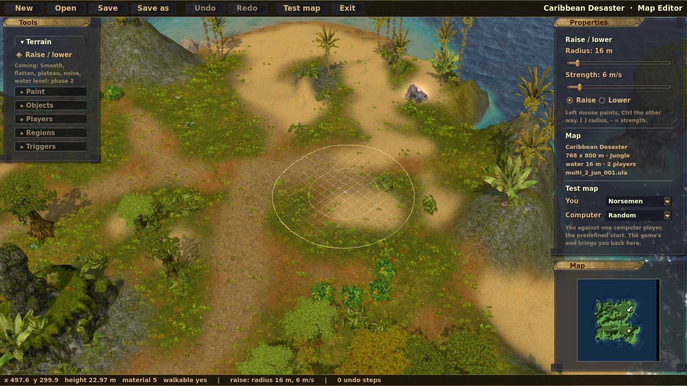
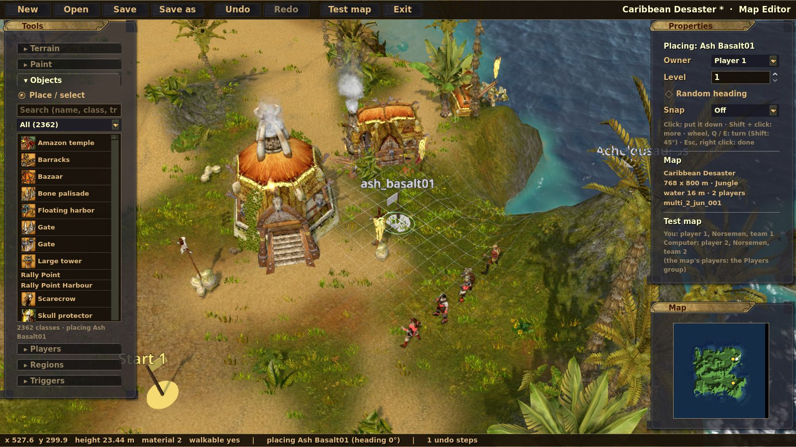
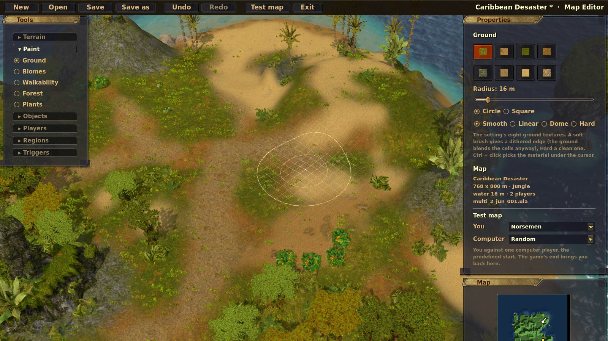
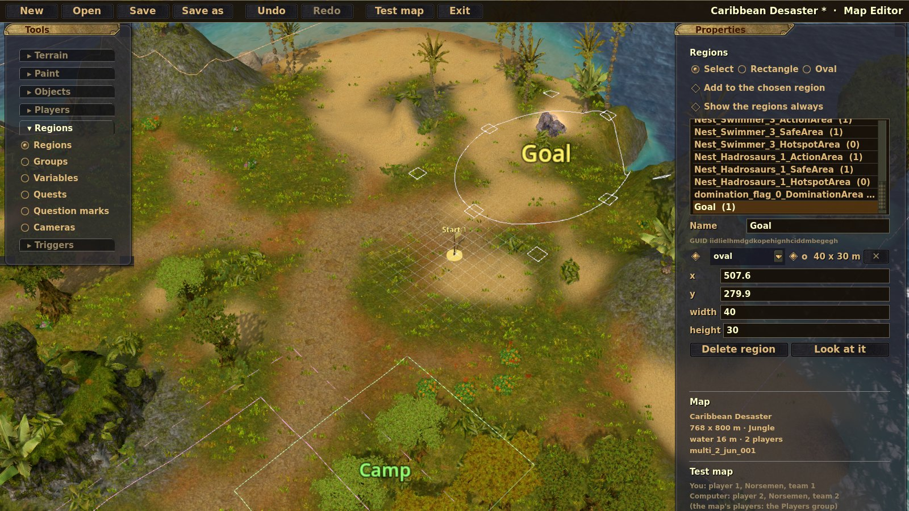
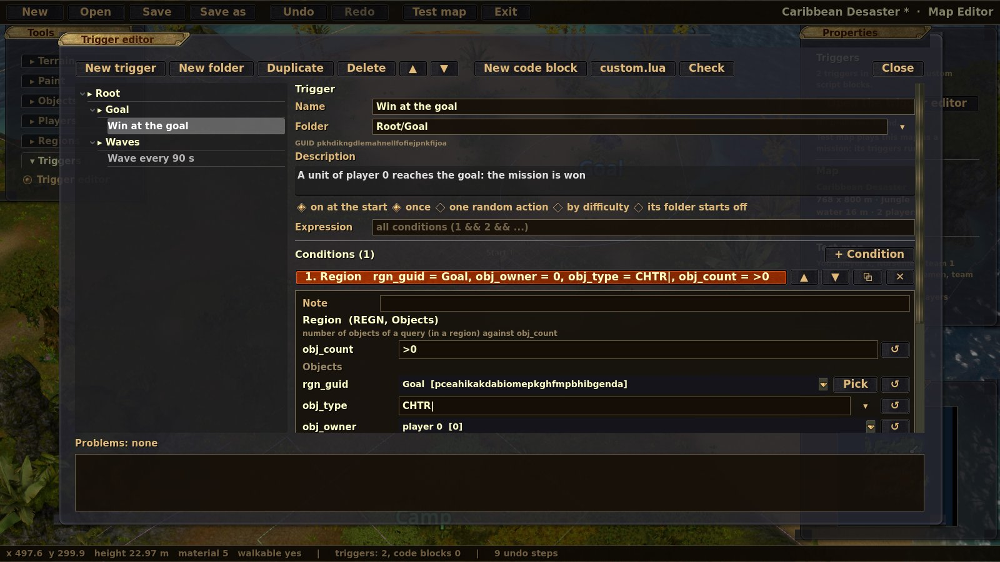
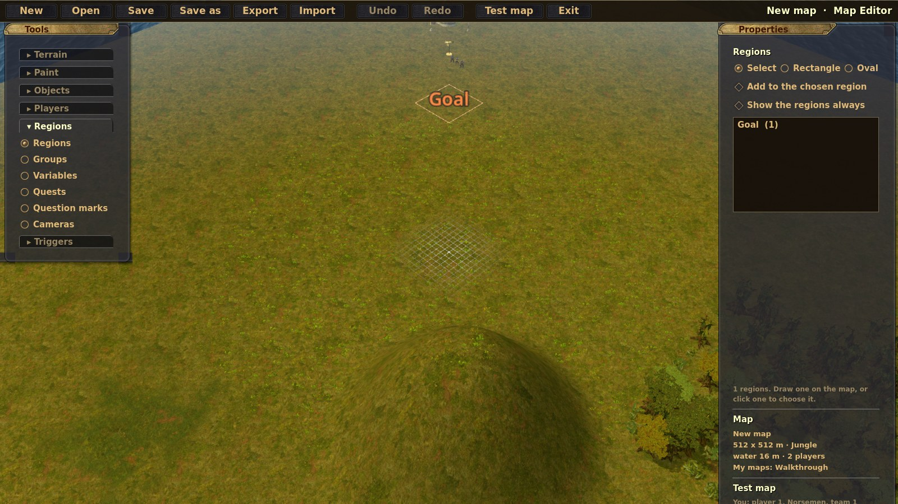
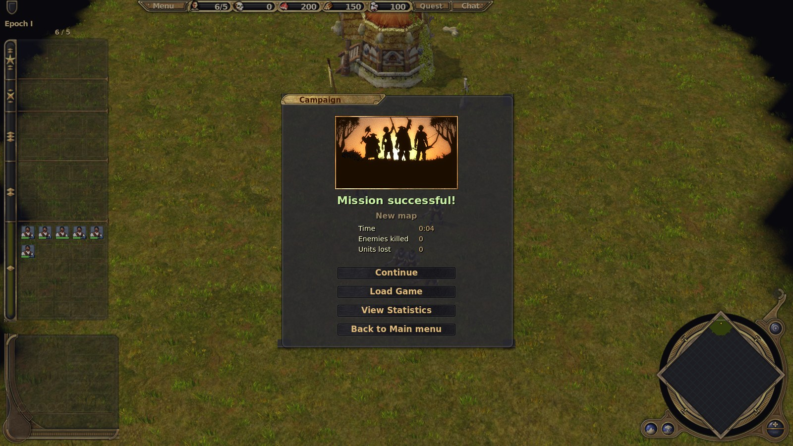
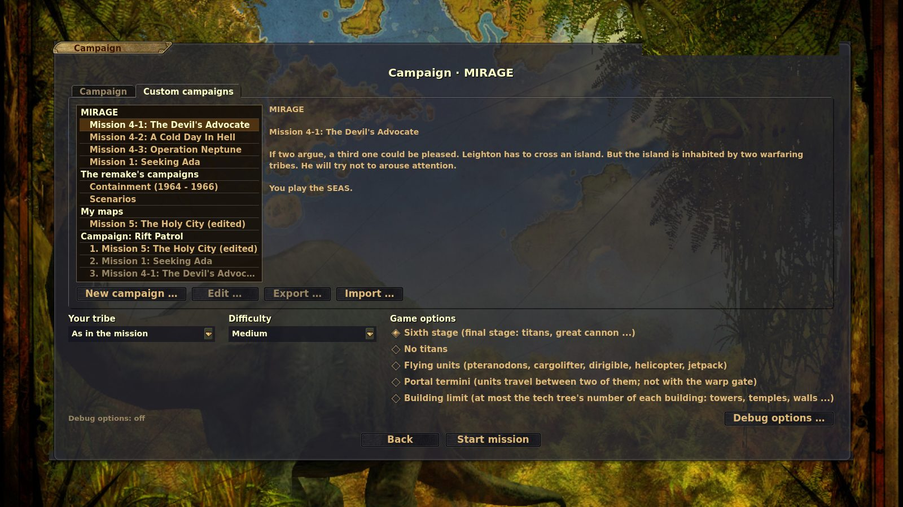

# Map editor

The remake's map editor lives **inside the game**: main menu → **Map Editor**. With it you make maps for the remake
(Warcraft 3 style): shape the terrain, paint the ground, plant forests, put down buildings, units, animals, resources and
decoration, set up the players, draw regions and write triggers - then **save** the map into your maps folder, **play**
it in a skirmish, in multiplayer or as a mission with its triggers, and **share** it as one `.pwmap` file. Every phase of
the plan (docs/MAP_EDITOR_PLAN.md) is done: the shell (camera, panels, undo / redo, new / open, Test map), the terrain
and paint tools, objects, players and map settings, regions and mission data, the trigger editor, and saving, packaging
and sharing.

Contents: [Opening it](#opening-it) · [Layout](#layout) · [Keys and mouse](#keys-and-mouse) ·
[Terrain and paint](#terrain-and-paint-phase-2) · [Objects](#objects-phase-3) ·
[Players and map settings](#players-and-map-settings-phase-4) · [Regions and mission data](#regions-and-mission-data-phase-5) ·
[Triggers](#triggers-phase-6) · [Saving and sharing](#saving-and-sharing-phase-7) · [Playing your map](#playing-your-map) ·
[Tutorial: a skirmish map](#tutorial-from-an-empty-map-to-a-skirmish-map) · [Tutorial: a mission](#tutorial-a-map-with-a-win-condition) ·
[How it is built](#how-it-is-built) · [Tests](#tests)





## Opening it

* Main menu → **Map Editor** (the configuration chosen on the title screen gives the rules, models and settings).
* Command line: `godot --path game -- --editor [--map multi_2_jun_001]` (docs/DEBUG.md; `--map User/<name>`: a map of
  My maps). Without `--map` the editor starts with a new flat 512 m jungle map.

The map stays in memory while the editor is away (Test map, the main menu): opening the editor again shows the same
map, camera and undo steps.

## Layout

| part | what |
|---|---|
| top bar | **New** (a flat map: name, size - the sizes of the original multiplayer maps -, setting - those the converted data has ground textures for -, ground height, water level or none, start locations), **Open** (My maps, the installation's multiplayer maps, all its maps, the campaign missions; Import .pwmap), **Save** / **Save as** (into My maps - "Saving and sharing"), **Export** / **Import** (`.pwmap`), **Undo**, **Redo**, **Test map**, **Exit**; the map's name, `*` when it has unsaved changes |
| left: Tools | the tool groups **Terrain, Paint, Objects, Players, Regions, Triggers**; an open group lists its tools (one chosen per group) - Terrain and Paint have theirs, Objects the palette of classes, Players the map's settings (below); Regions and Triggers say which phase brings them |
| right: Properties | the chosen tool's settings (the brush: radius, strength, circle / square, falloff; the tool's own), the map (name, size, setting, water, players, file), **Test map**'s players (from the Players group) |
| right: Map | the minimap: the ground shaded in the setting's colour, the water, the start locations, the camera; click or drag to look there |
| bottom | the status line: the cursor's **map coordinates** (x east, y south, metres - the original's), **height**, ground **material** (0 - 7 of the setting's eight), **walkable**; the tool; the undo steps |
| the map | drawn by the game's own view (terrain, water, forests, plants, grass, the map's objects); on the ground the cursor: the 2 m height grid around the mouse (the sample under it marked) and the brush's circle (inner circle: half the radius) |

Everything is in the game's look: PwTheme's buttons, fields, sliders and tabs, the original's window frames (PwWindow).

## Keys and mouse

| key / mouse | |
|---|---|
| W A S D, arrows, screen edge | pan (Shift: faster) |
| wheel, PageUp / PageDown | zoom (8 - 600 m: freer than the game's 25 - 150) |
| Q / E, right drag sideways, Alt + left drag | turn |
| R / F, right drag up / down | tilt (towards the horizon / straight down) |
| middle drag | pan |
| Home | the default view |
| left mouse | the chosen tool (below); **Ctrl** its other way (lower, erase, auto) or picks (Flatten / Plateau: the height, Ground: the material); one held stroke = one undo step |
| [ / ] , - / = | brush radius, strength (every brush tool shares the brush) |
| Objects: click, Ctrl + click, box | select (Ctrl: add / remove); a class of the palette chosen: click puts it down, **Shift** + click more of it |
| Objects: drag, Q / E, wheel | move the selection; turn the selection or the class being placed by 15° (Shift: 45°; the wheel only while placing - Ctrl + wheel zooms) |
| Objects: Delete, Ctrl+C / V / D, Ctrl+A | delete, copy / paste at the mouse / duplicate, select all |
| Objects: Esc, right click | stop placing; Esc again clears the selection |
| Ctrl+Z, Ctrl+Y / Ctrl+Shift+Z | undo, redo |
| Ctrl+N, Ctrl+O, Ctrl+S, Ctrl+Shift+S | new, open, save, save as |
| Ctrl+E | export the map as a `.pwmap` file |
| F5 | Test map |
| Esc | exit (asks when there are unsaved changes: Save first / Discard / Cancel) |

The camera keys do nothing while a text field has the focus.

## Terrain and paint (phase 2)



Every brush tool shares **one brush** (the raise / lower brush's settings: `EditorSession.Brush`): its **radius** (1 -
120 m), **strength**, **shape** (circle or square - a square's radius is half its side) and **falloff** (Smooth
(1 - t²)², Linear, Dome √(1 - t²), Hard: full strength to the edge). The cursor shows the brush's outline (the inner one
at half the radius), lowering / erasing in blue. A held stroke is one undo step; the view follows at once and only where
the edit was: the terrain chunks, the ground's texture weights, the biome blend, the grass, the water, the trees and
decoration (drawn anew from the edited map at most every 0.2 s during a stroke, at its end at once).

### Terrain

| tool | left mouse | settings |
|---|---|---|
| **Raise / lower** | raise (or lower, as set), Ctrl the other way: strength m/s at the centre × the falloff | brush, raise / lower |
| **Smooth** | each sample a share of the way to its neighbours' mean (3 × 3, 1-2-1) | brush; strength as a rate: 1 - e^(-strength / 4 × s) of the way (4: 63 % per second) |
| **Flatten** | towards the height under the cursor where the stroke began, or the typed one; Ctrl + click picks the height | brush, height source, height |
| **Plateau** | a flat top at the ground under the click + an offset (or the typed height) inside the radius, the sides at a slope (10 - 80°) until they meet the ground - up from lower ground, cut down into higher; drag stamps along the way; Ctrl + click picks the height. The cursor's second outline shows how far the sides reach | radius, circle / square, offset or height, slope |
| **Roughen** | value noise added (two octaves of `Noise.Fbm`, bumps of the set size): the same place always gets the same pattern, so brushing on makes it stronger | brush, bump size |
| **Ramp** | click the start, click the end: the ground between them a straight ramp from the start's height to the end's, the border blending into the ground; Ctrl + click forgets the start | width, border |
| **Level area** | drag a rectangle: every sample inside at one height (the corner's where the drag began, or the typed one) | height source, height |
| **Water** | a click sets the level to the ground's height there | water on / off, the level as a number and a slider (live: the water plane, its depth, the grass, the walk grid) |

Heights stay within 0 - 500 m. **What stands on the ground follows it**: a height edit moves the map's placed objects
and plants whose Z was at most 1 m above the ground (or lower: the plateaus and rocks sunk into it) with the ground,
their offset kept; ships, things on bridges or plateaus stay. The trees of the forest squares and the view's models of
the map's objects are placed on the new ground. An undo gives every Z back exactly.

### Paint

| tool | left mouse | settings |
|---|---|---|
| **Ground** | paints a ground material on the 4 m cells - the setting's eight textures as swatches (their role from biomes.json as the tip: land, rock, shore ...); a soft brush dithers the edge (a cell is painted where the brush's weight beats the cell's own hash - irregular like the original's borders; the ground blends the cells anyway), Hard paints a clean one; Ctrl + click picks the material under the cursor | swatches, brush (no strength) |
| **Biomes** | paints a biome (docs/BIOMES.md: `BiomeAuthoring.Paint`, a soft blob with a noisy edge, the strength per step). A map without a biome layer gets one (its setting everywhere); a biome the layer lacks is added - then the ground is drawn anew once (a second or two), else only the area | biome (every biome of biomes.json), radius, strength |
| **Walkability** | paints the 2 m walk cells **walkable**, **blocked** or **auto**; Ctrl: auto. The cells round the cursor are shown: blocked red (painted brighter), painted walkable green | the three, radius, circle / square |
| **Forest** | paints forest squares (32 m): their 15 trees and 16 undergrowth plants stand where the engine's layout for the square puts them (forest.json), as the original's forest blocks; Ctrl erases. The squares with forest near the cursor are outlined green, the one under it gold | plant / erase, radius, density (the share of items standing), the setting's five tree kinds (by their models), undergrowth |
| **Plants** | scatters landscape decoration (the map's IOMG plants: the setting's bushes, ferns, shrubs, flowers, reeds, grass tufts, small stones - the converted models of its plants and those the map uses); Ctrl erases | scatter / erase, brush, density (tries per 100 m² per second), spacing (no two closer), in the water too, erase only the chosen kinds, the kinds (a list, several) |

**Walkability**: every map has a walk grid now (an original map its editor's own - PaFi -, a new map one made by the
slope rule and the water, as the new format's `walk.png`). A cell is either painted (walkable / blocked) or **auto**:
the map's own value where the ground round it and its side of the water are as opened, else the game's slope rule (32°)
and the water. The game walks on the grid (Test map too); the grass leaves blocked cells bare.

**Forest squares**: painting sets a square's items standing (state 2, amounts 9 - 18 as the original maps); each tree
with the chance `density` if its kind is chosen, the undergrowth likewise. Erasing empties a square (the block stays,
empty, so an undo gives an original map's list back exactly). Nothing grows at or below 16 m, as in the original. The
tree models are the forest kinds of the map's setting (`ForestData.ForestKinds`); the world chops them as any tree.

The original LevelEd add-on (`Data/LevelEd`, its scripts and windows) is not in the installation staged here, so the
tools follow the plan and the remake's needs rather than its windows.

## Objects (phase 3)

The **Objects** group's tool **Place / select** (Tools/ObjectTool.cs on the tool framework).

**The palette** (Tools window) is built from the configuration's own data (`ObjectPalette.Build`), so a mod's classes
come with it: the tech tree's classes (StartTT Objects: the tribes' **buildings**, **units** - characters, vehicles,
ships -, **tribe animals**, the **wild animals** of the World tribe, the **nests**) and the scenery classes of the class
files (gamedata `script`): **resources** (trees CTree, stones CStone, fruit bushes CFruit_Food, fish CFishShoal),
**healing wells** (CFountain), **decoration** (CDecoObj, CDecoColObj, CDecoColAnimObj, CDecoBuilding, CHC_Wall, CVegetation,
CDecoChar, effects CFX - in groups by name: plants, water, rocks and cliffs, ruins and buildings, characters, effects,
other), **items** and item spawns, **markers** (start locations, domination flags). Scenery without a model in the data
is left out. A search field (every word of name, class or tribe) and the categories (All, **MIRAGE** - the classes a mod
adds, marked against the base configuration's class list -, and each category); each class with its HUD portrait icon
where the game has one (the card sheets' atlas), its name from the game's texts. Workshop-made units are tech tree
classes of the configuration and appear like the others. Lakes of healing / damage and question marks need regions
(phase 5).

**Placing**: a click in the palette - the class follows the mouse as a **ghost** (its model, a green ring); the wheel or
Q / E turn it; a click puts it down (Shift + click: more of it); Esc or a right click stop. Options in the properties:
the **owner** of new objects (Player 1 - 8 or nobody: the tribes' classes; scenery and wild animals are always nobody's),
the **level**, **random heading**, **snap** to a 1 - 16 m grid. A start location takes the first player slot without one.
Buildings are put down without touching the map's heights: **Test map** levels the ground under them as the game does,
on its snapshot.

**Editing**: click / Ctrl + click / a box select; dragging the selection moves it over the ground (units and buildings
stand on it, decoration keeps its height above it; one drag = one undo step); Q / E turn it (tilted plateaus and
cliffs turn about the up axis and keep their tilt); Delete; Ctrl+C, Ctrl+V (at the mouse), Ctrl+D (duplicate). The
properties panel: the **name** for the triggers (made unique; the class's name means none), **owner**, **level** (the
class's levels), **hit points %** (units and buildings: the remake's attribute `hp_percent`), **amount** (stones,
bushes, fish: the original's `hitpoints`), a nest's **species**, at most, rate and animals born before the start, an
item spawn's items, the **heading**; Duplicate, Copy, Delete.

**Drawn** with the game's own models (Tools/ObjectLayer.cs): the class's model of its level in the owner's colour, a
standing clip, trees with their leaves, buildings in their biome's setting textures, decoration with its stored
height and whole rotation (as MapSource); objects without a model (start locations, item spawns) as a post with a flag
in the player's colour and a label. The world view draws the map without its objects (`IEditorMapDoc.ToViewSource`),
so every object can be edited; terrain edits re-seat the objects standing on the ground and the layer follows.

**In the game** (Test map, and a saved map later) the objects are an original map's: MapSource makes the buildings and
units of the start slots (`owner` = the head quarters index), the wild animals, nests, resources, wells, items and
scenery. Two additions for the editor's objects: a **tribe animal** with an owner (riding dinosaurs ...: MapSource keeps
only the wild ones) joins the players' objects (`MapDataDoc.ToSource`), and `hp_percent` sets the hit points at the
start (SkirmishSession). In a **mission** (a campaign mission opened in the editor, or any map with triggers) every
object of the list comes alive too: the mission's own objects from world.lua (once - each is bound to its record by
its GUID), and an object you placed that no trigger or group names - a building, unit, vehicle, ship or owned animal,
which a mission's map does not place by itself - gets a world.lua record when Test map or a custom map write the
mission folder (`TestMission.Write`, `TestMission.DroppedInMission`).

## Players and map settings (phase 4)

The **Players** group (Tools/PlayerPanels.cs). Stored as the original keeps them, in the level settings tree
(`Root/PlayerSettings/Player_<n>`, `Root/Base`, `Root/WeatherData`; the remake's additions under `Root/Remake`), which
map.lua saves and MapSource reads:

* **Player slots 1 - 8** (Properties): a slot plays when the map has its **start location** (Place / Show; drag it on the
  map - in this group the object tool picks only start locations); the **tribes** it may play
  (`Restrictions/Base/Tribes`) and the one it **starts as** (`Tribes/Default`, or Random), **team** (`DefTeam`),
  **colour** (`DefColor` and the remake's palette id), **played by** a human / the computer / either (`DefPlayer`),
  **start resources** (`Restrictions/Resources`; all 0 = the tribe's own start, as on every original map),
  **population** limit, the **main building** at the start (`IncludeBuildings`), **diplomacy** towards each other slot
  (`Diplomacy` "12000000": hostile 0 / neutral 1 / friendly 2, for missions; "From the teams"); the game's defaults: the
  **army** (predefined or 1000 / 3000 / 10000 points), players choose their HQ, and with MIRAGE its **game options**
  (sixth epoch, no titans, flying units, portals, building limits).
* **Map settings** (Tools window): **name**, **author**, **description per language** (`Root/Remake/Texts/<lang>`;
  English also as the original's `Description`), **game types** (Deathmatch, Domination, Defender), last man standing,
  **time of day**, **weather** (snow / rain, intensity, wind direction and strength: one looping track), the
  **atmosphere** (ambience and music: `material_atmos`), **day and night** (the remake's real day-night cycle, map.lua
  `day_night`: on / off, the lengths of day, dusk, night and dawn, the first day's, the sight at night - docs/MAP_FORMAT.md;
  Test map plays it, the trigger editor has the condition *DayPhase* under Time), the **camera's angle** at the start, the **preview**
  (`MapPreviewMaker`: 200 x 200, the ground shaded by its slopes in the setting's and materials' colours, the water,
  the start locations). The number of players is the number of start locations.
* **Test map** plays these players (`PlayersSetup.Make`): one setup slot per slot with a start location, on its own
  start location; you play the first slot a human may play, the computer the others; their tribes (Random: one the slot
  allows), teams, colours, the army budget, MIRAGE's options and the first game type. The slot's start resources and
  population limit apply (SkirmishSession: a slot's map resources replace the tribe's when any is set).

## Regions and mission data (phase 5)



The **Regions** group (Tools/RegionTools.cs). What a map's triggers work with - world.lua's data (docs/LUA_MAPS.md §1),
drawn on the map while the Regions or Triggers group is open (RegionLayer: outlines on the ground, the names over them):

* **Regions**: *Rectangle* / *Oval* - drag on the map to draw a region (a free name `Region_n`, a GUID of its own);
  "Add to the chosen region" makes the drawing another **shape** of the chosen one (a region is the union of its
  shapes). *Select* - click a region to choose it (the smallest shape under the mouse), drag it to move the shape
  (**Shift**: the whole region), drag one of the chosen shape's eight **handles** to resize it; **Delete** removes the
  chosen shape (the last one: the region). The panel: the list (a click looks there), the **name** (rename), each
  shape's form (rectangle / oval), **on at the start** (off = dashed: `ActivateRegion` switches it on), its box in
  metres, delete, "Look at it". The triggers name a region by its GUID, so a rename breaks nothing. The map's regions
  (regions.lua: the nests' areas, the lakes) are the same list.
* **Groups**: named sets of placed objects. Choose a group (or *New group*), then click objects on the map to put them
  in or take them out (ringed on the map); *Add the selection* takes the object tool's selection. An object a group or
  a trigger names gets a GUID of its own (the attribute `guid`, world.lua's id: `MissionEdits.EnsureGuid`).
* **Variables**: name and value at the start (world.lua `variables`); a rename renames it in the triggers (`Var`,
  `SetVar`, `$(name)` in texts).
* **Quests**: name (the id `quest_name` names), headline, description, group title (the quest book's texts; written to
  `texts/<lang>.lua` under the quest's keys `_<name>_Headline` ... too), main / optional, **hidden at the start** (a
  `Quest` action shows it), accomplished / failed at the start, bonus points per difficulty.
* **Question marks**: click on the map - the chosen one goes there, none chosen: a new one; its state at the start.
* **Cameras**: *Add this view* (a camera point where the editor's camera looks: world.lua `cameras`, offered as
  positions in the trigger forms), *Look from it*; the **start camera**: *From this view* (map_info `start_camera` +
  `default_camera`: the mission's camera starts there - MissionSession) or *Angle only* (at the human's start location).

Every change is one undo step (a drag too). A **mission's objects**: world.lua has its own list (the GUIDs its triggers
use); the editor shows one list - each of world.lua's objects is the map object of its name with the GUID in the
attribute `guid` (one the map lacks is added, marked `mission_only`), and writing puts them back: moved, renamed,
re-owned or deleted objects change their world.lua record, objects given a GUID join world.lua, objects.lua is written
without the editor's attributes and the mission-only objects (`MissionDoc.BindObjects`, `ObjectsJson`,
`MapFileObjects`).

## Triggers (phase 6)



The **Triggers** group → *Open the trigger editor* (Tools/TriggerEditor.cs). It reads and writes the declarative part of
**triggers.lua** (docs/LUA_MAPS.md §2) - `TriggerScript.Parse` / `Write` - and never touches custom.lua except through
its own text box.

* **The tree** (left): the folders (paths like `Root/Waves`) with their triggers in the file's order (the engine's
  order), red when a trigger has an error, grey when it is off at the start; **custom script** blocks `{ }`. *New
  trigger* (in the chosen folder: on, once, a new GUID), *New folder*, *Duplicate*, *Delete*, ▲ ▼ (the order), *New code
  block*. A folder chosen: its triggers' count, *Rename* (every trigger in it moves).
* **A trigger** (right): name (SetTrigger by name follows a rename), folder, description (comment lines in the file),
  **on at the start**, **once**, **one random action**, **by difficulty**, **its folder starts off**, the **expression**
  (`1 && (2 || !3)`, empty = all conditions). Its **conditions** and **actions** as lists - a line each with the
  parameters, references by their names (`rgn_guid = Goal`) - ▲ ▼ copy delete; **+ Condition** / **+ Action** open the
  **catalogue**: every type the engine runs (24 conditions, 50 actions with MIRAGE's and Lua's), by category (Time,
  Objects, Groups, Players, Variables and quests, Scenes, Tutorial, Lua / Triggers and the mission, Quests and
  interface, Scenes and effects, Objects, Groups, Variables, Players, Regions, Computer players, Lua) with a search over
  name, code and description; double-click adds it.
* **The node's form** (a click on a line): the type, what it does, then one row per parameter of the type - its
  original level editor's list and defaults (`TriggerCatalog`, from `*_attrib_def.txt`): a field left out is the
  default (shown grey; ↺ goes back to it). By kind: texts and numbers, **choices** (with their meaning: the quest states,
  the gaits, the AI behaviours, ObjDo's actions ...), **players**, **references**: a **region** (the list, or **Pick**:
  click inside it on the map), an **object** (**Pick**: click it - it gets a GUID - or a group), a **position** (Pick: the
  ground point; waypoints add up), a **variable**, **quest**, **trigger**, **folder**, **sequence**, **dialogue**, **text
  key** (▾ lists the map's; the text itself in the map's language is edited under it and written to
  `texts/<lang>.lua`), classes (the object palette's). The query blocks' filters and second queries (`B_`, `dst_` ...)
  come with "More parameters". A note line (the comment before the node). A parameter written as a Lua expression stays
  one (edited as Lua).
* **Script / Check / anything else** in a list (and custom script blocks) are shown as **code** in a box with Lua
  colours; *Apply* checks the Lua syntax first.
* **custom.lua**: its text in a code box; *Check* (syntax), *Keep* (a syntax error must be confirmed).
* **Problems** (bottom): the editor's one check (`TriggerValidation.CheckAll`) - the same for this list (after every
  change and with *Check*), the Triggers group's panel and Test map: it **loads the whole file as the game does**
  (triggers.lua + custom.lua through the game's Lua loader with its standard library; a text is loaded once, then
  remembered) besides: unknown types, a condition in the action
  list, expressions that do not compile or name a condition that is not there, Lua syntax errors, references to
  regions, objects, groups, variables, quests, triggers, folders, texts, sequences, dialogues and question marks the map
  lacks, two triggers with one GUID or name. A click goes to the trigger and the node. (The original missions have no
  errors; their warnings are the original's own: references to things deleted from the maps.)

**What the file keeps.** Every converted original mission's triggers.lua read and written again is the same file, byte
for byte (48 missions, 8321 triggers): the layout is the converter's (folder separators, one node per line up to 150
characters, the descriptions and the original's node names as comments, the reference notes after a node). A
statement the editor cannot express as a trigger - a `local`, a function, a loop that makes triggers, a trigger with a
computed field - is a **custom script** block, kept in its place; so is a list entry that is not a plain constructor.

**Test map with triggers.** Before it starts, Test map runs the trigger editor's check (the file loaded as the game
loads it): with errors it asks first (*Play anyway* / Cancel - a mission whose triggers do not load would run without
them). A map whose triggers.lua or custom.lua has anything is played as a **mission**: Test map
writes the snapshot as a mission folder (temporary; `TestMission.Write`: map.lua with a mission table, world.lua,
triggers.lua, custom.lua, texts) and starts it (GameMode.Campaign, the folder) - the trigger engine runs (skirmishes have
none). A campaign mission keeps its own players (and the objects you placed into it come alive: "Objects"); a plain map gets a mission table from its player slots (the first a
human may play is yours, the others computer players - awake, Dodo -, tribes, teams, diplomacy, start resources, main
building and the tribe's start units). The end screen and the pause menu come back to the editor; Retry plays the same
folder again.

### Tutorial: a map with a win condition

1. **Map Editor** → **New** (a 512 m jungle, 2 players). Shape it if you like (Terrain, Paint), put a few things down
   (Objects).
2. **Regions** group → *Regions*, choose **Oval**, drag an oval somewhere away from your start location. It is
   `Region_1`; rename it **Goal** in the panel.
3. **Regions** → *Quests* → **New quest**; name it `ReachGoal`, headline "Reach the goal", untick nothing (hidden at the
   start is fine).
4. **Triggers** group → **Open the trigger editor** → **New trigger**, name it "Win at the goal".
5. **+ Condition** → search `region` → **Region**. In its form: `rgn_guid` → **Pick** → click inside the oval;
   `obj_owner` → player 0; `obj_type` ▾ → `CHTR|`; `obj_count` → `>0`.
6. **+ Action** → **Quest**: `quest_guid` → ReachGoal, `dest_state` → accomplished. **+ Action** → **Win**.
7. A second trigger to show the quest: **New trigger** "Show the quest", **+ Condition** → **True** (fires at once),
   **+ Action** → **Quest** (`ReachGoal`, show).
8. The problems list: "Problems: none (the file loads)". **Test map** (F5): the mission starts with your quest in the book; walk a
   unit into the oval - the mission is won and the end screen brings you back to the editor.
9. **Save** (Ctrl+S) - a name, the map goes into My maps. Main menu → **Campaign** → tab **Custom campaigns**: your
   map is listed under *My maps* (it has triggers) → **Start mission**: it plays as a mission with the campaign menu's
   tribe and difficulty. **Export** sends it to friends as one `.pwmap` (they **Import** it, then it is in their list
   too); **New campaign …** puts it into a campaign of your own (below, "Edited missions and custom campaigns").

`--editor-walkthrough` plays this tutorial in the real game by itself (docs/DEBUG.md): a new map, a hill, painted ground,
a forest, a base for each of two players, the region and the trigger, Save, Open, Test map - a worker walks into the
region and the mission is won (the two pictures above).

The same as Lua (what the editor writes into triggers.lua):

```lua
trigger "Win at the goal" {
  guid = "...", folder = "Root",
  enabled = true, once = true,
  conditions = { Region{ rgn_guid = "<Goal's GUID>", obj_owner = 0, obj_type = "CHTR|", obj_count = ">0" } },
  actions = { Quest{ quest_guid = "<ReachGoal's GUID>", dest_state = 1 }, Win{} },
}
```

## Saving and sharing (phase 7)



The editor writes the remake's own map format (docs/MAP_FORMAT.md): a folder of `map.lua`, `terrain/*.png` and Lua
files - readable and editable with ordinary tools - or the same files zipped as one `<name>.pwmap`.

**My maps** is your maps folder, in the game's user folder:

| system | My maps |
|---|---|
| Windows | `%APPDATA%\Godot\app_userdata\ParaWorld Remake\maps\` |
| Linux | `~/.local/share/godot/app_userdata/ParaWorld Remake/maps/` |

(`PW_USER_MAPS` overrides it.) Every map folder or `.pwmap` file in it is listed by the skirmish and multiplayer setup
under **My maps** and by the editor's Open (a map that needs another configuration - map.lua `requires`, below - is
left out of the lists, greyed in Open). Maps received from a multiplayer host are in its `downloaded/` folder. A map there is named in setups, saved games and lobbies by its id
`User/<folder or file name>` (`User/Island`, `User/Island.pwmap`) - the same on every machine.

* **Save** (Ctrl+S) writes the map where it lives in My maps. A new map, a map of the installation
  (`content/configs/<config>/maps`) or a campaign mission has no place there yet: Save asks a **name** (Save as) and
  writes a **copy** into My maps - the installation's maps and missions are never written. A name that is taken asks
  before it is replaced.
* **Save as** (Ctrl+Shift+S): always asks a name (a new folder in My maps). From then on the map is that folder.
* **Open** (Ctrl+O): *Show* My maps, the multiplayer maps (the skirmish list), all maps of the installation (the
  campaign's too) or the campaign missions (their folders: terrain, objects, world, triggers, texts); **Import .pwmap …**.
* **Export** (Ctrl+E): the map as one `.pwmap` file anywhere (the system's file dialog) - to send to other players.
  The map in the editor stays where it is. A map that uses classes the official game does not have (a mod's - MIRAGE -
  or the Workshop's) is exported with a note: players need the same configuration.
* **Which configuration a map needs** (`requires` in map.lua): one My maps folder serves the official game and MIRAGE,
  so Save and Export decide it (`MapRequirement.Decide`; EditorSession.StampRequirement): made in MIRAGE's editor, a map
  that places a class the official game does not have (a placed object or a mission's world object), whose triggers
  name such a class (a spawn's `classes_0` ...), that turns on one of MIRAGE's game options (no titans, flying units,
  portals, building limits) or has a player slot that plays only MIRAGE's tribes (SEAS) gets `requires = "MIRAGE"`; any
  other map - and every map made in the official game's editor - needs nothing. The official game's skirmish and
  multiplayer lists and its campaign menu's My maps leave a MIRAGE map out (`MapFiles.RequirementProblem`); its editor's Open
  shows it **greyed** with the reason ("needs MIRAGE (this is the official game)") and does not open it.
* **Import**: a `.pwmap` file is copied into My maps (`name.pwmap`, `name (2).pwmap` ... when the name is taken; a damaged
  file is refused before it is copied) and opened. Copying a `.pwmap` into the My maps folder by hand does the same.
* A **.pwmap opened** is saved back into that file (Save); Save as makes a folder of it.
* **Unsaved changes**: New, Open, Import and Exit ask first - **Save first** (where the map has a place, else Save as),
  **Discard changes**, **Cancel**; quitting the game (the title screen's Quit, the game's Exit, closing the window) asks
  too while the editor's map has unsaved changes - **Save and quit** (a map of My maps), **Back to the editor** (to
  Save as), **Quit without saving**, **Cancel**. The map stays in memory while you play Test map or visit the menus.

**What is saved**: everything the editor shows - heights, ground materials, the walk grid with your painted cells
(`walk.png`: 255 walkable, 0 blocked, **192 painted walkable, 64 painted blocked** - the game reads "128 and up =
walkable", the editor reads them back as painted), the biome layer, forest squares, plants, objects (with the editor's
names and attributes), players and settings (the level settings tree in `map.lua`), regions, groups, variables, quests,
question marks, cameras, the start camera, triggers (`triggers.lua`), `custom.lua`, the texts per language, and the
other files of the folder (Lua modules your `custom.lua` loads). The saved map opened again is the same document
exactly (tests: every kind of map). Heights the brushes make are stored on the file's 16-bit steps (1/128 m, or finer
when the map's range is small), positions as 32-bit floats - the editor takes those values at once when it saves, so
nothing moves when you open the map again. **An unchanged campaign mission saves byte for byte** as Prepare converted
it (every file; map.lua without its `source` line - a saved map is the user's own): regions.lua keeps the original's
32-bit floats of every region shape you did not change (world.lua's copy is rounded to millimetres - the editor
writes a moved or resized shape from its new box; `EdShape.MapBox`), and the converter writes its JSON numbers as the
reader writes them (`16.0` -> `16`; converter version 2).

**Workshop and mod units.** A `.pwmap` carries the map, not the units: a map that places classes of a mod (MIRAGE) or
of a Workshop mod (toolkit docs/WORKSHOP.md) needs that configuration on every machine that plays it - the units are not
bundled into the `.pwmap` (a Workshop mod is a configuration of its own: tech tree, models, texts; bundling it would
mean installing a configuration from a map file). Export says which classes are not the official game's.

## Playing your map



| how | what plays |
|---|---|
| **Test map** (F5) in the editor | the map as it is now, from memory - no saving needed. Without triggers: a skirmish (the map's players: you on the first slot a human may play, the computer the others). With triggers (triggers.lua or custom.lua has something): a mission with its triggers running (no loading screen wait). Its end screen and the pause menu come back to the editor; Retry plays it again. |
| **Skirmish** setup | every map of My maps (group **My maps**, after the installation's and the remake's maps): the usual skirmish - players, tribes, teams, game types, army. The triggers do not run in a skirmish. |
| **Multiplayer** (PvP lobby) | the same list. The host's map is identified by a hash of all its files: a player who lacks the map, or has another version of it, **gets it from the host** over the lobby's connection (Warcraft 3 style, up to 32 MB: "is receiving the map …: 45 %" at the player's name; the host cannot start before everybody has it); it is kept in the player's My maps `downloaded/<hash>.pwmap` (docs/MULTIPLAYER.md "Maps"). |
| **Campaign → Custom campaigns** (group *My maps*) | your maps **with triggers**, played as missions: the map is prepared once as a mission folder (in the user folder's `cache/custom-maps/`, by name and content: a changed map is prepared again), you play the first player slot a human may play, the computer the others (awake), or the map's own players when it has a mission table; the campaign menu's tribe, difficulty, game options and debug options. The end screen comes back to the Custom campaigns tab, Retry plays it again, saved games of it load while the prepared folder is there. Command line: `--custom-map <name>` (a map of My maps). A map of another configuration (map.lua `requires`) is left out. |

Why a map with triggers is a *mission* and not a skirmish with triggers: only a mission has the trigger engine, quests,
dialogues and the mission UI (MissionSession); a skirmish has the skirmish's end conditions. Custom maps use the same
path as Test map (`TestMission.Write`), so what you test is what is played.

### Edited missions and custom campaigns



**Editing a campaign mission**: Open → *Campaign missions* → change it → **Save** asks a name and writes a **copy** into
My maps (the installation's mission is never written). The campaign tab still plays the original; the copy is listed
under Campaign → **Custom campaigns** → *My maps* with the original's title and **(edited)** ("Mission 5: The Holy City
(edited)") - it is recognised by the mission table the copy keeps (map.lua `mission`: its key and the original's
`.ula` map; `MyMapInfo.Edited`, the original from the configuration's index). It plays as a custom map (above): your
copy's terrain, objects and triggers; the army budget screen of the original is not shown.

**Custom campaigns** (docs/CAMPAIGN.md "Custom campaigns"): on that tab, **New campaign …** - a name, an author, a
description, then pick missions and maps on the left (the configuration's missions: the original campaign, the Booster
Pack, MIRAGE's; your maps with triggers, edited copies too) and **Add →** them in playing order (**Up**, **Down**,
**← Remove**); **Save**. The campaign is a folder `campaigns/<name>/campaign.lua` in the user folder (data only, like
map.lua). Its missions are played in order, each opens when the one before is won. **Edit …** changes it (**Delete …**
removes it), **Export …** writes one `.pwcampaign` file (campaign.lua and every map of My maps it plays as
`maps/<name>.pwmap`), **Import …** adds such a file to your campaigns (its maps stay in the campaign's own folder).

## Tutorial: from an empty map to a skirmish map

1. Main menu → **Map Editor** → **New**: name *Twin Hills*, 512 x 512 m, Savanna, ground 20 m, water 16 m, 2 start
   locations → **Create**.
2. **Terrain** → *Raise / lower*: radius 40 (`]`), drag over the middle of the map for a hill; *Smooth* its top; *Ramp*
   for a way up. *Water*: click a low place to set the level there, or untick it for a dry map.
3. **Paint** → *Ground*: paint rock (a swatch) on the hill's slopes, grass round the bases; *Forest*: drag along the
   map's edges (32 m squares of trees, Ctrl erases); *Plants*: scatter bushes and stones; *Walkability*: paint a cliff's
   edge **blocked** where units should not climb.
4. **Players** → slot 1 and 2: **Place / Show** the start locations (drag them on the map), the tribes they may play,
   teams 1 and 2, start resources (all 0: the tribe's own), *Main building at the start* on. **Map settings**: author,
   description, game types Deathmatch and Domination, time of day, weather, **Make the preview**.
5. **Objects**: from the palette's *Resources* a few stone quarries and fruit bushes near each start, *Wild animals* in
   the middle, a *Healing well* on the hill; *Markers* → domination flags for Domination.
6. **F5** (Test map): a skirmish starts on the map as it is; quit (pause menu) to come back.
7. **Save** (Ctrl+S): name *Twin Hills* → My maps. Main menu → **Skirmish**: *My maps* → *Twin Hills*; **Multiplayer**:
   host it - the players who lack it get it from you in the lobby.

## How it is built

```
src/Sim/Editor/IEditorMapDoc.cs   the document the editor edits (no file format in it): heights, water, materials,
                                  walkability, Clone, ToSource (the map source the game builds its world from), Save
src/Sim/Editor/EditHistory.cs     IEditCommand (Do / Undo / TryMerge) and the history: undo, redo, merging a stroke, dirty
src/Sim/Editor/HeightBrush.cs     the raise / lower brush's maths and its command (HeightEdit)
src/Sim/Editor/MapDataDoc.cs      the document: a map of the format (or a new flat one) as MapData in memory; NewMapSpec; Save
src/Sim/Editor/Terrain/           phase 2: BrushShape (circle / square, falloff, the cells' hash), HeightTools (smooth,
                                  flatten, plateau, roughen, ramp, level), PaintTools (materials, walkability, biomes,
                                  water + their commands), VegetationTools (forest squares, plants + commands),
                                  MapDataDoc.Terrain.cs (the document's terrain part: walk overrides, seating)
src/Sim/Editor/EditorPlaytest.cs  Test map's snapshot under a key ("editor:<n>") the skirmish setup carries
src/Sim/Editor/GroundPick.cs      the ground point under the mouse (a ray over the height field)
game/src/Editor/MapEditor.cs      the editor screen: view, camera, cursor, the tools' mouse, commands, test runs (+ MapEditor.Ui.cs:
                                  panels; MapEditor.Terrain.cs: the view following terrain edits, the tools' self-test)
game/src/Editor/Tools/            EditorTool (a palette tool: Begin / Step / End, settings, cursor, status; EditorTools: the
                                  registry, one chosen per group), ToolUi (the settings' controls), TerrainTools.cs,
                                  PaintToolSet.cs; phases 3 / 4: ObjectTool.cs (the object and player tools, ObjectToolState,
                                  place / select / drag / turn / copy, the self-test), ObjectLayer.cs (the objects drawn,
                                  picked, rings, ghost), ObjectPanels.cs (palette, object properties), PlayerPanels.cs
src/Sim/Editor/Objects/           ObjectPalette (the classes of the data), ObjectEdits (ObjectsEdit, ObjectsAddRemove,
                                  ObjectOps: create, turn, move, snap, names; ObjectClipboard)
src/Sim/Editor/Players/           MapPlayers (MapPlayerSettings / MapPlayerSlot <-> the level settings), MapSettings,
                                  LevelSettings (the settings tree and its flat keys written together), MapPreviewMaker,
                                  PlayersEdit / SettingsEdit, PlayersSetup (Test map's skirmish setup)
game/src/View/World/WorldView.Edit.cs   RefreshVegetation: the trees and decoration of an area drawn anew
                                  (+ FoliageField.Edit.cs, WaterSurface.Edit.cs SetLevel, GrassLayer.Edit.cs WaterLevel)
game/src/Editor/EditorSession.cs  what outlives the screen: document, history, camera, tool settings, cached rules / models
game/src/Editor/EditorCamera.cs   the editor camera and its keys
game/src/Editor/EditorCursor.cs   the grid and brush circle on the ground
game/src/Editor/EditorMinimap.cs  the minimap
game/src/Editor/EditorDialogs.cs  New map, Open map, unsaved changes, messages
src/Sim/Editor/Regions/           phase 5: MissionDoc (regions, groups, variables, quests, question marks, cameras, the
                                  start camera, triggers, custom.lua, texts; world.lua / map.lua's mission read and
                                  written; world.lua's objects in the one object list), MissionEdits (ListEdit,
                                  ValueEdit, CompositeEdit, renames that follow into the triggers, EnsureGuid),
                                  MapDataDoc.Mission.cs (the document's mission part, ToMap)
src/Sim/Editor/Triggers/          phase 6: LuaLexer, TriggerScript (triggers.lua's model, reader, writer), TriggerCatalog
                                  (+ .Data.cs generated by tools/editor/gen_trigger_catalog.py from the original's
                                  *_attrib_def.txt), TriggerValidation, TestMission (Test map's mission folder)
game/src/Editor/Tools/            phases 5 / 6: RegionTools.cs (the Regions group's tools and panels, MissionToolSet),
                                  RegionLayer.cs (regions, question marks, cameras, group members drawn on the map),
                                  TriggerEditor.cs (the trigger tool, the trigger editor window, the catalogue, the
                                  forms, picking, custom.lua, Test map as a mission, the demo and the self-test)
game/src/App/GameSession.Editor.cs  Test map in the game session (the map from the snapshot; its end back to the editor);
                                  custom maps' ends (back to the campaign menu's Custom campaigns, Retry; a user
                                  campaign's next mission)
phase 7:
src/Sim/Editor/MapDataDoc.cs      Open (MapFiles.ReadDocument), Save (PwMapWriter folder / .pwmap) + Canonical; ToMap
                                  (Regions/MapDataDoc.Mission.cs) with the walk grid's painted cells (WalkGrid.Paint)
src/Sim/Maps/MapFiles.cs          the user's maps folder (UserDir, UserMaps, ids "User/<name>", IsUserPath), ContentHash
src/Sim/Game/SkirmishMaps.cs      the skirmish list's group "My maps"
src/Sim/Editor/Triggers/CustomMission.cs   custom maps: a user's map with triggers prepared as a mission (cache folder)
src/Sim/Editor/Triggers/TestMission.cs     + Clean / CleanStale (Test map's folders removed when leaving the editor and at
                                  the start); every placed object of a plain map in the mission's world
src/Net/Lobby.cs                  LobbyMap (the map's hash in the lobby; a player's problem), protocol 6
src/Net/MapTransfer.cs            the map sent to a player who lacks it (Pack, PackFor, Store), LobbyMapSync (a player's
                                  check / request); NetHost.MapFile, NetClient.RequestMap
src/Sim/Editor/MapRequirement.cs  map.lua's requires (the configuration a map needs): Decide, Reasons; MapFiles.RequirementProblem
game/src/Editor/EditorDialogs.cs  Open (sources), Save as, Confirm, the .pwmap file pickers, Unsaved (Save first), EditorQuit
game/src/Editor/MapEditor.cs      Save / Save as / Export / Import; MapEditor.Walkthrough.cs: --editor-walkthrough
game/src/UI/CustomCampaignsTab.cs Campaign → Custom campaigns (My maps, edited copies; CustomPlay: a map played as a
                                  mission); game/src/App/Boot.cs RequestQuit (the quit question)
```

The editor never touches a file format: tools make **commands** on an `IEditorMapDoc`; the document raises
`Changed` (kind + the height samples the change covers: Heights, Materials, Walk, Biomes, Forest, Plants; Water; All =
drawn anew) and the screen refreshes what changed. A tool (`EditorTool`) gets the left mouse over the map - `Begin` on
the press, `Step` every frame while held, `End` on the release (the screen then ends the stroke's undo merge) - and a
`ToolContext` (document, history, map source, view, Ctrl / Shift, `Run(command)`); a phase registers its tools in
`EditorTools.All`. The view is the game's own (`WorldView`
on the document's `MapSource`, which reads the document's height samples), so what the editor shows is what the game
draws. Test map registers `doc.Clone()` with `EditorPlaytest` and starts a skirmish whose map is the key;
`SkirmishSession.Create` takes the map source made from it (`map:` parameter).

### The document and the map format

`MapDataDoc` (src/Sim/Editor) is the editor's document: a map read in the remake's format (`MapFiles.ReadDocument`:
a folder or a `.pwmap`; an original `.ula` or a remake recipe converted in memory) held as `MapData` - the shape the
game builds its map source from - plus what only the file has (map.lua's title / description / author, the heights'
range, other files of the folder). `ToMap()` gives the whole map as a `PwMap` (`PwMap.FromMapData` + the mission data:
`MissionDoc.ApplyTo` + the walk grid's painted cells as `WalkGrid.Paint`); `Save(path)` writes it with `PwMapWriter`
(`WriteFolder`, or `WriteZip` for a path ending in `.pwmap`), reads it back and takes the values as the file holds them
(`Canonical`: heights on the file's 16-bit steps, positions and rotations as 32-bit floats, the level settings flattened
as the reader does, world.lua bound again) - so the saved map opened again is the same document exactly
(`EditorSaveTests`). Undo steps stay valid across a save.

## Tests

* `tests/PwRemake.Tests/EditorTriggersTests.cs` (`dotnet run EditorTriggers`, `EditorRegions`): triggers.lua of every
  converted mission (48: base and MIRAGE) read and written again - the same bytes, the same triggers for the engine
  (every name, GUID, folder, flag, expression, node, difficulty, parameter), stable; world.lua read and written again
  the same data on all 48 (and with the one object list: a move, a deletion, a new GUID follow; objects.lua as read), no
  errors of the checks on any of them; the catalogue against the engine (every type; every parameter Conditions.cs /
  Actions.cs read; every parameter the missions use; the defaults = the missions' trigger_defaults: 17352); code blocks
  and Script / Check / expression parameters kept; the checks finding what they should; region, group, variable, quest,
  camera edits with undo / redo and renames following into the triggers; and a map made in code - a flat map, a region
  "Goal", a trigger "a unit of player 0 enters it -> Win" - written as Test map writes it and played headless as a
  mission: not won after 3 s, won once a unit stands in the region.

* `tests/PwRemake.Tests/EditorSaveTests.cs` (`dotnet run EditorSave`): every kind of map - a new map with an edit of
  every tool (a hill off the 1/128 m steps, materials, painted walk cells of both kinds, a biome, forest, plants, objects
  with editor names, players, settings in two languages, a region, a quest, a variable, a trigger, an object with a GUID),
  an original multiplayer map, the remake's map with its biome layer, eight campaign missions of both configurations, an
  original `.ula` - opened, saved as a folder, opened again: the same document (every part: heights bit for bit,
  materials, walk grid and paint, biomes, forest, plants, objects, regions, players, settings, the level settings,
  regions / groups / variables / quests / question marks / cameras, triggers, custom.lua, texts, the mission table,
  world.lua); saved again: the same bytes; as a `.pwmap`: the same document; folder and `.pwmap`: the same content hash.
  walk.png's 64 / 192 read by the game (>= 128) and by the editor (overrides). My maps: ids `User/...`, the skirmish
  list's group, `MapFiles.Find`, a skirmish played on a user `.pwmap`. Multiplayer: the hash in the lobby, a player's
  missing / other copy a problem that refuses the start, cleared by the same copy and by another map. Custom maps (the campaign menu's My maps):
  listed (only maps with triggers), prepared once, three workers of one name three units, the trigger wins.
* `tests/PwRemake.Tests/EditorPolishTests.cs` (`dotnet run EditorPolish`): mission 11 with a fireplace and a warrior of
  the human placed in the editor (no GUID): both alive in Test map's mission and as a custom map, the mission's
  objects once (units and buildings +1 each, world.lua +2, every GUID once); `requires` decided (a MIRAGE building, a
  trigger spawning a MIRAGE unit, flying units on, a slot playing SEAS: MIRAGE; base classes or the official game's
  editor: nothing), kept in map.lua, the lists of both configurations (skirmish / multiplayer, the campaign menu's My maps, Open's greyed
  entry); the one trigger check loading the file (a custom.lua that runs into an error: found by CheckAll, not by the
  syntax checks; the largest triggers.lua checked once, then from memory).
* `EditorSaveTests.EditorSaveMissionSameBytes`: five missions of both configurations converted as Prepare converts them
  now, opened and saved unchanged: every file the same bytes (map.lua without `source`); a moved region: only its line
  of regions.lua changes. Multiplayer: `MultiplayerTests.MapTransferToPlayerWithoutMap` (docs/MULTIPLAYER.md "Tests").
* Headless runs of the editor: `--editor --editor-walkthrough [--editor-shots <dir>]` under xvfb (above: `EDITOR
  walkthrough ok`); the self-test on a new flat map (a hill first: smooth, flatten, ramp and level change nothing on flat
  ground) and on an original map, with a stone and a fruit bush of the map's setting following a raised ground (the
  document's Z and the drawn model).
* `tests/PwRemake.Tests/EditorTests.cs` (`dotnet run Editor`): undo / redo / dirty / the history's limit, a stroke
  merging into one undo step, the brush's falloff, footprint, limits, the ground pick, a new flat map, an original
  map's walk grid following an edit and coming back exactly on undo, and Test map: a headless skirmish built from an
  edited new map in memory (the world stands on the edited ground, the edited map stays unchanged).
* `tests/PwRemake.Tests/EditorObjectsTests.cs` (`dotnet run EditorObjects`, `EditorPlayers`): the palette of both
  configurations (every category, types, amounts, names, search; MIRAGE's classes marked against the base game's),
  place / drag (one undo step) / turn (heading and quaternion; a tilted piece keeps its tilt) / delete and undo back to
  its place in the list, owner / level / hit points / amount / names, copy / paste / duplicate (relative places, unique
  names, free start slots, MaxPlayers), players and settings written and read back (and as MapSource reads them: slots,
  start time, camera, weather, game types), Test map's setup from the slots, a Test map world with the placed objects
  alive (a building of slot 0, a level 3 warrior at half hit points and a stegosaurus of slot 1, a wild allosaurus, a
  stone of 1234, a nest; the snapshot's ground levelled, not the map's), the view's source without objects, and a
  round trip through the new map format (objects.lua, map.lua's settings, minimap.png).
* `tests/PwRemake.Tests/EditorTerrainTests.cs` (`dotnet run EditorTerrain`): the brush shapes, smooth, flatten,
  plateau (top, sides at the slope, cutting, idempotent), roughen (deterministic, bounded), ramp, level; painting
  materials (hard and dithered edges), walkability overrides over the auto grid (a hill, painted walkable / auto),
  the water (the walk grid follows; an original map's own grid back exactly), biomes (a layer made, painted in place,
  undone to none), forest squares (kinds, density, erase, an original map's list back exactly), plants (spacing,
  water, erase only some kinds) and objects / plants following the ground (offset kept, ships stay, exact undo).
* Headless runs of the editor (docs/DEBUG.md): `--editor --map multi_2_jun_001 --editor-selftest --quit-after 20`
  (a stroke through the editor's own path - history, document, the view's height field and mesh - checked, undone,
  redone; then a stroke of every terrain and paint tool through the tools' own path, each one undo step undone exactly:
  `EDITOR selftest ok`; then the object tools: the palette, placing through the ghost, picking, a 10 m drag in one undo
  step, owner, Q, copy / paste, delete, undo, the players and Test map's setup: `EDITOR objects selftest ok`; then the region tool draws, moves and the trigger editor makes a trigger with a region picked on the map, checked
  as triggers.lua and undone: `EDITOR mission selftest done`), and
  `--editor-test-map 5` (a stroke and a building of player 1, Test map, back at game time 5 s: `EDITOR test map objects
  ok` - the building stands for player 1 - and the map checked unchanged: `EDITOR test map ok`). `--editor-tool
  "Place / select"` opens the Objects group, `--editor-objects-demo` puts a few objects down for a screenshot.
