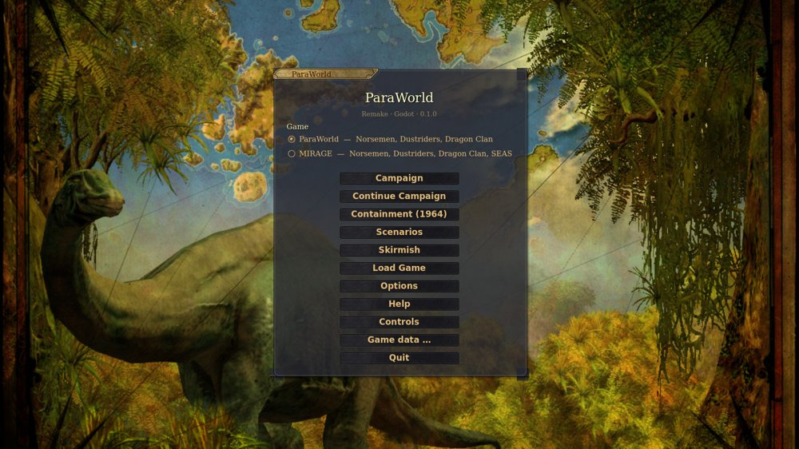
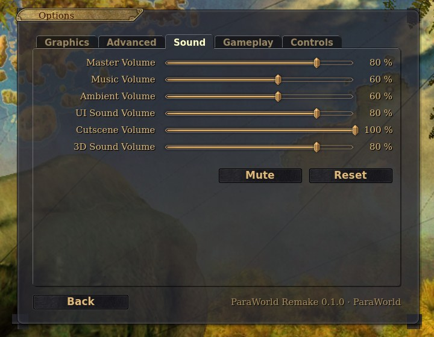
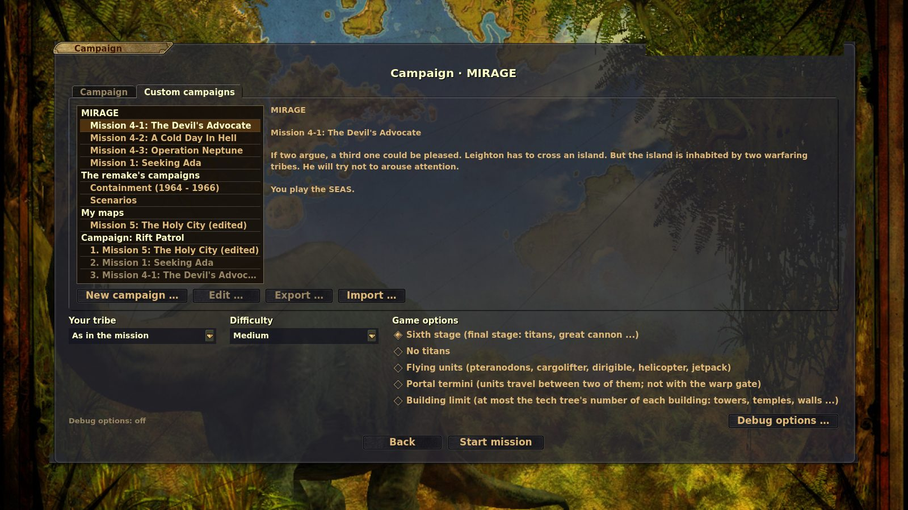
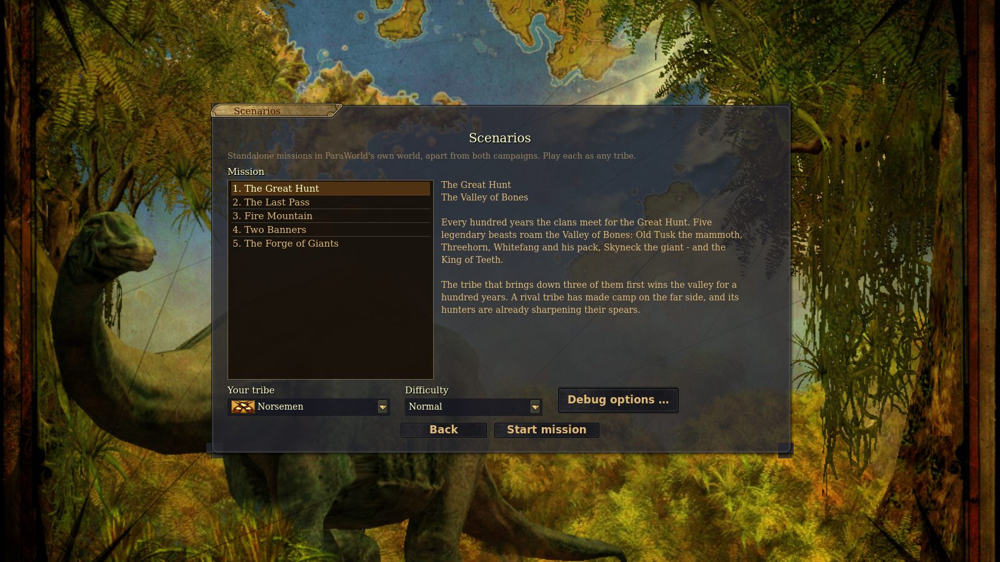
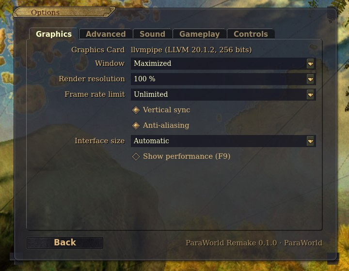
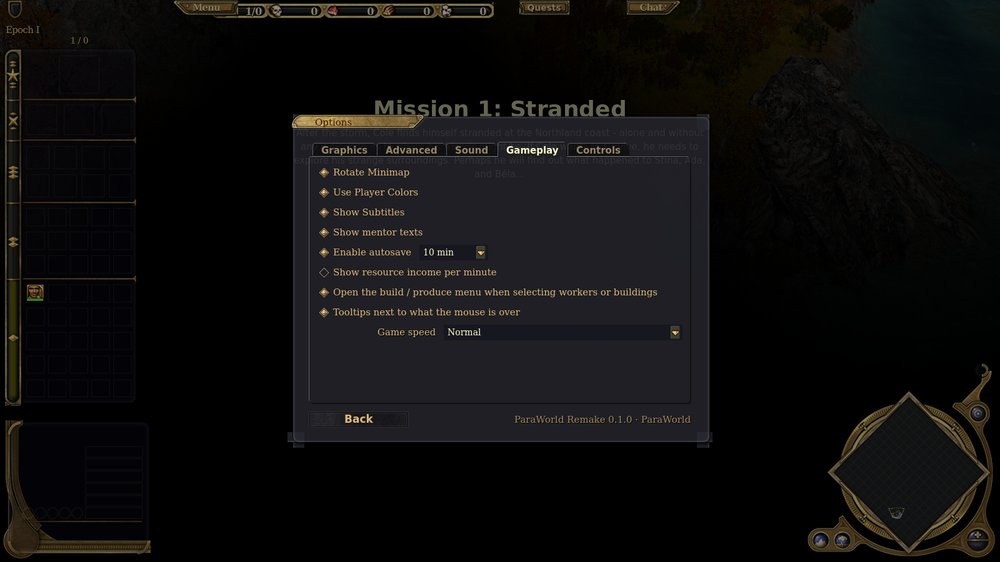

# Menus: title screen, Options, Controls

The menus before and around a game, in the original's look (menu art of `Data/*/UI/menue`, converted by the toolkit;
the window frame, buttons, check boxes, radio buttons, sliders, drop lists, tabs and scroll bars are the game's own
pieces - `game/src/UI/PwTheme.cs`, `PwWindow.cs`, `PwTabs.cs`) and with the game's own texts where it has them
(`src/Sim/Content/GameTexts.cs`, below). Ported from the browser remake's `remake/src/ui/menu.js` (title, settings,
help) and `main.js` (applySettings) - pw-exporter 98c7703. The campaign menu, skirmish, army screen, saves and the
help book have their own documents (docs/CAMPAIGN.md, SKIRMISH.md, SAVES.md, HUD.md).

**MIRAGE's game options** - **Sixth stage** (on by default), **No titans**, **Flying units** and **Portal termini** (off
by default), MIRAGE's own lobby options MaxEpoch 6 / RemoveTitans / FlyingEnabled / Portals - are in every menu a MIRAGE game starts from, and only with MIRAGE: the skirmish
setup and the multiplayer skirmish lobby (the host's; docs/SKIRMISH.md), the campaign menu's *Game options*
(single player, also for a mission's army screen; docs/CAMPAIGN.md) and the co-op lobby's *Settings*, online and
offline (the host's; docs/COOP.md). The campaign menu and the co-op lobby share the stored choice (settings.json
`campaignGameplay`). The **Debug options** window (docs/DEBUG.md) has the original's **First-shot delay** (on by default)
and its time in seconds.

```
game/src/UI/TitleScreen.cs      the title screen (configuration, the main menu's buttons, Continue Campaign); ControlsScreen
game/src/UI/MultiplayerMenu.cs  Multiplayer: name, Host Direct IP (port, game type), Join Direct IP; LobbyChat (docs/MULTIPLAYER.md)
game/src/UI/CoopLobby.cs        the co-op lobby: Shared / Co-op campaign, online and offline (the campaign menu's "Co-op …";
                                the PvP lobby is SkirmishMenu's network mode) - docs/COOP.md
game/src/UI/IntroScreen.cs      the start films (the logos and the intro) before the title screen
game/src/UI/CampaignMenu.cs     the campaign menu: tabs Campaign (the original campaign) and Custom campaigns; tribe, difficulty, options
game/src/UI/CustomCampaignsTab.cs  the Custom campaigns tab, its New / Edit campaign dialog (MenuDialog), CustomPlay
game/src/UI/OptionsPanel.cs     the Options window (tabs and settings); OptionsScreen = it on the title screen
game/src/UI/PwTabs.cs           the original's tab control (CTabCtrl; art controls/tabctrl_*)
game/src/UI/Game/PauseMenu.cs   the game's menu (Esc): Options opens the same OptionsPanel
game/src/App/AppSettings.cs     settings.json
game/src/App/SettingsApply.cs   a change applied at once: sound, window / frame rate, the running game
game/src/App/GameSession.Settings.cs   ... the running game's part (renderer, grass, particles, weather, HUD, minimap, camera, mission UI)
src/Sim/Content/GameTexts.cs    the installation's string tables (Data/locale/<lang>/Texts/*.ltf)
```

## Title screen



The configuration (ParaWorld or MIRAGE, docs/CONTENT.md), then the main menu's buttons with the original's captions
and tooltips (`_UI_MainMenu_Button_*`, `_UI_MainMenu_Tooltip_*`): Campaign, Continue Campaign, Skirmish, Load Game,
Map Editor (the map editor in the game: docs/MAP_EDITOR.md), Options, Help (the help book), Controls (the keys and the
mouse, `Help/ControlsList.cs`), Game data … (the setup screen), Quit - and the remake's Scenarios. The remake's
campaign **Containment** has no button here: it is in the campaign menu's Custom campaigns tab ("The remake's
campaigns", Start opens its menu; its Back returns there).

**Continue Campaign** (MainMenu.usl `Init` / `OnContinueCampaign`): the original looks through the profile's saves for
the newest one (by the file's time) whose level is not a multiplayer map and loads it at once. Here: the newest save of
the saves folder that is not a skirmish (a campaign mission, Containment or a scenario; autosaves and quick saves
count, as in the original), by the save's date (`SaveGame.NewestCampaign`, docs/SAVES.md); the tooltip names it. The
button is greyed out when there is none (the original's line for that is commented out - its button did nothing
then). `--continue` does the same from the command line.

### The start films

At start-up the client plays `sf_logo.bik` (the publisher), `sek_logo.bik` (SEK), `partner.bik` and then `intro.bik`
(the dinosaur battle) - PWClient.exe 0x456a86..0x456b19: the three logos when the config value `Global/PlayIntro` is
>= 0, the intro when it is >= 1. MIRAGE has no list of its own: its `MIRAGE.info` replaces files of `Data/Base` by
those of `Data/MIRAGE` with the same name (`tryfilereplace`), so a film of MIRAGE's own with one of these names takes
the place of the base game's - the prepare tool looks for each film in the language's video folder first, then in the
configuration's Data folders from the last (MIRAGE) to Base (`tools/prepare/films.py convert_start_films`). It
converts them to Ogg Theora like the story films (`assets/video/<name>.ogv` in the configuration's overrides; stubs
under 16 KB and the installations' 160 x 80 placeholders are left out). `IntroScreen` plays those that are there, the
picture as large as the screen allows in its shape (`FilmFit`: the black bars painted into the 4:3 films are found
from the frames and go off a wide screen, so the wide picture fills it; a film without bars is fitted whole); **Esc** skips the rest, a **click** or **Space** the film on show; then the title screen
and its music. **Options > Gameplay "Play the start films"** (`settings.json` `introFilms`, default on) turns them
off; `--no-intro` skips them once. Test runs (`--quit-after`, `--screenshot`, `--shots`) and starts of something else
(`--mission`, `--screen` ...) skip them; `--intro` plays them in a test run.


**Credits**: the original's Credits button plays `Video/credits.bik` (MainMenu.usl `OnCredits`) - the credits are
baked into that film; the scripts and the string tables have no credits text (only the button's caption "Credits" and
tooltip "View the credits."; checked in `Data/*/Scripts`, `Data/*/Texts`, `Data/locale/*/Texts` and the MIRAGE folders).
The installation's `credits.bik` is a 760-byte stub, so there is nothing to show: no Credits button.

Compared with the browser remake's title (menu.js `title()`):

| JS | here |
|---|---|
| Campaign, Skirmish, Load game, Options, Help, Controls, Exit game | the same |
| Containment (1964), Scenarios | the same (game/src/UI/Sequel: docs/SEQUEL.md "Playing") |
| (the toolkit's map tools) | **Map Editor**: the remake's map editor inside the game (game/src/Editor, docs/MAP_EDITOR.md) |
| the version line (click: copied) | the version under the title and in the Options window and pause menu (not copied on a click) |
| the game data configuration in the campaign menu (and the toolkit's build of a mod's data) | the configuration on the title screen; data are prepared by the prepare tool (docs/CONTENT.md) |

The original's main menu (MainMenu.srf / .usl) has more, which the JS did not have: **Continue Campaign** and the
**start films** are here now (above), and **Multiplayer** (host / join by IP, the PvP lobby - the skirmish menu's network
mode - and the co-op lobby with its two modes, Shared and Co-op campaign, with the original's captions: docs/MULTIPLAYER.md,
docs/COOP.md; the campaign menu's **Co-op …** opens the same lobby offline: you and one or two AI commanders; the original's GameSpy and LAN browsers
are not); not here: **Credits** (a film the
installation does not have, above), **ParaWorld website** (the site is gone). **Profiles** (OptionsMenu's last tab)
are not needed: one settings file per user folder.

## Options



The same window on the title screen (OptionsScreen) and in the game (pause menu > Options): the original's layout
(OptionsMenu.srf: a tab control, Back, the version beside it) and captions, filled with the browser remake's
settings. Every change is applied at once (`SettingsApply.All`: main.js applySettings) and settings.json is written
when the window closes (Back, or Esc in the game). The tab shown last is shown again.

| tab | setting | settings.json | applied to |
|---|---|---|---|
| Graphics | graphics card (shown) | - | - |
| | Window: windowed / maximized / fullscreen / exclusive (F11) | `window` | Boot.ApplyWindowMode |
| | Render resolution 50 - 125 % | `renderScale` | viewport 3D scale |
| | Frame rate limit | `fpsCap` | Engine.MaxFps |
| | Vertical sync | `vsync` | DisplayServer |
| | Anti-aliasing (FXAA) | `antialias` | WorldRenderer |
| | Interface size (automatic, 100 - 175 %) | `uiScale` | HUD layout |
| | Original colours (no player colours) | `originalColors` | ModelMaterials.OriginalColours |
| | Show units behind buildings | `showUnitsBehind` | UnitsBehind |
| | Setting textures on buildings (default on; off: plain textures, no snow) | `settingTextures` (was `snowOnBuildings`) | SettingMaterials, SnowCover (docs/VIEW.md "Setting textures") |
| | Show performance (F9) | `perf` | the performance line |
| Advanced | Shadows off / medium / high | `shadows` | WorldRenderer (sun shadows, atlas size) |
| | Grass off / medium / high | `grass` | WorldView.SetGrass |
| | Particles off / low / medium / high | `particles` | effects, particle emitters |
| | Weather off / on | `weather` | WeatherFx |
| | Restore default | | the six above and vsync, frame cap |
| Sound | Master, Music, Ambient, UI Sound, Cutscene (speech), 3D Sound (effects) volumes | `volMaster`, `volMusic`, `volAmbience`, `volUi`, `volSpeech`, `volEffects` | the audio buses (GameAudio) |
| | Mute | `sound` (false = muted) | AudioCore.Muted |
| | Reset | | the volumes and sound on |
| Gameplay | Rotate Minimap (default on, as the JS since the user asked) | `minimapRotate` | MinimapModel.Rotate |
| | Use Player Colors | `minimapPlayerColors` | MinimapModel.PlayerColors |
| | Show Subtitles | `subtitles` | the cutscenes' and films' lines (MissionUiState.Subtitles) |
| | Cutscene black bars | `cutsceneBars` | the remake's own, default off: cutscenes full screen, the subtitles over the picture; on: letterboxed as the original (docs/MISSION_UI.md) |
| | Show mentor texts | `mentorTexts` | the mentor's hints |
| | Play the start films (the remake's own; the original's `Global/PlayIntro`) | `introFilms` | IntroScreen at start-up |
| | Enable autosave, every 5 - 60 min | `autosave`, `autosaveMinutes` | GameSession.Saves (older settings: 0 minutes = off) |
| | Show resource income per minute | `incomePerMinute` | the top bar |
| | Open the build / produce menu when selecting | `autoMenu` | HudModel.AutoMenu |
| | Show attack ranges (the remake's own, default on; Ctrl+Shift+R in the game) | `showRanges` | RangeRings.ShowAll: a circle round each own finished shooting building, and the range markers of the selected objects - attack, alarm, fog, healing, aura (docs/HUD.md "Attack ranges", "Range markers") |
| | Tooltips next to what the mouse is over | `tipNear` | Hud.TipNear |
| | Game speed | `gameSpeed` | the session's clock (Numpad + / - / * too) |
| Controls | Scroll at the screen's edges | `edgeScroll` | RtsCameraInput |
| | the keys (read-only, Help/ControlsList.cs) | | |

The labels and tooltips of the original's own options come from its texts (`_UI_OptionsM_*`, `_UI_Tab_*`): e.g.
"Master Volume", "Show Subtitles", "Restore default", "Mute". The remake's own options are in English.

**Not here**, and why: the JS's "prepare all graphics while loading" (`warmup`: the session's model preloading is
`--preload`, docs/GAME_SESSION.md) and "sound on" (= Mute). The original's screen resolution and gamma, texture /
geometry detail, viewing distance, water, clouds, EAX, unit feedback, long tooltips, flat shades, hit point colouring,
AI assistance, camera speeds / rotation / snap back / stepless zoom, profiles and **key bindings**: the browser remake
has none of them (its keys are fixed, as here); they would need features the remake does not have yet. **Language**:
the JS has no choice; the texts follow the configuration's `language` (the prepare tool's, docs/CONTENT.md) - the
installation usually has one locale.

### The original's texts (GameTexts)

`GameTexts.For(configuration)` reads the installation's string tables once: `Data/locale/<lang>/Texts/*.ltf` and the
data folders' own `Data/<folder>/Locale/<lang>/Texts/*.ltf` (a later folder's file of the same name replaces an
earlier one), lines `"key";"text"`, English filling the gaps of another language - the toolkit's TextTable.
`Get(key, fallback)`, `Label(key, fallback)` (without the label's trailing colon). The toolkit's gamedata.json "ui"
has only the keys the browser remake used, so the menus read the installation itself; without an installation the
English fallbacks show.

### The art

`PwTheme` builds the controls from the menu art: buttons (`controls/button_*`), check boxes and radio buttons,
sliders (`controls/slider_hrz_left / leftbar / rightbar / right / mover`: the rail, its filled part and the mover),
drop lists (`controls/dropfield_backtile`, `dropdownbutton_idle`), vertical scroll bars (`controls/scrollbar_vrt_rail_idle`,
`scrollbar_vrt_mover_top / center / bottom`) and the tabs (`controls/tabctrl_*`: the active tab open to its page, the
others darker behind the frame's top line; the frame's corner, sides and bottom around the page). A missing piece
falls back to flat colours. The windows (`PwWindow`: the pause menu, quest log, end screen, the loading screen's
journal) are framed by `windows/outerframe_*`: the corners, the edges tiled between them (not under the rounded
corners' transparent parts), the title strip `outerframe_toptile` whose first ~190 px are the caption's tab - a caption
longer than the tab widens its plain middle. The test data of the development container had only part of the converted menu art; the
slider, tab, drop list and text box pieces were staged from the user's export (`E:\Paraworld\export\remake\375f3d3a`).

## Campaign menu



Two tabs (PwTabs, as the Options window); below them for both: **Your tribe**, **Your colour** (the skirmish's palette
and RGB picker with "As in the mission" first; the shown mission's other players' colours greyed out, "used by <name>";
remembered per campaign - docs/CAMPAIGN.md "Your colour"), **Difficulty**, MIRAGE's **Game options**,
the debug options line, **Back**, **Co-op …** (the Campaign tab only), **Start mission**. The tab and the entry chosen
last are shown again (settings.json `campaignTab`, `campaignMission`, `customSelection`).

* **Campaign**: the original campaign of the configuration - the tutorial and missions 1 - 16 - with the chosen
  mission's title, description, the tribe you play, the army budget and its status (missions not adapted yet greyed).
* **Custom campaigns**: every other mission, grouped (a header per group, its missions under it): **Booster Pack**
  (4-1 .. 4-3), **MIRAGE** (MIRAGE's own missions, only in MIRAGE), **The remake's campaigns** (Containment and the
  Scenarios: Start opens their menus), **My maps** (your maps with triggers, edited copies of campaign missions as
  "<title> (edited)"; was the "Custom maps …" menu) and **your campaigns** (each a header and its missions in order; a
  mission opens when the one before was won - greyed until then). The right side shows the chosen entry's texts; Start
  plays it with the tribe, difficulty and options below (on a campaign's header: its next mission). Under the list:
  **New campaign …** / **Edit …** (name, author, description, pick and order the missions and maps; Save, Delete …),
  **Export …** / **Import …** (a `.pwcampaign` file). docs/CAMPAIGN.md "Custom campaigns" has the rules and the file
  format, docs/MAP_EDITOR.md "Edited missions and custom campaigns" the user's side. `--screen custom` opens this tab.

## The campaign's army window

menu.js `campaignArmy` (the army screen of a campaign mission with an army budget) is ported: the campaign menu's
Start and the end screen's Continue open `ArmyScreen` with `CampaignArmy.Of` (docs/SKIRMISH.md, docs/CAMPAIGN.md),
`--army-mission <n>` shows it. One difference: its Back after the end screen's Continue goes to the campaign menu (the
JS went back to the end screen, which the session has left by then). The online co-op lobby opens it per seat ("My
army ...", `CampaignArmy.ForCoopSeat`: the host's budget, seats 2 / 3 without the story heroes, no debug "Free"; Done
and Back return to the lobby) - docs/COOP.md "Armies".

## The remake's own campaigns (sequel_ui.js, ported)

`remake/src/ui/sequel_ui.js` and the menus `sequel()` / `scenarios()` of menu.js are ported with those campaigns
(docs/SEQUEL.md): the campaign menu's Custom campaigns tab's **Containment (1964)** (no longer a title screen button) (`SequelMenu`: the 1964 and 1966 missions with place,
date, briefing and what each brings in; a mission opens when the one before it was won; the difficulty; it is played
with the MIRAGE configuration - the menu says so and offers the switch) and **Scenarios** (the title screen's and the Custom campaigns tab's; `ScenarioMenu`: all open,
the tribe to play, the tribes that won each marked). Missions that do not play yet are greyed out (`SequelStatus`, as
`CampaignStatus`). In the game: the briefing window before the mission (the game waits; Begin is a command), and
`SequelHud` beside the HUD (objectives, radio box with the speakers' portrait cards, clock, electricity, command
powers); the end screen's Continue starts the next mission. `--screen sequel`, `--screen scenarios`.



## Tests and screenshots

* `dotnet run --project tests/PwRemake.Tests -- MenusCutscene`: GameTexts (the .ltf format; the installation's
  options captions), plus the cutscenes' lip sync and day time (docs/GAME_SESSION.md "Cutscenes").
* `dotnet run --project tests/PwRemake.Tests -- NewestCampaignSave`: Continue Campaign's choice (not a skirmish, the
  newest by date, damaged files skipped); `python -m unittest tests.test_films` in tools/prepare: the start films'
  lookup (MIRAGE's own first, any case of the name), stubs and placeholders left out.
* `godot --path game -- --intro --quit-after 2 --screenshot <png>` (a start film), `--continue` (the newest save);
* `dotnet run --project tests/PwRemake.Tests -- CustomCampaign`: the campaign menu's groups, user campaigns
  (docs/CAMPAIGN.md "Custom campaigns").
* `godot --path game -- --screen options --options-tab 0..4 --quit-after 5 --screenshot <png>`; `--screen controls`;
  `--screen campaign`, `--screen custom` (the Custom campaigns tab);
  in a game `--menu-at 1 --menu-page options --options-tab 3` (docs/DEBUG.md).



