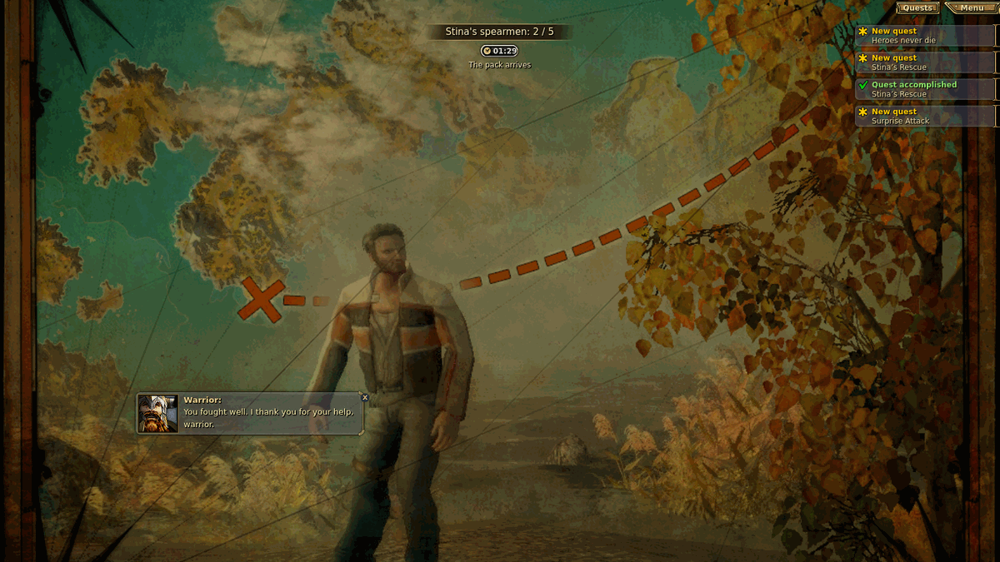
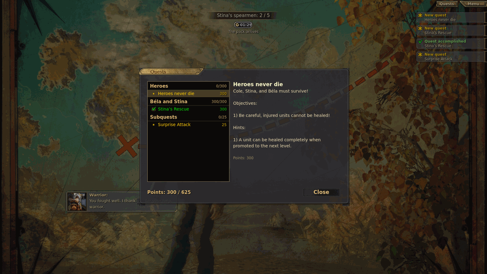
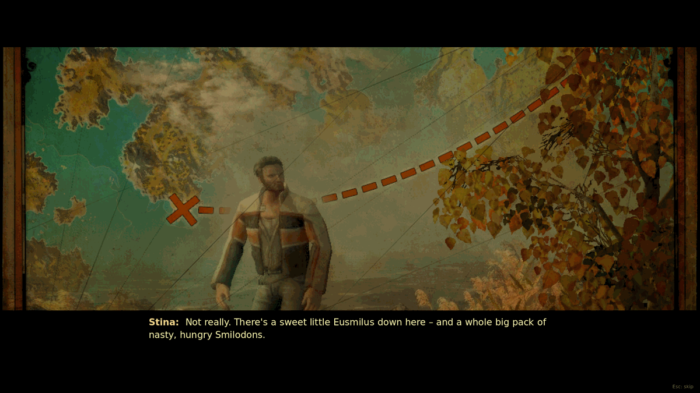
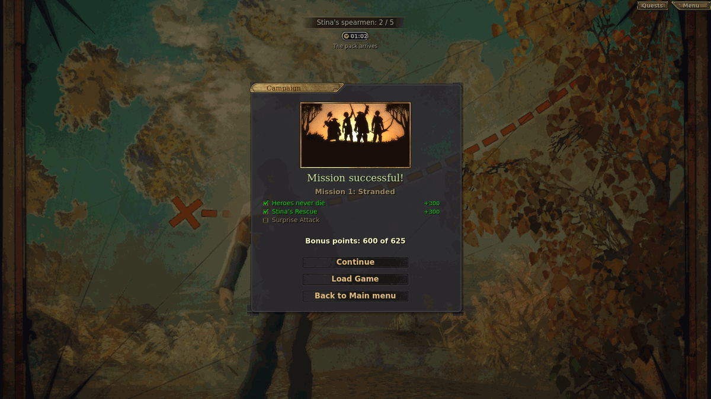

# Mission UI

What the player sees of a campaign mission besides the ordinary HUD: the quest button and the quest log, the news
ticker, dialogue scenes, cutscenes (sequences and films), the info bar and level timers, the title card and the end
of mission screen; and, as data for the HUD's minimap and the world view, the minimap markers and the question marks
over quest givers. The trigger engine (`src/Sim/Scripting`, docs/TRIGGERS.md) owns the state and calls the mission UI
through the presentation half of `IMissionHost`; the mission UI shows it and reports back when a scene is over.

Port of `remake/src/ui/mission.js` and `remake/src/ui/cutscene.js` (pw-exporter 98c7703; the JS's own description:
`remake/docs/MISSION_UI.md`). Originals: `Game/UI/QuestWindow.usl`, `NewsTicker.usl`, `DialogScene.usl`,
`TimerWnd.usl`, `MiniMap2.usl`, `IngameScreen.usl`, `Server/classes/misc/QuestionMark.usl`.



## Files

```
game/src/UI/Mission/
├─ Logic/                      no Godot types - compiled into the tests too
│  ├─ MissionUiData.cs         the mission's UI data: quests' texts, dialogues, sequences (lines, speech, films,
│  │                           timeline), question marks, texts, title (world.lua, map.lua's mission, texts/<lang>.lua)
│  ├─ MissionUiState.cs        mission.js: queues, frame timing, quests, ticker, markers, timers, cutscenes, end screen
│  ├─ CutsceneTimeline.cs      cutscene.js without its three.js parts: bars, fades, skips, sounds, speech, subtitles
│  ├─ MissionUiBridge.cs       IMissionHost's presentation calls -> the state; EndDialog / EndSequence back to the engine
│  └─ UiAtlas.cs               atlas.js: assets/ui/atlas.json (portraits, ticker icons, timer pills)
├─ MissionPresenter.cs         the node (CanvasLayer) the game uses; GodotMissionOutput (sounds, pause, films)
├─ HudArt.cs                   the original HUD art: ticker strips, tooltip frame, atlas regions, fonts
├─ HudViews.cs                 news ticker, dialogue box, info bar + timers, title card, quest button
├─ CutsceneView.cs             letterbox, subtitles, fades, films / film card
├─ QuestLogWindow.cs           the quest log (menu window)
├─ EndScreenWindow.cs          the end of mission screen
└─ Tests/MissionUiTest.tscn    the test scene (mission 1, screenshots)
tests/PwRemake.Tests/MissionUiTests.cs   tests of the logic on the real missions
```

The loading screen before a mission (picture, title, description, hint or journal entry, loading bar, ready button) is not part of the mission UI:
`game/src/UI/Loading`, described in docs/GAME_SESSION.md "The loading screen".

## Wiring (the API the game calls)

One `MissionPresenter` per mission, a child of the game session. The campaign host (the `IMissionHost`
implementation of `src/Sim/Campaign`) forwards the presentation calls, same names and arguments, one line each:

```csharp
var ui = new MissionPresenter(MissionUiData.FromJson(luaMission.World, luaMission.Mission, null), GameApp.Assets);
foreach (var (k, v) in luaMission.Script.Texts) ui.State.Data.Texts[k] = v;     // (or MissionUiData.Load(folder))
session.AddChild(ui);
ui.Bind(engine);                                   // EndDialog(token) / EndSequence() go to this engine
ui.OnPause = paused => session.Paused = paused;    // cutscenes, the quest log, the end screen
ui.OnCinematic = on => hud.Visible = !on;          // the HUD goes during a cutscene; the world takes no input
ui.OnEndAction = a => app.EndOfMission(a);         // "next" | "retry" | "load" | "menu"
ui.ShowTitle();

// in the host (IMissionHost):
public void QuestChanged(QuestState q, string change) => ui.QuestChanged(q, change);
public void SetQuestionMark(string guid, string state, string? tip) => ui.SetQuestionMark(guid, state, tip);
public void ShowMarker(MapMarker m) => ui.ShowMarker(m);
public void RemoveMarker(string id) => ui.RemoveMarker(id);
public void SetInfoBar(string text) => ui.SetInfoBar(text);
public void PlaySound(string name, MapPos? at) => ui.PlaySound(name, at);     // (or the world's audio, positioned)
public void PlayMusic(string file, bool loop) => ui.PlayMusic(file, loop);
public bool IsBusy => ui.IsBusy;
public bool PlaySequence(SequenceRequest r) => ui.PlaySequence(r);
public void SequenceFinished(SequenceRequest r) { /* reveal, actors */ ui.SequenceFinished(r); }
public bool PlayDialog(string path, int token) => ui.PlayDialog(path, token);
public void EndMission(bool won, string text) => ui.EndMission(won, text);

// every simulation step (game time: dialogue timing, markers):
ui.Tick(stepSeconds);
```

`PlayDialog` / `PlaySequence` return true (the UI plays the scene and calls the engine back). A path the data does not
know is a scene without frames / lines: it ends on the next tick. A sequence whose data says `"file": false` returns
false (engine.js: it ends at once). Nothing ends inside the call itself: scenes start and end in `Tick` / `_Process`,
so the engine's `EndDialog` / `EndSequence` never run inside its own action.

### What the HUD, the minimap and the world view read

| member | what |
|---|---|
| `Markers` (`MarkerState`) | minimap markers: map `X, Y` (following `Obj` through `ObjectPos`), `Color` (by kind as MiniMap2.usl:238-262: Attack 255,0,0 · SPMainQuest 255,200,100 · SPOptQuest 200,200,200 · SPHint 0,120,0; FixedColor its own), `Extended` (also a ring on the ground) |
| `MissionPresenter.MarkerLit(m)` | lit now: `ttl` 0 = always; else `ttl` s on, `repeats` more times with `interval` s dark between, then gone |
| `RingPhase(m, speed)` | the ring running outwards, 0..1 (minimap 0.85/s, the world's ring 0.7/s) |
| `QuestionMarks` (`QuestionMarkState`) | by guid: `Visible`, `Model` (the game's effect model questionmark_red / _green / _yellow, exclamation_yellow), `Glyph` + `Fill` / `Dark` colours for a drawn mark, map `X, Y, Z`, `Tooltip` (shown under the mouse) |
| `Cinematic` | a cutscene is on screen |
| `QuestButtonControl` | the quest button; the HUD may move it into its top row (left of "Menu") |

Hooks: `ObjectPos` (where object `id` is, map x/y), `Stage` (`ISequenceStage`: the cutscenes' camera, actors,
effects - below), `OnSequenceFinished` (the camera to `r.Camera` unless `r.SnapBack`), `MenuOpen` (another menu is
open: cutscenes wait, the log does not open), `EndStats` (time, kills, losses for the end screen), `UiScale`.
Beyond the contract: `OpenLog(questGuid?)`, `CloseLog()`, `ToggleLog()`, `News(text, kind, icon)`, `ShowTitle()`.

## What each part shows

| part | place | rules |
|---|---|---|
| quest button | top right, left of "Menu" (`hud_menu_questbutton`, 69 px) | flashes after a quest change until the log opens (QW:509-523) |
| news ticker | right column, 235 px at x desktop − 235, y 37 (NewsTicker.usl:12-13) | quest changes: `_NT_QuestNew` / `_NT_QuestAccomplished` / `_NT_QuestUnaccomplishable` + headline, icons `nticon_quest_*`, sounds `ui_quest_new` / `_accomplished` / `_unaccomplishable`; a line stays 12 s and fades; click opens the log at the quest, right click removes it; at most `MaxNews` lines (7). Background: the original strips `hud_newsticker_background_top/center/bottom` |
| dialogue box | bottom left, x 212, 198 px above the bottom, growing upwards (DialogScene.usl:143) | the HUD's tooltip frame (`hud_tooltip_*`), portrait (atlas level 4, 64 × 61: the actor's `icon`, else its `class`; a framed initial without one), `speaker:` and text, × closes the scene (DS:340-352); mentor scenes tinted blue |
| info bar | upper right, under the top bar's Quest / Chat buttons, right-aligned to Chat's right end (the HUD sets `MissionPresenter.ObjectivesAnchor`); a small toggle left of it (or Shift+J) folds the panel away, remembered in the settings (`objectivesHidden`). The original (IngameScreen.usl) drew it in its count-down window at (335, 2) | the resolved line (TriggerEngine.InfoBarText: `%n` arguments and `$(var)` variables, refreshed by the engine when a variable changes); "" hides it |
| timers | under the info bar, right-aligned, folded away with it (the original: rows from (268, 30), IngameScreen.usl UpdateTimerPos) | the engine's `Timers` with `Show`: pill `timer_default` over `timer_background` (hud_timers.png), `mm:ss` (`h:mm:ss`) rounded up, the label under it; red in the last 10 s, dimmed while paused |
| title card | upper third | mission title + description for 7 s, fading the last 1.2 s; the first dialogue line cuts it to 1.2 s |
| quest log | a menu window (QuestWindow.usl 765 × 515), modal, pauses the game | groups of the main quests (`group_title`) in order of appearance with points got / possible, main quests without a group, side quests under `_SubQuestGroup`; marks of `menue__controls__questchecks` and colours of QW:66-70 (new yellow, open grey-brown, accomplished green, failed red and crossed out); right: headline, state, description, points; total points; J / Esc / Close. What changed since the log was last open is "new" (QW:300-318). Not during a cutscene or after the end |
| cutscene | full screen over the HUD | below |
| end screen | a menu window | `gameover_victory` / `_defeat` art, `_GAOV_Accomplished` / `_GAOV_Failed`, the mission title, the reason of a defeat, the visible quests with their result and points, "Bonus points: earned of possible", Continue (won) or Retry, Load Game, Back to Main menu |



Points are `quest.Bonus[difficulty]` (0 easy, 1 medium, 2 hard; the remake's Nightmare (3): no points in the log, hard's
on the end screen - as the JS).

## Dialogue scenes

Queued; one scene at a time on **game time** (`Tick`), in the order asked for (DS:19-45). Per frame: the sound
`ui_message` (NT:113), the box, the speech. **Frame length** (DS:419-465): the frame's sound, at least 0.25 s per
vowel group of its text (a vowel counts when it differs from the last one counted); without a sound file the spoken
length is estimated (`max(0.25 × vowel groups, 1.5 s, 0.6 s + 0.065 s per letter)`). A frame whose sound still plays
waits for it (at most 20 s more). Sound and music are turned down to 50 % while scenes play (DS:164-166: the effects
bus and `AudioCore.DuckK`).

Speech: the frame's `audio` is a sound event of `dialogsounds.txt`; the file is the event's in sounds.json if there
is one, else the rule that table follows: `../SeqSounds/Level_<mission>/<scene>_<Actor>_<nn>.mp3`, mentor hints
`../SeqSounds/Mentor/<L01B01>.mp3`, the tutorial `0_Tut_Level` - relative to `Audio/Sound`, played through `GameAudio`
on the Speech bus. (`PathUtil.FindCaseInsensitive` steps back over the `..`, so `Audio/Sound/../SeqSounds/...` is found
in any case, e.g. `Mentor/L01B01.mp3` for `ds_l01b01`.)

**Mentor scenes** (`mentor` in the data): with the option "Show the mentor's hints" off (`AppSettings.MentorTexts`)
they are not shown and last 0.5 s per frame (DS:396-403, 440), except on a tutorial map.

**Not under a cutscene**: the original hides the dialogue scenes while a sequence plays and lets them go on after it
(MusicMgr.usl:386-417, OnSequenceStart "stop Dialogs" / OnSequenceEnd "continue Dialogs": `DialogSceneMgr.SetVisible`);
a sequence does not wait for a dialogue. So: a cutscene that starts while a scene speaks stops its speech
(`HoldScene`, log `dialogHeld`); no scene starts or runs on while a cutscene is on screen (also when the game's tick
comes meanwhile, a networked game); after the last waiting cutscene the held scene says its frame again
(`ResumeScene`, `dialogResumed`) and the scenes asked for meanwhile follow in their order - their ends (the triggers'
`DSEN`) come after the cutscene's (`SQEN`). Before (2026-11-05, mission 1 in co-op): the mentor's speech went on over
sc_1050. Test: `MissionUiTests.DialoguesWaitForCutscenes`.

## Cutscenes

Queued; the UI pauses the game while one shows (`OnPause(true)`, restored after), hides the HUD (`OnCinematic`),
switches the music to its Sequence situation (`Music.Sequence`) and ducks the sound. `IsBusy` is true from the
request to the end of the last queued one; the engine starts the next sequence only when it is false. Esc ends the
scene; in a line scene click / Space / Enter go to the next line; every other key is swallowed (F9 / F10 pass).

Three kinds, as the JS chose them:

* **Timeline** (the sequence has `play` with an end, no films; almost every in-engine scene): the original
  sequencer's items on real time from `play.start` to `play.end` - `bars` (letterbox on / off), `fade` (to / from
  black), `skip` (a cut jumps over its range), `sound` (a wav of Audio/Sound, its volume, looped if asked, stopped at
  its end), the actors' `say` items (their mp3 below Audio/SeqSounds on the Speech bus - music items on Effects - and
  the subtitle of the line with that key while it lasts + 0.3 s; none with the option "Show Subtitles" off,
`AppSettings.Subtitles`). Subtitles: `_ds_ACTOR_<Name>` or the capitalised
  speaker, `:`, the line.
* **Lines** (lines but no timeline): one line after the other with the speaker's portrait (atlas level 3), each for
  its speech + 0.4 s or a reading time `max(2.4 s, 1.2 s + 0.062 s per letter)`.
* **Films** (`videos`: hs_*.bik / ns_*.bik, the pre-rendered films): the films one after the other full screen, the
  sequence's lines spread evenly over them as subtitles.

**Full screen or letterbox**: Options → Gameplay "Cutscene black bars" (`AppSettings.CutsceneBars`,
`MissionUiState.CinemaBars`), **off by default** (the user's choice, 2026-11-11): a timeline scene has no bars; the
title, the subtitle line (at the bottom, on a dark backing with an outline) and the hint are drawn over the picture.
The camera is the same either way: the original's bars are its wide-screen filter over the full picture (ItemWideScreen,
docs/SEQUENCE_FORMAT.md §5) and its field of view is vertical over the whole screen, so without them the shot keeps its
width and framing and shows what the bars covered above and below. On, the bars as before (the scene's `bars` items
switch them).



**Films and Godot.** The toolkit converts the original's Bink films to **WebM** (`assets/video/<name>.webm`,
pwexport/video.py, for the browser). Godot plays **Ogg Theora only**, so these cannot be played. The presenter
plays `assets/video/<name>.ogv` when such a file exists (`GodotMissionOutput.FilmPath`, `VideoStreamTheora`; sized by
`FilmFit` as the start films: as large as the screen allows, shape kept, the painted letterbox bars off the screen); without
one a film sequence shows its lines without pictures (the JS's `filmMissing`), and a film without lines (21 of the 23 film
sequences of the official campaign; sc_3030 and ms_2020 have lines) shows a card with the mission title and a note for 4 s (`FilmCardTime`), then ends.
The prepare tool converts the films (`tools/prepare/films.py`: the original's .bik straight to Theora + Vorbis with
ffmpeg - the one on the PATH, else the pip package imageio-ffmpeg, as the toolkit finds it) into each configuration's
`overrides/assets/video/<name>.ogv`; `--no-films` skips that, and without ffmpeg the step is skipped with a message.

**Camera moves, actors, effects, lip sync, day time** of the timeline are the world view's (the game's stage:
`App/SessionSequenceStage.cs`, docs/GAME_SESSION.md "Cutscenes"; the engine-free parts of lip sync and day time are
`Logic/LipSync.cs`). They go through the hook `ISequenceStage` (`Begin`, `Update` for a line scene's camera ease to `opts.Camera` in 1.6 s, `Timeline(c, play,
t, dt)` with the scene's time after the skips - `play.Raw` holds `cuts` and `cams` with the position / turn / field of
view keys of cutscene.js, `play.Actors` the actors' walk / path / anim / act / attr / say items - `Effect(item)` for
particle items - the game's stage places the item's effect model, docs/EFFECTS.md -, `End`). Without a stage the scenes play over the frozen view.
Who speaks a line and whose mouth moves: `Logic/SceneSpeech.cs` (engine-free) - the line's character (its speech file
names it: 4070_Bela_01), not always the actor whose item it is, and a talk gesture's jaw only while its actor speaks
(docs/GAME_SESSION.md "Cutscenes", "Only the speaker's mouth moves"). Subtitles are not affected.

## The logic and its contract

`MissionUiState` keeps what is on screen; the views draw it every frame (`Sync`). The contract of mission.js (header
of `MissionUiState.cs`): `QuestChanged`, `InfoBar`, timers read from the engine (`Timers` func), `Marker` /
`RemoveMarker`, `SetQuestionMark`, `PlayDialog(scene, onEnd)`, `PlaySequence(seq, opts, onEnd)`, `Busy`, `Tick(dt)`
(game time), `Update(dt)` (real time), `SkipAll()`; beyond it `OpenLog` / `CloseLog`, `News_`, `ShowTitle`,
`CloseDialog`, `Next` / `Skip`, `FilmEnded` / `FilmSubtitle`, `EndMission`, the static helpers `VowelGroups`,
`FrameLength`, `LineLength`, `Clock`, `MarkerOn`, `MarkerDone`, and `LogLines` (what was asked, as the JS's `log`).
Everything the logic needs of the machine goes through `IMissionUiOutput` (`Sound`, `PlayFile`, `EventFile`, `Duck`,
`MusicSequence`, `Paused`, `FilmPlayable`): `GodotMissionOutput` in the game, a recorder in the tests.

## Tests

* `dotnet run --project tests/PwRemake.Tests -- MissionUi` (12 tests, `PW_CONTENT` = a content folder with
  configs/base/missions, default /home/claude/testcontent): the helpers against the JS (vowel groups, frame lengths,
  clock - values of mission.js run in node), the data of all 24 official missions, portraits from the atlas, the
  dialogue queue with speech lengths / held frames / close / unknown scenes, mentor scenes, the sc_1040 timeline
  (fade, sounds, the skip item, subtitles and speech at their times, the end, the pause restored), line scenes and
  Esc, films that cannot play and films that can, quests on the ticker and in the log (groups, points, new / read,
  clicks), markers / question marks / timers / info bar, and the bridge with a real `TriggerEngine` (EndDialog with
  the right tokens, a sequence without a file).
* `-- CutsceneMission13Tests` (base and MIRAGE content): sc_4070's carrier opens its hull, whose mouths move
  (`SceneSpeech` over every base scene), no attack loops on parts or swapped actors.
* The scene: `xvfb-run -a -s "-screen 0 1600x900x24" godot --path game res://src/UI/Mission/Tests/MissionUiTest.tscn
  -- --shots=<dir> [--mission=<folder>] [--data=<converted data>] [--install=<installation>]` - mission 1 over its
  loading picture: title card, quests, info bar and a timer, ds_1020 and ds_1030 with their speech, the quest log, the
  mentor's L01B01 (hidden and shown), sc_1040 with its timeline, Esc, the film ms_1120, markers, the end screen; 20
  checks, exit code 0 when all pass, screenshots 01..10.

The art the scene uses (staged from the user's export: `assets/ui/atlas.json`, `hud_closebutton`, `hud_timers`,
`hud_newstickericons`, `hud_newsticker_background_*`, `hud_menu_questbutton*`, `hud_tooltip_*`,
`hud_cards_cards_heroes_lvl3..5`, `hud_cards_cards_hu_units_lvl3..5`, `menu/menue__decoration__cinema_*soft`,
`menu/menue__controls__questchecks`, `menu/menue__decoration__gameover_*`) and the speech of ds_1020, ds_1030, sc_1040
and the mentor's L01B01. A missing picture gives flat colours, a missing sound the text timing.



## Not ported / differences

* The cutscenes' camera tracks, actors, lip sync, particle effects, camera shakes and day time: the `ISequenceStage`
  hook (above). The sounds of a timeline play 2D (the JS placed them at their map position).
* Films: only Ogg Theora (above); the WebM films of the toolkit show the card / the lines.
* The browser's "click for sound" (late speech when the page had no click yet) has no counterpart: Godot plays at once.
* Drawing the markers into the minimap and the rings / question marks into the world, and the question marks'
  tooltips under the mouse: the minimap's and the world view's (they read `Markers` / `QuestionMarks`).
* The end screen's buttons report `OnEndAction`; what they do (next mission, retry, load) is the app's.
