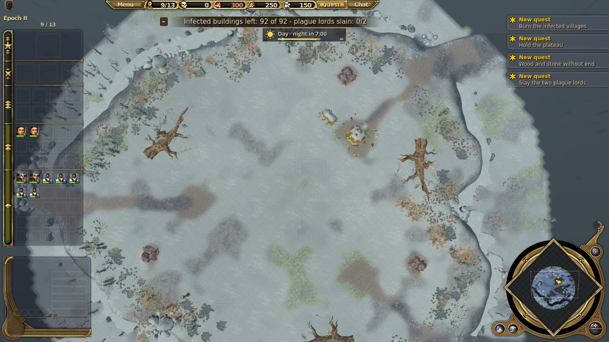
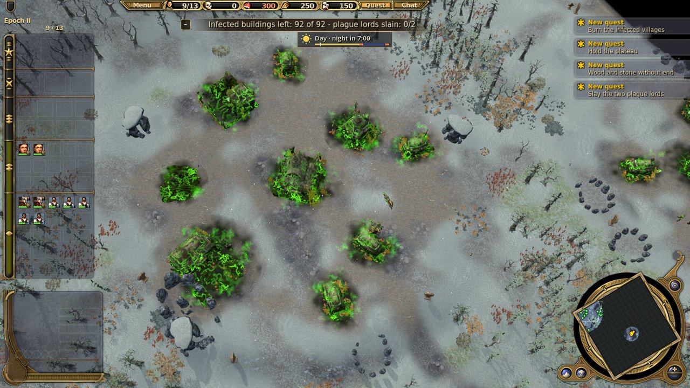
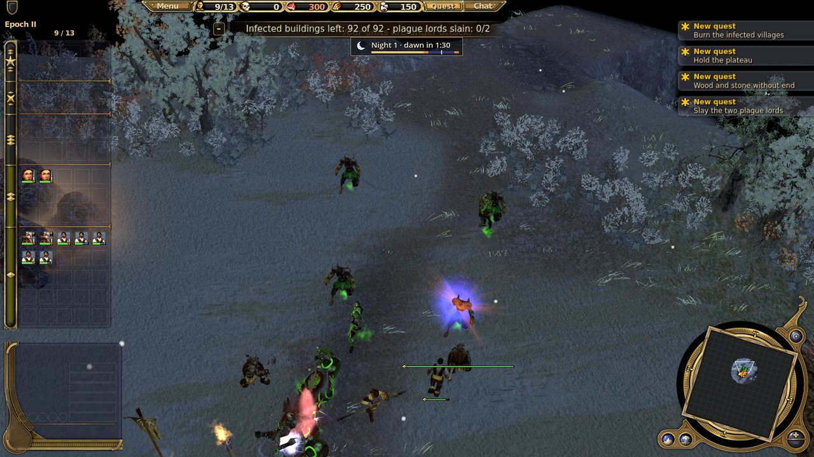
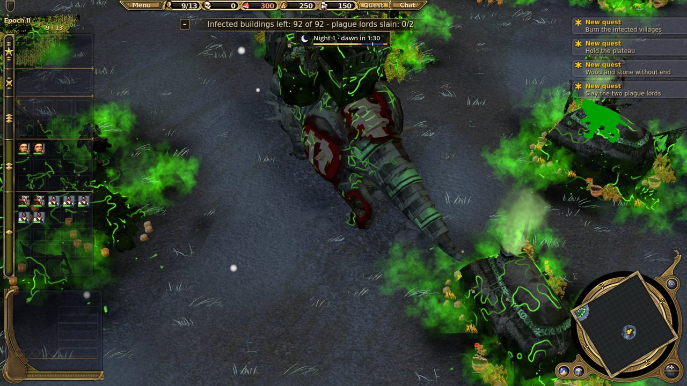

# Outbreak (the remake's own mission)

Kacper's wish (2026-11-19): StarCraft II Wings of Liberty's "Outbreak" in ParaWorld - single player and co-op for up to
three players, in the campaign menu's Custom campaigns. The players hold a wide base in the middle of a snowy valley,
**at the valley's level**, enclosed by a ring of **low rock ridges** (natural terrain all round) with **three
passes** - north and east open, the **south-west one blocked by a rockslide** the infected break later; around it
**twelve infected Norse villages** (outposts near the base, big towns far out). **By day** the infected sleep in their
villages - burn them; **the sun burns** those caught in the open. **At night** every infected building sends its dead at
the base in a steady stream, nastier each night; a building attacked at night spawns its dead fast. **Two plague lords**
hide by day and stalk their own towns at night. Each camp by a pass has a **giant fallen tree** and a **quarry** that are
never used up. Every seat starts in **epoch 2** with **six workers at work** and its own **field**. Storyless: a few
lines of a village elder about the plague.

Round 3 (2026-11-20, "closer to the real StarCraft II Outbreak in layout and scale, more buildings, the missing
mechanics"): the 768 m valley, the 240 m base, the entrances, 92 buildings, the rockfall, the counterattack, the
escalation, the shorter days on Hard, the plague lords, epoch 2.

Round 4 (2026-11-20 evening, Kacper): "instead of the main base being on a plateau, give it natural pre-placed
indestructible walls and/or small cliffs, like in StarCraft where the base is at the same level as the map"; "infected
should burn and die during the day"; "start with 6 workers and 2 of each assigned to every resource, 1 pre-built food
extractor"; the "circle of rocks" by the first village south-west of it - a rockslide now, not a ring; a 6000 HP lord
came to the base with a wave in night 1 - "was he supposed to be sent?" - the lords stay in their towns now. See
"Round 4" below.






## Playing

* **Solo**: Campaign → **Custom campaigns** → *Remake missions* → **Outbreak** → Start (the menu's tribe - any of the
  configuration's, MIRAGE also the SEAS - difficulty, game options and debug options apply). You start at camp A (the
  north pass) in **epoch 2** with your headquarters, a house of your tribe (where the start army needs one), your
  tribe's **field** (pre-built), **six workers** - two at the field, two at the camp's giant tree, two at its quarry,
  working from the first second -, two warriors, two spearmen and an archer; camps B (east) and C (south-west, behind
  the rockslide) with their tree and quarry are yours to take - the base has room for a town.
* **Co-op** (2 or 3 seats, people or AI commanders, any faction per seat): Campaign → *Co-op …* (offline, AI
  commanders) or Multiplayer → *Campaign (co-op)* → mission *Outbreak*, mode *Co-op campaign*. Seat 1 at camp A, seat 2
  at camp B, seat 3 at camp C - each in epoch 2 with its own headquarters, house, field, six working workers, start
  army and economy (an AI commander takes its workers over after the start); the infected
  grow with the seats and the co-op difficulty (docs/COOP.md "Enemy scaling": +50 % units, +20 % health, +10 % damage
  per extra seat).
* **Won**: every infected building destroyed. **Lost**: every headquarters of the players destroyed (in co-op: all
  seats').
* The objectives (quest book, objectives panel): *Burn the infected villages*, *Hold the base*, *Wood and stone
  without end*, *Slay the two plague lords* (side quest); the info bar counts the infected buildings left and the plague
  lords slain (0/2); the indicator under the top bar shows the sun or the moon and the time to the next night / dawn;
  the minimap pings the villages a wave comes from, the lords' towns when they come out, the rockslide when it breaks.
* Quick start for tests: `--mission 90` (the remake's missions are in every configuration's mission list).

## As StarCraft II's Outbreak (round 3)

* **Scale and layout**: the valley 768 m (the brief's fallback from 1024 m: the 1024 m valley's trees and their foliage
  sprites took the view past 6 GB - Godot was killed on the 7 GB test machine; 768 m peaks at 4.7 GB), the base
  about **240 m across** (its edge 100 - 141 m from the centre: waves, two spurs, a bay; at least 118 m round the
  entrances), the camps 60 m from the centre - since round 4 at the valley's level inside a ring of rock ridges
  ("Round 4" below). Entrances **north and east open, south-west closed** by a rockslide of ~29 ice rocks heaped in its
  pass (their pathfinder boxes close it).
* **The infected**: 12 villages, **92 buildings** - 4 outposts (4 - 5 buildings, 210 m from the centre), 4 villages
  (7 - 8, 280 m), 4 towns (10 - 12, 335 m). Every Norse building class the world can put down ready-made: temple,
  arena, fireplace (a town's hearth), warpgate, tavern, warehouse, smithy, workshop, lumberjack, stonemason, farm,
  fields, kennel, cauldron, houses, small and large towers, bunkers. Not used in the villages: walls and gates (lines
  the wall builder draws), the harbour (open water); the big farm, the marketplace, the medium tower are upgrades (no level 1).
* **The back entrance**: the rockslide breaks **in night 2, 45 s into it**, or at the **first night after 40 %** of the
  infected buildings are gone (at once if that happens at night). Announced by the elder ("they've torn it down!"), a
  minimap ping and a sound; the villages behind it send half their buildings' worth at once, and from then on the
  south-west villages take their own pass (before: the nearest open one).
* **The night's counterattack**: a building hit at night spawns **4 + night number** of the night's attackers on the
  spot, every 5 s, up to 6 times a night (by day still the weak defence: 2 guards, every 25 s, 3 times).
* **Escalation**: night 1 the infected villagers (undead / zombie warriors, boars), night 2 the soldiers (warriors,
  archers, spearmen, sabre-tooths), **from night 3 the aberrations** (undead / zombie killers, berserkers, woolly
  rhinos), night 4 marksmen and mammoths, 5 eusmilus, 6 the Norse war mammoths; the first night's villagers stop after
  night 3-4. Levels 1 → 4 (one more every second night). A **steady stream**: a pulse every 20 s of the night (0 - 160
  s); a far town sends only while its dead still arrive before dawn.
* **Shorter days on Hard**: the day is 7 min on Easy, **6 min on Medium** (StarCraft II's Normal), **3 min on
  Hard / Nightmare** (Brutal's); the first day 10 / 8 / 5 min; the night 3 min always.
* **The plague lords** (side quest *Slay the two plague lords*, 0/2 in the info bar): **Schliemann's zombie** (6000 hit
  points × the difficulty's factor, drawn 1.6 × its size) in the north-west town and **the infected titan** (the Norse
  titan triceratops `hu_triceratops`, 8000 × factor, 1.15 ×) in the south-east town, each on its town's open ground.
  **By day they are out of the world** (hidden: not drawn, not found, not hit - `api.objects.appear(id, 0)`); **at night
  they come out and stalk their own town** - they never join the waves (round 4, as StarCraft II's): every 15 s an
  attack-move to a spot up to 24 m round the lair, fighting what comes near; further than 50 m from it a lord walks back
  without fighting (so it cannot be drawn off to the base); minimap pings at their towns, the first time the elder
  warns. At dawn they walk home, by day they hide again (their wounds stay). The players go to them: a side quest for an
  army of the middle game. Both dead: **every seat gets 500 food, 500 wood and 400 stone** (over the storage limit if
  need be).
* **The lords' strength** (measured, round 4): the titan hits for 100 every 3 s (33 per second, armour 25) - it kills a
  level-3 soldier (500 hit points) in about 15 s; a level-3 warrior deals about 17 per second, an archer about 12. A
  dozen level-3 soldiers (about 200 per second) bring down Schliemann's zombie in about 30 s and the titan in about 40 s on
  Medium (Easy × 0.7, Hard × 1.35: 55 s), losing two or three of them - beatable by a middle-game army, too strong for
  the start army (not meant for it). The test data has no weapon for Schliemann's zombie (`schliemann_zombie`: no
  weapon in the base rules' tree) - it fights only where the configuration gives it one.
* **Epoch 2 at the start** for every seat and tribe (solo and co-op): the epoch upgrade as if researched (no "epoch
  reached" message); a seat whose unit limit is below 12 gets a house of its tribe beside its headquarters (the
  Norsemen: 5 + 8 = 13 for 11 units; the Dragon Clan and the SEAS need none; the Dustriders their equivalent).

## Round 4: a base at the valley's level, the sun, the start, the lords at home

* **The base at the valley's level** (Kacper: "like in StarCraft where the base is at the same level as the map"): no
  plateau - the base and the valley round it lie at the valley's mean height (31 m, a gentle swell left), enclosed by a
  **ring of low rock ridges** along the old rim's outline (organic: waves, two spurs, a bay; 13 - 20 m wide, 6 - 11 m
  high with rocky crests, sides steeper than 50 degrees - small cliffs; the whole ridge is unwalkable in the walk
  grid). The ridges are dressed with Icewaste's cliff pieces (`ice_plateau_0N`) along both faces, boulders on the crest,
  scree in drifts at their feet.
* **The old walls (round 4, gone in round 5)**: three stretches of the ring were old Norse stone walls
  (`hu_re_enforced_wall`, nobody's, indestructible). Round 5 (Kacper: "could you remove the reinforced wall and make it
  the natural terrain like you did for other parts?") made them rock ridge like the rest - see "Round 5". The
  indestructible mechanism they brought stays for other maps: the map attribute `indestructible = "1"`
  (docs/MAP_FORMAT.md "Indestructible objects", `Entity.Indestructible`).
* **The passes**: three gaps in the ring (25 m wide, the south-west one 20 m - round 6; they were 20 and 16 m), each a slightly bending line from inside
  the base out to the valley - layout.lua `entrance_in` / `entrance_out` (round 3's `ramp_top` / `ramp_foot`). The
  ridge dressing keeps clear of them (a cliff piece reaches 12 m along; plants block with their pathfinder boxes).
* **The rockslide** (round 4: "a natural rockslide blocking a pass, not a ring"): ice rocks heaped across the
  south-west pass between its two ridge ends - the big ones on the side they fell from, smaller ones spread to the
  other, the heap reaching further out of the pass on its side -, on a low scree mound (1.6 m, walkable when the rocks
  are gone); scree and stones that rolled furthest lie beside the passage and stay, boulders on the ridge end it broke
  off. The "stone rings" of round 3 are gone too: the villages' graves were spread round each village (they stand in
  one graveyard patch now, on the side away from the base), the rubble lay in an even line round the cliffs' foot (in
  drifts now).
* **The sun** (Kacper: "infected should burn and die during the day", StarCraft II's): by day and at dawn an infected
  unit further than **35 m from every infected building** catches fire within **0 - 6 s** (each its own moment) and
  **burns to death in 5 - 15 s** - the original's molotov fire (`fire_molotov`, particle `fx_fire_molotov`) burns on it,
  its hit points run down evenly whatever its armour (`api.units.burn`, `World.Ignite`: part of the world's state); one
  back in its buildings' shade by then is spared. So: the night's attackers caught in the open at dawn burn (all within
  about 21 s, before the day); those by an infected building go back inside (removed - they come out as new waves);
  the guards stand by their buildings (spawned at them, walked back past 22 m) and stay; a guard that chases you out
  into the open burns; **a building's daytime defenders fight for 50 s, then burn** - the day's defence stays real but
  does not pile up. The plague lords never burn (they hide). The kennels' own animals (two eusmilus each, roaming 50 m
  round their kennel: Buildings.cs NestB) are drawn infected too and do not burn.
* **The start** (Kacper: "start with 6 workers and 2 of each assigned to every resource; put 1 pre-built food
  extractor"): every seat (solo and co-op) gets its tribe's **field** - the Norsemen's corn field `hu_corn_field`, the
  Dustriders' slaughterhouse `aje_slaughterhouse`, the Dragon Clan's paddy `ninigi_paddy`, the SEAS greenhouse
  `seas_greenhouse` (Tribes.cs "field": the tribe swap of `api.units.spawn_own`) - 26 m from its headquarters towards
  the base's middle, and **six workers**, two sent to the field, two to wood (the camp's giant tree), two to stone (its
  quarry) at once (`api.units.gather`). The start army otherwise as before: two warriors, two spearmen, an archer - 11
  units, within every tribe's epoch-2 limit (base and MIRAGE; the Norsemen 11/13 with their house), so nothing was cut.
* **The lords stay home** (Kacper: a 6000 HP lord at his base in night 1 - "was he supposed to be sent?"): no - see
  "The plague lords" above.

## Round 5: rock all round

Kacper (2026-11-20, a screenshot of a wall stretch ending by a low bare grey mound): "could you remove the reinforced
wall and make it the natural terrain like you did for other parts?" - the three wall stretches are rock ridge now, as
high and as ragged as the rest of the ring (the generator no longer sinks the ridge there: `RidgeOpen` opens it only in
the passes), dressed the same way (cliff pieces on both faces, boulders on the crest, scree at the feet). The bare mound
was the ridge's tapering end beside the wall; the ridge's ends at the three passes taper the same way and were bare too
(the cliff pieces keep 13 m from a passage, their pathfinder boxes reach 12 m): they carry heaps of Icewaste's rock
add-ons now (round 6 made them low: see "Round 6"). One continuous barrier: a line out from the centre crosses unwalkable ridge
in every direction but the passes (tested), and with the passes shut the base is sealed in the nav grid. The
indestructible mechanism stays in the code (other maps).

## Round 6: the passes in view, wider

Kacper (a screenshot of a pass hidden behind tall cliff stacks): "make the pillars near the entrances on the Outbreak
less tall, as they would make the incoming enemies less visible"; "also make the entrances 25% wider so you can place
turrets a bit more easily".

* **Low dressing at the passes**: within **35 m** of a pass's line (both sides, inside and outside the ring) no piece
  stands more than **4 m** over the ground - about a unit's height. The tall pieces there (round 5's rock add-on pillars
  `ice_plateau_addon_03` / `_04`, 16 - 17 m; the cliff pieces `ice_plateau_0N`, 9 m; the big boulders, 7 - 8 m) became
  low heaps of Icewaste's small rocks in their places (a cliff piece three along its length): `ice_smallstone_01` /
  `_02` (small pathfinder boxes) next to the passage, `_03` a little further, `ice_snow_middlerock_03`,
  `ice_middlerock_03`, `ice_smallrock_03` further up the ridge's end - each sunk so that its top stays under 4 m. The
  heights are measured on the models (the generator's `Tops`: the meshes' highest point with their nodes' offsets).
  The ridge itself is unchanged (the walk grid blocks as before); the tall cliff pieces stay along the rest of the
  ring. Generator: `PassZone`, `LowMax`, `Tops`, `LowNear` / `LowMid` / `LowFar`, `Put`.
* **Wider passes**: 25 m across (north, east), 20 m (south-west) - `PassHalf` 12.5, `BarrierHalf` 10. The rockslide's
  heap grows with its pass (about 38 rocks, reaching 9 m past the passage's edges, big rocks across nearly all of it)
  and still closes it until it breaks (tested).
* **Towers beside the passes**: the base's ground beside each passage just inside the ring is flat and free - a small
  tower of every tribe fits there on both sides (tested: the Norsemen's, the Dustriders', the Dragon Clan's, MIRAGE's
  SEAS turret).

## Tuning (the numbers chosen)

| what | value | where |
|---|---|---|
| map | 768 x 768 m, Icewaste, light snow; the base about 240 m across at the valley's level, a ring of rock ridges 13 - 20 m wide and 6 - 11 m high dressed with Icewaste's cliff pieces and rocks, rock all round (round 5: no walls); three passes 25 m wide (the south-west one 20 m, the rockslide in it), within 35 m of a pass no dressing over 4 m; hills, clearings, a frozen pond, mountains and forest round the rim | tools/outbreak |
| day / dusk / night / dawn | Medium: **360** / 30 / 180 / 30 s, the **first day 480 s**; Easy 420 (first 600), Hard 180 (first 300); sight at night 65 % | map.lua `day_night` (Medium's), custom.lua `T.day`, `T.first_day` |
| villages | 12, **92 infected buildings**; 2 outposts and a village at **stage 2** (all stage 3 after the 2nd night) | tools/outbreak `Sites`, custom.lua |
| guards by day | 0.6 per building × difficulty (at least 2 per village), each by one of its village's buildings, back when more than 22 m from it | `T.guards`, `T.leash` |
| defenders by day | a building that loses hit points sends 2 (+1 every second night), at most every 25 s, 3 times; they burn 50 s after they came out | `T.defenders`, `T.defend_every`, `T.defend_max`, `T.defender_life` |
| the sun | by day and at dawn: more than 35 m from every infected building - on fire within 0 - 6 s, dead in 5 - 15 s | `T.shelter`, `T.sun_delay`, `T.burn_min`, `T.burn_max` |
| counterattack at night | 4 + night number, every 5 s, 6 times a night per building | `T.counter`, `T.counter_every`, `T.counter_max` |
| night waves | per building at nightfall: **0.12 + 0.16 × night** (night 1: 0.28, night 3: 0.60, night 6: 1.08) × 1.4 at stage 3 × difficulty (Easy 0.7, Medium 1, Hard / Nightmare 1.35) - Medium's first night about 34; spread over the pulses (every 20 s) whose dead arrive before dawn; the waves stop at 170 infected, the counterattacks at 200 | `T.per_building`, `T.per_night`, `T.stage3`, `T.difficulty`, `T.stream_every`, `T.wave_cap`, `T.cap` |
| the rockslide | night 2 + 45 s, or the first night after 40 % burnt | `T.breach_night`, `T.breach_at`, `T.breach_share` |
| plague lords | level 4; 6000 / 8000 hit points × difficulty; drawn 1.6 / 1.15 ×; at night round their lair (an attack-move to a spot up to 24 m from it every 15 s, back past 50 m); reward 500 food, 500 wood, 400 stone per seat | `T.lord_*`, `T.reward`, `LORDS` |
| the waves' way | to the outer end of their pass (while the rockslide stands the south-west villages take the nearest open one), then through it to that camp (attack-move); one that stood still for 8 s is sent on again | `steer()`, `entrance_of()` |
| dawn | the night's attackers by an infected building go inside, those in the open burn (the sun); the lords walk home | `go_inside()`, `sunlight()` |
| camps | a giant fallen oak (`icewaste_oak_01`, scale 2.2) and a quarry (`resource_stone_ice`, scale 1.8) per camp, both **infinite** | map attributes `infinite`, `fallen`, `scale` |
| start | epoch 2; 300 food, 250 wood, 150 stone (the headquarters' storage); headquarters, a house, the tribe's field (26 m towards the middle), 6 workers (2 at food, 2 wood, 2 stone, at work), 2 warriors, 2 spearmen, an archer (11/13 for the Norsemen; co-op seats the same in their tribe) | the mission table, custom.lua `T.epoch`, `T.house_below`, `T.field`, `T.field_at`, `WORK` |
| elsewhere | 16 normal quarries, 28 berry bushes, ~260 forest blocks and ~1400 trees, ~1100 plants, 26 wild animals (megaloceros, boars, mammoths) | tools/outbreak |

## Files

```
game/missions/outbreak/          the mission folder (the remake's map format: docs/MAP_FORMAT.md, docs/LUA_MAPS.md)
  map.lua                        the map + the mission table (players: 0 the survivors, 1 "The Infected", scripted) + day_night
  terrain/, objects.lua, regions.lua, minimap.png        the generator's map (camps, entrances, villages as regions)
  world.lua                      the infected buildings (GUIDs, owner 1), the rockslide's rocks (props), regions, quests,
                                 the dialogues, variables
  triggers.lua                   the generator's few triggers (the first dusk's and dawn's dialogue: DayPhase)
  layout.lua                     the generator's layout as Lua data (custom.lua requires it): centre, base_r, camps with
                                 their pass's entrance_in / entrance_out, tree, quarry; the rockslide (its pass, its
                                 rocks); the plague lords' lairs; villages (size, buildings, their pass
                                 and the one they take while it is closed)
  texts/uk.lua, texts/de.lua     the texts (English, German)
  custom.lua                     the mission's logic - written by hand, the generator never touches it
  coop.lua                       the co-op definition (seats 2 and 3 at camps B and C) - by hand
src/Sim/World/Indestructible.cs  the map attribute indestructible (Entity.Indestructible); Burning.cs: World.Ignite (burn)
tools/outbreak/                  the generator (C#, src/Sim's map code): dotnet run --project tools/outbreak -c Release
src/Sim/Campaign/RemakeMissions.cs   game/missions as missions: the token "remake:<name>", the list, the co-op file
src/Sim/World/DayNight.cs        the day-night cycle (any map: map.lua day_night); Infection.cs: Entity.Infection
game/src/App/GameSession.DayNight.cs the light of the cycle, the indicator, the screenshots (--outbreak-shots)
game/src/UI/Hud/DayNightIndicator.cs the indicator under the top bar
tests/PwRemake.Tests/OutbreakTests.cs
```

## The map's look (2026-11-20: "not some ugly round circle")

The generator builds the map the way the original's snowy maps are made (multi_4_ice_601 and multi_3_nor_201
measured: which material lies at which slope and height):

* **Outline**: the base's edge (the ridges' inner foot) is a sum of waves (2, 3, 5, 9, 14 per turn) with the seed's
  phases, two spurs and a bay away from the entrances; a noise breaks the edge by a few metres; the ridge's width and
  height vary round it; rocky crests here and there. `RimR`, `RidgeWidth`, `RidgeH`, `Ridge`.
* **Passes**: each a gently bending line (a quadratic curve, 5 - 9° aside) from inside the base out to the valley; the
  ridge opens round it (`Passes`, `RidgeOpen`; layout.lua `entrance_in` / `entrance_out` are its ends).
* **Villages** (round 3): each building where it fits round the main one (biggest first, its reach measured on the
  models' pathfinder boxes, a 5 m lane between them; a tight village grows); the clearing's ground trodden earth round
  the buildings and lanes, snow trampled in patches between, a ragged edge.
* **Ground** (Icewaste's 8 materials): rock and icy rock on the ridges, coarse snow on slopes, snow with smooth drifts
  and coarse spots in a fine-grained mix, small patches of snowy grass on the flats, dark trodden earth round the camps,
  pebbles at the quarries, the pond's shore; **worn paths** (dirt with pebbled edges) from each
  pass to its camp and from each pass out to its villages; the villages' trampled clearings.
* **Nature**: the original's **forest blocks** (Icewaste's firs and undergrowth: forest.json) round the map's rim and in
  the valley's woods; firs (and some birches and oaks) on a jittered grid where the woods' noise is thick; tree groups
  along the base's edge (the camps' build space kept free); Icewaste's shrubs, junipers, ferns, blueberries; reeds round
  the pond; scree in drifts at the ridges' feet, boulders on their crests; Icewaste's cliff pieces (`ice_plateau_0N`)
  along both faces of the ridges; ice mountains in the border forest; a graveyard by each village.
* The camps' giant trees are Icewaste's oak (`icewaste_oak_01`, its own log `_timber`), the quarries `resource_stone_ice`.

## How to edit

* **The layout and the terrain** (where the base, ridges, passes, camps and villages are, which buildings a
  village has, the trees, stones, animals): `tools/outbreak/Program.cs` (`OutbreakMap`: `RimR`, `RidgeWidth`,
  `RidgeH`, `Ridge`, `Low`, `PassHalf`, `BarrierHalf`, `MakePasses`, `MakePaths`,
  `EntranceDeg`, `BarrierEntrance`, `MakeBarrier`, `CampR`, `Sites`, `Radius`,
  `Lairs`, `Material`, `Forest`, `Objects`,
  `Plants`, the texts in `Lines`), then
  `dotnet run --project tools/outbreak -c Release` - the same seed gives the same files (`--seed n` for another
  valley). It rewrites everything but `custom.lua` and `coop.lua`.
* **The gameplay** (waves, guards, defenders, the counterattack, the sun, the rockslide, the lords, the days by
  difficulty, the start epoch, field and workers, the end): `custom.lua`'s table `T` and the class tables `WAVES` (`from` / `to`: the nights a class comes
  in), `GUARDS`, `LORDS`. A class the configuration lacks is skipped (`api.exists`, the rules' spelling - `Wild_Boar`);
  the first of a list that exists is taken.
* **The day and the night**: `day_night` in map.lua (the generator writes it; the map editor's map settings change it).
* **In the map editor**: Open → *Campaign missions* → "90 Outbreak": everything can be edited there (terrain, objects,
  regions, quests, triggers, the map settings' day and night); it saves as a map of My maps (Custom campaigns → My
  maps plays it; the generator's folder stays as it is).

## Co-op

`coop.lua` (docs/COOP.md "The definition"): seats 2 and 3 start at camps B (east) and C (south-west) with the tribe's
start army (`army = "default"`) and a headquarters; the map is not extended (the camps are on it). The mission's Lua
knows the seats (`api.players.seats()`): every seat is raised to epoch 2 and gets its house, its field and its six
workers at work (an AI commander's seat: its AI takes them over a second later); the lost condition looks
for any seat's headquarters; the waves go to the camp of their pass whoever holds it; the lords' reward goes to every
seat. The co-op scaling makes every spawn of the infected (guards, defenders, waves, counterattacks) bigger - not the
lords (one each: `api.units.spawn`'s 7th argument).

## The general features it brought

* **Day-night cycle** for any map: map.lua `day_night` (docs/MAP_FORMAT.md), the map editor's map settings
  (docs/MAP_EDITOR.md), the trigger condition `DayPhase` and Lua `api.daynight` (docs/LUA_MAPS.md). A function of the
  game time (lockstep, saves); the world's time of day, the lamps at night, the units' sight at night follow it; the
  event `daynight` at each phase.
* **Infinite resources**: map attributes `infinite`, `fallen`, `scale` on trees and stones (docs/MAP_FORMAT.md).
* **The infected stage in the simulation** (`Entity.Infection`, Lua `api.objects.infect` / `infection`): the view draws
  it (docs/INFECTED_LOOK.md) - saved and the same on every machine.
* **The remake's own missions** in the map format (`game/missions/<name>`, `RemakeMissions`): the campaign menu, the
  co-op lobby, saves, the map editor's Open.
* Round 3, the Game API (docs/LUA_MAPS.md): `api.daynight.set{ day, night, first_day }`, `api.players.epoch(slot[,
  raise_to])`, `api.players.attribute(slot, "max_units" | "epoch")`, `api.units.spawn_own(cls, slot, x, y)` (the slot's
  tribe), `api.units.scale(id, k)`, `api.units.maxhp(id, hp)`, `api.units.spawn(..., noscale)`; `api.exists` takes the
  rules' spelling (`Wild_Boar`) - it looked only for the lower-case name, so the wild animals never came before.

## Tests

`dotnet run --project tests/PwRemake.Tests -- Outbreak`: the clock (phases, lengths, the first day, smooth light,
map.lua round trip), the cycle in a world (events, IsNight, sight), infinite resources (workers at it, nothing used up),
the map (in the nav grid with the rocks: the north and east passes lead out, the south-west one is shut; the three
passes shut - the base is closed, no way through the ridges; no walls round the base; every infected building reachable, all 92 stand, the camps buildable, the camps at the valley's level,
the valley full of nature), **the passes** (round 6: no rock within 30 m of a pass more than 4.2 m over the ground,
the tall cliff pieces along the rest of the ring; 22 / 18 m open across in the walk grid; a small tower of every tribe -
`hu_small_tower`, `aje_small_tower`, `ninigi_small_tower`, MIRAGE's `seas_turret_tower` - fits on both sides of each
passage just inside the ring), **the indestructible mechanism** (an object made indestructible: untargetable, a hit, an
enemy's attack, its owner's Delete do nothing, in the state hash), **the layout** (768 m, the base 200 - 250 m across, 10 - 14
villages and 70 - 100 buildings, outposts near and towns far and bigger, every placeable Norse building class, the
passes north, east, south-west, the rockslide's rocks heaped in the pass - not a ring -, no walls in world.lua / objects.lua / layout.lua, every
straight line out from the centre crosses unwalkable ridge except through the three passes, the two lairs),
**epoch 2 and the start** (solo; MIRAGE every tribe; co-op every seat - each within its unit limit, its field built,
six workers: two at the field, two at wood, two at stone), the first night (guards by day in their buildings' shade -
none burns -, the kennels' animals infected, the weak day defence, nothing in the base by day, the stream comes out,
**the night's counterattack** spawns many more than the day's defence, only night 1's classes, they walk to the base,
**at dawn the ones in the open burn** - staggered - and none is left near the base by day), **the sun** (a guard taken
into the open catches fire and burns to death; a building's daytime defenders fight, then burn after 50 s; nobody
else burns), **the escalation** (each night's classes; the 6-minute day on Medium, 3 on Hard), **the nights on Hard**
(the lords hidden and untargetable by day, out at night, **all night within 65 m of their lair and far from the
base**; the rockslide closed in night 1 - the nav grid's way through the south-west pass shut - and broken in night 2
with a line and a ping; the side quest 0/2 → 1/2 → 2/2 and the reward), **the early breach** (40 % burnt: it breaks
in the first night, not by day), the win, the loss, co-op with three seats (each at its camp in epoch 2, its field and
workers at work, more infected), the determinism, a saved game at night, the map editor (opens it, keeps the cycle,
the files written again byte for byte).

Screenshots: `--mission 90 --outbreak-shots <dir> [--outbreak-shot day|valley|night|boss]` (docs/DEBUG.md).

## Not done / notes

* When the data lacks a log model (`<tree>_timber`) the giant tree is drawn as its standing model laid down, flattened
  and sunk into the ground (the view's fallback). The screenshots were taken one per run (`--outbreak-shot
  day|valley|night|boss`): the test container's memory. The boss picture shows the titan: the test data lacks
  Schliemann's zombie's animations (`schliemann_s0`).
* `hu_big_animal_farm`, `hu_marketplace` and `hu_medium_tower` cannot be put down ready-made by the world yet (no level
  1 stats): the villages use the other Norse buildings.
* "The infected headquarters' flag shows as a flat colour block at night when it is attacked" (round 3 report): not
  the flag - the dead its night counterattack sends out round the building, behind it on screen, drawn as the option
  *Show units behind buildings* draws them (flat, in the ring colour: the infected's green 0x00a200). At night they
  glowed in full colour over the dark building; now the silhouettes follow the scene's light (docs/VIEW.md "Units behind
  buildings"). The picture `outbreak_boss.jpg` (top right: an infected animal behind a building) is from before.
* The plague lords' "seer reveal by day" (optional in the brief) is not made: they are simply out of the world by day.
* The pictures above are from round 3 (the plateau); the round-4 base was not photographed (the container's memory and
  load times with another agent at work) - docs/DEBUG.md's `--outbreak-shot` takes new ones.
* `schliemann_zombie` has no weapon in the base data's tree (round 4 measured: "-"); in such a configuration the lord
  walks and soaks hits but deals none - only its 6000 hit points are a task.
* An infected temple (stage 2, 3) shows no healing area (`fx_heal_area`, the tall rays of light the original's
  temples have when finished - they stood over the village by day): `WorldFx.ReadyFx`.
