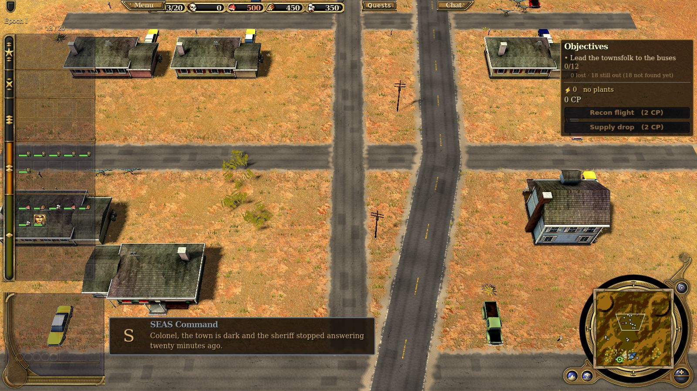
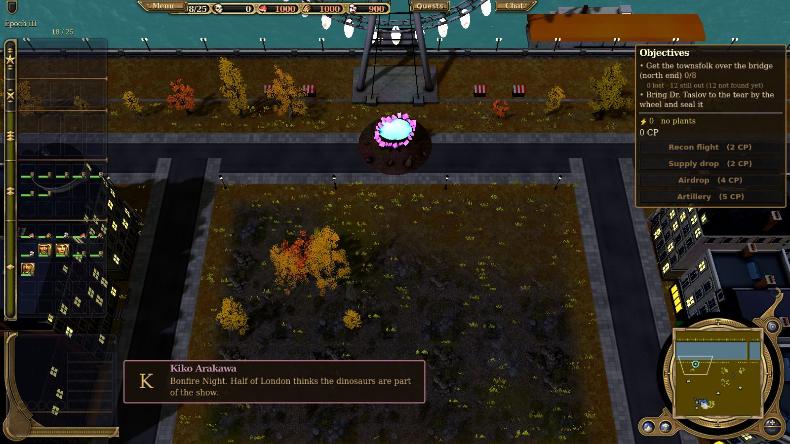

# The remake's own campaigns: Containment and the scenarios

The browser remake (the ParaWorld Toolkit's `remake/`, pw-exporter 98c7703) has campaigns of its own besides the
original game's: **ParaWorld: Containment** - the SEAS of the 1960s against the dinosaurs that come through the rifts,
1964 (missions 1-11) and 1966 (missions 12-16) - and five **scenarios**, standalone missions in ParaWorld's own world,
playable as any of the four tribes. This file is their port: the files, the runtime, the mission API for Lua, the
interface, the tests, and what is not done.

```
game/campaigns/containment/NN_name/mission.json   a mission: title, place, date, briefing, unlocks, the map recipe, the start, zones ...
game/campaigns/containment/NN_name/mission.lua    its script: the handlers (setup, tick, timers, events)
game/campaigns/containment/classes.json           the sequel's classes (SEQUEL_CLASSES / SEQUEL_HEROES of rules.js)
game/campaigns/containment/texts.json             their texts and radio introductions (texts.js)
game/campaigns/containment/cast.json              the radio's people: name, colour, portrait card (cast.js)
game/campaigns/scenarios/NN_name/mission.json     a scenario: its texts + "variants": the definition per tribe (and difficulty)
game/campaigns/scenarios/NN_name/mission.lua
game/campaigns/scenarios/tribes.json              the scenarios' tribe kit (for reference; the Lua has it in std/scenarios.lua)
game/lua/std/sequel.lua                           helpers of the missions (civilians, guards, posts, more, by ...)
game/lua/std/scenarios.lua                        helpers of the scenarios (KIT, settle, beast, army, strike ...)
src/Sim/Sequel/SequelData.cs                      the classes written into the tech tree (rules.js sequelData)
src/Sim/Sequel/SequelMap.cs                       the maps made from recipes (maps.js sequelSource)
src/Sim/Sequel/PowerGrid.cs                       electricity (power.js)
src/Sim/Sequel/SequelRuntime.cs (+ .Setup.cs)     the mission runtime (runtime.js)
src/Sim/Sequel/SequelLua.cs                       the mission API for Lua (`M`)
src/Sim/Sequel/SequelSession.cs                   a mission as the game runs it (IGameSim)
src/Sim/Sequel/SequelCatalog.cs                   the mission folders, what each mission unlocks
src/Sim/Sequel/SequelCommand.cs                   the player's inputs: begin (the briefing read), a power used, debug tools
game/src/App/GameSession.Sequel.cs                the session's part: loading, interface, events, the end, progress
game/src/UI/Sequel/SequelMenu.cs                  the menus "Containment (1964)" and "Scenarios"; progress
game/src/UI/Sequel/SequelHud.cs                   objectives, radio, clock, electricity, powers, the briefing
game/src/UI/Sequel/SequelStatus.cs                which missions play (greyed out otherwise)
game/src/View/Sequel/SequelFx.cs                  roads, night, rifts, searchlights, wires, rotors, set pieces, rocket, arcs
tools/sequel/export_js.mjs                        the data of the browser remake's tables -> the JSON above (once; kept for updates)
tools/prepare/sequel_art.py                       the sequel's built art the converted data lacks -> a configuration's overrides
```

## Playing

**Containment (1964)** is in the campaign menu's **Custom campaigns** tab ("The remake's campaigns": Start opens its
menu, Back returns to the tab; it is no longer a title screen button). **Scenarios** is on the title screen (beside
Campaign and Skirmish) and in the same tab.

* **Containment** is played with the **MIRAGE** configuration (its SEAS: more units and buildings, the heroes' bonuses
  for the SEAS) - as in the browser remake (rules.js `SEQUEL_MOD`). The menu says so and offers to switch. A mission
  opens when the one before it is won (settings.json `sequelUnlocked`); the debug options ("Use the debug options")
  open all. Difficulty Easy / Normal / Hard (the outbreak's strength 0.75 / 1 / 1.35, wave sizes 0.7 / 1 / 1.3 and
  what each script makes of it).
* **Scenarios** are all open, played as any tribe of the configuration (the base game: Norsemen, Dustriders, Dragon
  Clan; MIRAGE also the SEAS); the menu marks the tribes that won each (settings.json `scenarioWon`).
* Before a mission the **briefing** (title, place, date, the text, what the mission brings in; the game waits). The
  mission's clock and script start with **Begin** (a command: a saved game replays it).
* Saved games work as for any mission (docs/SAVES.md): the start and the inputs, replayed. The end screen's Continue
  starts the next mission of the campaign, Retry the same.
* Test starts: `--sequel <n>` / `--scenario <n> [--tribe Hu|Aje|Ninigi|SEAS]` `[--difficulty 0..2] [--debug]
  [--skip-briefing]`, `--screen sequel` / `--screen scenarios`.




## Mission folders

`mission.json` is the browser remake's mission definition without its code (exported by `tools/sequel/export_js.mjs`
from `missions.js`, `missions_1966.js`, `scenarios/missions.js`): `id`, `title`, `place`, `date`, `briefing`,
`unlocks` (classes it brings in; `["name", "later"]`: when the script calls `M.introduce`), `creatures`, `powers`,
`res`, `popMax`, `map` (the recipe, below), `start` (`buildings`: `[class, x, z, rot]`, `units`: `[class, x, z, n,
level]`; a class may be a list: the first the data has), `zones` (`{name, x, z, r, kind: evac | pen}`), `night`,
`dusk`, `epoch`, `camera`, `pieces`, `props`, `models`, `tribes`, the roles' players (`crane`, `aje`, `foe`, `foe2`,
`ally`: `true` or `{tribe, name, color, behaviour, res, relation, ai: false}`), `ajeFriendly`, `looks`, `civName`,
`winText`, `loseText`. A scenario has its texts and `variants`: the rest per tribe - `{"Hu": {...}, ...}`, or per tribe
and difficulty `{"Hu": {"0": ..., "1": ..., "2": ...}}` (the browser remake's `make(tribe, difficulty)`).

`mission.lua` returns a table of **handlers**; the runtime calls them by name with `M` (the API) and an argument table:

| handler | when | arguments |
|---|---|---|
| `setup` | the mission is set up (before the briefing) | |
| `tick` | every 0.5 s of mission time | |
| any name | a timer of `M.after(seconds, name, args)` ran out | `args` |
| `died` | a unit or building died / was destroyed | `e` (id), `name`, `role` (its owner's), `by` (whose blow was the last), `by_me` |
| `evacuated` | a rescued civilian reached an evacuation zone | `n` (evacuated so far), `zone` |
| `rescued` | a unit of the player's found a civilian | `u` |
| `asleep`, `loaded`, `captured` | a tranquilized creature fell asleep / was loaded on a truck / reached a pen | `u`, `name` (`captured`: `n`) |
| `netted` | an electrified net caught a creature | `u`, `net` |
| `plantTaken` | an abandoned generating station became the player's | `b` |
| `riftClosed` | a rift was sealed | `id` |
| `arrived_<piece>` | a set piece reached the end of its path | `id` |
| `done_<objective>` | an objective was completed | |

The missions are the browser remake's scripts translated 1:1 (each file names its source); the shared helpers are in
`game/lua/std/sequel.lua` and `scenarios.lua` (`require "sequel"`).

### The mission API (`M`)

Objects are numbers (entity ids), roles names (`me`, `outbreak`, `civilians`, `crane`, `aje`, `foe`, `foe2`,
`ally`), positions game metres (x east, z south, from the map's centre). `M.state` is the mission's own table (it lives
in the Lua state: a saved game replays the mission, so it comes back the same); `math.random` and `M.random()` are the
world's random numbers.

| call | does |
|---|---|
| `M.id`, `M.kind` ("sequel" / "scenario"), `M.tribe`, `M.difficulty` (0-2), `M.def` (mission.json), `M.state` | the mission |
| `M.time`, `M.cp`, `M.diff` (the outbreak's strength), `M.night` | read-only values (now) |
| `M.after(s, name, args)`, `M.call(name, args)` | a timer; a handler now |
| `M.say(who, text)`, `M.notify(text, kind)` | the radio (who: cast.json); a message line ("good" / "bad") |
| `M.objective(id, text, {of, secondary, civ, hidden})`, `M.progress(id, n)`, `M.complete(id)`, `M.fail(id)`, `M.is_done(id)`, `M.get_objective(id)`, `M.set_note(id, text)` | objectives (a failed main objective loses the mission; civ: the townsfolk line) |
| `M.win(text)`, `M.lose(text)` | the end |
| `M.introduce(class, quiet)`, `M.grant(n)`, `M.count(key, d)`, `M.counter(key)` | a class brought in; command points; counters (`civLost`, `evacuated`, `captured`, `dinosKilled`) |
| `M.mark(x, z, label, color, seconds)`, `M.unmark(label)`, `M.set_clock(at, label)` | minimap markers; the mission clock |
| `M.spawn(class, role, x, z, n, {level, target, tag, heading, swim})` -> ids, `M.building(class, role, x, z, rot)` -> id | objects (a class may be a list) |
| `M.units(role, filter)`, `M.buildings(role, filter)`, `M.near(x, z, r, role, filter)`, `M.in_zone(name, role, filter)` | ids; filter: a class, a list of classes, `{name, tag, cls, worker, built, envoy}` or `function(info)` |
| `M.info(id)`, `M.alive(id)`, `M.home(role)`, `M.cls(list)`, `M.exists(class)` | `{id, name, cls, role, x, z, hp, maxhp, alive, worker, task, built, powered, workers, tag, asleep, ...}` |
| `M.send(ids, target)`, `M.move(ids, x, z)`, `M.attack(ids, id)`, `M.stop(ids)` | orders (target: `{x, z}` or an id) |
| `M.kill(ids)`, `M.remove(ids)`, `M.teleport(id, x, z)`, `M.set_owner(ids, role)`, `M.invulnerable(ids, on)`, `M.trap(ids, s)`, `M.set_hp(ids, hp, maxhp)`, `M.scale_hp(ids, k)`, `M.sleep(id, s)`, `M.wake(id)` | objects |
| `M.set(ids, key, value)` | the runtime's marks: `target`, `tag`, `home` (`{x, z, r}`: stays by it), `rescued`, `hiding`, `envoy`, `intown`, `untargetable`, `disarmed`, `scale` (drawn bigger) |
| `M.rift(id, x, z, {every, first, waves, sealTime, cap, target, guard})`, `M.rifts()`, `M.rift_set(id, key, v)`, `M.rift_open(id)`, `M.close_rift(id)`, `M.remove_rift_building(id)` | rifts (waves: `{ { {class, n}, ... }, ... }`) |
| `M.zone(name)`, `M.add_zone{...}`, `M.pen(zone, tx, tz)` | zones; a fenced pen with a gate facing (tx, tz) |
| `M.piece(id, model, x, z, y, rot, {spin})`, `M.sail(id, path, speed, remove)`, `M.remove_piece(id)` | set pieces |
| `M.set_night(on)`, `M.fx(kind, x, z, scale)`, `M.shake(strength)` | night; effects ("explosion", "dust", "launch") |
| `M.res(role, res, value)`, `M.add_res(role, res, n)`, `M.relation(a, b, rel)` (both ways), `M.role_of(id)`, `M.has_role(role)`, `M.epoch(role)` | players |
| `M.ai(role, behaviour)`, `M.ai_lock(role, ids, on)`, `M.ai_attack(role, ids)`, `M.has_ai(role)` | the computer players |
| `M.area_damage(x, z, r, dmg, end, role, size)`, `M.reveal(x, z, r, s)`, `M.height(x, z)`, `M.random()`, `M.log(...)` | |

## The runtime (src/Sim/Sequel)

`SequelSession.Create` (the browser remake's main.js for `cfg.sequel` / `cfg.scenario`): the rules - Containment's
with the sequel's classes written into the tech tree (`SequelClasses.Apply`: copies of original classes with other
models, values and weapons; the build actions of classes later missions bring in left out, unless the debug option
"no mission bans"); a scenario's are the configuration's own -, the map made from the mission's recipe
(`SequelMap.Source`, the same random numbers as the JS: mulberry32 of the recipe's seed), the world
(`WorldBuilder.Build`) with the players by role and the start (`SequelRuntime.Build`: resources, the start buildings,
the epoch - Containment: 1, 2 from mission 4, 3 from mission 7 -, the units, the workers sent to the nearest food, wood
and stone), the script (`SequelLua`), its `setup`, the computer players (`TribeAI`, asleep until the script wakes them
unless the definition gives a behaviour), the debug options.

`SequelRuntime` is `World.Campaign` (its `Update` runs in every step after the computer players) and nothing else:
the world's random numbers, lists in their order, every input a command - the save's replay makes it again
(`StateHash`: objectives, rifts, counters, points mixed into the world's). Its rules (runtime.js):

* **Rifts** spawn waves every `every` s (capped by `cap` living creatures, sized by difficulty); a finished Rift
  Stabilizer of the player within 32 m seals one in `sealTime` s - the rift surges meanwhile (waves twice as fast, at
  the stabilizer); without one the seal falls back. A `guard` rift's creatures stay by it.
* **The outbreak's creatures**: to their target, else the nearest enemy (160 m), else the nearest building; a guard to
  what comes within its radius, else back.
* **Civilians** hide until a unit of the player's comes within 14 m, then run for the nearest evacuation zone (and
  away from creatures); the townsfolk objectives (`civ`) count the lost and fail when too few are left; hiding ones are
  marked on the map after three minutes.
* **Tranquilizers** (`tranq` tag): a dart puts the "Tranquilized" debuff on a creature for 30 s - a blow that would
  kill it then leaves it asleep at 1 hit point (`World.Hooks.Lethal`); darts strike five times as hard on a netted one.
  A **Capture Truck** next to a sleeper loads it, at a pen (or the garage / headquarters) it becomes the player's.
* **Electrified nets** hold a creature 15 s (30 s to charge); **searchlights** at night dazzle what comes within 26 m
  and light 36 m of the fog; the units' sight is 0.6 at night (`World.SightScale`, `World.ExtraViewers`).
* **Electricity** (`PowerGrid`): plants (generating stations, generators and water wheels with workers; windmills by
  themselves) deliver only while a line of power poles (at most 40 m apart) connects them to a hub (the headquarters, a
  field command post); the outbreak raids powered lines every two to three minutes. The map's stations stand abandoned
  until a unit of the player's comes near. Shock and chain weapons stun and jump (`World.Hooks.Damage`).
* **Command powers** (command points from objectives, sealed rifts, captures, big kills, one every 75 s): Recon flight
  (2 CP, reveals 70 m for 40 s), Supply drop (2: +150 food, wood, stone), Airdrop (4: four troopers), Artillery (5:
  six shells after 3 s). A power is a command (`SequelCommand`).

## The interface

`SequelHud` beside the HUD: the objectives in the right column above the minimap (done / failed / counts / notes, the
rifts being sealed), the electricity line, the command points and the powers' buttons (a power with a target: the
input's click mode), the radio box above the command bar with the speaker's portrait (cast.json's card from the
game's card atlas; the heroes are copies of the first game's and have their portraits), the mission clock, and the
briefing window. The minimap shows the mission's markers (`Hud.MinimapExtra`). `SequelFx` draws the roads (the
sequel's road surfaces), the night (`WorldRenderer.SetNight`: the mission's dusk or a dark blue one), the rifts pulsing
(the warp gate's vortex in them, shrinking while sealed, lightning from the stabilizer), searchlight beams with their
lit ground (the lamp turning on the tower, its beam - a cone brighter at the lamp - reaching down to a lit spot 17 m
out that sweeps round the tower, a glow at the lamp, and the 28 m round the tower glowing; the lit spot and that glow
are discs of soft light laid on the ground: grids whose vertices follow the terrain, 0.25 m above it - sequel_ui.js
`groundLight` / `drape`), the power lines, the windmill rotors and water wheels, the set pieces, the mission 5 rocket and its flight,
the electric arcs, and the reach of the open rifts while a stabilizer is being placed.

## Art

The sequel's own models (houses, cars, London, the sq_* buildings and vehicles, the rotors, the rocket, road surfaces)
are made by the ParaWorld Toolkit (`remake/art/sequel`, kept built: `built/models`, `built/tex`, `built/manifest.json`)
and its pipeline step "sequel" copies them into the converted data. Whatever a configuration's data lacks (an export
made before that step, a model added since) the prepare tool copies into the configuration's overrides
(`tools/prepare/sequel_art.py`, run by `Prepare.bat`: `overrides/assets/models`, `overrides/assets/tex`,
`overrides/assets/manifest_sequel.json`, which the game merges). Everything else is the original game's: the
creatures, the SEAS, the heroes (copies of the first game's), the civilians (`hc_citizen_*`), the warp gate's vortex,
the trees, rocks and ground of the settings.

## Tests

* `dotnet run --project tests/PwRemake.Tests -- Sequel`: the catalog, the classes in the rules (MIRAGE), the maps
  (the same every time), mission 1 set up and run, every Containment mission and every scenario (with several
  tribes) set up and played `PW_SEQUEL_SECONDS` (200) game seconds without errors in its Lua.
* `PW_PLAY=1 dotnet run --project tests/PwRemake.Tests -- SequelPlaythroughs` (or `PW_SEQUEL_ONLY=1,5`): every
  mission played through by script to its win (the browser remake's tests/sequel_flow.js and scenario_flow.js): the
  player's side cannot be hurt, the fights are won by killing what stands in the way, the heroes are put where the
  story needs them. The scenarios as every tribe (`PW_SCENARIO_TRIBES`), scenario 4 both ways (a side chosen,
  silence).
* `python3 -m unittest tools/prepare/tests/test_sequel_art.py`.
* In the game: `--sequel 1 --shots <dir> --shot-every 10` (docs/DEBUG.md).

## Status

See `game/src/UI/Sequel/SequelStatus.cs` and the playthrough results in docs/TESTING.md. Not ported (yet): the
browser remake's renumbering of old saves and settings (`migrateSettings`: no old saves here). (Ported 2026-11-18: the
searchlight's lit ground is draped over the terrain as in the JS - it was a flat disc.)

The sequel's cards (portraits of its classes in the HUD): the toolkit's step "sequel" puts `sq_cards.jpg` and the
marked `sq_cards_x.jpg` (shock trooper, tranquilizer: the SEAS card with a bolt / dart) into the data's card atlas.
When the data lacks them (or its atlas names a sheet that is not there), the prepare tool writes them into the
configuration's overrides (`sequel_art.cards`: `assets/ui/atlas_sequel.json` beside the sheets), and `UiAtlas.Load`
merges that file over `assets/ui/atlas.json`.
