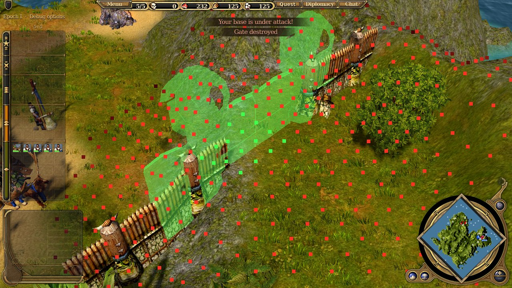
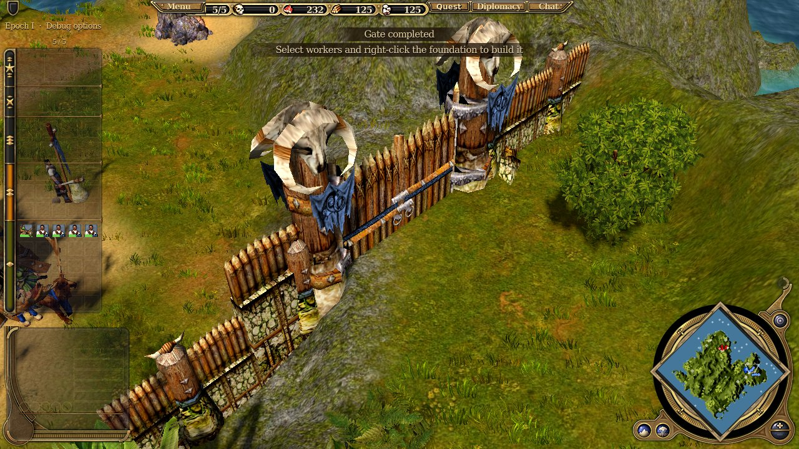

# The simulation core

What the systems (`src/Sim/Systems`), the campaign, the computer player and the view build on: the rules
(`src/Sim/Rules`), the world (`src/Sim/World`), the commands (`src/Sim/Commands`) and the model data
(`src/Sim/Content/ModelManifest.cs`). Ported from the browser remake's `game/techtree.js`, `rules.js`, `data.js`,
`colors.js`, `buffs.js`, `world.js`, `entities.js`, `player.js`, `nav.js`, `formation.js`, `delayed.js`, `prop.js`,
`anim.js`, `compose.js` (pw-exporter 98c7703). Read docs/ARCHITECTURE.md and docs/PORTING.md first.

## Rules (`PwRemake.Sim.Rules`)

| class | JS | what |
|---|---|---|
| `TtNode` | plain JSON objects | a tech tree node: a string leaf or an object with **JS key order** (integer keys first, then insertion order); an object's own value is its child `_value` |
| `TT` | techtree.js helpers | `Num` (parseFloat + finite), `Bool`, `NodeAt`, `Scalar`, `ApplyMod`, `ModsOf`, `JsString` (JS number to string), `JsRound` |
| `TechTreeBase`, `TechTree`, `LocalTree` | techtree.js | StartTT + the enabled filters of a player (counted `Enable`/`Disable`, `Suspend`/`Resume`, `Version`, `Memo`, `Invented`, `Built`, `Modifier`, `Modify`); a unit's own local tree follows its owner's |
| `Rules` | rules.js | `Def`, `Stats`, `StatsAt`, `MinLevel`, `LevelFilters`, `HasLevel`, `WeaponSetOf`, `WeaponStatsOf`, `WeaponPaths`, `DefenceVs`, `Actions`, `ActionsAt`, `ActionsOf`, `Check`, `Missing`, `Invented`, `StartLevel`, `Text`, `ActionText`, `Ui`, `IdleSet`, `StartOf`, `Kind`, `IsA`, `IsWildClass`, `Script`, `Composites`, `ClassGfx`, `ItemNode`, `CorpseFood`, `ResourceValue`, `MiscValue`; `Rules.Load(dataDir)` |
| `GameData` | data.js / gamedata.json | typed tables: texts, ui strings, idle sets, composites, start presets, script classes and parents, class models, resource values, npc, pyramid, level-up skulls, hero constants, buffs, wall classes; `Raw` for the rest (pointBuy, finishing, particles) |
| `Colors`, `Buffs` | colors.js, buffs.js | player colours; the buffs of a unit and those a viewer sees |
| `IRulesOwner` | `owner.tt / tribe / debug / maxEpoch / foreignActions` | whose tree a query reads: a `Player`, a unit's `LocalOwner`, or null (the neutral world tree) |

Results are memoised per tree version (as in the JS); the names keep the JS fields (`ObjectDef.CanHarvest` =
`def.can_harvest`, `LevelStats.Fow` = `stats.fow`, `WeaponStats.Dur` = `cs.dur` ...).
**Golden tests** (`tests/PwRemake.Tests/RulesGoldenTests.cs`, `tests/golden/rules_dump.mjs`): node runs the JS rules
on the same data and both answer ~2,700 class queries (def, stats per level, weapons per level, weapon values,
action lists with costs/times/requirements, check results, texts) in 9 scenarios per configuration (the neutral
tree; per tribe a fresh tree and one with epochs, buildings, upgrades and level filters switched on) - 0 differences
for both configurations.

## The world (`PwRemake.Sim.World`)

`new World(rules, models, map, new WorldOptions { Seed = ... })` - then players (`World.Players.Add(new Player(id,
tribe, new PlayerOpts { Rules = rules, Team = ... }))`), `PlaceBuilding`, `SpawnUnit`, `AddResource`, `AddProp`.

| member | |
|---|---|
| `Data` (Rules), `Models` (ModelManifest), `Map` (IWorldMap), `Opts` | what the world is made from |
| `Rng` (SimRandom), `Time`, `StepNo`, `STEP` = 0.05 | random numbers (instead of Math.random), game time |
| `Players`, `Units`, `Buildings`, `Resources`, `Projectiles`, `Props`, `Spirits`, `Timers`, `Effects` | the state |
| `UHash`, `BHash`, `RHash` | spatial hashes (`Query(x, z, r, fn)`, `Near(x, z, r)`) |
| `Nav`, `WaterNav`, `NavFor(u)`, `AmphibNav()` | the walk grids (2 m cells) |
| `ById(id)` | entities by id (commands, saved games) |
| `Step()` | one step (below) |
| `Order(units, o)`, `QueueOrder`, `ToIdle`, `ReleaseTask`, `DropStates` | orders (world.js) |
| `SpawnUnit`, `UnitModel`, `PlaceBuilding`, `PlaceAdapted`, `AddResource`, `EntityFilters`, `LevelFilters`, `Victory` | spawning, filters |
| `Later(sec, kind, args)`, `PeriodicEffect(host, dur, every, kind, s, now)` | delayed actions as data |
| `Emit(type, args)`, `Events`, `DrainEvents()`, `EventsSince(i)` | events |
| `GroundY`, `Height`, `IsWater`, `MarkWater`, `MarkTerrain`, `LandIsland`, `ClearArea`, `Reserve` | ground |
| `DayTime`, `IsNight`, `CanResurrect`, `NearestSpirit`, `AlarmUnit`, `VictoryAnim` | |
| `StateHash()` | determinism check |
| `Fog`, `EnableFog(p)`, `FogUpdate`, `SetFogRevealAll` | the human player's fog of war, kept by the world (FogOfWar.cs; `Fow` answers the systems from it) |
| `Stepped` | after every step (a saved game's recorder) |

### The step (`World.Step`, docs/ARCHITECTURE.md)

1. `ApplyCommands()` - the commands due (`Command.Step <= StepNo`) in submission order
2. `Update(0.05)` (world.js `update`): time; due `Timers` (DELAYED); `EffectsTick` (auras, periodic: Effects);
   `EffectsUpdate` (PERIODIC); spirits; wild nests, wells, lakes, weather, game over (when there are any);
   `StatsUpdate`; every 0.5 s `RefreshTick` (entities whose tree changed re-read their rules); every unit
   (`UnitUpdate`: the task switch), every building (`BuildingUpdate`), props, projectiles; `Separation`; ground
   heights; removal of the removed

`Separation` pushes overlapping units apart (land units with land units, ships with ships; never into blocked
cells). Two units exactly on one spot part in a direction fixed by their ids - the JS skipped such a pair, so units
trained at the same spawn point in one step (debug "free and instant": four ships at a harbour), or put on one spot by
a script, stayed inside each other and, ordered alike, walked as one (player report: four ships "stacked into one").
The way finder knows no units and the separation pushes only along the line between two, so two units whose ways ran
head-on through each other walked into each other for good (player report, MIRAGE 13 co-op: two SEAS mechs of a
computer player in its base "kept going straight at each other forever"; big units stood 20-40 s or longer, freed only
by rounding drift). `Unit.Steer` now turns off for a unit coming the other way in its way (`Unit.Avoid`: within the
two radii across the way, up to radius + 1 + 0.7 s ahead; any owner, land with land, ships with ships): both to
opposite sides, decided alike by both from the pair (the lower id goes away from the other across its own way, the
other the opposite way). Not from the unit it is going to or that comes to it (its task's target: a squad boarding a
hovercraft that drives to it stepped aside and boarded later - `FerryTests.Mission15SeasCrossing` - , a fighter
charging one coming at it). The original's engine steers round in its C++ code; the scripts only step an idle fighter
standing in another aside at random (FightingObj `CheckUnitCollision`). `MoveDeadlockTests.HeadOnSwapGetsThrough`:
swaps of infantry, SEAS suits / walkers, a mammoth, a big dinosaur and ships, in the open, in a passage and past a
corner, for a human's, a computer player's and enemies' units, through within 8 s of the time alone. Not handled: a
passage only one of them fits through (one would have to back out). Nor from a unit going to the same point (its
goal within 1 m): a group sent to one point - a trigger's attack-move to a waypoint - comes together there from all
sides, each one "head-on" to those across it; turning off, they circled the point for good and never arrived (base
mission 13: the third outpost team's eight SEAS units round 1121,785 for 45 minutes, the waypoint chain stalled, "Hold
the Fort" was never accomplished). They stop behind the ones nearer it (`Unit.QueuedBehind`);
`MoveDeadlockTests.GroupToOnePointComesToRest`.
A group order's places that fall on blocked ground (`Formation.FormationSlots`) move to the nearest free cell no other
unit of the group got. Note: units without model data get radius 0.45 (`ModelManifest.UnitSize`); the test data
lacks most model files (MIRAGE: all), so there ships and big animals stand much closer than in a full installation.

**Goals out of reach** (`Nav.Find`, 2026-11-20). The ground is labelled in connected regions once the terrain is marked
(`NavGrid.LabelRegions`: across mountains or water - the map's walk grid). A goal in another region than the unit's is
replaced by the cell of the unit's region nearest it: the unit walks to the point nearest the goal it can reach and
stops there, as in the original. That cell was looked for within 80 cells (160 m) only; a goal farther off got the
search that fails, which ends at the cell it reached nearest the goal - another one by where the unit stood and by its
size (a big unit's search has no coarse route and ran out after 30,000 cells), so units sent on wandered from one such
end to the next (mission 9: a triceratops sent from the Dragon Clan village to the launch ramp's island stood 104 m from
the island's point nearest it). Now the whole map is searched (`FarCell`, its last answer kept for the group's other
units), and "nearest" is the straight-line distance: the ring search took the first square ring holding a cell of the
region, up to 41 % farther than the nearest (mission 9's west altar: the corner of the island 350 m off instead of the
shore 280 m off). Such a far goal is still reported not found (`Found` false: `Unit.NoWay`, `Combat` gives up on a foe
there, the computer players' checks), as before; within 160 m it stays found, as before. (A first try on 2026-11-12
lost base mission 6's playthrough and was reverted; this one wins it with every tribe in both configurations:
docs/CAMPAIGN.md mission 9.) `UnreachableGoalTests` (mission 9's village and its islands; mission 6's army sent from
its island to the pirates' prison): every way to a far goal on another island ends at the one nearest cell (brute force
over the region), small and big units stand there.
The same flaw elsewhere: a builder or repairer whose way ended anywhere set to work where it stood (`BuildUpdate` /
`RepairUpdate`: "arrived, or the way is walked"), so buildings went up from across the water - mission 9's tower at the
airplane from the village's shore 465 m off, the launch ramp from the village for 50 minutes (docs/CAMPAIGN.md). Now
(`Construction.WayEndedShort`) a builder whose way ended more than 10 m from the walls looks at the cell of its ground
region nearest the building: none within 25 m of the walls (another island) - the job is given up, the worker stands;
it stands at that cell - it works from there (mission 9's launch ramp stands in rocks, the nearest walkable ground 20 m
from its walls); else it walks there. Not for a harbour (a coastal building, or one standing in the water: MIRAGE's
Dustrider floating harbour): built from the shore as before.

**Bridges** (`World/Bridges.cs`, 2026-11-13; how the original makes them: docs/MAPS.md "Bridges"). A bridge has no
walk surface: units walk the ground (the map's walk grid), and a bridge blocks the cells of its model's pathfinder
boxes like every CDecoColObj - placed by the map source or by the mission (`Campaign.NO_BLOCK` no longer names
bridges: mission 6's footbridges and mission 7's river bridges were walked through). A bridge without boxes (mission
13's `hcl13_bridge_01`, mission 5's `hc_bridge_*`) blocked nothing, so walkable ground just below its deck was walked
under it, out of sight (player report, MIRAGE 13: the allied Dustriders coming back from the SEAS outpost 1 "ended under
the bridge" - their way over the strip of ground between the two city bridges cut the strip's corner at the first
bridge's east end). `Bridges.Shade` blocks the free cells inside the model's drawn box (`ModelManifest.Box`, turned
like the pathfinder boxes, 0.5 m wider) whose ground lies 0.5 - 4 m under the bridge's stored height - on maps with a
walk grid only, when the map is built (`WorldBuilder`) or the prop placed (`Prop`). It never cuts a way: before and
after, the free ground of a window 24 cells round the cells is split into its connected parts (4 neighbours, for a
unit's width of 1 and 3 cells); if a part would fall apart, 75 % and then 50 % of the box is tried, else nothing is
blocked. Ground more than 4 m below (an arch walked under in plain sight: Ice_Bridge_01) and ground at or above the
deck (the raised strips under the river bridges) stay walkable. A unit's height is the ground's as before.
Tests: `BridgeTests` (a ravine with a strip of ground beside a bridge: the edge under the deck blocked, units cross
by the strip and never under the deck; a box over the whole strip cuts no way, a radius 5.5 unit still finds it; the
heights that are shaded; no walk grid: nothing; mission 6 / 7 bridges block their boxes; MIRAGE / base 13: the
Dustriders' team sent back by CBL_Ga05 from the cleared outpost - no unit on a blocked cell, none just under a deck
with a box given to the city bridge, all back).
3. `AiUpdate(dt)` - the computer players (hook)
4. `CampaignUpdate(dt)` - the campaign / trigger engine (hook)
5. the events stay in `Events` for the view and the interface

### Map access: `IWorldMap`

`Size`, `Play` (playable rectangle), `Height(x, z)`, `Water` (level or null), `Setting`, `StartTime`, `WallGrid`,
`Walkable` (the map's own walk grid: the PaFi marks of an original map; null = the slope rule `MaxSlope`), `Kind`.
The world marks its grids from it in the constructor (main.js: border, water, walk grid / slope, regions).
`FlatMap` is the test map (optional height function, water, blocked rectangles). Also `IWallMap` (the wall grid,
game/wallmap.js: `World.WallMap`, set by the map setup), `IBuildingBehaviour` (systems/buildings.js),
`IFogOfWar` (`World.Fow`: the systems ask it as the JS did), and the delegates `AdaptTerrain` / `ClearVegetation`
(the map setup's ground levelling and plant removal under new buildings).

## Entities (`Entities.cs`, `EntityState.cs`, `Compose.cs`, `Anim.cs`)

`Entity` (abstract) → `Unit`, `Building`, `ResNode`; plus `Projectile`, `Prop` (not entities). All partial.

Simulation state as in the JS: `Id`, `Owner`, `Pos` (V3 field: `u.Pos.X = ...`), `Heading`, `Radius`, `Alive`,
`Hp`/`MaxHp`, `St` (Status: timed states `T`, `Aura`, `Bonus`, `Camo`, poison, `Active(key, time)`), `Cd`, `Attackers`,
`LocalTT`, `RulesOwner()`, `Name`, `Def`, `Cls`, `Level`, `Stats`, `Weapons`, `Weapon`, `Cs(w)`, `Queue`, `Rally`;
units: `Task` (UnitTask), `Path` (NavPath of Waypoints), `Vel`, `Carry`, `Stance`, `SetPath`, `Steer`, `Face`,
`MoveAnim`, `IdleTick`, `CanWalkInto`, `ApplyLevel`, `ReadRules`, `RefreshRules`, `UseWeapon`, `AttachTool`,
`SetCarry`, `SetVisFlag`, `SetCamoLook`, `BuildModel`; buildings: `Built`, `Progress`, `Boxes`, `Cells`, `SetBlocking`,
`SurfDist`, `LinkWorld`, `Slots`/`OccupySlot`/`FreeSlot`, `ExitPoint`, `SpawnPoint`, `OnWork`, `OnDelivery`,
`SpawnAnim`, `AimTurret`, `Slide`, `Relocate`, `SetParts`, `SetGateEnds`, `RefreshRules`, `SwapModel`.
Loose JS objects are classes: `UnitTask` (`u.task`), `Order` (`o`, also a task's `Then`), `Status`, `Carry`,
`QueueItem`, `Knock`, `JumpFx`, `Lift`, `PendingShot`, `DeployState`, `Spirit`, `WallJump`, `Wreck`.

### What the view draws (the "look": plain data, no engine objects)

| entity | data |
|---|---|
| all | `Gfx` (model), `Anim` (AnimCtl: `Cur.Clip`, `Cur.Time`, `Cur.TimeScale`, `Cur.Loop`, `Cur.Paused`, `Fade`, `Serial` counts starts), `Pos`, `Heading` / `Rot`, owner's `Party` colour, `LookVersion` + `LookChangedEvent` (every change) |
| unit | `HeldWeapon` (its `Parts`: gfx + link), `WeaponsVisible`, `ToolGfx`/`ToolLink`/`ToolShown`, `Carry.Look` + `CarryShown`, `VisFlags`, `HideMask` (animals/vehicles: saddle, party colour, gear, wounds - parts.js animalMask), `PartyTinted`, `Comp.Parts` / `Comp.Wagon` / `Comp.Riding` (attached parts: gfx, link, parent part, own AnimCtl, turret `Yaw`; when the unit dies `Comp.Died` holds them - riders their sitting pose, the rest their standing clip or the first frame of theirs, paused: a dead unit's parts are not updated, and the ankylosaurus' catapult kept swinging on the body), `Night` (ships), `JumpH`/`LiftH`, `SinkY` (dead), `CamoGfx` |
| building | `VisLevel` (construction 0..3, 4 finished), `VisDmg`, `VisAge` (epoch), `ArmMask`, `WallParts`, `GateEnds`, `Night`, `ReadyFx`, `Parts` / `Turret` (`Yaw`), `Cranes`, `Origin` (model origin; `Pos` is the footprint centre), `Ruin`, `SinkY` |
| prop | `Model`, `Visible`, `Anim`, `LookVersion` |

Turret angles: the JS turned a part about its link's z axis (`rotation.z`); here `Yaw` is the angle relative to the
carrier (+ as an entity heading), the view applies it in the link's frame. The trailer (collector wagon) follows the
drawbar in the view; the sim plays its walk clip. Damage smoke, spirit glows and other particles are the view's.

### Animations (`AnimCtl`)

`Play(name, AnimOpts { Loop, Ts, Fade, Restart, OnDone, Cut })`, `Pick(...)`, `Has`, `Duration`, `Start`, `Update(dt)`;
start/loop/end clips (`#s`, `#l`, `#e`) as in anim.js. `OnDone` is an `AnimDone(kind, args)` (no closure):
`ANIM_DONE` handlers `"busy"` (unit free again) and `"idle"` (building back to its idle clip) are built in, systems add
theirs. Animations advance every step for every entity (the JS skipped off-screen ones: not deterministic).
The original's actions on start / loop / end clips: `PlayLoops(name, loops, intro, outro, ts, onDone)` is
`AnimAction(name, loops, intro, outro)` / `SetSLEAnim` - the start part once, the loop part `loops` times (9999: until
`StopLoop`), the end part once, then onDone; it returns its length (`SleLength`: start + loops x loop part + end; a clip
without loop marks: loops x the clip). `StopLoop()` is `AnimActionStopLoop` / `EndCurrentLoopAnim` (the end part now),
`Still(name, t)` is `SetAnim(name, 0, frame)` (a held frame, t = frame / 25), `Done` tells that a clip played once or an
end part has run out ("Animation audit (2026-11-13)" below). `Play(.., AnimOpts { Via })`: a gait change's transition
clips (accel_1_2 ...: `WalkGaits`, walkanimconfig.txt), each once (Phase "t", `CurName` already the new gait's), then
the new gait's loop part.
Sound events: `World.AnimSounds = true` makes the clips' GSF sound events "animSound" events (alternatives listed).

### Model data (`src/Sim/Content/ModelManifest.cs`, `ModelFileInfo.cs`)

`ModelManifest` = `assets/manifest.json` (arch, anims source, pf footprints, walk speeds, walk sets, sounds, loop
marks, sequel sizes) + per model what the JS read from the three.js template: `Fourcc`, clip lengths, link positions
(model frame), bounding box (`ModelFileInfo`). Those come from `assets/modelinfo.json` (to be written by the prepare
tool: `ModelFileInfo.BuildAll(modelsDir)`) or, without it, from the `.glb` files on first use (only the JSON chunk and
the skins' inverse bind matrices are read). `Clips(model)` (with the animation source and the loop parts),
`UnitSize`, `Box`, `Link`, `HasLink`, `Has`. Without model files the world still runs (no clips, default sizes).

## Melee blows and the titans' turrets (Combat.cs; deviations from combat.js)

* **A blow is decided at the swing.** The original's attack loop (FightingObj `AttackEnemy`, FO:5787) calls
  `TakeDmg(A)` with the fight clip's delay, `Penetrate` (the cone of lances, staffs, the big carnivores' bites) or
  `CAreaDamage` at the victim's place when the swing *starts*; the damage arrives after the delay whatever the victim
  did meanwhile (only a dead attacker or victim drops it, `ProvideDmg` FO:4324). combat.js fired the blow after the
  delay and only then looked who was in reach (`fire`: "the victim got away during the swing"; `penetrate` at the
  hit). Here the swing stores its victims in `PendingShot.Victims` (an area blow its point `At`) and `LandBlow` deals
  the damage after the delay without a range check; the attacker stands still until its blow lands (the original even
  waits the whole attack duration, `WaitAction(Duration)`). The moves' shots (`FireShot`, `FireUnit`) still go through
  `Fire` with its check.
* **The cone always takes the attack's own victim.** The attack zone (`RangeZoneOf`) is measured to the victim's full
  radius (the spec's fallback for the engine's attack zones), the cone (`GetPenetratedObjs`, FO:5900) to its inner
  radius (half): a big victim standing at the far edge of the zone was swung at for ever and never hit. Other victims
  in the cone are chosen by the original's formula (`PenetratedBy`).
* Player report (MIRAGE): "the CBR titan (`seas_rex`, model `arena_tred`) was unable to kill the elk, it was just
  stuttering behind it without dealing damage, the attack sound did play" - with blue sparkles on the elk: the melee
  hit effect (`fx_impact_02/03/04/07` have blue particles) of the "hit" event the cone emitted though it caught
  nobody. Others with the same trouble against a fleeing elk (Sys1ChaseTests): `ninigi_sumo`, `aje_atroxosaurus`,
  `aje_brachiosaurus`, `ninigi_triceratops` (cones), `hu_pikeman` (a blow re-checked at the hit).
* **Minimum range:** a target inside the minimum range of a weapon with no short weapon ends the fight unless
  another target is in reach - a player's order too (Fight.usl: "the target is in the min range: end the task");
  combat.js kept the order and the unit (fire cannon, Wehrspinne, log cannon) walked against its victim for ever.
* **Target choice by the minimum range** (`FindTarget`, `InSortZone`, `SortKeeps`; FightingObj `SortEnemyList`
  FO:4890-4924, called by `ExamineEnemies` with `GetRealMinAttackRange()>0`): a unit whose primary weapon has a minimum
  range sorts its enemies by the engine's attack zones - short (S = short range + radius + 2), the minimum range (M =
  minimum range + radius + 2 in place of the medium range) and primary (A = attack range + radius + 2, + 0.5 m per metre
  shot down). Only the enemies in the primary zone keep their place; those inside S / M and those out of reach are left
  out when the unit has no secondary short or medium weapon, otherwise put behind the others. combat.js's `findTarget`
  had no such rule: the log cannon, the fire cannon, the Wehrspinne, the Seismosaurus, the Hu steam boat, the Aje
  catamaran, the Ninigi rocket boat (MIRAGE also: the cargolifter, the SEAS cannon turtle) locked onto an enemy at their
  feet that they cannot shoot (since port/chase the fight ended at once and the next search took it again) or walked
  off to one beyond their range; now they pick an enemy they can shoot, or none. MIRAGE's workers (a slingshot with a
  0.5 m minimum range and a short weapon) and the Kong (15 m, a short weapon) take enemies in their primary zone first
  and the close ones after. Test: `Sys1MinRangeTests` (every walking class with a minimum range of both configurations).

## First strike (FirstStrike.cs; the engine's `FrstStrk` event)

A unit **ordered by its player** to attack strikes once while it runs up to its victim. The original: FollowEnemy
(FightingObj.usl:5953-6080) gives the engine's advance action `m_sFirstStrike = GetFirstStrikeAnim()` only in the branch
of an order of the player; the engine plays that clip when the unit comes into first-strike range of a character,
animal or vehicle and sends the unit `FrstStrk` with the time to the hit; `OnDoFirstStrike` (base FO:2585, MIRAGE 3732)
then gives the fight's enemy `TakeDmg(this, factor, timeToHit)` - the normal damage of the primary weapon, landing at the
hit - and resets the follow timer.

| | base | MIRAGE |
|---|---|---|
| who | characters with the clip `first_strike_0` (character.usl:548) | characters with the tech tree's `/fsa` ("first_strike_0\|first_strike_1": one at random, if the model has it - character.usl:857); animals with `first_strike` (Animal.usl:2082; the brachiosaurus only without a build-up) |
| damage | factor 1.0 | factor 1.5; `/fsm` = 1 (Bela): a shot instead |

Here: `World.TryFirstStrike` runs in the chase of `AttackUpdate` (once per follow - a new chase may strike again; the
clip is picked once per follow), `OnDoFirstStrike` strikes, the event `firstStrike {attacker, target, delay}` is emitted.
The clip plays while the unit runs on (no walk clip over it); its next normal blow waits for the hit; the first strike
does not count as a blow (`LastHitDone`). The time to the hit is the clip's first blow / shot sound (weapon_*_att 0.48 s
or 0.84 s, *_shot 0.8 s, a dinosaur's *_hit), else half the clip.

**The engine's rule** (PWServer.exe 0x49A1E0, the attack-walk action's tick; read 2026-11-18): the settings
`Server/FirstStrike/MinDist` 3, `MaxDist` 8, `DistFact` 0.9, `MaxHitDist` 9 (defaults in the exe; no settings file sets
them) - and the tick then sets MaxHitDist to **0.5** itself, so the setting is never used. Only for a character, animal or
vehicle target. P = the target's position predicted the clip's hit time ahead, r = the advance's distance between the
centres (here: the approach distance + the target's radius); the strike starts when MinDist² + r² < |P - A|² <= MaxDist²
+ r² (2D). The strike point is S = P + DistFact x r towards the attacker; the nearest free spot to S must be within
MaxHitDist of it and at least MinDist from the attacker. The unit then lunges there with the clip (here: straight, from
where it stood to S by the time of the hit - `World.FirstStrikeLunge`) and gets `FrstStrk` with the time to the hit.
`World.FirstStrikeCfg` (FirstStrikeSettings) has these values. Not taken: two more conditions of the tick that could not be
named (the attacker's action state >= 2 and an age <= 20 of something it keeps).
Tests: `FirstStrikeMarkersTests.FirstStrike*`.

## Attacking the ground (`GroundAttack.cs`, order "attackground"; 2026-11-20)

User request: "units that deal aoe damage like catapult diplo when used attack button show their radius of splash
damage and you can also order them to attack ground ... into the spot you click no need for an exact target".

The original (SecondaryInputController.usl HandleMsg, the "Attack" command) does it like this:

- A click of the Attack mode on open ground sends each selected object whose `hitrange` (splash radius) is above 0
  a Fight command with no target and the pick point ("Scape").
- The rest of the selection walks to the point, each shifted by up to sqrt(n) m.
- While the mode is armed and the selection has an area weapon (CSelectionInfo.AREA_WEAPON), a range marker of the
  selection's largest splash radius (`m_fAreaRange`) follows the mouse.
- The cursor reads `attack_area_weapon`, plus `_invalid` inside the minimum range and `_walk` out of reach (GetCursor).

The remake:

- The view (GameInput.Orders: `UpdateAimArea`, `AttackModeCursor`) draws that circle as `SelectionOverlay.AimArea`:
  red, or grey inside the minimum range.
- On a ground click the view sends the area units an OrderCommand "attackground" with the point. The others get a
  group "move" (the formation stands in for the random shift). A selection without an area weapon keeps the old
  attack-move on a ground click.
- `World.CanAttackGround`: the primary weapon has Splash > 0 and damage, and no penetration (a flamethrower's cone is
  no area shot).
- `GroundReach` gives the reach as `RangeZoneOf` measures it for a target without a body. The unit walks onto the line
  from the spot to itself, inside that reach and out of its minimum range (a mortar too near steps back). A unit that
  cannot walk ends the attack.
- In reach it turns to the spot, setting up first where it sets up to shoot. It then fires at the cadence of its
  normal attacks, with the same clip choice, fight positions and first-shot overtime.
- The shot is a `PendingShot { Ground = true, At }` that `World.FireAt` lets go:
  - with a projectile, a `Projectile` with no target and a fixed aim, jittered as every area shot (Launch);
  - without one (a tail sweep), the blow's `AreaDamage` at the spot.
- It goes on until the next order.

## Setting up and fight positions (Compose.DEPLOY, Combat.FightPosition)

User report (2026-11-12): "When the Black Widow is in the shooting mode and is 'curled up', it should continue to be
curled up until it has to move. Currently it uncurls after every attack." The original agrees (Vehicle.usl CWehrspinne,
MIRAGE repo copy - the base script folder of the installation lacks TransportObj/; the toolkit's datamine read the base
copy with the same class; Fight.usl): the Black Widow's weapon is a build-up with `SetCanSwitchAttackMode`; in range
`SwitchToAttackMode` plays `AnimAction("attack_front", 1, intro, no outro)` - it curls up (frames 0-30 of the clip,
whose loop part is frame 30-31) -, each shot `SetAttackAnim` = `SetSLEAnim("attack_front", 0, no intro, no outro)` - it
stays curled -, and only `SwitchToWalkMode` (to follow a target out of range, or `Break`: the fight broken off by a
new order) plays the end part (it uncurls). When a fight just ends nothing switches: it stays curled until it moves.
The remake played the whole clip (curl, shot, uncurl) for every shot.

* **Units that set up** (`Compose.DEPLOY`, `DeployState` walk / down / attack / up; `Sle`: the body's start / loop / end
  clip is the set-up): `seas_wehrspinne` (`attack_front`), the log cannon mammoth (`rest`: CMammoth.SwitchToAttackMode
  `AnimAction("rest", 1, intro, no outro)`, SwitchToWalkMode `AnimAction("rest", 0, no intro, outro)`; the frame's
  build_down / build_up as before - the remake played "rest" whole, lying down, resting and standing up again, so the
  set-up mammoth stood, and backwards to get up), MIRAGE's `seas_mgwalker` (`standup`). Down / up last the clip's
  start / end parts. They stay set up when the fight ends (no idle clips: `BusyAnim`), get up when they have to move
  (`Unit.Move` -> `HoldMove`) or a new order breaks the fight off (`World.Order`). A one-frame loop part is cut for
  attack clips (`ModelManifest.MinLoopPart`: 0.04 s; other one-frame loops - idle_1, sleep, spawn - stay whole clips).
* **Fight positions** (`Combat.FightPosition`, `AnimCtl.PlaySle`, `Unit.FightPos`): the ranged units of base
  CCharacter.IsAnimLoopUnit (character.usl:2529: the archers, marksmen, Dustrider rammer and thrower, ninja, mortar,
  SEAS marksman / gunner / rocketman, the flamethrowers, Bela, Tesla, Babbage, Lovelace, Schliemann, the hermit; MIRAGE
  adds the sniper, the jetpack warrior, shooter_lvl*), CLumberjack (the minigun lumberjack, Babbage's mobile suit) and
  MIRAGE's CSpecialMobileSuit / CSeasTerminator play their shooting clip's start part on the first shot (the weapon comes
  up) and its loop part on every shot (`SetSLEAnim(clip, 1, !m_bTecInFightPos, no outro)`), holding it between shots;
  the end part plays when the fight is over and the standing clip takes over (`EndFight`: `AnimAction(clip, 0, no
  intro, outro)`). They raised and lowered the weapon for every shot and stood in the fight stand between shots. Not
  taken: the workers of the list (with an animal's weapon: the slingshot of m_sAnimalWeapon).
* **The first shot's delay** (taken 2026-11-13, Kacper: "on by default, with a debug option to customise it"; base
  character.usl CCharacter.AttackEnemy lines 2399-2412 and 2471-2474, GetWeaponDuration / GetProjectileDelay 2584-2590;
  the same in MIRAGE's character.usl 3856-3926, 4042-4048): a character of IsAnimLoopUnit shooting with its primary
  weapon (`GetCurrentWeapon()==GetRightHandWeapon()`) with the shooting clip on its model sets
  `m_fWeaponDurationOvertime` = 0 and, when the weapon is not up (`!m_bTecInFightPos`), **0.6 s for `Bela_s0`, 0.4 s for
  the others**. It is added to `GetWeaponDuration()` (Fight.usl `m_fDuration`: the wait to the next shot) and to
  `GetProjectileDelay()` (the clip's `m_fShootDelay`: the arrow leaves that much later); a direct hit (the flamethrowers'
  `Penetrate`) is not delayed, only the next shot. `m_bTecInFightPos` goes false in `EndFight` - the fight over, or
  `FollowEnemy` (the target out of range: it walks after it) -, so the first shot after the weapon came up again has
  the delay again; the shots from the raised weapon have none. Other weapons (a secondary melee blow) leave the member as
  it is. Vehicles (CLumberjack: the minigun lumberjack, Babbage's suit; MIRAGE's CSpecialMobileSuit / CSeasTerminator)
  have no such member. The remake (`Combat.AttackUpdate`, `World.FirstShotUnit`, `Unit.ShotOvertime`,
  `World.FirstShot` = `FirstShotDelay`): a primary shot of those characters that plays its clip's start part (not
  already holding the loop part) sets the unit's overtime, any other primary shot sets 0; the time to the next shot is
  the weapon's duration + the overtime, a projectile's delay the clip's shoot delay + the overtime (still capped at
  0.9 of the shot's duration). Measured (FirstShotDelayTests): hu_archer 2.45 s to its second shot, 2.05 s after;
  seas_gunner 1.0 / 0.65 s; Bela 2.0 / 1.4 s. A model without a start / loop / end shooting clip gets none (no weapon
  raised here). The jetpack warrior counts only flying (MIRAGE's IsAnimLoopUnit). The debug option "First-shot delay"
  (docs/DEBUG.md) switches it off or sets one time for every unit; it travels with the GameStart. The golden tests
  against the browser remake (which has no delay) compute damage, aura and move values without fight timing, so none
  needed it switched off; a golden test that ran fights would set `W.FirstShot = new FirstShotDelay { On = false }`
  (as `WallMap.Overbuild = false` for the walls).
* **Checked and as the original**: the build-up catapults (held at their first frame between throws, a throw a shot),
  the ballista / gatling / tower turrets and the carrier turret (their clip once a shot), the riders' and gunners' attack
  poses. Not checked: the siege tower / brachio's `siege` docking clips, MIRAGE's cannon turtle body (`SetAttackAnim`
  `SetSLEAnim("attack_front", 0)`). Test `FightPositionTests`.
  Every automatic choice goes through it: the idle look-around, the defensive guard (AIAM state 1), the attack move
  (also the computer player's: its squads attack-move), the look for a better target during a fight, the next target
  after a kill, and the automatic `EngageTarget` - being hit (`OnHurt`: AddEnemy -> ExamineEnemies -> OnAttack in the
  original) and answering a shout for help. Not: the player's orders, the computer player's direct orders, the alarm
  (FillEnemyList's alarm list is not sorted: `FindOpts.AllZones`), towers (`TowerFind`, in range and outside the
  minimum range already; no secondary weapons) and turrets (`GunnerUpdate`, their own weapon's ranges). The measures
  follow `RangeZoneOf` (to the victim's surface, the minimum range between the centres); the sort's minimum range is
  at least 2 m wider than the fight's, so a target the sort keeps never ends the fight at once.
* **Turrets that shoot by themselves** (`GunnerUpdate`: a composite turret with a weapon class - the titans'
  ballistas and gatlings, `hu_ballista_titan`, the predators, MIRAGE's CBR titan's two machine guns
  `seas_arena_mg`): BuildUpBase.usl `CBuildUpWeapon` with an aggression region of its weapon's range; the JS ported
  `gunnerUpdate` but never called it, so they never fired. They run every step (UnitUpdate) and shoot at what the
  carrier fights, else at an enemy in their range.
* **Turrets and towers defend the neighbours** (MIRAGE's mirage_transport_turret_autotarget v2, `FindAutoTarget`):
  a peaceful wild animal is a target of `GunnerUpdate` and `TowerFind` also when it fights an object of the owner or
  an ally (`FindOpts.Defend`, `Combat.FightsFriendOf`: its attack task's target) - the cronosaurus attacking the
  neighbouring carrier; before, only one that had hit the carrier or tower itself. Grazing animals are still left
  alone. Test: `CrossoverFixesTests.TowersShootAnAnimalFightingANeighbour`.
* **Defence bonus against attacker types** (`World.DefenceBonusVs`, used by TakeDmg and the info window): a melee
  hit's armour gets the weapon's DefenseBonus for the attacker's class or name × the tech tree's `Defence_<class>`
  `tec_rel` + `tec_abs` (FightingObj.usl TakeDmg, base and MIRAGE). The remake added `tec_abs` only when the weapon had
  a bonus against that class, so the bony amulet (`item_amulett1`: + 10 on `Defence_ANML`) did nothing for most units;
  now always. Ranged hits get none (the original's TakeDmg; MIRAGE adds `RangedDef_<class>`, all 0 in its tree and no
  weapon has a RangedDefenseBonus - not ported). The skulls a kill pays: `World.ScalpsFor` (Kill and the info window).
* **Who plays the attack clip on a composite unit** (`Compose.GunSpec` / `CarrierStrikes` / `IsAnimal`,
  `Rules.IsStrikeOf`, Combat.AttackUpdate): variants share the base animal's model, and the weapon tables of the ranged
  ones copy its strike (MIRAGE's saltasaurus launcher, seismosaurus, gatling parasaurolophus, ballista rhino,
  catapult ankylosaurus / brachiosaurus / mosasaurus, submarine muraenosaurus, cannon turtle: "attack_front"; the SEAS
  MG triceratops lists none, so the default "attack_front"). FightingObj.AttackEnemy sets the weapon's clip on the
  unit whenever the model has it, so those animals stomped and bit while the gun shot. The rule: a ranged shot that a
  gun add-on fires (the first turret without a weapon class, else a build-up with a clip, else a build-up) plays the
  gun's clip once (`Composite.Fire`: its "anim" - "attack_front (on attack)" in the datamine - else attack_front /
  gun_shoot) and the crew's attack pose; an animal carrier (class ANML, or a model from an animals archive) stands
  instead of striking, as it does for a shot its rider fires with a clip that is a melee strike of its model (a melee
  weapon of a class on that model lists it: the pteranodon archers). Melee blows - a variant that has or gains one, a
  ranged unit's short weapon - are the carrier's strike and the gun stays still; a ranged clip of the animal's own
  stays (the dilophosaurus' spit "attack_front_m"); vehicles and ships keep their hull clip. A catapult build-up holds
  its throw at the first frame between shots (it was looped as its standing clip). Tests: VariantAttackClipsTests.

## Attack clips of vehicles and big units (2026-11-21)

Kacper: "The SEAS scorpion, the playable unit from MIRAGE, doesn't play its animation when attacking; the same issue
might be for the scorpion from the final boss battle." Read from MIRAGE master (Mirage.usl CSeasScorpion 6064-6416,
CScorpionBuildup; TransportObj.usl CTransportObj.AttackEnemy 1013; BuildUpBase.usl CBuildUpWeapon.AttackEnemy 1884;
Vehicle.usl CWehrspinne, CSeasMGWalker) and the base Building.usl CScorpionBoss.

* **MIRAGE's Scorpion** (`seas_scorpion`, the titan of the launch pad `seas_final_boss`): its own model is
  `pirate_boss` - an empty carrier with links and no clips -, the robot is the build-up `seas_eb_buildup` (model
  `scorpion`) at `psh2`, and `CSeasScorpion.AttackEnemy` plays the fight clip (`GetNextFightAnim`) on the build-up:
  `SetAnim(sFAnim, 1)` at its own speed; with a penetrating weapon (both of its weapons) not again while the timer
  SCORPION_FLAMER (the clip's length - 0.5 s) runs; `SetAnim("standanim")` of the body is passed on to it. The remake
  played the clip on the body, which has none: the Scorpion fought without moving. Now `Composite.Fighter` (the classes
  of `Compose.FightsWithBuildUp`: CSeasScorpion) plays it (`Composite.FighterStrike`, Combat.AttackUpdate), back on
  `standanim` when it ran out. Against a unit its claws, sting and legs (`seas_boss_weapon_melee_*`: attack_1 /
  attack_4 / attack_3); **against a building its flamethrower** (`UpdateEquipment` / `GetRightHandWeapon`:
  `/Objects/SEAS/Weapons/seas_boss_weapon_flamer_a .. _e` by its level, a weapon no "Users" list names - the remake had
  only the melee weapons and clawed buildings): `World.AgainstBuilding`, taken by `RangeZoneOf` as the primary weapon,
  with its clip attack_2 (12 s). It turns to face its target within 11.25 degrees before a blow (`GetPenetration() &&
  fAngle > Pi/16`: RotateToEnemy, no blow). Its corpse: "Script corpses" below.
* **The end boss of mission 16** (`scorpion`, CScorpionBoss, a building: Buildings.cs `ScorpionB`) plays its own clips -
  stand_up, then rounds of prepare_<n> / standanim / prepare_<n> / attack_<n> (scissors 1, flamethrower 2, legs 3) -
  and the view follows its AnimCtl as any building's: it was right (`BossScorpionPlaysItsAttacks`, base and MIRAGE).
  Its model's attack_4 and prepare_4 are not used by the class.
* **Set-up vehicles' guns** (the Black Widow `seas_wehrspinne`, MIRAGE's MG walker `seas_mgwalker`): their weapon is a
  `CBuildUpWeapon`, whose `AttackEnemy` plays `m_sAttackAnim` ("attack_front") on its top - `seas_wehrspinne_top`,
  `seas_hq_machinegun_nest_top` - with every shot. `Composite.Fired` played the clip only on the log cannon's gun
  (`Dep == "gun"`): the tops never moved. Now the weapon build-up (`Composite.Gun`) when there is no such part.
* **The ballista rhino's recoil** (`hu_rhino_ballista`): `CTransportObj.AttackEnemy`, when its weapon build-up fires the
  primary weapon, plays `attack_front_secondary` on the carrier where the model has it (only `woolly_rhino`); the remake
  let the rhino stand (`Compose.CarrierStrikes`). Now that clip.
* **The audit** (`VehicleAttackClipsTests.EveryAttackClipOfVehiclesIsPlayed`): every class of the four tribes of type
  VHCL or SHIP and every animal carrying a build-up or turret, base and MIRAGE (models from the data's own folder, then
  the base export), fights a unit and a building for 40 s each; the clips of the weapons it used that a model of it has
  (its own, else a part's), its gun's, turrets' and riders' attack clips must start. The one left, explained: the MG
  walker's body (it holds its "standup" while it fights; CTransportObj.AttackEnemy returns before the weapon's clip is
  set on the body). Attack clips of the models that no weapon table names are listed in its log only (the Black
  Widow's attack_long / attack_short, the mobile suits' "attack" / "flame", the rhino's attack_left / right ...: no
  script plays them).

## Script corpses (`ScriptCorpses.cs`, 2026-11-21)

Some units' scripts make a corpse object of their own class (a `CUniversalCorpse`: its model, its clip, a timer
TIMER_DELETE, then `MoveAction` to a height at a speed in m/s and `Delete` when it arrives; the falling ones wait 5 s
(TIMERID_SINK) on the ground before they sink). The remake draws them as the dead unit's `Wreck` (EntityViews.Wrecks,
like the ships' and vehicles' `<gfx>_dest` wrecks of `ShipWreck` / `VehicleWreck`), with `Wreck.Moves` / `YAt` for the
height, `HoldFrom` / `HoldAt` for a held frame (`World.CorpseHold`) and `Fire` for the burning (AddFX "fire_corpses" =
the effect model `fire_molotov`, attached at its link). `World.ScriptCorpse` comes before the ship and vehicle wrecks
(Combat.UnitDied), not for a silent death or one inside a transport. MIRAGE master, Mirage.usl / Vehicle.usl:

| unit (script class) | corpse (class) | model, clip | goes |
|---|---|---|---|
| `seas_scorpion` (CSeasScorpion.CreateCorpse) | `seas_scorpion_corpse` (CScorpionCorpse) | `scorpion_dest`, "destroy", held at frame 249 from 10 s | at 14 s sinks to height 0 at 1 m/s |
| `ninigi_siegetower` (CSiegeTower.CreateCorpse) | `siegetower_corpse` (CSiegeTowerCorpse) | `ninigi_siegetower`, no clip, burning | at 1 s sinks to 0 at 5 m/s |
| the four zeppelins (CZeppelin.Delete) | `zeppelin_corpse` (CZeppelinCorpse) | `flyingtrader`, burning at Dri2 | falls to the ground - 12.26 m at 15.5 m/s, 5 s, sinks to 0 at 1 m/s |
| `ninigi_cargolifter`, `ninigi_dirigible` (CNinigiCargoLifter / CNinigiDirigible.CreateCorpse) | `cargolifter_corpse`, `dirigible_corpse` (CCargolifterCorpse) | its model, burning at Dri1 | falls to the ground or the sea (the higher) + 0 / + 3 m at 15 m/s, 5 s, sinks to 0 at 1 m/s |

Before: the Scorpion left the pirate ship's wreck (`VehicleWreck` took its carrier model `pirate_boss` + "_dest"), the
siege tower played its own dying, and a flying zeppelin, cargolifter or dirigible that died stayed in the air until
its corpse sank after 12 s. A corpse on high ground sinks for as long as the original's (to height 0), at most 60 s.
Not taken: the Scorpion's stone corpse with MIRAGE's unit resources (the remake has no unit resources). Not ported
(other script corpses): the pteranodons' `CPteranodonCorpse` (made in Delete besides CAnimal's own corpse - "dying",
falls to the ground + 3.5 m, frame 40 held), the SEAS carrier's sinking (`CCarrierSink`, a building: BuildingCorpse or
the sink at random, with its turret), the rebuild protocol's wreckage (`CWreckageStill`: the protocol is not ported),
the magma's lava stream (`CCustomCorpse`), the Crash RPG's pilots. Test: `ScriptCorpsesTests`.

## Animation audit (2026-11-13)

Kacper: "Could you inspect if other pieces of animations were not used correctly too? Not just attacking?" Every activity
outside the fights (those: "Setting up and fight positions" above) compared with the original's server scripts - the
base installation's `Scripts/Server/classes` (FO = FightingObj.usl, CH = character.usl, B = Building.usl, A =
Animal.usl) and, for the task classes the installation lacks (Harvest, Mine, GetFood, GetCorn, GetUnlimited, BuildUp,
Repair, HealUnits, Feed, Sleep, PickUp: MIRAGE repo `GameFiles/Basic/Data/MIRAGE/Scripts/Server/classes/task`) - and
`Scripts/Game/misc/IdleAnims.txt`. The engine's start / loop / end clips: `AnimAction(clip, n, intro, outro)` plays the
start part, n times the loop part and the end part as one action (the task waits for it); the loop counts are loop
parts - chop_tree's loop part is exactly the 1 s of a blow (Harvest.usl:643-650 `WaitAction(1.0)` a blow). The JS
counted the whole clip as a loop (hacking_dirt: 1.8 s instead of its 1.0 s loop part), restarted or cut clips, and left
end parts out. Test: `AnimAuditTests` (PlayLoops, gathering, carrying walks, idle variants, the hammer's end, death
clips, a field's grow frame and chunks); `Sys2EconomyTests.GatherDeliver*` (a load's time); `AnimHeadHitGaitTests` (the
head cut off, the hit reactions, the gait transitions, the heads and side clips in the data); `AnimAuditTests.SnareTrapVictimClips`,
`HarbourCraneWorks`.

| activity | original (file:line) | remake before | status |
|---|---|---|---|
| chopping a tree | `SetSLEAnim("chop_tree", 9999, intro, outro)` on the first blow, a blow every 1 s; `AnimActionStopLoop` when it falls (Harvest.usl:641-677) | chop_tree looping; its end part only because the next clip was a plain Play | fixed: `StopLoop` when the tree falls, the hacking waits for the end part |
| hacking a log, mining, picking food, the slaughterhouse | `AnimAction(hacking_dirt / hacking_stone / harvesting_bush / potter_ground, F2I(K x TF x space / cap), intro, outro)` (Harvest.usl:846, Mine.usl:300, GetFood.usl:343-345, GetUnlimited.usl:184) | the clip looped for loops x the whole clip (Hu wood 9 s, stone 18 s); no end part (pick_up restarted over it) | fixed: `PlayLoops`; a load takes start + loops x loop part + end (Hu wood 5.8 s, stone 10.8 s, bush 6.4 s): gathering is faster, as the original |
| fields | chunks of 2 + Random % 4 loops (cut to what the load still takes, + 1), the harvest of a chunk credited at its start, `AnimAction(sowing / scything, loops, intro, outro)` a chunk; the field `SetAnim("grow", 0, step)` and step + 1 a chunk, 0 .. 100 (GetCorn.usl:257-292, B:3436-3445) | a credit and a grow step every whole clip; the field played its whole 4 s grow clip each loop (it grew up every 1.6 s) | fixed: chunks, the grow clip held on the step's frame (`Still`, step / 25 s) |
| picking up / putting down | wood and fields `shoulder_pick_up` / `shoulder_put_down`, stone and food `pick_up` / `put_down` (Harvest.usl:880, 997, Mine.usl:365, 487, GetCorn.usl:292, 374); the slaughterhouse `pick_up` / `put_down` (GetUnlimited.usl:197, 236) | the slaughterhouse used the shoulder clips | fixed (the slaughterhouse); the rest already right. Not changed: stone / food wait 0.4 s (the clip) where Mine.usl waits 0.3 s (`m_xDuration`) |
| carrying walk / stand | walk set `sldr` (shoulder_walk_*) for wood, fields, the slaughterhouse; `cary` (carry_walk_*) for stone and food; `shoulder_standanim` waiting at the slaughterhouse (GetUnlimited.usl:241), `standanim` without a storehouse (Harvest.usl:905); walk sets: spec economy.md 4.1-4.5 | as the original | already right (`AnimAuditTests`) |
| building, repairing | `SetSLEAnim(hammer, 9999, intro, outro)`, a trap (CTrap) `disembowel` without the hammer; `AnimActionStopLoop` when done (BuildUp.usl:184-188, 296-306; Repair.usl:241-242, 333-352) | always hammer with the hammer; the end part cut by the idle clips (Restart) | fixed: `disembowel` for traps, `StopLoop` when the building is done or repaired |
| healing (units) | `SetSLEAnim("heal_0", 9999, intro, outro)`, `AnimActionStopLoop` when the target is healed (HealUnits.usl:339-371) | heal_0 looping, cut by the next clip | fixed: `StopLoop` in `StopHealing`; on an open transporter the passenger clip (as before) |
| idle variants | IdleAnims.txt: per class a weighted set of clips with min_loops .. max_loops (engine) | each variant looped for loops x the whole clip, the next one restarted over it (no end part) | fixed: each variant `PlayLoops(clip, loops)` (start, loop parts, end) before the next; the end part of the last task's clip (hammer, chop, heal_0, a walk) plays first |
| idle after a fight: victory | one time in four `AnimAction(victory_0..2, Random % 2 + 1, intro, outro)`, not workers (CH:1040-1066, 1104-1118) | looped for loops x the whole clip, then cut | fixed: `PlayLoops`, busy until it ends |
| level up | `AnimAction("level_up")` once, not in a transport / on a wall / trapped (CH:948-962) | as the original | already right |
| death of a character | killed in a `hit_*` clip: that clip held (`SetStillAnim(clip, -1)`); own player's Kill (Del): `harakiri`; on a wall `hit_rotate_s`; else by the side of the last blow (FO:4380-4434 `GetDirection`, 4 sides): back `dying`, left / right / none `die_simple`, front `hit_fw` (CH:2272-2338) | always `dying` (die_simple only without it); Del: dying | fixed: the side of the last blow (`Unit.LastHitDir`, not when thrown or on a wall), Del `harakiri` (`Unit.SelfKill`), a `hit_*` clip: **fixed** (2026-11-18) - the corpse holds its last frame at once (`Combat.UnitDied`: `Anim.Still(clip, its length)`; before: the rest of the clip ran on to its end; test `AudioAnimTests.DeathInHitClipHoldsTheLastFrame`). The front: **fixed** (2026-11-13): `hit_fw` is in all_characters.gsf (234 models); the toolkit dropped it from the converted packs and keeps it now (pw-exporter `remake/pipeline/build_assets.py` KEEP_ANIMS) - data prepared before that plays `dying`. `SetStillAnim(.., -1)` (2026-11-18): `CCharacterCorpse.PlayAnim` sends `SetAnim(clip, 0, -1)` - mode 0 is `AM_Still` (PWClient.exe's script enum AM_Still / AM_Forward / AM_ForwardLoop / AM_Backward / AM_BackwardLoop); the client's frame of a base animation is its start frame + the time's frames, and for AM_Still 0x7a97b0 gives no time (0x7a9b8b, 0x7a9d14: start + 0), so the corpse shows one frame, not a running clip. -1 is the clip's last frame: the corpse is a new object (CreateCorpse -> CreateObj, SetSource copies only class and level), there is no "current frame" of it, and the hit clips end lying on the ground (hit_back / hit_front are followed by getting_up, which starts there) - frame 0 would leave the body standing. The server's conversion of -1 (PWServer.exe) is not in the container. The head cut off: **fixed** (2026-11-13), see the next row |
| death: the head cut off | CH:2252-2270 `DiePerHeadOff`, called by `CreateCorpse` CH:2297-2299 after the `hit_*` and Del cases (MIRAGE CH:3608-3640, 3680 the same): the killer a character (`cast<CCharacter>(m_xLastEnemy)`), the victim no statue, `Random.GetInt()%3==0`, the killer's `GetFightAnim()` (FO:7307, the clip of its swing) one of res_strike_13 / 15 / 1 / 7 / 12, the victim's caste "res" (the techtree's `caste`: the workers and the warriors): `CreateObj(<class>+"_head", owner, pos, rot)` - a plain `CGameObj` with a static mesh (all_characters.gsf: 163 `*_head` models, fourcc Misc, no clips) -, `SetHead` on the corpse (deleted with it, CH:3242-3246), the corpse `SetDieAnim("chop_1")`; on a wall `hit_rotate_s` all the same (CH:2310) | not ported | **fixed**: `Combat.HeadOff` (Combat.cs:1344) at the same place of `DeathClip` (Combat.cs:1381: after `hit_*` and Del, before the wall and the side of the blow); the killer's clip `Unit.FightAnim` (set at the swing, Combat.cs:554); the head `Unit.Head` = the class's model (`Rules.ClassGfx("<class>_head")`; none for a class without one), drawn at the corpse's origin in its turn and gone with it (view `EntityView.SyncHead`, `ModelInstance.AttachAtOrigin`). The draw: `World.HeadOffRoll` (Combat.cs:1361, SplitMix64 of the seed, the victim's id and the step) - the original's `Random` draw would take a number of `World.Rng` for every character a character kills and shift every random choice after it; this stream leaves `World.Rng` as it was. **Data: fixed** (2026-11-13): the toolkit exports the heads (pw-exporter `build_assets.py` `head_models`: every `<class>_head` class of the class files with its model, the 163 static meshes of all_characters.gsf; manifest entries with `map`: loaded when used) - data prepared before that has none (the body plays `chop_1`, no head) |
| death in a trap | the snare trap: catching / hanging / `snare_trap_dying` (B:5004-5017, 5099) | not played (the trap's own catching only) | **fixed** (2026-11-13): the clips are in all_characters.gsf (230 models), the toolkit keeps them now. CSnareTrap.OnHoldTrap: the victim `all_snar_trap_catching` once, weapons hidden; when the trap's `catching` ends (OnActionEnd) the trap `hanging` and the victim `all_snar_trap_hanging` looping (`World.SnareCatch` / `SnareHang`, Buildings.cs); dead in it `snare_trap_dying` (`DeathClip`, after the head); the trap destroyed: `all_snar_trap_end` once, weapons shown (`SnareRelease`). Not taken: the victim linked to the trap's "we" and turned (LinkAction, SetRot) |
| hit reactions | `ProvideDmg` FO:4383-4446: a blow of an enemy of at least 1 hit point, not on a wall, not thrown (`SetHitReactionTimer`), not a projectile (`IsProjectile`), not a building / vehicle / ship (`GetType`), not trapped (`m_xTrap`: SetTrapped, FO:2271-2300): `InvokeSCEvent(EID_HitReactionOVLAnim_<side>)` by `GetDirection` (FO:3806: 4 sides, DIR_LEFT the model's +X - the unit's left after the converter's mirror); the client plays the overlay clip of the walk set's slots `hit_reaction_fa / la / ra / ba` (`_fb .. _bb` with `Client/HitReaction/UseB`; PWClient.exe settings Weight, Blend, AddObjSpace, FramesBlendIn / Out) over the running clip (Game.usl:1099-1150: the blood and flash effects, then the engine's default) | none (the blood / flash effects only) | **fixed**: the simulation counts it (`Unit.HitReactN`, `HitReactSide` f / b / l / r, `HitReactT`; Combat.cs:930 - no random draw, nothing the world reads); the view plays it over the running clip without restarting it (`AnimController.HitReaction` / `OverlayRestore` / `OverlayApply`: the clip's bone turns relative to its first frame added to the pose, 0.08 s in and out; only units drawn - EntityViews `SyncHitReaction`). The clip: the side's `hit_reaction_<f/l/r/b>a` where a model has it, else `hit_reaction` (0.28 s, 55 models). **Data: fixed** (2026-11-13): the 84 character models with the side clips (`hit_reaction_fa .. _ba`, `_fb .. _bb`) keep them now (pw-exporter `build_assets.py` KEEP_ANIMS; before, only `hit_reaction`). **Open**: in the shipped GSF only the test model cole_test fills the walk set's side slots, so whether the engine plays the side clips of the others is not known, nor its blend weights; `_fb .. _bb` (UseB) are exported but not used |
| thrown / fall from a wall | `FallActionDest(.., "hit_back", "getting_up")` (FO:3905-3925); a wall piece gone: `FallAction(.., "hit_front", "getting_up")` (CH:2172) | as the original | already right |
| animals: sleeping | `AnimAction("rest", 20 + Random % 40, intro, outro)` (Sleep.usl:68-74) | rest looped for loops x the whole clip | fixed: `PlayLoops` (lies down, loop parts, gets up) |
| animals: feeding | bouts of `AnimAction("feeding", 1, first loop, last loop)`, the standing clip between bouts (Feed.usl:134-160) | the whole clip restarted every loop (it bent down again each bite) | fixed: a bout is start, loop parts, end |
| animals: idle | `SetIdleAnim`: standanim looping (A:1417, 3505); the T-rex (CTrex) idle_0 .. idle_4 at random (A:4181-4192); the client's `CIdleAnimMgr` (Scripts/Game/mgr/IdleAnimMgr.usl StartAnim; MIRAGE master, unchanged since its import) plays IdleAnims.txt on every animal on the screen whose class a set lists: busy while its task is not "Idle", but a wild one (owner -1) in its `standanim` never; a new one only from a standing or `idle_*` clip; GetRandomAnim `Random % all chances` - the set's standanim when the draw is at most its chance (`SetAnim(.., 1, 0)`: once), else the entry whose running sum reaches it (`SetSLEAnim(anim, Random % (max + 1 - min) + min, intro, outro)`); the next when it ends | standanim; owned animals take IdleAnims.txt (IdleTick) | **fixed** (2026-11-18): `World.WildIdle` (WildIdle.cs) for a roaming animal standing (Animals.RoamUpdate idle / wait): its IdleAnims.txt set as CIdleAnimMgr draws it (Base: the wild ankylosaurus, apatosaurus, stegosaurus, wild boar, kentrosaurus, saltasaurus ... standanim 20, menace 5, rest 3, feeding 5), its standing clip without a set; walking, feeding, sleeping, a fight replace it at once (the client's clip was only a look). CTrex: `World.TrexIdle` - idle_0 for Random % 15 loops or idle_1 .. idle_4 once, again when done, also an owned one (Unit.IdleTick). No object of the tech trees or the campaign maps is of the class `trex` (only its class file; the Aje's atroxosaurus has the T-rex model but is a CAjeTrex = CAnimal): the rule is there for maps that make one. The draws are the animal's look: `World.IdleRoll` (SplitMix64 of the seed, the animal, the step, the draw), not `World.Rng`. Not taken: the 4 s screen check and the 6 s re-check while busy (a standing animal draws at once); the standanim of the feeding pauses (Feed.usl, 0.5 s). Test: `AudioAnimTests.WildAnimalIdleAnims`, `TrexIdles` |
| passengers | `GetPassengerLoopAnim()` = standanim (TransportObj.usl:1453; CH:576-581) | standanim (view `SyncPassengers`) | already right |
| picking up an item | `AnimAction("pick_up")` (PickUp.usl:114) | pick_up once | already right |
| buildings: production | `StartWorkAnim` work looping, on the product `OnWorkFinished`: work_finished (once) else the idle clip (Action.usl:962-981, B:469-497) | work until 6 s after the last product (the OnWork timeout) | fixed: the queue empty, the work ends at once (`Production.WorkDone`) |
| buildings: idle clip | standanim looping, (MIRAGE) idle looping, else work / deliver: running -> `EndCurrentLoopAnim`, else played once (B:751-770, MIRAGE B:1065-1087) | standanim / idle; else a running work paused on its frame | fixed: `Building.IdleAnim` as the original (end part, or the clip once) |
| buildings: deliveries | `AnimAction("deliver", drops + 1, intro, outro)` (AcceptDeliveries.usl:65) | deliver: a loop more each delivery (at most 5), the end part | already right (approximately: the loops are added while it runs) |
| gates | `SetAnim("open" / "close", 1)` once; loaded: its frame 50 / 70 held (B:2465-2535) | once (`SetGateAnim`) | already right (`CutsceneGateTests`) |
| the Hu harbour's crane | `hu_harbour_crane` at Cr_3 of a finished Hu harbour, its "work" while ships are built (B:5180-5190, 5300-5325) | attached (the composites table), no work | **fixed** (2026-11-13): the toolkit always exported it (hu_buildings.gsf, a composites part: the container's data only lacked the file); the crane hangs at Cr_3 of a finished Hu harbour (`Building.UpdateTurret`) and loops "work" while the harbour produces (`Building.CraneWork`: `OnWork` starts it, the work over - the product done or 6 s without work - ends the loop) |
| walk gait changes | `Scripts/Server/init/walkanimconfig.txt`: per table (a walk set's GSF slot 28 names it: Animals1 .. 4 = the set's number of gaits in every walk set of the three archives but the brachiosaurus' "rage" and the flying trader's Ships4) the clip for gait asked for x gait in: `S`/`L`/`E` start, loop, end, `T<a><b>` the transition (the set's slots 19-24: accel_1_2, accel_2_3, accel_3_4, brake_4_3, brake_3_2, brake_2_1), a digit "that gait first" (Animals3 1 -> 3: T12, T23) | start / loop / end of the walk clip; a gait change started the new gait's start part | **fixed**: `WalkGaits` (WalkGaits.cs: the Animals tables, the transition clips' names by the slots' rule - shoulder / belly prefix, `_new` of the "defn" sets, `swim_<a>to<b>`), `Unit.MoveAnim` (Entities.cs:757) asks for them when the walk clip changes to another gait of its set, `AnimCtl.Play(.., Via)` (Anim.cs:171, 273) plays them once each (Phase "t"), then the new gait's loop part; stopping during one plays the new gait's end part. In the simulation (the walk clips are chosen there); the speeds are unchanged, only the clip. Riders have no walk set (their mounts do) |
| construction cranes, spawn | engine (cranes' "build"; `InvokeGenericSCEvent(24)` with open_gate - no model has it) | build while builders work; "spawn" once | not checked (no script rule) |

**Statues neither board nor climb** (2026-11-14): the original's `BoardTransport` and `EnterBunker` refuse
`hu_berserk_statue_01` .. `_04`, `hu_avatar` and `hu_stone_statue`, and MIRAGE's mirage_statues_no_boarding refuses them
climbing up siege objects (`CCharacter.CannotClimbSiege`: brachiosaurus, siege tower, ladder, SEAS staircase). The
remake had neither: `World.IsStatue`, checked by `CanBoard` (transports, bunkers, the siege tower; the board cursor and
the right click follow it) and `CanClimb` (walkways, ladders, a docked siege brachiosaurus; `MayUseSiege`, `WallReach`,
the right click on a wall). Climbing down stays allowed. Test: `CrossoverFixesTests.StatuesNeitherBoardNorClimb`.

## Walls and gates (`WallMap.cs`, `Construction.cs`, `Buildings.cs`)

The wall grid is the engine's WallMap ported 1:1 (8 m tiles, one 16-bit word per tile; reverse-engineered in the
browser remake's docs/spec/walls_engine.md, the rules in docs/spec/walls.md). A gate is placed through `CalcWall` for
the cursor's tile (`World.PlacementOf`, the same answer for the ghost, the placement grid's dots and the server's
`StartConstruction`):

* **A one-tile gate** (the shipped `NewGates` setting, `GateFits`): the tile is empty or holds an own wall piece, the
  tiles on both sides along an axis d hold wall pieces (any owner), the flank tiles are free, the two wall pieces at
  most 2 levels apart; the first axis that fits wins (NW-SE, N-S, NE-SW, E-W). The gate takes the strongest wall class
  of its tile and its wings (that class's gate and price), replaces the wall piece of its tile, and its neighbours
  become its wings (`Entity.ParentGate`: a wing's damage goes to the gate, B:2266). Destroyed, it leaves its tile
  empty between the two wings, and the same rule puts a new gate there (the wings are linked again).
* **The campaign maps' gates** are the old two-tile kind (centred on a tile edge or corner, the wall ends 12 m from
  the centre; `OldGateTiles`): destroyed, they leave a gap of two tiles, which the one-tile rule never fits (no wall
  piece right next to either tile) - the original refuses a gate there too, the engine's old-gate placement being
  switched off. The remake remembers such a gap (`WallMap.GapAt`, recorded when an old gate leaves the grid; the gate
  that fills it clears it): with the cursor on either tile, while both tiles are empty and the wall pieces at both
  ends stand, a gate of the player's tribe (the strongest class of the two ends) goes back exactly where the map's gate
  stood - same origin, rotation and tiles, no wings (the map's gates have none) - and closes the line again (its cells
  ask the gate: AUTO / OPEN / CLOSED as for every gate). A wall piece put into the gap makes it an ordinary line (the
  one-tile rule for the other tile); a two-tile gap that never had a gate keeps the original rule. This is the fix of
  "a destroyed gate's gap takes no new gate" (2026-11-05: mission 1 as SEAS in co-op, the village's converted gates).
* **A gate site blocks enemies** (MIRAGE's mirage_gate_blocking, 2026-11-14): `CGate.OnInit` sets a new gate to AUTO but
  the original had the call that tells the pathfinder commented out, so it learnt the state only when the gate was
  finished and an unfinished gate was a hole for every player (the remake did the same: gate cells only from
  `Built`, `GateBlocks` asked only finished gates). Now `PlaceBuilding` gives a gate site its cells at once
  (`SetGateCells`) and `NavGrid.GateBlocks` asks sites too: AUTO from the placement on - the owner, allies and the
  builders pass, enemies are shut out; finished, the gate opens for them as before. The solid parts beside a door
  (`Building.SolidCells`) block from construction level 1 and when finished, as on a gate placed by the map (a gate
  put up by workers never marked them). Units already walking: one that reaches a shut gate cell stops and plans again
  (`Unit.Steer`'s 1.5 s stuck rule); an enemy standing in a gate's cell when it was placed or shut may walk out of it
  (`CanWalkInto`). Test: `CrossoverFixesTests.GateSiteBlocksEnemies`.
* The view: the gate's ghost snaps to the tile or the gap (`GameInput.UpdateGhost`); pointed at the end piece of a gap,
  the ghost takes the gap under the cursor rather than the wall piece's tile.
* Tests: `Sys2WallTests` `GateRebuiltInGap` (every tribe of both configurations, straight and diagonal: destroyed,
  rebuilt, snapped, the wings linked again, closed for everybody / AUTO for the owner, the old rule elsewhere, a wing's
  damage to the gate), `OldMapGateRebuilt` (the two-tile gap, the gap without a gate, a piece put into the gap),
  `CampaignGatesRebuilt` (missions 13 base / MIRAGE and 1 as SEAS: every own map gate destroyed and rebuilt); in the
  game `--test-placement` (the straight gate and an own map gate destroyed, the ghost into the gap, placed).

## Wall upgrades and overbuilding (`WallMap.cs`, `Construction.cs`, `Rules.cs`)

User report (2026-11-12): "I should be able to place upgraded walls over the un-upgraded ones, for example the SEAS
wall should be placeable on the SEAS fence" and "I should also be able to click on the SEAS fence and transform it into
a wall, as the Dustriders' wall does when they raise Miyagi to level 4, or the Norsemen's".

* **Overbuilding** (the remake's rule; the original keeps every own piece of a line as "have"). The wall class table
  (gamedata `wallClasses`: name -> [race, class, type]) gives every wall its class: seas_fence 1, seas_wall 3 (MIRAGE);
  hu_palisade 1, hu_small_wall 2, hu_re_enforced_wall 3; aje_bone_palisade 1, aje_clay_wall 2 (MIRAGE 5);
  ninigi_defense_skewer 1, ninigi_palisade 2 (MIRAGE 5). In `CalcWall` an own wall piece of the line's race and a
  **lower** class (`WallMap.Weaker`, the object's real class - the tile word stores at most 3) is not "have": the tile
  is built, costs as a new one and shows "ok" / "cost" in the preview (`WallPreview.cs`; a kept piece shows as itself).
  Placing it (`StartConstruction` through `PlacementOf`'s `Placement.Replaces`) removes the weaker piece the way a gate
  removes the piece of its tile (`RemoveWallPiece`: no ruin, no refund); a gate it was a wing of takes the new piece as
  its wing; a tower on the tile stays. Equal or stronger pieces stay "have", gates are never built over (a line does
  not cross a gate). The pieces of one race connect whatever their class, and a gate keeps its class (the gate rule
  takes the strongest class of its tile and wings when it is placed). `WallMap.Overbuild = false` gives the original's
  rule (the golden tests against the browser remake). The computer player's ring (`Ai/Walls.cs`) is unchanged: a tile
  with any own piece counts as built, so it never pulls its own wall down.
* **A piece becomes another class** (`World.WallClassChanged`, the engine's WallClassChanged 0x48f3b0 from
  CWall / CGate.UpdateGfx, walls_engine.md §9): when a filter gives a wall piece or gate the gfx of another wall class
  of its race and type (the original's filters write the class name as the gfx), the object becomes that class -
  its name, values, hit points (the ratio kept), weapons, build action (repairs, BuildDown, refunds), BuildObjects
  entry, model (a gate: its cells for the pathfinder again), and the wall map's class of its tile, so the gate rule and
  the overbuilding see it. `Building.RefreshRules` calls it. Before, the upgrades only swapped the model: the piece
  kept the weaker class's hit points and class.
  * The Norsemen: `/Actions/Hu/Upgrades/hu_palisade/hu_small_wall` and `hu_re_enforced_wall` (player filters): every
    palisade (gate) becomes a small wall (gate), every small wall a reinforced wall.
  * The Dustriders (MIRAGE): `/Actions/Aje/Upgrades/aje_bone_palisade/clay_wall` and
    `aje_bone_palisade_gate/clay_wall_gate`, personal upgrades with a local filter on the one piece.
* **The SEAS fence -> SEAS wall** (the remake's own upgrade, `Rules.RemakeWallUpgrades`, MIRAGE only - the data has no
  such upgrade): written into the tech tree before it is read, marked `"remake": "1"` (`ActionDef.Remake`), in the form of
  the Dustriders' clay wall upgrade: `/Actions/SEAS/Upgrades/seas_fence/seas_wall` and
  `/Actions/SEAS/Upgrades/seas_gate/seas_wall_gate`, personal, on the piece's command bar (Produce, Upgrades), the result
  a local filter that sets the piece's gfx to the class name (`/Filters/SEAS/Upgrades/seas_fence/seas_wall`).
  * Price: the stronger class's build cost less the weaker one's, each resource at least 0, and its build time less
    the weaker one's - the pattern of the clay wall upgrade (clay wall 30 wood / 40 stone / 22 s less bone palisade
    20 / 20 / 10 s = 10 / 20 / 12 s). MIRAGE: SEAS wall 40 / 30 / 22 s less fence 30 / 40 / 15 s = **10 wood, 0 stone,
    7 s**; SEAS wall gate 80 / 60 / 35 s less SEAS gate 60 / 80 / 30 s = **20 wood, 0 stone, 5 s**.
    Kept this way by Kacper's decision (2026-11-20): per piece, the Dustriders' pattern - not a player-wide research
    like the Norse wall upgrades (palisade -> small wall 200 stone / 30 s from epoch 3, small -> reinforced wall
    300 stone / 40 s from epoch 5, both from the original tech tree).
  * Conditions and visibility: the SEAS wall's build action's (Mayor_s4); every filter modificator of the SEAS wall
    build's visibility (the chief's level 4 and 5, the 5th epoch) shows the upgrades too, as the clay wall's are; the
    cost and duration modificators of the stronger class's build action apply to them (the chief bonus x0.7).
  * Icon and help text: the SEAS wall's (wall gate's) own.
* **Several pieces selected**: an upgrade of the object itself (a local result) goes to every selected object of the
  producer's class that offers it, each paying its own price (`QueueActionCommand.Also`, the HUD sends the selection),
  as the original sends an action to every selected object; a player-wide upgrade is researched once.
* Tests: `Sys2WallUpgradeTests` - `OverbuildWeakerPieces` (a SEAS wall line over a fence line: replaced, charged per
  tile, "ok" in the preview, the gate's wing relinked, the tower kept; fence and wall lines over the wall: all "have";
  `PlacementOf`; the Dragon Clan's palisade over skewers), `SeasFenceUpgrade` (hidden before level 4, the price, three
  selected pieces upgraded with their own payment, the hit-point ratio, model and class 3, the gate to a wall gate with
  its cells and wings, none in the base game), `AjeAndHuWallUpgrades` (two of four bone palisades to clay walls; the
  Norsemen's two player upgrades on every piece and the gate).

## Special moves play out (Moves.cs, MovesMirage.cs)

User report: "heroes abilities fire in an instant when they should play out their animation". The JS port (moves.js)
started a move's clip and applied the effect in the same step (or after a free-standing timer), then set the unit idle
- it walked off, fought on or took another order while the clip still ran. In the original every move is a task
(`CSpecialActionTask`, Hero.usl; the tasks of `Scripts/Server/classes/task`): after the walk into range and the turn
it calls `StartSpecialActionTimer` (the cooldown), `SetUnStoppable(true)` (`Break()` refuses, a new order waits) and
plays the move's clip as an action; the task's next state - the effect, or the end - runs when that action is over, a
`WaitAction(offset)` in between times an effect inside the clip, a projectile has its own start timer
(`CArrow.Set` -> `START_TIMER`). The remake now does the same:

* **The act.** A move's `Run` calls `Moves.Act(u, clips)` (`ActLoops` for a clip played n times) and puts its effects
  with `Moves.After(u, sec, kind, args)` / `AfterClip(u, kind, args)` (DELAYED entries); effects the original applies
  as the clip starts are applied in `Run` at once. The caller (`UseMoveAt` for moves without a target, `SpecialUpdate`
  after the walk, `AutoMove` inside a fight) makes it the unit's task (`BeginAct`: task "special", phase "act",
  `UnitTask.Act` = `MoveAct` with the clip, start, end and the effects by time). `ActUpdate` keeps the unit standing,
  lands the effects that are due (fixed 50 ms steps: the first step at or after their time), and at the clip's end
  `EndAct` gives the order that came meanwhile, else goes back to the fight it broke off (ReturnToFight: the attack
  task before, if its target is still valid), else idle. The view plays the simulation's clip (`AnimCtl`) as always.
* **Unstoppable.** `World.Order` keeps an order given during an act in `Task.Next` (as for a finishing move); an
  automatic fight (`EngageTarget`: being hit, a shout for help) does not take the unit; another move is refused
  ("busy"). Exceptions, plain `AnimAction`s in the original with no task: reveal, oracle (FindTracesAndTraps), illusion
  (CreateIllusions) and the fireworks task (`Break()` = true) - `MoveAct.Breakable`, an order ends them.
* **Interruption.** Death: the act and its effects go with the unit. A stun (`World.Trap`: SetTrapped ->
  `SetTaskImmediate`) ends the act (`BreakAct`): the effects still to come are lost, the cooldown stays spent, an order
  given meanwhile still follows. A throw (`Trap(.., "knock")`, SetHitReactionTimer -> `FallActionDest`: an action of
  its own) only holds the act up - the effects due meanwhile land when the unit is up again. Before the act (the walk
  into range) a new order cancels the move and no cooldown is spent, as before.
* **Projectiles.** Bela's (CSniperArrow, 2.0 s) and Lovelace's / Schliemann's shots (CAdaArrow, 1.72 s) leave at their
  arrow's start timer (`World.SpecialShot`, a world timer: not broken with the shooter's task, dropped when shooter or
  target is gone - `ValidateObjects`) and fly as the shooter's own shots (`Launch` with `Projectile.Impact`: the
  move's damage on impact instead of the weapon's). The archers' burst arrow and multishot keep their 0.4 s timer.

| move | clip (length in the game's models) | effect |
|---|---|---|
| Shotgun (Cole) | shotgun 2.8 s | throws at 1.95 s (the characters smaller than him), damage when the clip is over |
| Snipershot (Bela) | throwdownshot 3.2 s | the arrow leaves at 2.0 s, damage on impact |
| Ada_DeathShoot, schliemann_deathshoot | lovelace_musket 3.16 s | the shot leaves at 1.72 s, damage on impact |
| Tesla_DstrVhcl_0 | potter 2.0 s | the vehicle wrecked when the clip is over |
| Druid_HealAnml_0 (hermit) | heal_0 x5, 12 s | the animals healed when it is over |
| Babbage_Minigun_0, Babbage_ExoMinigun_0 (MIRAGE) | babbage_minigun / attack_ranged, 4 s | 8 bursts every 0.5 s from the start |
| Mayor_Specialmove_0, warden_spec (Darwin) | res_sm_jump 2.2 s, warden_spec 4.4 s | at the start (MayorSpecialMove.usl), held to the end |
| schliemann_special_move_1, schliemann_sacrifice (MIRAGE) | aje_velo_strike_0 1.8 s | the strike at 0.9 s (KILL_ANIMDELAY) |
| Hypnosis (Stina's cat), MickDundee (MIRAGE Stina) | sm_01 3.4 s | the animal asleep at 2.6 s, the task ends at 3.4 s |
| Kick, AlloScrunch, triceratops_tusk / kick_down (MIRAGE) | res_sm_kick 2.4 s, sm_scrunch 1.6 s ... | at the start, held to the end |
| Roar, Quake, Twister, Matrix, StegoBash, the shake-offs, trex_scrunch, barrage, cyborg_tnt, Wild_Boar_Rage, bash_exo | the bash's clip | knockback and area damage at the bash's offset (CharacterBash / ShakeOff WaitAction) |
| trex_roar, cyborg_roar | menace / roaring | at 0.8 s (CStunningRoar) |
| BrachioStomp | stomp_harvest 2.4 s | at 1.8 s |
| lacerate (harvester) | harvest x2 | at 0.6 s (VHCLSpec.usl) |
| Mammoth_Trumpet, titan_paw | trumpet, pawing | when the clip is over (CMammothTrumpet, CPaw) |
| insects, termites, quicksand, tornado, reveal, oracle, illusion, fireworks, burst_arrow, multishot | their clip | at the start (the swarm / trap / tornado / arrow object starts then), held to the end |
| MIRAGE: plunder, call_twins, blinding_storm, frightening, song_of_valor, deplenish, contamination, parasite, suicide (1.0 s), exocutor_hand | their clip | as before, held to the end |

Not acts: moves without a clip in the original (livingstone's vanish, doping, enchain, stimpack, deafening, the
toggles), the casts (`World.Cast`: Resurrect, lockpicking, reanimation, meteor, ceasefire - already timed and broken
by an order), jumps, digging in. Tests: `Sys3MoveActTests` (effect not before its moment, at it, held to the end,
orders wait, stun / death lose it, a throw holds it up, back to the fight after an automatic move, deterministic),
`Sys3MovesTests` (every move of both configurations: cooldown when it runs, effect).

## MIRAGE: the sixth stage, the titans' launch pads, the SEAS healing well

Player report (2026-11-12): "the HUGE cannon is missing from the SEAS arsenal, same as the scorpion" and "MIRAGE's
healing well SEAS building currently does nothing".

* **Visibility of an action** (`Rules.ParseAction`): filters `add` to it. The server (RequirementsMgr) allows an
  action with visibility > 0, MIRAGE's command bar shows one with exactly 1 (CommandBar.usl `GetSubValueI("visibility",
  1) != 1`: skip); the remake keeps `> 0`. MIRAGE counts with negative start values: final_stage starts at -1, its
  epoch's `age_5` adds 1 and the game option's `xenage/epoch_six_enabled` adds 1.
* **The cause**: the remake never switched on MIRAGE's game-option filters, so final_stage stayed at 0 - hidden for every
  tribe - and nothing it unlocks could be built. MIRAGE adds them at the start for all four tribes
  (StartLocation.usl MirageInitialized; MirageSrvMgr.usl EpochSix: the option MaxEpoch, default 6 in
  Mirage_UI_scripts.usl SetDefaultStuff; RemoveTitans, default off). Now `GameplayOptions` (src/Sim/Rules) does:
  `Rules.PlayerTree(tribe, options)` makes every player's tree (`PlayerOpts.Gameplay`, null = the defaults: epoch six
  on, titans on); the skirmish setup has `epochSix` / `removeTitans` (docs/SKIRMISH.md; the multiplayer skirmish lobby
  the same, the host's), a campaign mission `GameStart.Gameplay` (2026-11-13: the campaign menu's and the co-op lobby's
  "Sixth stage" / "No titans", MIRAGE only; `CampaignConfig.Gameplay` -> every player of `Campaign.Build`, the co-op
  seats' new players, the co-op enemies, and the tree CoopRuntime makes again for an ally a seat takes in another
  tribe). The base game's tree has no
  such filters: nothing changes there. Two more options (2026-11-13): **FlyingEnabled** (`flyingEnabled`, MIRAGE's
  default off - Mirage_UI_scripts.usl SetDefaultStuff, MirageSrvMgr FlyingEnabled) - without it StartLocation.usl
  InitializeFlyingEnabled adds `xenage/flying_disabled` for all four tribes: the build actions of the Norsemen's and the
  Dustriders' pteranodons, the Dragon Clan's cargolifter and dirigible and the SEAS' flying helicopter (and the
  helicopter's upgrade to it) get visibility -2 and `disabled`, the Norsemen's jetpack move `jetfly_on` -1 and
  `disabled`, their `ai_cap` 0 (the computer players want none), the zeppelins' `flying_unit` false (CZeppelin walks and
  swims then; with the option they fly - "MIRAGE: flying units" below), and the units after them in their menus move up (`menupos` -1 / -2; none drops out of its menu). The filter
  also "adds" to the menu position of `ninigi_ninigi_helicopter`, a misspelt path: the tree gets a node of nothing but a
  location - `Rules.ParseActions` skips such a node (it was a phantom action). **Portals** (`portals`, default off; MIRAGE
  offers it only without the warp gate - InitWarpGate): `<tribe>_portal_terminus/portal_terminus_visible` (+1 to the
  termini's visibility). The skirmish setup, the multiplayer lobby, the campaign menu and the co-op lobby have both
  (docs/SKIRMISH.md, CAMPAIGN.md, COOP.md, MULTIPLAYER.md). The browser remake's golden tests run with
  `GameplayOptions.NoFilters` where the trees differ (the JS had no options). The debug option "highest epoch" (1 - 5) hides final_stage as MIRAGE's MaxEpoch
  below 6 does (its AntiActions).
* **What final_stage unlocks** (its filter `/Filters/<tribe>/Upgrades/<base>/final_stage`): SEAS - the great cannon
  (`seas_great_cannon`, worker, Defence row place 8, 1500 wood 1000 stone) and the Scorpion's launch pad
  (`seas_final_boss`, worker, 3000 food 2000 wood 1000 stone, level 5), the mine, the mechanization upgrade, the MG
  walker, Babbage's suit ...; Norsemen - the colossus' launch pad `hu_launchpad_colossi`, the ballista titan;
  Dragon Clan - the pirate boss' launch pad `ninigi_launchpad_pirate_boss`, King Kong; Dustriders - the catapult rex
  (at a farm in huge-farm mode: that local filter adds the last 1). The garage's `VHCL/seas_scorpion` (visibility -1,
  final_stage adds -2) and the machine maker's `hu_colossi` stay hidden in the original too: the titans come from
  their launch pads. The option "no titans" (`xenage/titans_disabled`) adds -2 and `disabled` to the titans, the
  pads and their moves, and sets their `ai_cap` to 0.
* **The launch pads** (MirageBuildings.cs `LaunchpadB`; Mirage.usl CSeasScorpionLaunchpad, CHuAvatarLaunchpad,
  CNinigiPirateBossLaunchpad): a worker builds the pad; finished, it can't be selected or hit and is replaced by its
  titan - a unit of the pad action's level (5) at its place and rotation, the pad gone without a ruin. The Scorpion's
  pad waits 1 s and plays "stand_up" first (the Scorpion fights with its build-up: "Attack clips of vehicles and big
  units"); the pirate boss ship appears at the pad's link "Bl_1". The pads count in
  the unit limit from the moment the site is placed (DoesCountInUnitLimit; `MiragePads.COUNT_AS_UNIT`, also the zeppelin
  launch pad): the titan takes the pad's card in the pyramid. **The build-up decorations** (CHuAvatarLaunchpad /
  CNinigiPirateBossLaunchpad OnInit + SetProcess; `LaunchpadB.SiteProgress` / `ExtraParts`, the models of MIRAGE's
  mirage_misc.txt): on the colossus' site the colossus itself (hu_colossi_launchpad_misc_0 = hx_berserk_statue_04) stands
  without head, arms and weapon (VIS_FLAG_CHTR_HEAD 5, BODY 6, LEGS 7 hidden); at 51 % its arms appear, at 76 % its head,
  the weapon never. On the pirate pad the wreck of a ship (deco_0, pirate_boss_dest) lies at Bl_1; at 40 % it gives way to
  the ship's parts - tail (11.36 m aft), sail, rowing deck (12.6 m ahead), cannon deck: the boss ship's links psh1 / psh2
  / psh3, read from sl_pirate_outpost.gsf - at destruction level 2, at 60 % level 1, at 80 % whole. They go with the site
  and when the titan comes.
* **The SEAS healing well** `seas_outpouring` (CSeasWell, MirageBuildings.cs `SeasWellB`; Mirage.usl CSeasWell,
  Miracle.usl CSeasWellHeal, FightingObj.usl's energy functions): built by the SEAS worker from epoch 4 (250 wood,
  100 stone, at most 8). It holds energy - `starting_energy` 1000 from the site on, refilled by `replenish_step` 2
  every `replenish_time` 1 s up to `max_energy` 2000 once finished (values from the owner's tree, re-read at every
  refill). Own and mutually allied characters, animals and vehicles (not ships, flying units or blood-infected ones)
  are sent to a finished well with a right click (the "healing" cursor; order `fountain` on the building): at the
  unit's radius + 7 m from its centre (or 3 m from its walls) the well gives what the unit lacks - all of it when the
  energy covers it (FullHeal), else all the energy left (HealMe with the tribe's Healing_Bonus) - and loses that much.
  The unit then takes no damage for 0.1 s per hit point healed and is cured of poison (FountainOfYouth:
  `St.T["fountain"]`, `Combat.Invulnerable`). Units merely standing near it get nothing; a site heals nobody. Its
  "fill_anim" plays; the info window shows its energy. The computer players do not build it (MIRAGE's AI requests are
  commented out).
* Tests: `MirageGameOptionsPathsTests` (the options through the multiplayer skirmish lobby, a campaign mission, the
  co-op lobby and an ally's tribe swap: final_stage offered at epoch 5 or not), `MirageFinalStageTests` (final_stage
  offered for every tribe at epoch 5 and not without the option or under "highest epoch 5"; the SEAS cannon and pad unlocked with the original's costs; no titans; the other tribes'
  unlocks; the pad becoming the Scorpion, the colossus), `SeasWellTests` (build action, energy and refill, the heal
  with the original's numbers, what is left, who may drink).

### The MIRAGE classes (MirageSeasBuildings.cs, MirageClasses.cs, PortalTerminus.cs, PirateShip.cs; 2026-11-13)

Kacper: "please port the rest of these, we do not want to lose any features from the original". The building classes
of MIRAGE's mirage_buildings.txt that stood as plain buildings, towers or producers by their tech tree data, ported in
two parts merged together: the SEAS buildings (MirageSeasBuildings.cs, registered in Buildings.cs `BEHAVIOURS`) and the
Norsemen's, Dustriders' and shared classes (MirageClasses.cs, its table `MIRAGE_CLASSES`, which `BehaviourOf` asks after
`BEHAVIOURS`; a class without an entry of its own takes an ancestor's from `INHERITED_BEHAVIOURS` - the SEAS portal
terminus is a CPortalTerminus). Values from the classes (Mirage.usl, Building.usl, Nest.usl, GetCorn.usl,
mirage_buildings.txt) and the tech tree; each file's header has the rules with their sources. Not ported: CSeasFortress's
own parts.

#### Shared by several tribes

* **Mines** (`hu_mine` CHuMine, `seas_mine` CSeasMine: CGrowingFields of stone, 2 workers, Mirage.usl 9702, 10723-10840):
  GetCorn.usl's mine work for "hu_mine" / "seas_mine" (`World.IsMineField`, `MinePick` MirageClasses.cs:111-113;
  Economy.cs FieldWork:339-356): AnimAction("hacking_stone") with the worker's pick ("<its class's prefix>_pick", Larry's
  hu_pick) instead of sowing / scything, the stone in the tribe's container (SetThing "_mine": the SEAS backpack, the
  Norse pannier); the "harvest_stone" cursor (GameInput.Orders.cs). The SEAS mine's six parts: below.
* **Portal terminus** (`CPortalTerminus` - aje_ / hu_ / ninigi_portal_terminus - and the SEAS' `CSeasPortalTerminus`
  that inherits it; Mirage.usl 9706-10017, Miracle.usl CEnterPortal 6362-6545; PortalTerminus.cs `PortalTerminusB`): a
  terminus is a rally site from its site on (the HUD's rally point). Its rally point set on another terminus of its side
  - own or mutually allied, finished or not - makes that one its destination (CheckDestination / SetDestination,
  `PortalSetDestination` :107, from Commands.cs SetRallyCommand:282); set on itself, none; a destroyed destination is
  nobody's, and its passengers' tasks end. A terminus works when its destination is finished and of a mutual ally
  (IsFunctionable, `PortalWorks` :99). Characters, animals and vehicles (not ships, nobody in a transport) right-clicked
  on an own working terminus - an ally's only with locked diplomacy - (the "load" cursor; order / task `portal`,
  `CanEnterPortal` :158) - or a producer's new units whose rally point is on a finished terminus of its side (NextJob,
  `PortalNextJob` :178, Production.cs:213) - run up (3 m, at their maximum speed), within its radius + 10 m enter (5
  tries, 0.8 s apart), and come out at the destination's release point, one a second (RELEASE_FREQUENCY:
  `PortalUpdate` :187), turned as the destination, then walk to its rally point if it is their owner's. The release
  point (CalculateReleasePos, `PortalReleasePos` :129): between the links Bl_1 and Bl_0 (the Norse model 2/5 of the way
  and 1.5 x from the centre; without the links in front of the gate). A terminus that does not work: a walk to it.
  Buildable only with MIRAGE's game option "Portals" (below) in a game without the warp gate; age_5 adds the other
  visibility. The SEAS one adds its part seas_wg_misc_0, which plays "destroy" when it is destroyed.
* **Zeppelin launch pad** (`CZeppelinLaunchPad`, every tribe's `<tribe>_launchpad_zeppelin`): counts in the unit limit
  from its site on; finished it becomes `<tribe>_zeppelin` at level 1.
* **Special box** (`CSpecialBox`): a lemur and a sloth with helmet and armour sit on it, resting.
* **Goods** (`CGoods`, hu_goods, a map object without a tree object): 25 wood and 25 stone to its owner every 5 s.
* **Decorations** (CMirageDeco, mirage_misc.txt: models a class links to its building at "NOPE" / a link with an offset
  in the building's frame): one mechanism for all - parts of kind "deco", whole (construction level 4 on a site too:
  `CompositeSpec.Whole`), hung by `AttachDeco` (MirageSeasBuildings.cs:392) at their link or the model's origin with their
  offset. The SEAS classes' fixed parts (`DECOS` :315 in `PartSpecs` :336: the mine's, pub's, warp gate's and SEAS
  portal's, once finished; the one with "destroy" stays as a ruin part, `DecoRuin` :403, Construction.cs:826) follow the
  building's damage; the parts a class's behaviour lists by its state (`BuildingBehaviour.ExtraParts`: the sensor tower's
  guard, the special box's animals, the launch pads' build-ups) have their own destruction level and visibility flags
  (`AttachedPart.OwnState`, `VisFlags`; Entities.cs UpdateTurret, UpdateVisual:1207). A site's construction going on
  (SetProcess) is one hook, `World.SiteProgressed` (:412: from AddProgress and every step of a site), which calls the
  behaviour's `SiteProgress` (the pads) and updates the great cannon's parts. docs/VIEW.md "A script's decorations". Not
  ported: the placement ghost's decorations (PlaceController.usl AddGhostAdvanced).
* Not ported, a mechanism of MIRAGE's own: the custom build-up of some classes (CMirageSrvMgr.CustomBuildUp - the big
  horn rises out of the ground with one crane at 5 m) - the remake builds them as every building.

#### The SEAS buildings

The original's region events (CreatePersonalRegion, m_xSink OnObjAdd / OnObjRem) are a check of the region every 0.25 s
(`SeasRegionTick`), the per-unit flag counters m_aiMirageFlags are `Unit.PsiDisrupt` / `SpeakerIn`.

* **Psi disruptor** `seas_disruptor` (CSeasPsiDisruptor, Mirage.usl 11096-11182; `PsiDisruptorB`
  MirageSeasBuildings.cs:140, `PsiFlag` :175): "open" held at its first frame on the site (OnInit SetAnim("open", 0, 0)),
  played once when finished. Enemy (either way; wild animals too) characters, animals, vehicles and ships within 40 m
  (DISRUPT_RADIUS) get `/Filters/SEAS/Upgrades/seas_disruptor/reduce_speed` on their own tree (World.LocalFilter: every
  tribe's and caste's WeaponDuration x 1.5 - FightingObj.usl SetMirageFlag MIRAGE_PSI_DISRUPT 12094-12099), once
  however many disruptors reach them, until they leave or the last disruptor goes. Buffs: owner_less_attack_speed on
  the disruptor from its site on, slower_fighting_rate on the units (`SeasBuffs` :202, Buffs.cs).
* **Speaker** `seas_speaker` (CSeasSpeaker, Mirage.usl 11800-11866; `SpeakerB` :182): finished, the owner's own
  characters, animals and vehicles within 50 m (SPEAKER_RADIUS) have + 20 defence and + 20 ranged defence
  (AddTemporaryDefenseBoni / AddTemporaryRangedDefenseBoni with MIRAGE_SPEAKER, FightingObj.usl 10093, 10179;
  `SpeakerDef` :198 in Effects.cs TempDef / TempRangedDef:79-81), not twice. Allies only with MIRAGE's game option
  AuraSharing (default off; not in the remake). Buffs: owner_more_defense, owner_more_armor; more_defense / more_armor.
* **Stygimoloch nest** `seas_stygimoloch_nest` (CSeasStygiNest, Mirage.usl 12115-12272, its hidden CNest
  seas_stygo_nest_spawn; `StygiNestB` :217): finished, a grown (spawn_grown), autonomous (spawn_uninfluenced)
  `seas_stygimoloch` of the owner every 10 s (spawn_rate) while fewer than 2 (spawn_max) live; NEST_GROW 360 s after it
  was finished the maximum rises by NEW_EGGS 2 (ChangeSpawnAmount -> m_iGrowSize); a death starts the 10 s again
  (DieAnimal -> StartTimer). Its animals stay within 70 m (NEST_RADIUS_1, `HomeRadius`); every 2 s one outside walks
  back to a point inside unless it walks there, flees or fights within 140 m (NEST_RADIUS_2; TIMER_CHECK_AREA,
  `StygiCheckArea` :261). The building's end kills the nest, not its animals (CNest.Die).
* **Tesla machine** `seas_tesla_machine` (CTeslaMachine, Mirage.usl 12967; `CheckTeslaMachine` :286, `TeslaSpawn`
  :296): a producer's rally point on a finished, own or mutually allied Tesla machine (FightingObj.SetRallyPoint ->
  CheckTeslaMachine: CRallyBuilding - the barracks, headquarters, garage, laboratory ... of every tribe -, CTemple,
  CNPCSeller - the taverns and the SEAS pub -, CSeasFortress; Building.usl 1921-1944, 4983-5006, 5051-5072) makes its
  new units come out at the machine: its position + its radius along the world's y axis, turned as the machine
  (GetSpawnPos, Action.usl 1278-1290; Production.cs:191). A site, an enemy's machine or another rally point: the door;
  a destroyed machine: the door again (Commands.cs SetRallyCommand:282).
* **Mine** `seas_mine` (CSeasMine): the mine work above; finished, its six parts seas_mine_misc_0..5 (BuildAddons).
* **Pub** `seas_pub` (CSeasPub, a CNPCSeller: the SEAS tavern, Mirage.usl 11184-11309): its heroes are bought as at
  the taverns; finished, its gate and antenna seas_pub_misc_0 / 1.
* **Warp gate** `seas_warpgate` (CSeasWarpGate, a CWarpGate, Mirage.usl 12274-12539): it had no behaviour - BehaviourOf
  looks the class up exactly - and now has the warp gate's (Buildings.cs:504: the countdown, the victory, deleting
  itself without the option); the AI's warp gate rules and the one-gate-per-player rule know it (`IsWarpGateScript`
  :309; Ai/Attack.cs, Ai/Economy.cs, Ai/Brain.cs, Construction.cs:242). Finished, its parts seas_wg_misc_0 / 1; destroyed,
  the first (scorpion_hut_04_dest) stays as a ruin part playing "destroy" (Die; `DecoRuin`).
* **Portal terminus** `seas_portal_terminus` (CSeasPortalTerminus, Mirage.usl 10842-11094): the portal terminus above,
  with its part seas_wg_misc_0.
* **Towers** (CTower.SetTurret in SetReady, SetConstructLevel(4); `PartSpecs` :336): the MG nest (CSeasMgNest,
  seas_hq_machinegun_nest_top), the small cannon (CSeasSmallCannon, seas_hq_defense_turret_top) and the shore cannon
  (CSeasShoreCannon, a map object: seas_carrier_turret 7.05 m below "we") show their turret only once finished, at
  construction level 4 - the composites table's "always" showed it on the site (`CompositeSpec.Whole`, Entities.cs
  UpdateTurret, UpdateVisual:1207). The great cannon (CSeasGreatCannon, Mirage.usl 10508-10702) has its rotator from 80 %
  of the construction on (SetProcess; `SiteProgressed` :412, Construction.cs:518) and its barrel seas_hq_big_cannon_cannon
  on the rotator's "we" once finished; the barrel plays "attack_front" (with the cannon's sounds) with every shot that
  did not need the turn first (AttackEnemy !p_rbRotated; `TowerFired` :420, Combat.cs:1258); its damage stage follows
  the cannon's hit points (UpdateDestructionFlags: the parts' VisDmg). MIRAGE's special firing of the cannon (ThrowBack's
  self-damage INTERNAL_DAMAGE, the announcements, AttackSrv disabled) is commented out: it fires as a tower.

#### The Norsemen's and the Dustriders' classes (MirageClasses.cs)

* `CHuMudPit` (hu_mud_pit): a hidden trap of 12 m; every enemy character, animal or vehicle walking in (not flying
  ones) gets broken legs for 45 s - its slowest gait (`St.T["brokenLegs"]`, Unit.Steer); caught again only after it left
  the pit; the pit stays hidden (no OnReveal) and marks itself owner_less_attack_speed. (Traps generally no longer catch
  flying units: CTrapQuery skips them.) The mud pit's 0.5 m lift (SetReady) is left out.
* `CHuPunchingBag`: walked through (empty SetPFBlocking), no field although the tree gives it "unlimited stone"
  (`IsFarm`); its build action stays hidden as in MIRAGE.
* `CHuBigHorn`: its will-o'-the-wisp when finished (`READY_FX`); its 50 m region does nothing in MIRAGE (the handlers
  are commented out).
* `CAjeAmazonTemple`: a CTemple - heal glow, owner_healing_temple and the heal of its tree data now by the class it
  inherits from (`Building.ReadyFxOf`, `Buffs.BldgOwner`); its corpse is the temple itself at destruction level 2 for
  3 s, then it sinks (`Building.RuinSinkAt`).
* `CAjeSensorTower`: every 2 s every enemy in its 135 m sight loses its camouflage (disguise, digging in, the
  Dustriders' camouflage), hidden traps are found and hidden again 20 s later; an amazon guard on top plays its idles
  at random.
* `CAjeGalliNest`: a nest of gallimimus, one every 10 s up to 3 within 70 m, 5 from 360 s after it was finished; they
  die with it.
* `CHCGate` (aje_hc_gate, a decoration): blocks nothing (`MapSource.DecorBlocks`).
* The pirate boss ship (`CPirateShip`, PirateShip.cs) and its parts (`CPirateShipTail` / `Sail` / `Row`, the cannon
  deck): the parts hang on the hull's psh1 / psh2 / psh3 (`GameData.PirateShipParts`: composites of kind `shippart`) and
  show the ship's damage (>50 % whole, >25 % level 1, else 2); a shot is a volley of 14 arrows from the cannon deck's
  D_01 .. D_14, spread along the ship's length and 5 m across, each with the weapon's area (10 damage in 15 m); a link
  the deck lacks (D_10 on pirate_boss_cannons) leaves its arrow mid-ship as GetLinkPosObj's zero vector did.
  * **The broadside** (AttackEnemy, SetAttackDirection(Pi/2)): while the target is more than 45 degrees off its
    broadside the ship turns (RotateActionSpeed(GetAngleToQ, 0.20): taken as 0.2 rad/s - a quarter turn in 7.9 s) until
    its side faces the target exactly, firing nothing meanwhile; the side is its right, where the cannon deck's links
    are (`PirateBroadside`, `BroadsideHeading`).
  * **The level-up pause** (SetLevel: StopEverything, TerminateAction, TIMER_LEVELING): a level-up stops it and it
    obeys no order but Kill for 9 s (`PirateLevelUp` from `ApplyLevel`, `PirateLevelPause` in `World.Order`); its
    automatic fights are not held back (AttackSrv is no command). Scripts' SetLevel (SetLevelClean) has no pause.
  * **The wrecks** (Die -> CreateShipCorpse, CPirateShipCorpse): the parts leave their own wrecks where they were -
    the tail's (pirate_boss_tail_dest, destruction level 2) plays "destroy" at once, the rowing deck's at 1.33 s, the
    sail's at 2.15 s; the cannon deck (pirate_boss_cannons) gives way to its reduced wreck at 4.2 s; when the tail's clip
    is 5 s from its end (12 s - 5 = 7 s) the parts' wrecks go and the hull's wreck (pirate_boss_dest) shows and plays
    its 16 s "destroy", gone 17 s later (`PirateWreck`; `Wreck.From` / `Until` / `Parts`, `WreckPart`). Drawn by
    `EntityViews.Wrecks` (docs/VIEW.md "Ship wrecks").
  * Not ported, dead code in MIRAGE: the parts' own deaths (their Die is commented out: ReplacePart, CheckDeath, the
    reduced cannon deck after the tail is lost) - so `m_bDeadBoat`, which MIRAGE master now also reads back on load, is
    always false and the ship always fires.

* Tests: `MirageSeasBuildingsTests` (PsiDisruptor, Speaker, StygiNest, TeslaMachine, Mine, Pub, WarpGate, PortalTerminus,
  Towers), `MirageClassesTests` (each class of MirageClasses.cs and the portal terminus, the launch pads' build-ups,
  FlyingEnabled, the permanent ruins, also saved and loaded), `VisualsPortTests` (PirateBroadside, PirateLevelUpPause,
  PirateShipWrecks).

### MIRAGE's custom construction (`CustomBuildUps.cs`; custom_buildups.txt, 2026-11-18)

MIRAGE's `Scripts/Server/settings/custom_buildups.txt` (read by MirageSrvMgr.CustomBuildUp into CBuilding: cranes,
CustomConstruction, StartHeight, HeightOffset, FakeCorpse) - the data export has no copy, so its 34 classes are a table
in the code (`CustomBuildUps.TABLE`, master a349cb41), used with MIRAGE's data only:

* **Rising buildings** (CustomConstruction 1; CBuildUpMgr / CFakeBuildUp, Building.usl BuildUp / SetProcess /
  UpdateGfx): models without construction stages - the special boxes, the sensor tower, the goods, the SEAS mine, pub,
  speaker, staircase, small and great cannon, fortress, the Scorpion's launch pad, the warp gate / portal terminus
  dummies, the jail's part 2. The site shows paving tiles (GetFakeGfx: `seas_temple_paving_tiles_01`, the SEAS'
  `seas_hq_paving_tiles_02`: `Building.RisingSiteGfx`) and the finished model stands `StartHeight` m deep under them and
  comes up with the construction: `Building.RiseY` = HeightOffset - (StartHeight - p * StartHeight), p the whole per
  cent (BuildupProcess); finished (construction level 4) the risen model goes and the building shows its own. The view
  draws it (docs/VIEW.md "Rising buildings"). Classes with CustomConstruction 0 (the Norse mine, the laboratory, the
  Tesla machine) have construction stages in their models now (MIRAGE 2.6.x: "got buildup animation like original
  buildings").
* **Cranes** at the table's places (metres in the building's frame, AddCranesCustom: linked at "NOPE" with the
  offset) besides those at the model's Cr_1 .. Cr_4: the owner tribe's `crane_01`, half of them `crane_02` (never the
  SEAS'); "build" while worked on, gone when finished (`Building.AddCustomCranes`). The original picks crane_02 at
  random; here by the building's id (the eye only - the world's random numbers stay as they were).
* **Fake corpses** (FakeCorpse 1; CBuilding.CreateBuildingCorpse -> CFakeCorpse "mirage_bldg_corpse"): a finished
  building of the class leaves no `<gfx>_dest` ruin - also where one exists - but itself at destruction level 2 with
  its parts (AddAddons, TransferLinkedObjs) and a fire (fire_corpses: `fire_molotov`) for 3 s, then it sinks
  (`World.FakeCorpse`, before `RuinOf` in `BuildingDestroyed`). Not for classes whose script has its own
  CreateBuildingCorpse (the towers - so not the sensor tower -, the launch pads, the Amazon temple: MirageClasses.cs).
* Not ported: the risen SEAS Scorpion held at frame 0 of "stand_up" (Henry's hack: the model stands in its rest pose);
  CFakeCorpse's SetNoParticles. The jail's part 1 left the table in MIRAGE 2.6.8 (acd97c79: its model got its own
  build-up stages, "New animation added: jail buildup") and so did the Amazon temple's ("buildup animation added"):
  both are drawn by the construction stages of their models (the view's part flags 21-25, nothing to port). An asset
  export made from a MIRAGE older than 2.6.8 has the old models (`seas_jail_part_01` of GSF/seas_buildings.gsf,
  `amazon_temple` of the sl_amazons archive) without those stages: they then stand whole on their sites until the
  export is redone from 2.6.8 (not checked here: the PC was not reachable to stage the two models).
* Tests: `VisualsPortTests` (RisingBuilding, CustomCranes, FakeCorpse), `BuildingRuinTests` (the fake corpses).

## Building limits (`BuildingLimits.cs`; MIRAGE, 2026-11-18)

MIRAGE's game option **Building limit** ("BldgMaxCapacity", `GameplayOptions.BuildingLimit`, off by default as in
MIRAGE; the skirmish setup, the campaign menu and the co-op lobby offer it when the tree has limits) caps how many
buildings of a class a player may have: `max_quantity` of the class's tech tree node (MIRAGE: towers 10, temples 5,
walls 300, the Tesla machine 4, the jail 1 ...; the base game's tree has none, so nothing is limited there). The Aje
farm types are one class (aje_small_farm): each type has its own count and its limit is `max_quantity_<type>` of
aje_small_farm, else its `max_quantity` (BLDGConditionsMgr.usl GetLimitBase / GetMaxQuantity of the v2 farm design;
MIRAGE's data has no farm limit yet).

* **What counts** (CBLDGMgr's counters, kept live here instead: `World.LimitCount(p, class)`): every alive building of
  the player, sites included (Building.usl OnInit counts at placement), under its **limit class** (`LimitClassOf`: an
  Aje building's object flag - the first key of its tree node's `flags`, e.g. an upgraded aje_small_tower counts as
  aje_medium_tower, a farm as its type -, a farm site placed by the hidden build action aje_medium_farm / aje_huge_farm
  as that type (SetPlacedLimitClass), else its class); plus every queued or running **upgrade with `check = '1'`** in
  the player's buildings, under its product (`product_name`, else the action's id: `ActionDef.LimitCheck` / `Product`).
  So an upgrade counts toward its product from the moment it is queued - for the owner of the building (v3's fix of
  `m_iOwner`) -, is uncounted when it is cancelled (the queue entry goes), and when it is done the building has the new
  flag and the entry is gone: counted once. A destroyed building stops counting, a captured one counts for its new
  owner at once. Nothing is stored, so a saved game (a replay) cannot count twice (v3's Save / Load fix).
* **Checks** (`LimitWhy`: "limit" when count >= max - CanAddBuilding's count + 1 <= max): `StartConstruction` (a new
  site; a gate of the stronger class too; a wall line stops at the first piece over the limit, its preview shows those
  as unpaid), `CanQueue` (an upgrade with check = 1, and the worker's Build/BLDG card: the HUD's `Why`). The tower
  upgrades have `check = 1` in MIRAGE's data; the three Aje farm conversions get it from the remake
  (`Rules.MirageFarmLimitChecks`: the data fix of mirage_aje_farm_limits_v3, only where the tree has the
  `Filters/<tribe>/BuildingCount` filters, i.e. MIRAGE).
* **The HUD** (CommandBar.usl CheckBuildConditions + CmdButton.usl, v3's GetQueuedUpgradeCount): a card at its limit
  is dimmed ("You've reached the maximum quantity of this building class." - `_MI_BuildingMaxReached`), and the tooltip
  of every card with a limit shows "Current count: n/max" (`World.LimitOf`: the same count as the server's).
* **The computer player** keeps to them (MIRAGE's AI tried and the server refused): `TribeAI.BuildCheck` (the tree's
  check, then the limit) for its towers, housing, storage, farms and walls; a build list entry wants no more than the
  limit leaves room for (`Missing`), so an entry at its limit is done and does not hold one of the five request places.
* Tests: `LimitsFountainsTests` (`LimitsData`, `PlacementLimit`, `QueuedUpgradeCounts`, `FarmConversionCounts` - the
  README's test with max_quantity 10 on aje_small_farm -, `AiRespectsLimits`).

## MIRAGE: flying units (`Systems/Flyers.cs`; 2026-11-18)

Until now the remake had only a `Flying` flag (the jetpack warrior's flight, the campaign trader's zeppelin): MIRAGE's
pteranodons, cargolifter, dirigible, zeppelins and the flying helicopter walked. They fly now as in the **MIRAGE flying
units design v4** (delivered to the MIRAGE modder; tested in parts by Zidell; not in MIRAGE master a349cb41): Mirage.usl
`CFlyerCtrl` and its callers (`CAjePteranodon`, `CHuPteranodon`, `CNinigiCargoLifter`, `CNinigiDirigible`, `CZeppelin`;
Vehicle.usl `CSeasHelicopter`; Animal.usl `CFlyingAnimal`), _TechTree.ttree `Moves/<TYPE>/fly_land`, `fly_takeoff`.

* **Who flies** (`World.FlyerKind`, by the script class; decided whenever the unit reads its rules - `Unit.ReadRules` ->
  `World.FlyerRules`): `aje_pteranodon`, `hu_pteranodon` ("ptera": ground model), `ninigi_cargolifter`,
  `ninigi_dirigible` ("vehicle"), the four `<tribe>_zeppelin` only while the tech tree's `flying_unit` is true (the game
  option **FlyingEnabled**: without it `xenage/flying_disabled` makes it false and the zeppelin walks and swims as before -
  CZeppelin m_bFlying), `seas_helicopter` only in its flying mode (the local filter `seas_helicopter_flying` sets
  `flying_unit` true; back in the assault mode it comes down where it is - CSeasHelicopter.ChangeHeight), and the wild
  `Pteranodon` / `Archaeopteryx` (CFlyingAnimal, always). A flyer has `Unit.Flyer` (`FlyerState`: the entry of
  CFlyerCtrl's arrays plus the engine's flight) and `Flying` (straight ways, no unit collision or separation, no traps,
  no healing well, no boarding; only weapons with a projectile reach it - `Combat.ReachesFlyer`, unchanged).
* **The flight** (the engine's CActFlight `FM_Flight`): `FLIGHT_HEIGHT` 15 m above the ground or the water
  (`World.GroundY` of a flyer: the higher of the two; `LiftH` is the height, `Pos.Y` = floor + `LiftH`), a straight line
  to the point (no way finder: over cliffs, walls and water). From the ground it climbs over 90 % of the route; a
  landing (`FM_Land`) comes down over its route. The remake's own: the height changes at most 6 m/s
  (`FLY_CLIMB_RATE`); the speed is the unit's walking speed as before.
* **A move order** (`Unit.SetPath` -> `World.FlyTo`): the flyer's own target, one unit size (its radius, at least 3 m,
  + 1 m) away from the targets of the other flyers' orders of the last 30 s and from the flyers standing there
  (`FindFreeSpot`: pushed away from the nearest one up to 8 times, then rings round the point); flyers of one owner sent
  to one point within a second keep their places (moved to the point, squeezed to 30 m). In a fight the new target
  stays as near the enemy as the order's; a trading zeppelin flies straight to the market. **v4: a new move to within
  4 m of the running flight's order point keeps that flight** (the same way, no restart - the chase gives one every
  update).
* **Idle**: 1.5 s after an order it moves apart from the other flyers once (`Settle`) and then stays where it is - no
  idle landing (v3), no turning on the spot (v4: after its own separation, landing or take-off it doesn't check again).
* **"Land"** (`fly_land`, a point - secondarycontroller VEC3, icon `jetfly_off`): a free, passable land spot one unit
  size from the other units (none: nothing happens); from more than 24 m it flies at 15 m to 12 m before the spot first,
  then lands; from less than 4 m it takes a 4 m approach (no vertical drop). It stays on the ground until an order.
  **"Take off"** (`fly_takeoff`, icon `jetfly_on`): a landed flyer rises on the spot (a 4 m leg up to 15 m). Both act at
  once (their tasks stopped first). The tech tree's actions are written in by `Rules.RemakeFlyAbilities` ("remake": 1;
  SPEC / UFOC places 1 and 2, as in the design's _TechTree.ttree) for every flying class of a tribe; `World.MovesOf`
  offers them only to a unit that flies now (not a zeppelin without the option, not the helicopter in its assault mode,
  not a wild flyer).
* **A landed flyer**: a move order takes it up by itself (the climb of FM_Flight); an attack takes off first
  (`FlyerAttackGate` in `AttackUpdate`: "take_off", the 4 m leg up to 15 m, then the fight - CFlyerCtrl.TakeOff from the
  flyers' AttackEnemy).
* **Pteranodons on the ground (v4)**: after the landing the "land" clip, then the ground model `<gfx>_boden`
  (`Unit.LookGfx`; `pteranodon_boden`) with "standanim" (`FlyerState.Ground`, `Flying` false): a move order **walks**
  (the way finder, the ground model's walk_1 at its clip's speed) - no take-off; "Land" on another point walks there.
  "Take off" or an attack switches back to the flying model, plays "take_off" and climbs. In the air their idle clip is
  "idle" (CAjePteranodon.SetIdleAnim; IdleAnims.txt's "fly" is not used), standing "standanim".
  **`pteranodod_boden` (the Norse pteranodon's ground model, in mirage_animals.gsf) is not in the remake's asset
  export** (pw-exporter `remake/pipeline/build_assets.py` exports only the models the tech tree, the class files, the
  roster and the maps name - nothing names the `_boden` models but the v4 script's SetGFX; `pteranodon_boden` comes in
  only as a class gfx of all_animals): the Norse pteranodon lands in ground mode with its flying model, which has
  "standanim" and "walk_1" too.
* **Dives** (FM_DiveCombat, simplified): a pteranodon attacking flies at its target (no own target) and comes down near
  it to the dive's height - 3 m hand to hand, 8 m with a projectile, 12 m at buildings, 14.5 m at a flyer in the air
  (from 15 m beyond its reach down to its reach); the blows are the normal fight's (not the design's once-per-pass
  damage of `OnDiveEvent`). The wild Archaeopteryx comes down to its enemy's radius (CFlyingAnimal.GetFlyingHeight).
* **A flying zeppelin destroyed**: its passengers die with it (CZeppelin.Die: m_bFlying -> AllGotDrowned).
* **The computer players** build flyers with the option on (MIRAGE's ai.json lists them; with the option off their build
  actions are disabled by `xenage/flying_disabled` and never queued); they need no landing logic.
* Left out: the old collision regions' `Nudge` (v4 re-arms the separation only after a real order, as here); MIRAGE's
  targeting rules by the weapons' `airweapon` flag and "a flying unit without a projectile doesn't pick ground targets"
  (FightingObj.usl:6585, 6726 - the remake keeps `ReachesFlyer`: a projectile weapon reaches a flyer; a landed pteranodon
  on its ground model is not `Flying` and can be hit hand to hand); fog and sight are as for every unit.
* Saved games are replays (docs/SAVES.md): the flyers' state comes back by itself; the state hash has `Pos.Y`.
* Tests: `FlyingUnitsTests` (to a point at 15 m over blocked ground, over water, Land and Take off, the pteranodon's ground
  model and walk, the Norse one without its ground model, an attack taking off and diving, a new order within 4 m
  keeping the flight, a group spreading once and staying, the option off - no flyers built, zeppelins no flyers -, the
  helicopter's modes, wild flyers, a save with a landed pteranodon).

## Delayed actions (`Delayed.cs`)

Handlers are static methods with an attribute, found once in the assembly (`Delayed.Scan(asm)` for others):
`[Delayed("hit")] static void Hit(World W, Args a)`, `[Periodic("insects")] static bool X(World W, PeriodicEffect f)`
(+ `[PeriodicEnd]`), `[AnimDone("getUp")] static void X(World W, Entity e, Args? a)`, `[Job("x")] static void X(object
engine, Args a, object? trigger)` (campaign). Arguments are `Args` (string keys; numbers, strings, V3, entities,
players). Built in: `animDone`, `expire` (from combat.js / moves.js - their ports must not register them again).

## Events (`World.Events.cs`)

`World.Emit(new WorldEvent(type, args))` or `Emit(type, args)`; fields as in the JS (`built {building}`, `died {entity,
killer}`, `hit {attacker, victim}`, `trained {unit, producer}`, `msg {player, text, key}`, `ground {x, z, r}` ...).
`DrainEvents()` once per frame (view / interface: ui/feedback.js), `EventsSince(i)` for the campaign (and
`EventsDrained`). Readers inside the simulation keep absolute positions (`EventBase + index`, `EventIndex(n)`); the
game sets `ViewEvents` (the view drains its own copy) and `TrimEvents` (the world drops the events older than the step
before at the start of a step), so a drain at a frame never takes an event a reader has not seen (docs/SAVES.md). Each event passes `StatsOn` (stats.js).

## Commands (`src/Sim/Commands`)

`Command { Player, Step, Seq; string? Apply(World) }`; `ICommandSink` / `LocalCommandSink` (applied at the next step);
`World.Enqueue`, `World.CommandResults` (reason codes for the interface), `World.Recorded` (a replay: saved games),
`PendingCommandList`, `CommandCodec` (JSON). Entities by id. `SceneEndCommand` (a scene of the mission UI is over).
Implemented here: `OrderCommand` (G.order, Shift-queue, patrol), `GroupMoveCommand` (ui/input.js moveGroup with
formations and group walks), `SetRallyCommand`, `DeliverCommand`, `DiplomacyCommand`. Forwarding to the systems:
`QueueActionCommand`, `UnqueueCommand`, `PlaceBuildingCommand`, `PlaceWallCommand`, `ChangeLevelCommand`,
`LevelUpCommand`, `UseMoveCommand`, `KillCommand`, `AimTowersCommand`, `MoveHarbourCommand`,
`LayWaterThingCommand`, `TributeCommand`. Only the player's own entities obey.

## For the system porters

* A system file: `namespace PwRemake.Sim.World; public partial class World { ... }` in `src/Sim/Systems/<X>.cs`.
  Fields only your system uses go into the partial classes: `public partial class Unit { public double Foo; }`,
  `public partial class UnitTask { ... }`, `Status`'s `AuraState` / `PoisonState`, `WildNest`, `Well`, `Lake`,
  `WeatherProgram`, `GameOverState`, `Item`, `Watcher`, `Reveal`, `QueueItem`, `Spirit`, `Wreck`, `WallJump`.
* **Hooks** (`World.Hooks.cs`, `partial void`, no access modifier - implement with the same signature and none):
  Effects `EffectsTick`, `SetCamo`; Economy `DepleteNode`, `RecomputeCaps`, `StartGather`, `GatherUpdate`,
  `StartTrade`, `TradeUpdate`; Construction `StartBuild`, `StartRepair`, `BuildUpdate`, `ConstructionUpdate`;
  Production `ProductionUpdate`, `RallyJob`; Combat `PoisonUpdate`, `Fire`, `AttackUpdate`, `Engage`, `TowerUpdate`,
  `ProjectileUpdate`; Healing `HealUpdate`, `SupportUpdate`, `StopHealing`; Moves `SpecialUpdate`, `CastUpdate`,
  `CastCancel`, `DigOut`; Animals `RoamUpdate`, `FleeUpdate`, `FatigueUpdate`, `WildNestsUpdate`; Transport
  `LeaveTransport`, `UnloadAll`, `BoardUpdate`, `PassengerUpdate`; Naval `HarbourUpdate`; Siege `Undock`, `DockOrder`,
  `DockUpdate`, `ClimbSiege`, `SiegeGone`; WallWalk `UseWall`, `WallUpdate`, `ClimbUpdate`, `WallFall`, `SetOnWall`;
  Landmarks `FountainUpdate`, `WellsUpdate`, `LakesUpdate`, `WeatherUpdate`; Items `PickupUpdate`; Finishing
  `FinishUpdate`, `FinishedUpdate`; GameOver `GameOverUpdate`; Scripting `DeclareWar`; Stats `StatsOn`,
  `StatsUpdate`; Ai `AiUpdate`; Campaign `CampaignUpdate`. If another class must call one, add a public wrapper.
* **Stubs** (`World.Stubs.cs`): none are left - every system is ported and merged, and each stand-in was replaced by
  its real method (the integration, 2026-10-31). Where a stub had been written by one port for another port's function
  under another name, its callers now call the real one: transport `PassengerCount` / `TransportOf` / `UnloadBuilding`
  -> `PassengersOf(t).Count`, `Unit.InsideOf`, `UnloadAll(b, false)`; items `ItemOf` / `CarriedItem` / `ItemEntities` /
  `ItemCarrier` / `TakeItem(u, prop)` -> `Unit.Item`, `World.Items`, `Item.Carrier`, `ItemOfProp(prop)`; moves
  `UpgradeHook` / `MoveSpecOf` -> `MirageMoves.UPGRADE_HOOKS`, `Moves.MOVES`; naval `Sailing` -> `Building.Sail`;
  buildings `WarpTimers` -> `GoTimers` (the warp gates' `WarpT`), `ActivateBehaviour` -> `ScorpionActivate`,
  `IsDisabled` (a flag nothing sets in the JS) dropped; construction `Placement` -> `PlacementOf` (no `Replace`: the JS
  had none); economy `GatherFullT` / `SetTradeHome` -> `UnitTask.FullT`, `Unit.TradeHome`; production `QueueFree` -> the
  queue item the JS pushes, `CompleteUpgrade(at, p, a)` -> `CompleteUpgrade(at, a, p)`; wall map `WallCentre` /
  `WallLine` / `WallAt` -> `Walls.Centre`, `WallMap.Line`, `Walls.At`; game over `DominationFlags` / `DominationLeft` /
  `DefenderLeft` -> `Go.Flags`, `Go.Dom`, `Go.Def`; combat `LastHitOf` (now in Combat.cs), `Knockback` takes any entity
  (a building is not thrown), `SetAggro`; landmarks `AddLake(MapLake)` / `StartWeather(Maps.WeatherProgram)` overloads;
  animals `AddWildNest` / `JoinNest` / `FlockAdd(nest.Flock)` + `UpdateFlockPos` (was `NestReady`), `EndNest` -> the
  nest's `Amount = 0` (setup.js). The file stays as the place for a future port's stand-in (`Stub(name)` logs once).
* **Hooks**: every hook of `World.Hooks.cs` is implemented (by its system's file).
* **Step profile** (`World.Profile = new StepProfile()`, src/Sim/World/StepProfile.cs): the time and the memory
  allocated per phase of the step (commands, timers, effects, units by task, buildings by part, separation, the
  computer players per brain, the campaign's events / host / triggers), the slowest step and the slowest single unit
  update. Off (null) it costs nothing. `SoakPerf` prints it (docs/TESTING.md).
* **Step time** (SoakPerf, the human's units kept alive, 5 game minutes after a 10 s warm-up, this container's 2 shared
  cores under load; 2026-10-31): missions 7, 13 and 15 (190-310 buildings, 190-280 units, 5-7 brains) - median
  0.5-1.2 ms, p95 1.4-5.7 ms, p99 5-20 ms (89 ms on mission 7's first minute), maximum 50-190 ms. The maxima are
  garbage collections and the other processes on the machine, not one system: the slowest step lands in a different
  phase each run. What was fixed on the way: a tech tree rebuild per filter (TECH actions, every upgrade's filters, an
  entity's level filters: now once per batch - 4 s at MIRAGE mission 7's start), local trees rebuilt per object after
  every research (now shared by objects with the same filters), the epoch asked through string paths every step
  (`Player.Epoch`, `TechTree.Invented` cached per tree version), a closure per record in every trigger query (50 KB per
  REGN poll), closures allocated on every call of the per-unit / per-building updates (lambdas moved into helpers),
  per-step copies (timers, projectiles, the trigger engine's lists, separation's neighbour queries). Allocation went
  from ~280-400 MB to ~120-180 MB per 1000 steps.
  On a quiet machine (mission 13, base): median 0.64 ms, p95 3.2 ms, p99 6 ms, maximum 120 ms - a gen-1 collection of
  the large heap (the rules' trees, the map): a smaller gen-0 budget (`DOTNET_GCgen0size=0x1000000`) halves the time
  spent in collections; the game's runtime settings (game/) are the place for that or for
  `GCSettings.LatencyMode = SustainedLowLatency`.
* Moved into the core (do not port again): `periodicEffect` / `effectsUpdate` (moves.js) → `World.PeriodicEffect`,
  `EffectsUpdate`; `unitModel` (scripting.js) → `World.UnitModel`; DELAYED `animDone` (combat.js), `expire` (moves.js).
* Determinism: `W.Rng` only; no iteration over `HashSet`/`Dictionary` where the order matters (`OrderedSet`,
  `OrderedMap` are the JS Set / Map); stable sorts (`OrderBy`, not `List.Sort`) where the JS sorted; JS `for...of` over
  an array that grows while it runs is an index loop.
