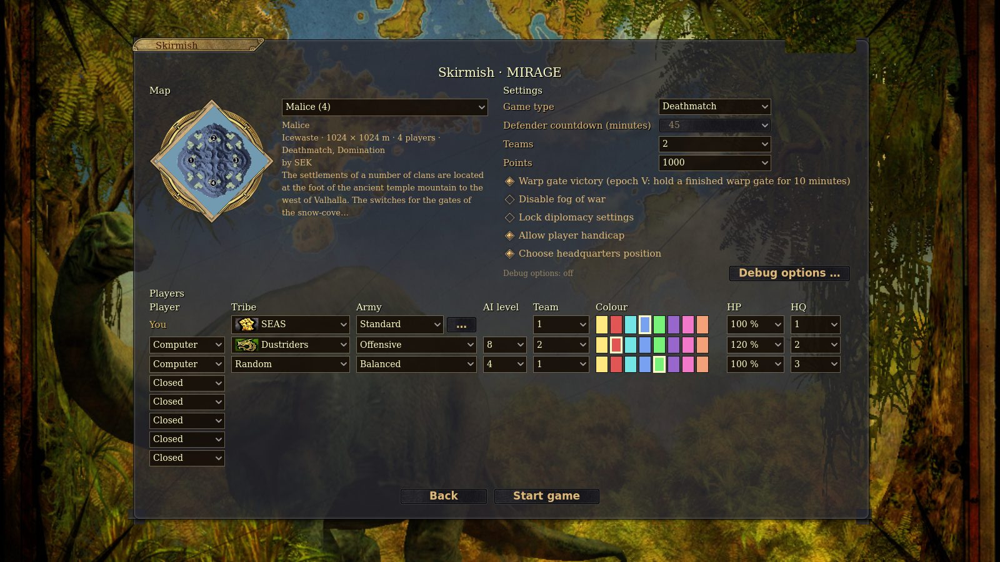
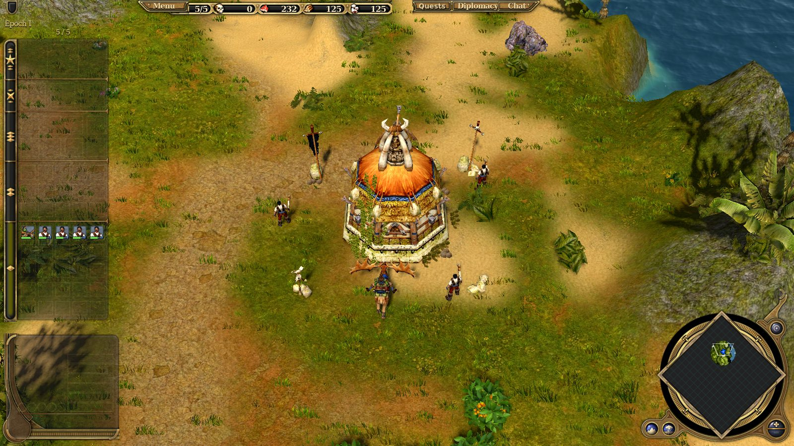
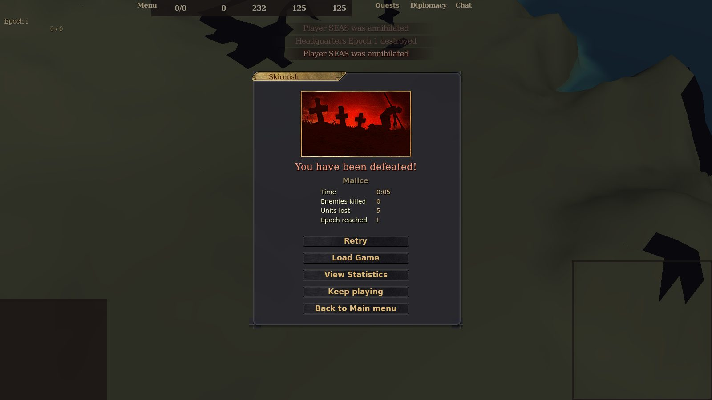
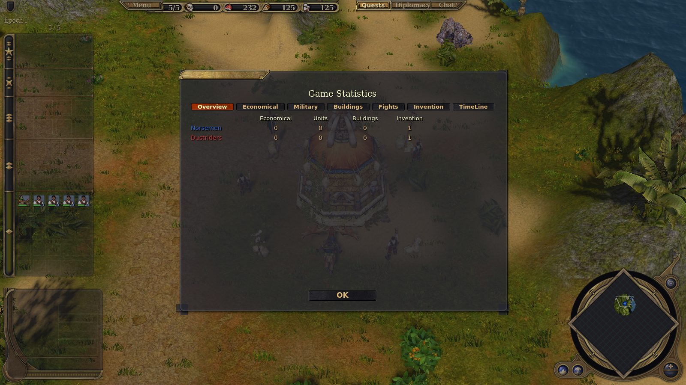
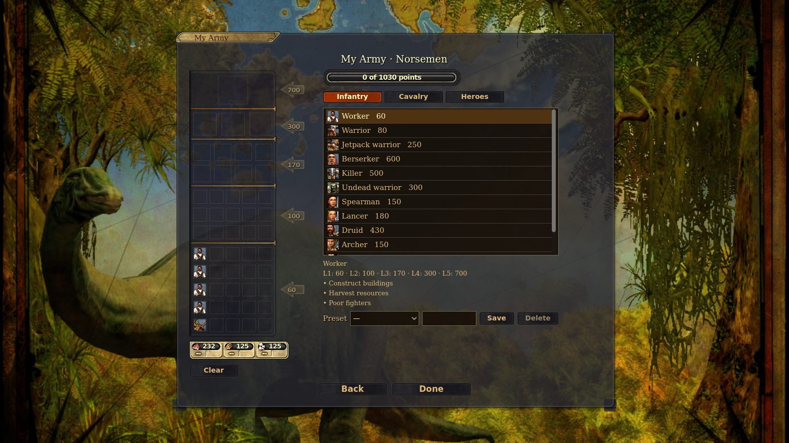
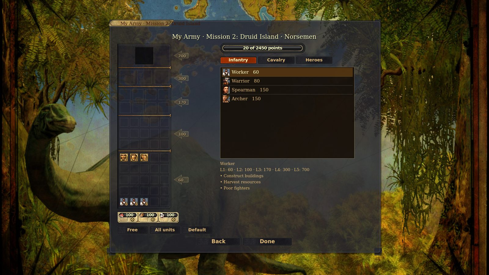

# Skirmish

A game against computer players on a multiplayer map, set up in the menus as the original's pre-game window in
skirmish mode (PlayerListWindow, LobbySettingsPage, PlayerInfoSlot; docs/spec/ui_groups7_9.md §10), started through the
same game session, loading screen, HUD and game-over rules as the campaign. Port of the browser remake's
`game/skirmish.js`, `game/pointbuy.js`, `ui/skirmish.js`, `ui/pointbuy.js`, `ui/mappreview.js`, the skirmish part of
`main.js` (startGame, skirmishPlayers, createBrains, checkEnd) and of `ui/menu.js` (end) - pw-exporter 98c7703.





## Files

```
src/Sim/Game/Skirmish.cs          the setup (SkirmishSetup, SkirmishSlot: JSON) and skirmish.js: DefaultSetup, OpenSlot,
                                  ApplyMode, LoadSetup, ActiveSlots, Validate, FreeColor; MODES, PERSONALITIES, POINTS
src/Sim/Game/SkirmishSession.cs   the game of a setup (IGameSim): resolveSetup, skirmishPlayers (colours, handicap,
                                  the army budget), gameOverInit, the brains and their armies
src/Sim/Game/SkirmishMaps.cs      the maps of the installation (level info only), their names and descriptions
                                  (mapnames.ltf), a setup's map file
src/Sim/Game/PointBuy.cs          the army budget (pointbuy.js): prices, shop, pyramid, presets, AI armies, placing
src/Sim/Campaign/CampaignArmy.cs  the army screen of a campaign mission with point_buy (menu.js campaignArmy)
src/Sim/Game/IGameSim.cs          what GameSession runs: a MissionSession or a SkirmishSession
game/src/UI/SkirmishMenu.cs       the setup screen; --skirmish quick start
game/src/UI/ArmyScreen.cs         "My Army" (skirmish and campaign)
game/src/UI/MapPreview.cs         the map picture in the original's frame
game/src/App/GameSession.Skirmish.cs  the session's skirmish part: creating it, the start line, the end, the end
                                  screen's buttons, the statistics from the end screen, --end-at
```

## The setup: a plain object

`GameStart { Mode = Skirmish, Skirmish = <SkirmishSetup> }` is everything a skirmish is started with. The setup has the
JS setup's field names and is (de)serialised with System.Text.Json (`SkirmishSetup.ToJson / FromJson`; test
`SkirmishSetupJson`: the same JSON after a round trip and the same world from it), so a lobby can fill it and send it
to the machines of a lockstep game later (docs/ROADMAP.md):

```json
{ "map": "Base/Maps/Multiplayer/multi_4_ice_601.ula", "mapName": "Malice", "seed": 7, "mode": "deathmatch",
  "defenderMin": 45, "points": 1000, "warpgate": true, "warpgateMinutes": 10, "fog": true, "lockDiplomacy": false,
  "handicap": false, "chooseHQ": true, "teams": 2, "epochSix": true, "removeTitans": false, "flyingEnabled": false, "portals": false, "buildingLimit": false, "debug": null,
  "slots": [ { "type": "human", "tribe": "SEAS", "personality": "Random", "level": 5, "team": 1, "color": "blue",
               "hp": 100, "hq": 0, "preset": "custom", "army": { "cards": { "0": "seas_worker" }, ... },
               "armyTribe": "SEAS", "armyPoints": 1000 },
             { "type": "ai", "tribe": "Aje", "personality": "Offensive", "level": 8, ... },
             { "type": "closed", ... } ] }
```

* `map`: below the installation's `Data` folder (found without regard to case), an absolute path (a map file), or ""
  for a random jungle (the remake's map generator). The menu keeps the last setup per configuration in
  `settings.json` (`skirmish.<configuration>`).
* `slots`: sixteen (the original: eight; older setups and saves with eight still load - "16 players" below); slot 0
  is the human. `type` human | ai | closed (a remote player of a lobby later: one more type).
  `tribe` or Random (one of the tribes the start position allows: the map's `Restrictions/Base/Tribes`, and the
  configuration's - the SEAS only in MIRAGE). `personality` Random | Defensive | Balanced | Offensive | Passive = the
  behaviours ai_Random (Dodo / Giraffe / Schnecke), Schnecke, Giraffe, Dodo, Mikrobe; `behaviour` sets one directly
  (tests). `level` 0-9. `color` one of the sixteen palette colours (the original's eight of ACColors.txt, then the
  remake's eight) or a colour of the whole spectrum `"#rrggbb"` ("Colours" below). `hp` the handicap in % (the tech tree's
  `/Filters/Special/Upgrades/handicap/handicap_<hp>`; MIRAGE's tree has none: the option is greyed out). `hq` the
  start position with `chooseHQ`, else random and distinct.
* `mode` deathmatch | domination | defender (`ApplyMode`: Domination and Defender lock diplomacy and switch the warp gate
  off, Defender lets the players choose the headquarters - the one on position 1 defends).
* `points` the army budget: -1 "Predefined" (the tribe's start: base, three workers, 200 / 150 / 100), 1000, 3000,
  10000.

What the start screen refuses (`Skirmish.Validate`, PlayerListWindow.usl:334-456; the column turns red): more players
than the map has room for, two players with one colour or colours too alike to tell apart (`Skirmish.ColorClash`), two
on one headquarters position, a headquarters position the
map does not have, nobody on position 1 in Defender, one team with locked diplomacy, a game type the map does not have,
fewer than two players.

## The game (SkirmishSession)

`SkirmishSession.Create(setup, ula, rules, models, forest, brushes, aiJson, progress, aiControlScript)` - main.js
startGame for a skirmish:

1. the map (or `MapSource.GeneratedSource` for "") and the world (`WorldBuilder.Build`);
2. `Resolve` (skirmish.js resolveSetup): the slots that play, each with its headquarters position, tribe and
   behaviour; Defender: the defender is team 1, the others team 2;
3. `PlacePlayers` (main.js skirmishPlayers): per slot a player (name "Norsemen 2" ..., team, colour: the light party
   colour on the models, the dark one on the minimap), the handicap filter, the map's population limit of its position,
   the tribe's start resources; the main building (the Aje resource collector of a human with points is a card of the
   army instead); without points the three workers; with points the human's army (`My Army`, else the chosen preset
   of the budget; checked against the points: more than allowed or less than 30 food gives one worker - `Player.Cheated`)
   placed by `PointBuy.Place`; then the map's own objects of the positions that are played and of nobody;
4. the debug options, `GameOverInit` (the map's flags, last man standing, the defender's minutes);
5. one brain per computer slot (`AiPlayers.ForSkirmish`), then each brain's army for the budget: the AiPBPreset of its
   sub-strategy and difficulty (`PointBuy.AiPreset`, AIC:148-155), else the Standard preset;
6. the camera at the human's home.

`GameSession` runs it through `IGameSim` (World, Map, Built, Human, StartCamera, Title, Step, Over). In a skirmish
`GameSession.Mission` is null and `GameSession.Skirmish` is set; the mission UI shows only the end screen; the HUD's
diplomacy button is there (`IHudHost.Multiplayer`); the fog of war is the human's own (no shared vision: main.js
G.sees); "Disable fog of war" reveals the map.

### The end (main.js checkEnd, ui/menu.js end)

`game/systems/gameover.js` (src/Sim/Systems/GameOver.cs) decides who is out and who wins. Once a second the session
looks at the human player: defeated or won -> the combat music stops and 1.5 s later the end screen: the original's
victory / defeat picture, "You were victorious!" / "You have been defeated!" (`_EndScreen_YouWin / YouLose`), the time,
enemies killed, units lost, the epoch reached, and **Retry** (the same setup again), **Load Game**, **View
Statistics**, **Keep playing** (the end screen goes, the game runs on), **Back to Main menu** (the skirmish menu).

**View Statistics** (also on a campaign mission's end screen): the statistics screen of `ui/stats.js`
(HudStatsWindow / StatsModel on `World.GameStats`, game/stats.js: Overview, Economical, Military, Buildings, Fights,
Invention, Quests in a campaign, the time line), its OK back to the end screen.




## The army budget ("My Army", PointBuy)

`PointBuy` is pointbuy.js: prices per class and level (gamedata `pointBuy.costs`, heroes the same for every tribe),
resource rates (food 1, wood 1.5, stone 2 points), the multiplayer gift (30 food, free), the Aje collector's price in
the budget, the shop (infantry / cavalry / heroes; a mission's allowed classes), buying at a level (the first free place
of that pyramid row; the highest places of a row blocked by a mission's limits), buying at the lowest level, selling,
moving a card (up only when the points allow, never below a fixed level, swapping), resources +/- (1, Shift 10, Ctrl
100), the default presets of a budget (Standard first; a tribe without any - the SEAS of the base game's data - a
made-up Standard), loading a preset as far as the points last, Clear, the computer players' presets and placing an
army at the start (workers by caste at 0° / 120° / 240°, the others around; each at least its class's least level).
Golden test against the JS: `PointBuyGoldenBase/Mirage` (tests/golden/pointbuy_dump.mjs: ~2,400 queries, a scripted
shopping session of 120 steps per tribe and budget; 0 differences), also the setup functions of skirmish.js.

The **army screen** (`ArmyScreen`, ui/pointbuy.js) uses the original's art: the HUD's open pyramid with the atlas cards
at the HUD's places (fixed cards with `card_fixed`), the "buy at level n" arrows (`pointbuy_addarrow*`, the price of the
selected class), the resource buttons (`pointbuy_resources`: idle / down / disabled rows), the point gauge
(`pointgauge_empty / _full`, "%1 of %2 points"). Left drag a card to another place (out of the pyramid: sold), right
click sells; a click in the shop picks a class, a double click buys it at the lowest level. Skirmish: the presets of the
budget, own presets (Save / Delete, kept in settings.json `armyPresets`), Clear. Campaign: Default (the level's
preset), the debug switches Free and All units.




### Campaign missions with an army budget

`point_buy` missions (2 - 8, B41 - B43 ...) open the army screen before the loading screen (`CampaignMenu.StartWithArmy`;
CampaignMenu.usl:199-206): `CampaignArmy.Of(mission.json, rules, tribe, credits)` - the level's preset of the human's
tribe (another tribe: its equivalents, campaign/tribes.js), fixed; the budget max(the bonus points the mission before
earned, the mission's least credits); the shop limited to the classes the level allows; the level's limits per pyramid
row; a resource of "-1" locked at the tribe's start stock. The army goes into `GameStart.Army`; the start location
places it (campaign/setup.js startLocation) instead of the preset. A won mission keeps its bonus points as the next
mission's budget (settings.json `campaignCredits`, main.js G.endMission). Retry keeps the army; Continue opens the
next mission's army screen.

## The menu (SkirmishMenu)

The map (the installation's multiplayer maps of the configuration's Data folders, `SkirmishMaps.List`: the level
info only, the campaign's maps left out; then the remake's own maps of `game/maps` - an installation's map with biomes
and the like, folder "Remake", docs/BIOMES.md; their names and descriptions from the game's `mapnames_<lang>.ltf`; those of
the chosen game type; the random jungle for deathmatch) with its picture (`MapPreview`: the preview the map stores, else
drawn from its heights in the setting's minimap colours, in the original's `levelimage_background_mp` frame), the
settings (game type, defender countdown, teams, points, warp gate, fog of war, lock diplomacy, handicap, choose
headquarters, with MIRAGE "Sixth stage", "No titans", "Flying units", "Portal termini" and "Building limit" - `epochSix` / `removeTitans` /
`flyingEnabled` / `portals` / `buildingLimit`, MIRAGE's game options MaxEpoch 6, RemoveTitans, FlyingEnabled (off by default: no pteranodons,
cargolifter, dirigible, flying helicopter, jetpack), Portals (off by default; the portal termini: docs/SIMULATION.md
"The MIRAGE classes"; only without the warp gate victory, greyed while it is ticked) and BldgMaxCapacity (off by
default; docs/SIMULATION.md "Building limits" - no filter, the limits of max_quantity), tech tree filters of every player:
docs/SIMULATION.md "MIRAGE: the sixth stage"; in the network lobby
the host's, greyed for the players -, the debug options line), and the sixteen slots in a scroll box (player, tribe with its icon, army /
personality, AI level, team, colour, handicap, headquarters). Title screen -> Skirmish, for both configurations;
`--screen skirmish` (`--open-slots n`: slots 1..n-1 computer players, `--pick-color i`: slot i's colour picker open).
The network lobby (docs/MULTIPLAYER.md) is the same screen.

## 16 players (the remake's)

Not a 1:1 port here (Kacper: lift the 8-player limit to up to 16, a colour picker of the whole RGB spectrum next to the
predefined colours):

* **Slots and players**: `Skirmish.MAX_SLOTS` 16 (= `NetProtocol.MaxPlayers`), teams 1..16. The simulation keeps its
  players, relations, fogs and brains in lists (no player bitmasks), so nothing else had a limit; the AI plays any
  number of players. A map takes as many players as it has start positions (`Mp.MaxPlayers`).
* **The random jungle** (`MapGen`) grows with the players: up to 4 the original 480 m square (the same map as before,
  the JS's golden), 5 - 8 a large one (800 m, the bases on a 3 x 3 grid without its centre, 260 m apart), 9 - 16 a huge
  one (1120 m, a 4 x 4 grid, 280 m apart, the corners first); trees, stones, bushes and herds by area. It is the
  16-player map of the menu ("Random jungle (2 - 16)"). `SixteenPlayersTests`.
* **Colours**: `Colors.PLAYER_COLORS` - the original's yellow red cyan blue green purple pink orange, then white grey
  lime teal navy maroon brown olive (set apart by brightness or hue); a slot's `color` may also be `"#rrggbb"`: the light
  colour as picked (the models' tint), the dark one derived (`Colors.CustomColor`: more saturated, 88 % bright).
  `Colors.Distance` (a weighted RGB distance) below `NEAR_DISTANCE` (60) counts as the same colour: refused by
  `Validate`, avoided by `FreeColor` / `OpenSlot`. The lobby's colour cell (`PlayerColorCell`): a swatch that opens
  Godot's colour picker (HSV square, hue, RGB / HSV sliders, hex) with the palette's sixteen colours below it, and a list
  of the palette's names ("Custom" for a colour of its own); while the picker is open the colours are checked at once,
  the choice is saved / sent when it closes.
  Where the colour goes: `Player.Color` (dark) / `PartyColor` (light) / `ColorSlot` (palette index, -1 custom) ->
  the party-colour materials and SEAS markings (`ModelMaterials` caches a tinted copy per material and colour value, so
  any colour works), selection rings / health bar circles / units behind buildings (`GroundRings.RingRgb`: the
  original's ring colours for the first eight, else the dark colour), the minimap (the setting's table for the first
  eight, else dark for buildings and light for units), names in the diplomacy and statistics windows, chat and computer
  players' lines (the sender's name in its colour: `Hud.ChatKind`). The colour travels in the setup: the network
  lobby, `GameStart`, saved games.
* **Network**: protocol 3 (a client of protocol 2 is refused: "Different versions!"); the lobby takes 16 humans.
  (Protocol 4 since 2026-11-13: MIRAGE's game options of a campaign mission, docs/MULTIPLAYER.md.)
* **Saved games**: a save keeps its setup; one of before (eight slots, palette ids) loads and replays as it was.
* **Performance** (2026-11, a 2-core test machine, `PerfSaveSkirmish` / `PerfReplaySkirmish` with `PW_PERF_PLAYERS=16`,
  docs/DEBUG.md "Performance"): you and 15 computer players of level 8, 23 game minutes (~600 units, ~470 buildings):
  the whole game replayed at 4.4 ms per step on average, 6.3 - 7.1 ms per step late in the game (units 2.3, the AI 1.4,
  buildings 1.0; the budget is 50 ms), single steps up to ~150 - 190 ms (one long path search), a managed heap of
  ~600 MB. The fogs are linear in the units (one grid per human, each stamped by its own viewers); the per-player
  scans that grew with players x entities (game over check, statistics samples) are one pass now.

## Saved games

A skirmish is saved and loaded like a mission (docs/SAVES.md "Other modes"): the save carries the setup, loading
rebuilds the skirmish and replays its inputs. The end screen's **Load Game** opens the load window.

## Quick start (tests)

```
godot --path game -- --config mirage --skirmish multi_2_jun_001 --players SEAS,Aje --points 1000
godot --path game -- --skirmish random --players Hu,Aje,Ninigi --teams 1,2,2 --levels 8,2 --mode deathmatch --no-fog
```

`--skirmish [map]` (a file name or a path below Data; `random` = the random jungle; nothing: the stored setup's map),
`--players` (the first is yours), `--teams`, `--levels` / `--aib` (the computer players' levels / behaviours),
`--hq` (start positions), `--mode`, `--points`, `--seed`, `--no-fog`, `--debug`. `--end-at <game s>[,lost]` ends the
game there (the end screen), `--end-stats` opens the statistics over it; `--screen army` shows "My Army" of the stored
setup, `--army-mission <n>` the army screen of campaign mission n. (docs/DEBUG.md)

## Tests

`dotnet run --project tests/PwRemake.Tests -- PointBuy` (golden, the skirmish games with points, the campaign's army
screen, the setup's JSON, the map list), `-- MirageAje` (the MIRAGE computer players: docs/AI.md).
