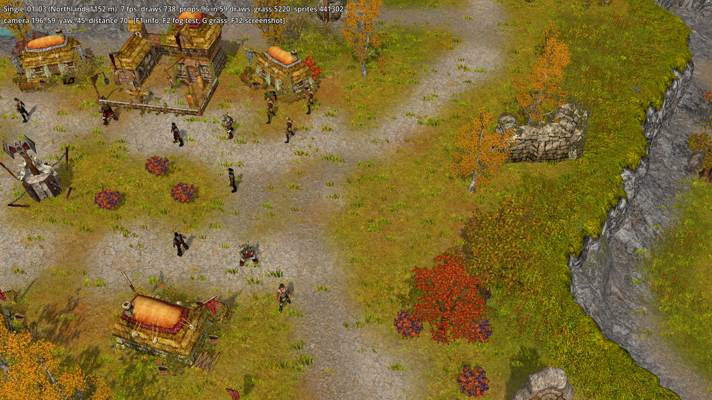
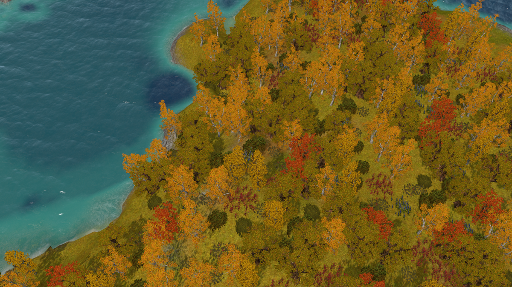
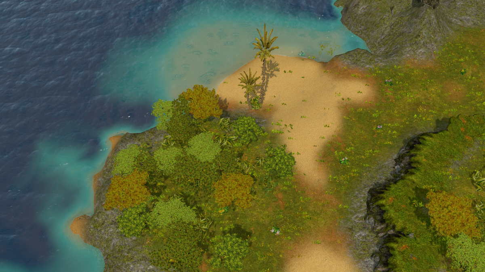
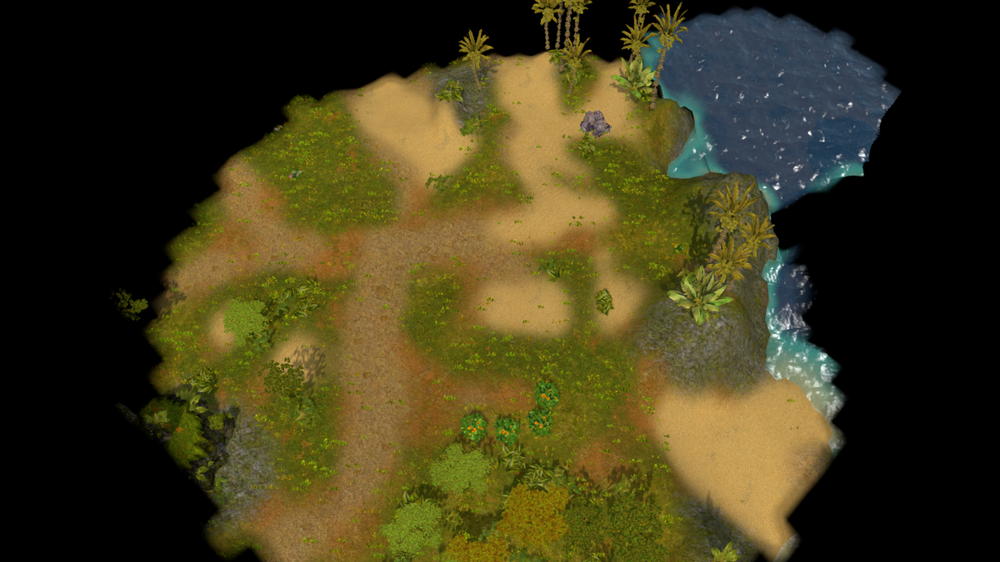

# Terrain and world view: drawing a map

`game/src/View/Terrain`, `game/src/View/World` and `game/src/View/Fx` draw an original ParaWorld map in Godot as the
browser remake does: the ground with the setting's eight ground materials, the water, the forests and the map's
plants, rocks and scenery, the grass around the camera, the weather, the fog of war, the light and the RTS camera.
The map data comes from `src/Sim/Maps` (docs/MAPS.md: `MapSource`, `HeightField`, `Ground`, `Forest`) - nothing of
it is read twice; the models from `ModelLibrary` (docs/VIEW.md).



| JS (remake/src, pw-exporter 98c7703) | C# | what |
|---|---|---|
| engine/terrain.js buildTerrain, refreshTerrain, refreshSplat | Terrain/TerrainMesh.cs, Terrain/TerrainShader.cs | ground mesh (chunks) + splat shader |
| engine/terrain.js FogOfWar, fowUniforms, applyFow | Terrain/FogOfWar.cs (`FogGrid`, `FogOverlay`) | fog of war grid and its drawing |
| engine/water.js | Terrain/WaterSurface.cs | sea / lake plane |
| engine/grass.js | Terrain/GrassLayer.cs | grass clumps around the camera |
| engine/props.js PropField | World/PropField.cs | instanced static props |
| engine/props.js FoliageField, treeSprites | World/FoliageField.cs | camera-facing leaves of the whole map |
| engine/renderer.js Renderer | World/WorldRenderer.cs | sky light, sun, shadows, fog, camera, performance settings |
| engine/renderer.js RTSCamera + camera parts of ui/input.js | World/RtsCamera.cs (`RtsCamera`, `RtsCameraInput`) | the RTS camera and its controls |
| engine/weather.js | Fx/WeatherFx.cs | snow and rain |
| main.js buildWorld (terrain, skirt, water, trees, decoration, stones, bushes, fish, grass, W.adaptTerrain, W.clearVegetation) | World/WorldView.cs | the scene of a map: the API the game uses |
| (the rules' answers maps/source.js needs) | World/RulesMapAdapter.cs | `IMapRules` over `Sim/Rules` |
| - | World/MapLoader.cs | find a converted map of the configuration (docs/MAP_FORMAT.md) by name, id or path, read it into a `MapSource` |
| - | World/MapViewer.cs + scenes/MapViewer.tscn | the map viewer tool |

The effects (engine/fx.js, particles.js, modelfx.js: the models' particle emitters, the game's effect models, the
drawn effects) are docs/EFFECTS.md; `WorldView.Particles` sprays the emitters of the map's props (waterfalls) and of
every model instance, updated in `WorldView.Step`.

## The API the game session calls

```csharp
var lib  = new ModelLibrary(assetSource);
var S    = MapLoader.Load(ulaPath, rules, cfg.Data, lib.Has);           // or MapSource.OriginalSource(...) / GeneratedSource
var r    = WorldRenderer.Create(renderSettings);  parent.AddChild(r);   // environment, sun, Camera
var view = WorldView.Load(S, lib, new WorldViewOptions { Render = renderSettings, GrassBlocked = ... }, hf);
parent.AddChild(view);
var cam  = new RtsCamera(r.Camera, (x, z) => view.Ground.At(x, z), S.Size / 2 - 8) { X = x0, Z = z0, Yaw = Math.PI / 2 - S.DefaultCamera };
parent.AddChild(new RtsCameraInput { Cam = cam });                      // keys, edge scroll, wheel, drag (or drive cam yourself)

world.AdaptTerrain    = view.AdaptTerrain;      // (gfx, x, z, heading) -> bool: levels view.Ground + repaints the materials
world.ClearVegetation = view.ClearVegetation;   // (x, z, r): decoration, plants and trees around a new building go

// every frame
input.Step(dt); cam.Update(dt); r.FollowSun(cam.Target);
view.Step(dt, r.Camera, cam.Target, weatherNow);       // props in view, foliage detail, grass, weather, map objects
view.SetFog(visible, explored, w, h);                   // the local player's fog of war (bytes per cell, 1 = yes)
//   or: var fog = new FogGrid(S.Size, 4); fog.Update(viewers); view.SetFog(fog);   (FogGrid is the sim's IFogOfWar)
view.Fog.RevealAll = true;                              // "Disable fog of war" / debug reveal
view.RemoveTree(i);                                     // a tree of S.Trees felled (its model and leaves go)
var stump = view.AddProp("jungle_tree_01_stump", x, z, rot);  view.RemoveProp(stump);
view.SetGrass("off" | "on" | "dense");  r.Settings.Shadows = "high"; r.ApplySettings();
```

* `hf`: pass the world's own `HeightField` (the simulation and the mesh then read the same samples - the level of a
  building changes both), or leave it null and give `view.Ground` to the world's `IWorldMap`.
* `view.Splat(x, z)` gives the ground material weights with the painted cells (tests, ambience), `view.SlotOf(k)`
  the texture slot of ground material k (main.js GROUND_NEAR), `view.GroundLog` / `VegetationLog` what was done
  (saved games redo them).
* `view.Trees[i]` (index of `S.Trees`: prop + sprite handles), `view.Decor`, `Stones`, `Bushes`, `Fish` (the props
  of the map's resources, same order as in the source).
* `view.Foliage.SetHoles(points)`: see-through canopies over units (x, y, z, radius; up to 16).
* `RtsCamera.AddShake(duration, strength, fade %, position)`: camera shakes (GameCameraModule.usl).

## Data flow

```
map folder ──PwMapReader──> PwMap ──ToMapData──> MapData ──MapSource.OriginalSource(rules, forest.json, manifest)──> MapSource S
  (.ula ──Prepare: tools/mapconvert, PwMapConvert──> map folder; docs/MAP_FORMAT.md)
S.Height ──HeightField(S.Size, S.MeshCell)──> Ground (float samples every 2 m on every map)
Ground + S.Splat(hf) (8 weights / vertex: 4 m material grid, bilinear, noise-warped borders)
       + painted brush cells ──GroundLayers (biomes: x the biome weights, per biome by role - docs/BIOMES.md)──>
       TerrainMesh (chunks of 64 x 64 cells: position, normal, CUSTOM0/1 = 8 weights, CUSTOM2 = the tile's palette)
S.Textures (assets/terrain/<Setting>/scape_0..7.jpg; with biomes every biome's 8) ──one Texture2DArray──> TerrainShader
(co-op maps: MapExtension makes the 4 m material grid of the new and changed land - one material per cell like the
original's; it follows the final slope: a rock material only where the ground is as steep as the original map uses it
from, with per-cell dithered limits so the splat's bilinear blend gives soft borders - docs/COOP.md "Maps")
S.Water ──> WaterSurface (depth texture from Ground, assets/terrain/water_normal.png)
S.Trees / S.Decor / S.Stones / S.Bushes / S.Fish ──ModelLibrary templates──> PropField (one MultiMesh per model part)
template root extras.foliage ──treeSprites──> FoliageField (one MultiMesh per texture and 64 m chunk)
the biomes' grass atlas + grassDensity x weights ──> GrassLayer per biome (tiles of 16 m around the camera)
S.Owned / Animals / Wells / Flags / Items (map viewer only) ──> ModelInstance nodes
```

## Terrain

* **Resolution**: the map's own 2 m height samples on every map. The JS took 4 m on maps above 1400 m (single_06, 07,
  12, 13 and the co-op maps grown past it: 2, 4, 10, 14) for the browser; the map's objects stand at the heights the
  editor gave them, so ground finer than 4 m - the cuts for stairs, the bed of a metal plateau - was smoothed away and
  came through them (mission 13's SEAS fortress: "the yellow ground coming out of the metal stairs", its plateaus up to
  4.5 m off; 1031 of single_13's 6171 decorations more than 0.3 m off their ground, 113 at 2 m - those lie between
  the samples). A 1920 m map has 961 x 961 samples (CoopMapsTests.ObjectsKeepTheirGround checks it).
* **Mesh**: `hf.N x hf.N` vertices at `i * Cell - Size / 2`, two triangles per cell split along (i, j+1)-(i+1, j) as
  three.js' PlaneGeometry, so `HeightField.At` (units) and the drawn ground agree. Cut into 64-cell chunks (128 m on
  the 2 m grid; Godot culls them); a height or material change rebuilds only the chunks it touches. Normals are
  central differences everywhere (the JS: computeVertexNormals at build, central differences on refresh), the same
  on both sides of a chunk border - no seams.
* **Splat shader** (TerrainShader.Code(4 | 8), the JS's GLSL in Godot shading language, generated like the JS; the
  textures are one Texture2DArray and each vertex names its 8 layers by its 16 m tile's palette - an original map's
  is 0..7 everywhere; a map with biomes has more layers at the same cost per pixel: docs/BIOMES.md "Drawing"):
  per material two scales (the second turned by mat2(0.8, -0.6, 0.6, 0.8) and scaled 0.43) mixed by a value noise;
  height blending (weight x clamp(0.55 + 1.6 (brightness - the texture's mean from a mip biased by 9), 0.08, 1),
  squared); side projection on slopes (normal y 0.62 .. 0.38); a large-scale brightness variation 0.9 .. 1.1.
  Lambert, no specular. The material borders' warping is in the weights (MapSource.Splat).
* **Textures**: loaded through `AssetSource` from `assets/terrain/`, flipped vertically on load (three.js'
  TextureLoader flips, and the JS shaders - grass atlas cells, ground orientation - are written for it), mipmapped,
  anisotropic. Scales: the source's `S.Scales` (1/24 m for original maps).
* **Ground brushes** (`AdaptTerrain`): `Ground.LevelGround` on the height field -> `TerrainMesh.RefreshHeights` (and
  the water's depth texture), `Ground.BrushCells` -> painted 4 m cells (texture slot by GROUND_NEAR) ->
  `RefreshSplat` over the brush plus 8 m; the grass tiles there are rebuilt. In the game the view draws on the
  simulation's own height field and with its brushes (`WorldViewOptions.Brushes` = `BuiltWorld.Brushes`): the
  simulation levels, the view only redraws (`Ground.BrushRect`; before, the view levelled the same samples a second
  time). The map viewer levels its own ground.

### Ground under buildings (src/Sim/World/BuildingGround.cs)

A building put down in the game - built by a player or an AI, or put down ready-made by a script (`World.PlaceAdapted`)
- levels the ground under it and paints its materials with the building model's ground brush. The original has
brushes (`Texture/Scape/ObjBrush/<model>.tga`, `assets/terrain/objbrush.json`) for 101 models: most houses of the
Norsemen, Dustriders and Dragon Clan, five of the SEAS'; a building without one changed no ground - the Dustriders' and
Dragon Clan's towers, the Dragon Clan's cauldron and rocket ramp, the SEAS' laboratory (the hospital: Kacper
2026-11-11), tents, fortress, cannons, MIRAGE's own buildings. The remake gives every building one:

* the original's brush where it has one;
* else one **made** (`BuildingGround.Make`, `GroundBrushes.Fallback`, made once per model): the building's footprint
  (the GSF pathfinder boxes, else the model's box) and the **brush of its tribe** (`hu_`, `aje_`, `ninigi_`, `seas_`
  brushes; not walls, gates, bridges, harbours) whose levelled core (alpha above 90 %) is nearest the footprint in size.
  Axis by axis the footprint is mapped onto that core and the ground beyond it at the original's scale: the core is
  stretched over the footprint, the rim - the soft falloff, the earth, the grass at the corners - keeps its width.
  The ground is the tribe's own (the SEAS' paving, the Norsemen's gravel), in the setting's materials as any brush.

Which buildings change the ground (`BuildingGround.Changes`, used by `StartConstruction` and `PlaceAdapted`): every
building but walls and gates (the original's bWall: lines of pieces over any slope), traps (hidden from the enemy - a
patch of fresh ground would show them), coastal buildings (in the water), ladders and towers put on a wall piece. A
free-standing tower does (the original has brushes for the Norsemen's; the JS levelled no tower). Test:
`BuildingGroundTests` - every building class of every tribe (ParaWorld and MIRAGE, the SEAS and MIRAGE's own
buildings) put down on a slope levels and paints its ground, printed as a list (2026-11-11: 18 / 15 / 24 of the
Norsemen's / Dustriders' / Dragon Clan's in ParaWorld, 25 / 21 / 27 / 27 with the SEAS in MIRAGE, 2 - 22 per tribe with
a made brush).



## Water

One plane of 4 x the map at the water level, unshaded, blended, no scene fog (as the JS ShaderMaterial): depth from a
texture of the ground (0..10 m, up to 1024 x 1024), shallow 0x3f9a8c / deep 0x0d3550, two scrolling samples of the
original water normal map, fresnel towards the sky colour 0x9cc4dc, Blinn-Phong glints (power 140), shore foam in the
first 0.35 m, alpha 0.35 .. 0.92. Time = Godot's `TIME`.



## Props and foliage

* **PropField**: a model kind = its visible meshes in the template's default look; each part's transform in the model
  (the converter's GSF frame, mirrored) is baked into a mesh copy with reversed triangles where it mirrors (assets.js
  mirroredGeometry), so an instance is only its placement (heading, or the map quaternion via `Frame.MapQuat` for
  tilted plateaus and cliffs). Each camera move packs the instances whose bounding sphere is in the view to the front
  of the part's buffer (one draw per part, as the JS); parts of kinds with nothing in view are hidden (no draw, no
  shadow pass). Casting shadows: trees and blocking scenery (the JS rules).
* **FoliageField**: sprites grouped by texture and 64 m chunk; per sprite centre, size, uv rectangle, screen-plane
  rotation, tint, aspect (MultiMesh: origin, colour = uv rect, custom = rotation, tint, size, aspect). Detail sprites
  (the original's LOD bit 2 off) in a second MultiMesh per chunk, shown within 150 m of the camera. Unshaded x light
  (0.86, 0.9, 0.8), cut at alpha 0.5, cast shadows (in the shadow pass they face the light). `Hide(handle)` zeroes
  sizes. The jungle's undergrowth (bushes, underwood, flowers, reed, wild rice, beach grass) is leaf and flower
  sprites from jng_small_a / jng_misc_a with the JS's seeded random numbers (16807 generator, seed 99); fruit bushes'
  leaves and fruit as main.js.
* **Grass**: tiles of 16 m, 150 candidates per tile kept with probability = density (the biome's grassDensity - the
  JS's GRASS_DENSITY of the setting for an original map - x the material weights; one grass layer per biome; none on
  slopes with normal y < 0.8, none where `GrassBlocked`), the tile's random numbers from a
  hash of its coordinates (the JS's generator, bit-exact), drawn within 100 m of the camera target and shrinking to
  nothing between 70 and 100 m; "on" = 0.55 x density, "dense" = 1.

## Light, sky, camera

three.js r186 (physically based lights) -> Godot, measured with a calibration scene (a white plane under each light):

| three.js | Godot |
|---|---|
| background / Fog(0x9fb8c8, 260, 620) | Environment background colour, depth fog 260 .. 620 m, curve 1 |
| HemisphereLight(0xe6eef2, 0x5a5236, 1.25) | ambient light from a sky shader: sky colour above, ground colour below, x 1.25 / pi in the shader (Godot ignores `ambient_light_energy` for sky light; its cosine-weighted sky ambient equals the hemisphere light's mix) |
| DirectionalLight(0xfff2d8, 2.3) from (-90, 150, 60) | DirectionalLight3D, energy 2.3 / pi (Godot: energy e lights albedo a to e x a at normal incidence) |
| shadow box fitted to the visible ground + 14 m in 8 m steps, at most 105 m (130 on high), map 2048 / 4096 | PSSM 2 splits, max distance = camera distance to the target + that box; atlas 2048 / 4096; "off" turns them off |
| PerspectiveCamera(40, near 2, far 1400) | Camera3D fov 40 (vertical), near 2, far 1400 |
| pixel ratio x resScale, antialias, fps cap | Viewport.Scaling3DScale, FXAA, Engine.MaxFps |

The RTS camera: target (x, z), yaw (0 looks north, -z), distance 25 .. 150 (smoothed, x10 per s), pitch 0.72 + 0.36 t;
the eye at (x + sin(yaw) cos(pitch) d, h + sin(pitch) d, z + cos(yaw) cos(pitch) d). Controls as input.js: arrows and
the 4 px screen edge pan at distance x 1.1 m/s, wheel zooms x 0.88 / 1.12, PageUp / PageDown 60 m/s, middle drag pans,
Alt + left drag or middle + right drag turns (0.006 rad per pixel), Alt + right drag pans, End resets. The camera
starts on the first start location looking along the map's DefaultCamera (yaw = pi/2 - DefaultCamera).

## Fog of war

`FogGrid` is the JS FogOfWar: cells of 4 m, `Update(viewers)` stamps sight discs, `Vis` / `ExploredCells`, texture
values 255 visible / 115 explored / 0 never seen; it implements the simulation's `IFogOfWar`. **The game draws it as
the original: `FogClouds`, below** ("Fog of war: how the original draws it"). The JS's darkening pass is kept as the
fallback without any cloud texture in the data: `FogOverlay` draws it
for everything at once: a full-screen pass in the transparent queue (last) reads the depth buffer, rebuilds each
pixel's world position, samples the fog texture (linear) and multiplies the pixel by
`smoothstep(0, 0.45, v) * mix(0.55, 1, smoothstep(0.45, 0.9, v))` - applyFow's factor - then adds back the scene fog's
share (`fog colour x fog amount x (1 - f)`), which makes it equal to the JS's darken-before-fog on every material.
The sky is left alone. The JS patched each material instead (terrain, props, units, water, grass, sprites); one pass
needs no change to the models' materials.

### Fog of war: how the original draws it

Read from PWClient.exe and the scripts for the remake (2026-11-21, Kacper: "look into the original game how exactly fog
of war was being drawn and copy it"); the two screenshots of the original he sent (a savanna town, a jungle river) were
used only to check the result. Implemented in `game/src/View/Terrain/FogClouds.cs` (the drawing) and
`game/src/View/Entities/EntityViews.cs` (what is shown in the fog).

* **Which renderer**: `Rendering/FOW/Visible` (default 1) and `Rendering/FOW/Type` (default 0) (0x450469 ff.). Type 0
  is `Pest::CFOWRenderer2` (FOWRND2, the clouds, the only one the game uses by default); Type 1 is the older
  `CFOWRenderer` with a darkening screen filter (`CFXRenderFilterFogOverlay`: `Rendering/FOW/ColorR/G/B` default 160,
  `SoftnessLayers` 3, `SoftnessWidth`, `ScapeOffset`, `Complete`; 0x450ff2 ff.). So by default **the ground is not
  darkened at all** - not never seen, not explored: the fog of war is only the clouds.
* **The fog map**: cells of 16 m, 2 bits each: 0 never seen, 1 explored, 3 seen now (0x6fa630 stamps a circle - the
  cells whose centre lies within the sight radius + 8 m; 0x6fa7a0 turns 3 into 1 before each update). From it a byte
  per cell "seen now", eased every 0.04 s by +6 while the cell is seen and -2 while not (0x44ec08 -> 0x6fa7f0): from
  nothing to fully seen in 1.7 s, back in 5.1 s.
* **Where the clouds are**: over everything not seen *now* - explored or never seen alike (the original makes no
  difference on the screen). A cloud sprite every 4 m (4 x 4 per cell; 0x71b9xx), its alpha (1 - bilinear over the
  cell of the corners' s = max(0, (byte - 128) / 128)) x fade x the sprite's own weight; fade = clamp((0.75 - (d - 10)
  / R) x 6, 0, 1) with d the distance from the camera and R the terrain renderer's range (copied every frame,
  0x71be6e; its value was not read - **R = 800 m here, estimated**: beyond the remake's camera view); sprites under
  0.05 are left out (0x71bb03 ff.).
* **A sprite**: camera-facing, 6 m to each side along the camera's right and 8 m up along the camera's up from its
  point (0x71a3b8 x 6 / x 8, quad 0x71a850 ff.): 12 x 8 m, the lower edge on the ground - the clouds lie on the land
  and the water, tall trees stand out of them. Its point: the ground's height there (the original computes a height
  per sprite from the terrain around it, 0x71b0xx, not fully read - **here the ground's height, the water level over
  the sea**). A random byte per sprite (a table, 0xa40a68): bits 0-1 the atlas column, 2-3 the row, 0-5 one of 64
  drift paths. Blending: alpha over (the material `Scape.FogOfWar`'s blend mode was not read), no depth write.
* **The drift** (0x71a431 ff.): t = time x 0.02; path i moves by (2 sin(((i x 1.141) + 105) x 0.05 t) + sin(7.234 t),
  2 sin(((i x 0.131) + 70 - i + 154) x 0.05 t) + sin(7.723 t)) m - +-3 m on periods of 35 .. 60 s.
* **The colour**: the sky manager's (0x727e00): **row 8** of the setting's sky gradient (`skygradient_day.tga`, else
  `skygradient.tga`, Texture/Scape/<Setting>/) at the time of day; row 0 when the table has fewer than 9 rows; 0x607090
  without a table. Row 8 of the original tables: Northland and Jungle white, Savanna ffffc9 (warm white), Icewaste
  d5e0f0 .. e5eef5, Ashvalley / Cave2 / Cave3 e5c6b5 .. fcd6c2, Cave1 ffd28a. Times its brightness (205 + 50 x (0.5 +
  0.25 x (sin u + sin v))) / 255, u and v sines of the sprite's place and the time (constants 0x88c710 .. 0x88c750).
  Alpha: the colour's alpha x the sprite's x 150 / 255 (0x71a79e). The clouds are not lit otherwise.
* **The texture**: the setting's `Texture/Scape/<Setting>/fog.tga` (on disk `fog_(0256).dds`, DXT5; the path "Scape/"
  + setting 0x48cf67, the name 0x6fc432), else `Texture/Effects/fogofwar.tga` (0x71ab49 .. 0x71ab89). Each is a 4 x 4
  atlas of white wisps, the wisp in the alpha; every setting of Base and MIRAGE's Cave3 has the same picture.
  `tools/prepare/fog_textures.py` makes them `assets/terrain/<Setting>/fog.png` and `assets/terrain/fogofwar.png`
  (Prepare); without them the game takes the original's `particle_06` cloud atlas (2 x 2, not the fog's own - a log
  line says so), without that the old darkening pass (`FogOverlay`).
* **What is seen in the fog** (0x44e850, each object after a fog update; the server's `SetVisInFOW`):
  characters, animals, vehicles and ships (CHTR, ANML, VHCL, SHIP) only where the byte is above 127; an object marked
  VisInFOW always - decoration (`CDecoObj`, `CDecoColObj`, `CDecoColAnimObj`, `CSeasHQLavaObj`: MiscObj.usl), wild
  animals (Animal.usl OnInit: owner -1 -> `Server/GameplayOptions/ResourcesVisibleInFOW`, default true), the gates
  `CGateFOWVIsible`, the flying trader; buildings are not hidden by the client's pass (whether the server sends an
  enemy building never seen was not read: here as before, shown once explored). Every object not seen gets a flag
  (0x2e5 bit 0x40) whose use was not found. Here: units as before (seen now), wild animals, resources and props
  always, buildings once explored.
* Not taken over / open: the minimap's fog (`EventSink_CMiniMap_FOWUpdate`) was not read - the remake's minimap as
  before; units appear when the 4 m grid sees them (the original: when the eased byte passes 127, up to 0.85 s later).

**In a cutscene no fog of war is drawn at all** (`FogClouds.Suspended`, `FogOverlay.Suspended`, docs/GAME_SESSION.md
"No fog of war in a cutscene"): mission 16's opening sc_7050 looks over the crater rim beyond the 250 m its trigger reveals - the black
covered the left 60 % of the screen.

Note: with MSAA the depth texture this pass reads stays empty (Godot 4.7, seen on Vulkan / llvmpipe), so the world
renderer uses FXAA and turns MSAA off.



## Weather

The level's weather (type 1 snow / 2 rain, intensity, wind direction and strength): a box of 110 x 70 m around the
camera target, up to 280 particles per intensity point (max 9000), wrapped at the box's sides; snow drifts at 2.2 m/s
with a sine wobble, rain falls at 26 m/s as 1.4 m streaks along the wind. Fades in and out over a second. Snow:
camera-facing quads of a radial gradient (three's point size 0.85 with size attenuation is a quad of 0.85 x tan 20 deg);
rain: line segments (MultiMesh of a 2-vertex line, the instance's y axis is the streak). `RenderSettings.Weather`
switches it off.

## Map viewer

`res://scenes/MapViewer.tscn`:

```
xvfb-run -a -s "-screen 0 1600x900x24" godot --path game res://scenes/MapViewer.tscn -- --map=single_01 [--cam=x,z,yawdeg,dist | --spot=start|centre]
    [--data=<converted data>] [--install=<ParaWorld>] [--shadows=off|medium|high] [--grass=off|on|dense] [--res=1] [--aa=0|1]
    [--objects=0|1] [--weather=snow|rain[:intensity]] [--fog] [--adapt=<building model>] [--check] [--shot=<png> [--frames=30] [--info]]
    [--coop=<config>:<mission>[:<seats>]] [--overview] [--mapcam=x,z,yawdeg,dist (map coordinates)]
    [--config=<id> (a prepared configuration of PW_CONTENT: its data and overrides)] [--settex=0 (setting textures off)]
```

`--coop` draws the map extended by the mission's co-op definition (docs/COOP.md "Maps"), `--overview` the whole map
from above (orthographic, no depth fog, the co-op seats' starts marked).

Keys: the camera controls, F1 info line, F2 fog of war test, G grass mode, F12 screenshot (user folder), B the biome
brush (docs/BIOMES.md "Authoring"; `--biomes=<file>`, `--brush=<biome>`, `--biomes-out=<file>`). `--map` takes a map's name
(`single_11`), its id (`Base/Maps/Multiplayer/multi_2_jun_001.ula`, `Remake/frost_to_jungle.pwmap.json`) or the path of
a map folder / `.pwmap` (a `.ula` path: converted in memory) - the configuration's converted maps (docs/MAP_FORMAT.md).
`--check` runs the API on the loaded map and prints `CHECK` lines: chunk count, vertex weights = MapSource.Splat,
water, trees and props drawn, AdaptTerrain levels samples and paints materials (and returns false without a brush),
ClearVegetation takes the trees within its radius, FogGrid discs and explored cells. Results on multi_2_jun_001 and
single_11: all 12 pass.

The map's players' objects, animals, wells, flags and items are drawn as static `ModelInstance`s in their standing clip
(`WorldViewOptions.MapObjects` + `ClassModel`), for looking at a map without the simulation; the game session draws its
own entities instead.

## Performance (container: llvmpipe software rendering - relative numbers)

| | multi_2_jun_001 (800 m) | single_01 (1152 m) |
|---|---|---|
| terrain mesh (401² / 577² samples, weights) | 180-330 ms | 460 ms |
| props (template loads of ~120 / ~180 models + sprites) | 1.3-2.0 s | 3.1 s |
| instance buffers | 0.2-0.6 s | 0.4 s |
| map objects (158 units / buildings, characters ~1 s each) | - | 8.7 s |
| foliage sprites | 55 000 | 441 000 |
| trees / decoration | 228 / 637 | 1834 / 2256 |
| drawn props at 70 m (instances in draws) | 30-50 in ~25 | ~100 in ~60 |

Per frame on the CPU: the prop packing only when the camera moved (a frustum test per instance), the grass rebuild
only every 8 m of camera movement, the weather's particles (up to 9000) when it snows or rains. The foliage field is
the heaviest thing drawn (441 000 sprites on single_01, about 300 MultiMeshes); on a real GPU this is the JS's load
too. Next steps if needed: a coarser far LOD for the foliage chunks, background loading of the templates, caching the
baked prop meshes.

## Differences to the JS / not ported

* Shadows are redrawn every frame (the JS: every 2nd frame on medium); the sun is not snapped to a 4 m grid (Godot
  stabilises its own shadow splits).
* See-through holes work for the foliage sprites; the trunks of trees keep their model materials (no dither).
* The jungle_tree_01 trunk cut-out finding of docs/VIEW.md shows here too (faithful to the JS).
* The JS's PageUp key both zooms out a step (keydown) and in continuously (update); only the continuous part is kept.
