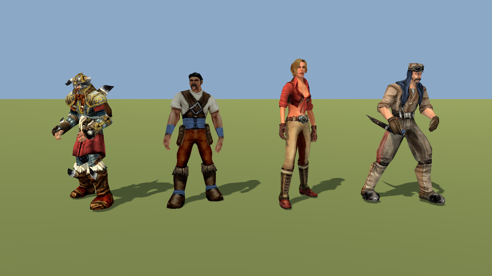
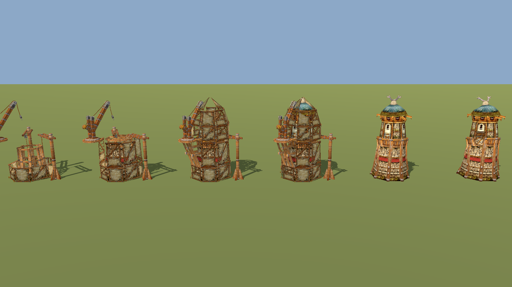
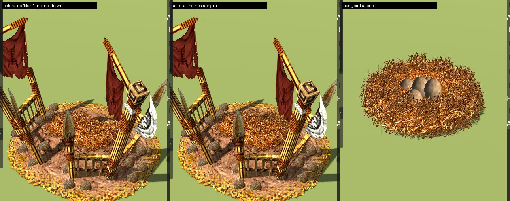
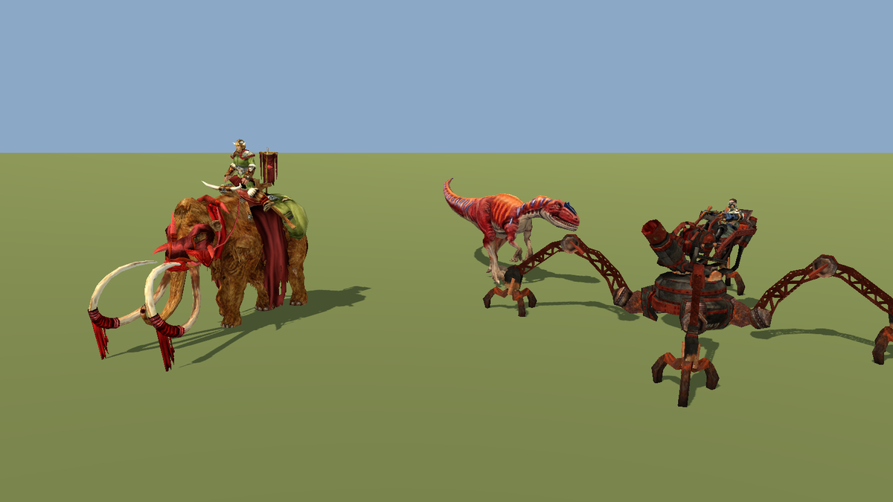
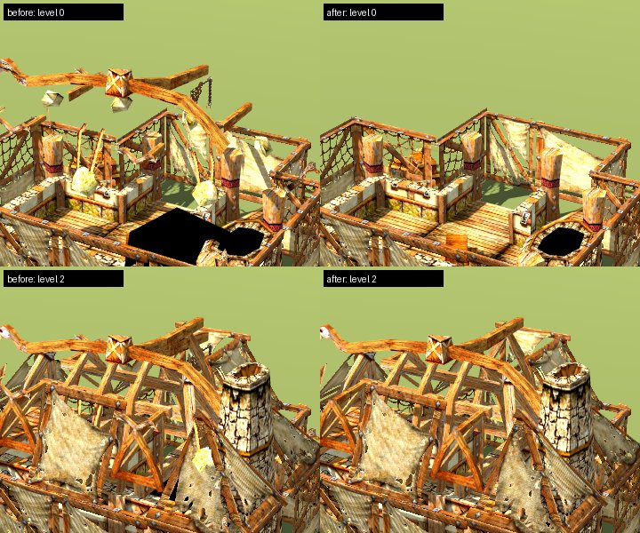
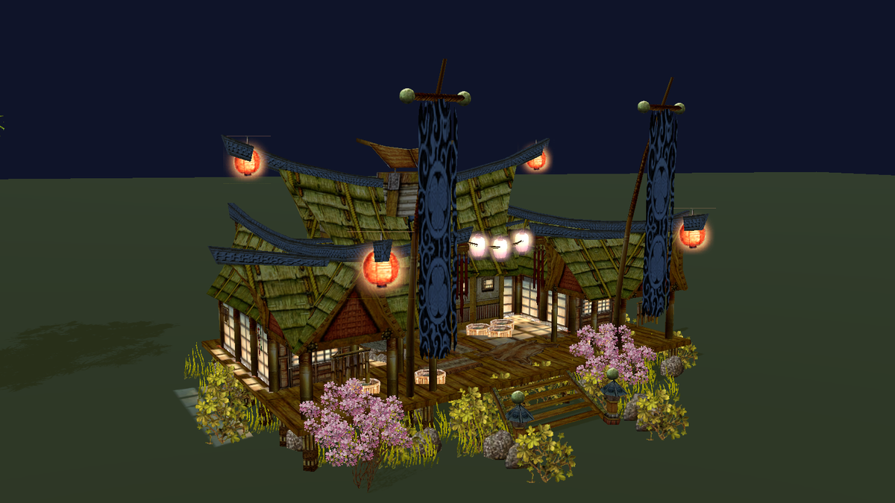
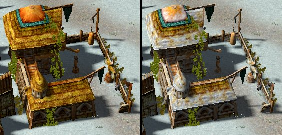
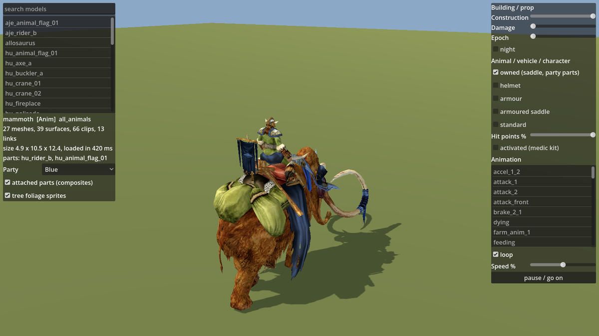

# View: drawing the original models

`game/src/View` draws the original game's models in Godot exactly as the browser remake does: from the toolkit's
converted assets (glTF + textures + `assets/manifest.json`), **loaded at runtime** through the configuration's
`AssetSource` (the assets live outside the project and are never imported into `res://`).

| JS (remake/src) | C# (game/src/View) |
|---|---|
| engine/assets.js (manifest, loadModel, templates, mergeSkinned / mergeStatic, tagWallArms, toLambert, tintParty, retarget, splitLoops) | Models/ModelManifest.cs, Models/ModelLibrary.cs, Models/ModelTemplate.cs, Models/GlbJson.cs, Materials/ModelMaterials.cs, Anim/ClipTools.cs |
| engine/parts.js (render flags) | Parts/Parts.cs (bit logic, no Godot), Parts/PartStates.cs (applyMask / applyState) |
| game/anim.js (AnimCtl) | Anim/AnimController.cs |
| game/compose.js (drawing side), entities.js (links, weapons, cranes, setVisFlag) | Compose/Composite.cs, Models/ModelInstance.cs |
| game/colors.js | Materials/PartyColors.cs |
| engine/props.js modelSprites / treeSprites | Models/ModelSprites.cs |
| - | Tools/ModelViewer.cs (+ scenes/ModelViewer.tscn), Tools/ViewerStage.cs, Tests/ModelViewTest.cs (+ .tscn) |



## Classes and the API the game uses

```csharp
var lib = new ModelLibrary(assetSource);                 // manifest + texture cache; templates loaded on first use
ModelInstance m = lib.Instantiate("hu_warrior_s1", PartyColors.ById("red")!.Light)!;
worldNode.AddChild(m);  m.Position = pos;  m.Rotation = new Vector3(0, heading, 0);   // heading 0 faces -z (maps/frame.js)
m.SyncAnimation(clip, loop, speed, startTime, now);      // or m.Play("walk_1"), m.Anim.Play(name, PlayOptions)
m.Advance(dt);                                           // per frame (game time): the clips of the model and its parts
```

* **ModelLibrary** - `Template(name, opts)` loads and prepares a model once (cache per name + options),
  `Instantiate(name | template, party)` makes an instance. `Manifest`, `Textures` (shared texture cache).
* **ModelTemplate** - the prepared scene (packed), `Parts` (switchable parts with their attribute bits), `Links`,
  `Clips` (an AnimationLibrary with the `#s/#l/#e` parts), `Loops`, `Sounds`, `Extras` (glTF root extras: foliage,
  walksets, pf, sounds), `Fourcc`, `Bounds` / `Radius` / `Height` (entities.js sizes), `Pick` (pick volume), load time.
* **ModelInstance** (a `Node3D`; the game moves and turns it, the model's own frame is inside):
  * part state as plain data: `SetBuildingState(level 0..4, damage 0..2, epoch 1..5, night)` or the full
    `BuildingState` (wall arm mask, variant pick, wall part names, gate ends); `SetNight(bool)`;
    `SetAnimalLook(AnimalLook {Owned, Gear, NoSaddle, Misc, Hp})` / `SetHideMask(uint)`; `SetVisFlag(bit, on)`.
    Each applies only when the state changed (cheap to call every frame).
  * colours: `SetPartyColor(Color?)` (GSF material flag 0x1000), `SetAnimalTint(Color?)` (owned animals' attr bit 5),
    `SetInfected(stage)` (the infected look: docs/INFECTED_LOOK.md).
  * links: `FindLink("Ride")`, `LinkWorld(name)`, `LinkLocal(name)`, `LinkNames`.
  * parts: `Attach(gfx, link, party)` (riders, flags, weapons, tools, cranes), `AttachTo(node, gfx)`, `Detach`.
  * animation: `Anim` (AnimController), `Play(...)`, `SyncAnimation(...)`, `OnAnimEvents(cb)` (GSF sound events), `Advance(dt)`.
* **AnimController** - anim.js: clips by name ignoring case, `Pick(...)`, `Duration`, cross-fades, start / loop /
  end clips (a looping walk runs `walk_1#s` once, then `walk_1#l`; leaving it plays `walk_1#e` first), `Hold`, events,
  the hit reactions' overlay clip (`HitReaction(side)`, `OverlayRestore`, `OverlayApply(dt)`: "Hit reactions" below).
  A gait change's transition clips (accel_1_2 ..., Phase "t") come from the simulation's AnimCtl like every clip.
* **Composite** - compose.js: `Build(PartSpec[] active, unitName, deployed, wagonParent)` attaches the parts the
  simulation resolved (parents first), riders idle / attack (`Update(dt, attacking, now)`), turrets (`Aim(target, dt)`,
  `TurnPart`), the log cannon's frame and gun (`DeployFrame`, `AimGun`, `Fired`), passengers on open transporters
  (`SyncPassengers`), trailers (`SyncWagon`); `GearFor(class, invented)` and `MiscShown(...)` give the animal look.
* **PartBits** - parts.js without Godot: `StaticSig`, `SigVisible`, `HelperPart`, `TodOf`, `AnimalMask`, `WoundStage`.

What the simulation needs to give the view per entity (plain data): model name, party colour, the clip with loop,
speed and start time, the part state (building: level / damage / epoch / night; animal: owned, gear bits, hit point
ratio; wall: arm mask, parts), the attached parts (`PartSpec` list) and, for turrets, the target. What the JS
simulation asked three.js for comes from the manifest (`ModelManifest`: speeds, walk sets, loops) and from
`ModelInstance.LinkLocal` (link positions in the model's frame).

## How a model is loaded

1. `assets/models/<name>.glb` through `AssetSource` (overrides first, then the converted data). The JSON chunk is read
   with System.Text.Json (`GlbJson`: root extras, material extras, image URIs).
2. The glb is given to Godot's `GLTFDocument` **without its images** (`GlbJson.WithoutImages`): Godot decodes every
   PNG of a file even with `HANDLE_BINARY_DISCARD_TEXTURES` (over a second for a character); textures come from one
   shared `TextureCache` instead (`assets/tex/<file>`, loaded once for all models, with mipmaps).
3. `GenerateScene` gives `ModelRoot > Model (the glTF root: GSF Z-up left-handed -> Godot, rotation -90° about x and
   scale x -1) > Skeleton3D > meshes, BoneAttachment3D > link_<name>`. Animation tracks are renamed to `Model/...` so
   every model's clips have the same paths (borrowed animations work across models).
4. Materials: lambert, no specular (three.js MeshLambertMaterial); glows (GSF flag 0x4) unlit and additive; the
   vegetation cut-out rule; party materials flagged. Double-sided materials (glTF doubleSided: cloth, tents, banners,
   leaves, fur fringes, every alpha-tested part) are a small shader of the same look (`ModelMaterials.TwoSided`), see
   "Light of double-sided parts" Emission (the sequel's lit windows, signs and coils) is glTF's: the emissive factor
   x the emissive texture (Godot's own default adds them - a white factor lit the whole surface white).
5. Parts: attribute bits from the node extras (Godot keeps them as metadata "extras"); time of day; helper parts
   dropped (pick volumes -> `Pick`, shadow models, lower LODs, low-poly hulls); foliage quads of buildings become
   camera-facing sprites (`ModelSprites`, they carry the node's bits and follow the part states).
6. Merging: skinned meshes of the same skeleton, material and attribute become one; static models (everything but
   animals, vehicles and characters, or `ModelLoadOptions.Static`) merge their non-moving rigid parts per part
   signature into one mesh with a surface per material. Small rigid parts (< 0.8 m) cast no shadow.
7. Clips: start / loop / end clips cut into `#s`, `#l`, `#e` (manifest `loops`); a model with `anims` takes the source
   model's clips retargeted (position tracks moved by the rest offset difference, or scaled for a scaled rig).
8. Default look (finished, intact, epoch I / wild animal / medic kit hidden), then packed into a `PackedScene`.

## Part flags (GSF attribute bits; remake/docs/DATA_PIPELINE.md "Models")

| bits | meaning | here |
|---|---|---|
| 0-4 | LOD mask (bit 0 = full detail) | LOD0 only (`HelperPart` "lod") |
| 5-8 (Bldg) | build-up: 5 rises while its level is built, 6 sinks after its level, 7-8 the group (Wall: 18, 19, 29-30; Fiel: 9, 10, 11-12) | `BuildUp`, below |
| 9-13 | epoch variants I-V | `BuildingState.Epoch` |
| 17 / 20 | day-only / night lights (Bldg, Ship; 20 also Deko, Fiel, Misc) | `BuildingState.Night`, `SetNight` |
| 18, 19 | pick volume, shadow model | dropped (pick -> `Template.Pick`); wall archives (`Wall`) keep parts with both (every wall piece's construction parts) but drop a shadow model without the pick bit (the holy city gates' `hcl13_gate` / `hc_gate` mesh 18, a pyramid with the placeholder `test/gates.tga`: a brown slab in the gate in sc_4070, 2026-11-11) |
| 14 (without 16) | a gate's leaves modelled standing open (editor only) | dropped for gates: the rules' gate classes' models and any wall-archive model with skinned leaves of flag 16 (`hcl13_gate`, a CBuilding; `hc_gate`) - `ModelLibrary` |
| 21-24, 25 | construction levels 0-3, finished | `BuildingState.Level` (0..4) |
| 26, 27, 28 | intact, damage 1, damage 2 | `BuildingState.Damage` |
| animals: 5 party colour, 6 saddle, 7 helmet, 8 armour, 9 standard, 10 armoured saddle, 11 misc, 20-27 wounds | | `AnimalLook` -> `PartBits.AnimalMask` (owned = not wild and not of a class that keeps the wild look, `Compose.WildLook`: the arena animals - mission 10's arena_allosaurus of player 5 -, the kennel's sabre-tooths `hu_kennel_eusmilus`, the Dragon Clan nest's `ninigi_dilophosaurus`, MIRAGE's nest `aje_gallimimus`: their OnInit hides party colour, saddle, helmet, armour, standard, armoured saddle and misc - CKennelEusmilus, CNinigiDilophosaurus, CAjeGallimimus) |
| characters: 16 activated (medic kit) | | `SetVisFlag(16, on)` / `SetHideMask` |



### Building up (the engine's, 2026-11-21)

Kacper: "in original there was gradual build step and here we just suddenly change to the next build stage". The scripts
only set the construction level (BuildUpBuilding.usl AddProgress: `CurProcess`, `SetConstructLevel(progress / 25)`); the
client animates the parts between the levels itself:

- **The construction state.** PWClient 0x46e9b0 runs for objects of class BLDG / TRRT while they are built and when
  their level changes. With the model's kind (Bldg, Wall, Fiel) it builds two transitions (0x7aa060): last level -> this
  level, and this level -> the next.
- **Rising.** The next level's parts that this level lacks rise out of the ground while this level is built, if they
  carry the appear flag (Bldg 0x20).
  - Each group (bits 7-8) is lowered by its highest top (the chunks' boxes, GSF z) times 1 - f, where
    f = CurProcess / 100 * 4 - level. A part is not drawn at f = 0 (0x7a9d30: a z offset per chunk).
- **Sinking.** The last level's parts that this one lacks sink in the half second after the level changed, if they
  carry the disappear flag (0x40: scaffolding). They are lowered by their group's top times (now - change) / 0.5
  (0x46fe90).
- **Everything else** of the last level goes at once. A next-level part without the appear flag waits for its level.

The remake keeps those parts apart when it merges a model's static meshes (`ModelLibrary.MergeStatic`: the build-up
bits are in the key). It records each one's top (`PartRef.Top`). A drawn building calls `ModelInstance.StepBuildUp`
every frame (`EntityViews`) with the game time. The rules are `BuildUp` in Parts.cs.

A building first seen, or seen again after a while, shows its level as it is. A finished building does nothing.

## Attached parts, turrets, party colours

Links are the exporter's `link_<name>` nodes (on skinned models below a `BoneAttachment3D`, so they follow the bones).
An attached model drops its own root turn and mirror (`ToLinkFrame`: the link is already in the parent's GSF frame);
turrets turn about the link's z axis towards a world point (`Composite.TurnPart`, BuildUpBase.usl RotateToEnemy).
A turret's clip of the composites table is the one it shoots with (`seas_wehrspinne_top`: `attack_front`, its only
clip): it is played on a shot, never as the part's standing loop - neither in the world (`Composite.Build`) nor on an
actor drawn for a cutscene (`SeqActors.RestClip`: no turret clip, no attack clip; the Black Widows of mission 13's
scenes fired for the whole scene). A cutscene's bound prop is drawn with the scene's clip (`EntityViews.PropAnimOf`).
The parts' clips are the simulation's (`AttachedPart.Anim`, `EntityView.SyncParts`): a weapon build-up's top plays
"attack_front" with each shot also on a unit set up to shoot (the Black Widow, MIRAGE's MG walker), and MIRAGE's
Scorpion - an empty carrier (`pirate_boss`) with the robot as its build-up - fights with the build-up's clips
(docs/SIMULATION.md "Attack clips of vehicles and big units").
Party colour: materials with GSF flag 0x1000 get a tinted copy per colour, shared by all models of that colour:
texture × colour × 2 (`ModelMaterials.PartyTinted`, `Modulate2X`). The original's material setup (PWClient 0x6ac340)
draws them with D3D MODULATE2X (texture × lighting × colour × 2), and the textures under them are painted at about half
brightness for it (hu_tech_a: 61-80 against 117 elsewhere); the remake drew texture × colour, so owned party parts were
half as bright and unowned ones dark. The × 2 is done in gamma space as the original's (the albedo's linear value is
the colour's × 2^2.2). An object without an owner and the "Original colours" option draw these materials with white
× 2 (`PARTY_NEUTRAL`: the texture as painted) - MIRAGE's mirage_party_colour_no_owner fixes the original's skipped
stage (dark, "black" parts) the same way. Owned animals' attr-bit-5 parts get colour × 1.6 (compose.js updateMask)
unless the surface is a party material already (it was colour² × 1.6 on the harness of dilophosaurus, gallimimus,
iguanodon, mammoth, megaloceros ...). Attached parts take the host's colour. The SEAS paint keeps × 1 (× 1.15 lift):
it paints white texels, painted at full brightness, so white × colour is as bright as another tribe's half-bright
party texel × colour × 2; the markings (`SEAS_MARK_LEVEL`) are relative to the texture and unchanged.
SEAS paint: the SEAS models have few 0x1000 materials (the soldiers' and riders' cloth, the mobile suit's cockpit, a
part of some buildings - the steelwork's chimney, the greenhouse's dome, the turret tower's body; none on most vehicles,
robots, ships, weapons), so their sides were hard to tell apart. Materials of the seas_* textures get a copy per player colour
(`ModelMaterials.SeasPainted`, the Lambert shader with `seas_paint`) whose white and light grey parts (key from a
blurred texel - mip `SEAS_PAINT_LOD` 2 - so whole parts change: saturation up to `SEAS_PAINT_MAX_SAT` 0.22, brightness
from a per-texture line so at most `SEAS_PAINT_SHARE` 30 % of the texture is painted, never below `SEAS_PAINT_MIN_VAL`
0.5) take the owner's colour as the other tribes' marked parts do (texel × colour × `SEAS_PAINT_LIFT` 1.15, strength
`SEAS_PAINT_STRENGTH` 0.9). Kacper 2026-11-11: the first version recoloured the red paint - "too much, try more natural
markings ... like 30% of the model ... try to paint white elements". `PW_SEAS_PAINT="max sat,min val,strength,lift,lod,
share"` overrides the constants for a tuning run. Glows (fire, lights, blood splashes: flag 0x4) are other materials.
The Compatibility renderer hands the shader sRGB texture values (measured), the
others linear (`#if CURRENT_RENDERER`). Option "Original colours (no player colours)" (Options → Graphics,
`AppSettings.OriginalColors`, applied at once): `ModelMaterials.OriginalColours` - no player colour on any model
(party materials white × 2, as unowned objects; no SEAS paint); `TintEpoch`
makes the entity views re-apply their colours (map props with a party colour change at the next game start).
Test: `LightingTest.tscn -- --only=seas --shots=<dir>`: seas_colours.png, original colours above, player colours below.

**SEAS markings.** Most SEAS textures have little white (measured on the models' surface, area-weighted: the carrier
1 %, turret tower 0.4 %, robots 0.3-8 %, submarine and hovercraft 0 %), so the key alone barely changed them. Kacper
2026-11-11: "for units that didn't have a clear spot you need to paint your own". `SeasMarkings.Marks` is a table of
UV boxes per texture (texture, u0, v0, u1, v1, `Sel.All` / `Sel.Red`, a note) chosen from each texture's UV layout:
roof sheets, roof-edge beams, girder and scaffold stripes, coping band on the brick bases, SEAS emblems and hazard
stripes (`Sel.Red`: only the red / orange paint in the box), the carrier's waterline and superstructure bands, the
submarine's hull band, the hovercraft's trim lines, the pennant cloth, selected armour plates of the walker, mobile
suits and lumberjacks, the tents' canvas, the soldiers' uniform parts (gunner's trousers, rocket trooper's jacket,
flamethrower's vest, rider's jacket and vest). `SeasMarkings.Mask` rasterizes a texture's boxes at load (256 px, soft
1.5 px edge, `Sel.Red` weighted by the texel's redness) into the shader's `paint_mask`; the shader paints
k = max(white key, mask) × strength. A marked texel takes the colour as a coat of paint: colour × `SEAS_MARK_LEVEL`
0.5 (linear) × the texel's brightness against its neighbourhood's (mip `SEAS_MARK_LOD` 4), so dirt, rivets and
scratches stay; where the white key is larger it stays texel × colour. Faces, skin, glass, fire and lights are not in
any box. Each model ends near 20-30 % of its visible surface painted (white key + markings + 0x1000 parts; the table
in the commit / Kacper's review). A texture is shared by many models: a box paints every model using those texels.
Buildings (Kacper 2026-11-11: "the garage is nice but others have too much color change ... closer to 10-20% and
mostly stripe based not whole roofs"): a box has a `Scope` - Any, `Buildings` (GSF kinds Bldg, Wall, Deko:
`SeasMarkings.IsBuilding`, `MaterialTag.Building`) or `Others` - and the mask is built per texture and scope, so a
texture shared with vehicles (seas_building_a: helicopter, defence spider) keeps their boxes. Buildings get no roof
sheet and no armour-plate band, narrower roof-edge beam, girder and coping stripes, stripes on the tents' canvas, only
the copper outline on the carrier turret's plate: 8-20 % per building (the white key alone stays below 11 %, so its
share is unchanged). Check: `--only=seasbldg` (seas_buildings.png).
Selections and per-model boxes: `Sel.Gold` (brass: the SEAS triceratops' armour is baked into its animal texture
ash_triceratops_a and it has no party-colour harness - attr bit 5 - parts, so it took no colour; the brass plates
now do, not the leg armour, skin, horns or face: 19 %), `Sel.Keep` (the mask's green channel: nothing painted there,
not even by the white key - the lumberjack's minigun; the cannon turtle's own skin), `Mark.Model` (a box only on that
model; `MaterialTag.Model`, `SeasMarkings.HasMarks(texture, model)`: another tribe's texture is painted only on a
seas_* model or the model a box names - MIRAGE's SEAS use scorpion, hs_warpgate, plane_parachute_box_ingame ...).
**Parts that keep their colours** (`SeasKeepParts`, Kacper 2026-11-12 in MIRAGE mission 13: the Black Widow "no
longer paint its legs in team colours", "do not paint the flamethrower for the exo robot"): whole mesh nodes of a model
that neither the white key nor a box paints (`PartRef.SeasKeep`, set by `ModelLibrary` by the node's name and kept
apart when meshes are merged; `ModelInstance.ApplyTints` gives them no `SeasPainted` copy): the Black Widow's legs
(`seas_wehrspinne`: every mesh but the body mesh3 - also MIRAGE's MG walker and the wreckages, the same model; the
turret `seas_wehrspinne_top` keeps its paint) and the exo flamethrower's gun (`seas_mobile_suit_flamethrower` mesh28,
the cage in its right hand). Not `Sel.Keep` boxes: the robots reuse their texels all over a model - the gun shares
45 % of the shoulder plates' texels (the round grey disc) and some of the thighs', the legs a sixth of the body's
seas_products texels - so a box would have unpainted those too. Test: `SeasPaintTests`; look:
`--only=seasclose --gap=1.7 --models=seas_wehrspinne,seas_mobile_suit_flamethrower`.
MIRAGE's SEAS (classes only the MIRAGE configuration adds): scorpion red plates, disruptor dial ring, tesla machine
hazard stripes and copper beams, warp gate panel lines, speaker bar and hazard stripes, special box parachute band.
Their animals (carnotaurus, gigantosaurus, arena T-rex, polakanthus, panoplosaurus, stygimoloch, muraeno- and
mosasaurus, cannon turtle) keep their skins: their SEAS parts are the transporter / collector / MG housing and the
riders on them. Tents: four proposals each, D the default (small tent: the net's outer border - its 3 x 3 tiles share one texture
square, so `SeasMarkings.Outline` paints within a width of the rim polygon in the mesh frame, shader varying
`seas_lpos`, uniforms `outline_pts` / `outline_n` / `outline_w` / `outline_uv`; big tent: the eave line, u 0.72 along
the sides and v 0.50 at the ends). Earlier: three proposals each (`SeasMarkings.SmallTent`, `BigTent`), `PW_SEAS_TENTS="<small><big>"`
(default "AA"), `--only=seastents`. `--only=seasmirage` (with the MIRAGE data): seas_mirage.png.
A texture of another tribe can carry markings too (`SeasMarkings.HasMarks`): ash_specloc_d, which the SEAS defences
use, gets the hq bunker's hatch X, the defence turret top's red trim line and red bulb (also on the MG nest top and the
big cannon rotator, same design) - its materials are painted only where marked, without the white key (Kacper
2026-11-11). Close-up check: `--only=seasclose [--models=a,b]` (seas_close.png: original | blue | red per row).
Test: `LightingTest.tscn -- --only=seasall --shots=<dir>` (window `--resolution 2400x1400`): every SEAS model, one
cell each, blue and red copies side by side, original colours above: seas_all.png.

**Snow vs SEAS colour (order).** Snow is never a "white part": it stays white over every player colour.
* A setting texture with painted snow (MIRAGE's Icewaste `seas_building_a` / `seas_tent`, "Setting textures" below):
  the paint copy is made from the variant, but its **white key, threshold (`PaintThreshold`) and markings come from
  the plain texture** (`MaterialTag.Plain`, set by `SettingMaterials.Variant`; shader `paint_plain` / `use_plain`), and
  the snow the variant adds is kept unpainted: per texel the share of white it adds to the plain one,
  (variant - plain) / (1 - plain) in sRGB brightness, smoothstep 0.06 .. 0.4 (`seas_snow`, `SEAS_SNOW_FROM` / `_TO`),
  goes into the mask's keep channel (`seas_unsnowed`: as `Sel.Keep`). Until 2026-11-21 the key read the variant: its
  white, unsaturated snow was the brightest "white part" - big yellow blotches on a yellow SEAS player's roofs in the
  Outbreak's Icewaste, a yellow-green tent (Kacper's screenshot). A variant that adds no white (Jungle moss, Ashvalley
  soot, cave3) is painted where the plain texture is.
* Shader snow (`SnowCover`, buildings without a setting texture - the base game's SEAS): the snow code runs after the
  paint in the same shader (`a.rgb = seas_paint(...)`, then `SnowCover.Fragment` mixes the snow texture in), so the snow
  replaces the coloured texel; party materials (0x1000: colour × 2 in `albedo`) are the same - the snow does not use
  `albedo`.
* Order on a model (`ModelInstance.ApplyTints`): setting variant -> party / SEAS paint -> infected look -> "units
  behind" stencil copy. The infected copy keeps the variant's texture (its painted snow rotted with the rest, no paint,
  no shader snow); the stencil copies only add passes.
* Not changed: the tribes' own party materials (0x1000) on their Icewaste atlases are tinted texture × colour × 2 like
  the original's.
Check: `LightingTest.tscn -- --only=seasclose --models=seas_barracks,seas_small_tent,seas_big_tent --setting=icewaste
--colors=yellow,green --data=<data with assets/tex/settings>` (seas_close.png: original | yellow | green, Icewaste).

**A script's decorations (MIRAGE's CMirageDeco).** Some MIRAGE classes link models of their own to a building
(`LinkAction(building, link, offset)`). All of them are parts of kind "deco" (`CompositeSpec.Kind`), attached by
`World.AttachDeco` at their link - "NONE" / "NOPE", links the model lacks, hang them at its origin - with their offset in
GSF axes, and whole (`CompositeSpec.Whole`: construction level 4 on a site too). They come from two lists that
`Building.UpdateTurret` reads with the composites, building the parts again when either changes: the fixed ones of the
SEAS classes (`World.PartSpecs`: the mine's, pub's, warp gate's and SEAS portal terminus' parts once finished; the one
with a "destroy" clip stays as a ruin part - `World.DecoRuin`) and the ones a class's behaviour lists by its state
(`BuildingBehaviour.ExtraParts` / `ExtraPart`: model, link, offset, destruction level, script visibility flags, clip -
the special box's lemur and sloth, the sensor tower's amazon guard, the launch pads' colossus and pirate ship parts
growing with the site). A fixed decoration follows the building's damage; a listed one has its own state
(`AttachedPart.OwnState`: construction level 4, its destruction level - not the host's -, applied on any host by
`EntityView.SyncParts`) and its own visibility flags
(`AttachedPart.VisFlags`, set when the view builds it: SetRndInvMaskSingleFlagInv - the colossus' head, arms and
weapon). The pirate boss ship's parts (tail, sail, rowing deck, cannon deck: composites of kind `shippart`) have an own
state too: their destruction level follows the ship's hit points.

**Offsets (MIRAGE).** MIRAGE links some parts with an offset (`AddObjCustomized(obj, link, {x, y, z})`, the engine's
`LinkAction(parent, link, offset)`; composites `offset`, metres in the link's frame, GSF axes - as the toolkit's scene
export places them): the attached part's position under its link (`EntityView.BuildParts`, `PartSpec.Offset`), so it
turns about its own origin. The simulation adds it to the shot origins (`CompositeSpec.OffsetModel`: the offset in the
model frame, (-x, z, -y); the links that carry offsets are not turned). All 19 offsets are MIRAGE's (the base game has
none): the CBR titan's two machine guns 3 m left and right of the saddle (were on one spot) and its transporter 1.6 m
lower, the shore cannon's carrier turret 7.05 m down onto its base (floated 7 m above it), the ballista titan's two
steam cannons and log cannon stacked 1.4 m apart (were inside each other), and the build-ups / turrets of the catapult
rex, liopleurodon, muraenosaurus / muraenosaurud, carcharodontosaurus, styracosaurus, tarbosaurus, cannon turtle,
SEAS mosasaurus and the gallimimus nest's eggs (`nest_birds` at "Nest", a link its nest model lacks - below).

**A link the model lacks.** MIRAGE's gallimimus nest (`aje_gallimimus_nest`) is drawn with the Dragon Clan's
dilophosaurus nest (`ninigi_dilophosaurus_nest`: links D_01-16, Bl_1-6, Ex_1, Spwn - no "Nest") and hangs its eggs
`nest_birds` at "Nest" with the offset {0, 0, -0.1}. The part was not drawn at all. The original's client skips the link
of a child whose link slot is not set (PWClient.exe 0x46e5c3: index -1, the child keeps the position the server gives
it - the parent's); the toolkit's scene export hangs such a part on the parent's root. So a part on a missing link of a
**static** model (a building, a decoration) now hangs at the model's origin with its offset
(`ModelInstance.LinkOrOrigin`; EntityView.BuildParts, Composite.Build): the eggs' straw lies in the middle of the
nest, 10 cm lowered as the mod's author set it. Not on animals and vehicles - their origin is the ground under the
belly: MIRAGE's level flags at "flag" on models without that link (muraenosaurus, saltasaurus, tarbosaurus,
gigantosaurus, carnotaurus, the scorpion, the pirate boss, the SEAS spider, the cannon turtle, the zeppelins, the SEAS
lumberjacks, mobile suits and hovercraft, their wreckages) stay undrawn, as before; the test knows them as a class. Not a model's
own copy of itself (MIRAGE's `pilot_lvl4`: the floating harbour on the floating harbour). Every composite of both
configurations was checked against the converted models (`CompositeLinksTests`): besides these, only the Norse large
tower's ballista lacks its link ("we") on `hu_large_tower` - it is put on once the tower is upgraded, whose model
`hu_large_tower_upgrade` has it. (Not certain: whether the original shows the eggs at the origin - the server side was
not traced; the -0.1 m would also fit the first link, D_01 at 0.13 m on the nest's front edge. A screenshot of the
original would settle it.)



**A model's own copy of a part hung on it.** `seas_carrier` has the turret it gets at `we` (`seas_carrier_turret`,
CSeasCarrier.SetReady) modelled into the hull as well (meshes 57 / 58, attribute 0x1c00001f), on the same spot: both
were drawn, the hull's standing still beside the turning, shooting one. The game gives the library the parts the
classes hang on each model's links (`ModelLibrary.PartsOnLinks`, from the composites table: `GameSession.PartsOnLinksOf`;
the model viewer from gamedata.json); `DropBakedParts` leaves out, at load, every mesh of the model whose box seen from
the link is the box of one of the part's meshes (same size and place within 5 % + 15 cm). Every turret, build-up,
drawbar and crane of the base game's and MIRAGE's composites was checked against the converted models this way: only
the carrier (and `seas_carrier_fake`, same model) has such a copy.



## Destruction: the ruins and the turrets' ruins

A finished building that is destroyed (not a wall piece) is drawn as its ruin `<gfx>_dest` (`World.RuinOf`; Building.usl
CBuilding.Delete -> CBuildingCorpse.Init(gfx) -> "<gfx>_dest"), which plays its clip `destroy` once from the moment of
the destruction (CBuildingCorpse.PlayAnim; `EntityViews.SyncOne`), sinks after 8 s and is gone after 20 s. Every ruin
of the GSF archives at hand has that one clip `destroy` (2026-11-13).

**The turrets' ruins** (user report 2026-11-13: "some buildings do not play their destruction animation, for example
the small cannon and the machine gun nest"). The original's towers make a corpse of their turret apart from their own
(CTower.CreateBuildingCorpse: BuildingCorpse.Init(turret gfx) -> "<turret>_dest", turned as the turret; CSeasBigCannon:
the rotator; CRocketRamp: the top and the bird). For the SEAS machine-gun nest and the small cannon (the defense
turret) the whole collapse is in the turret's ruin: `seas_hq_machinegun_nest_dest` and `seas_hq_defense_turret_dest`
have no clip, `seas_hq_machinegun_nest_top_dest` / `seas_hq_defense_turret_top_dest` have `destroy`; the big cannon
the same (`seas_hq_big_cannon_rotator_dest`). The remake drew only the building's ruin, with the **live** turret still
hung on it - no collapse at all for those. Now `World.RuinPartsOf` gives every attached part with a `<part>_dest`
model its ruin part (`Building.RuinParts`: same link, parent and turn; `AttachedPart.From` = the live part's model),
and the view (`EntityView.SimParts` / `BuildParts` / `SyncRuinParts`) draws those instead of the live parts on a
destroyed building and plays their `destroy` with the ruin's. Parts without a ruin go with the building (the original
deletes its grouped children: the big cannon's barrel, cranes, the floating harbour's turtles). A ruin part stands
where the live part hung - at the link of the building's (or the parent part's) **live** model, from the model data
(`EntityView.RuinLink`: a ruin model need not have the link): MIRAGE's fix of its towers (MIRAGE CTower.CreateBuildingCorpse
puts the turret's corpse at the turret; the base game's at the tower's foot left `seas_turret_dest` 10 m down).
MIRAGE's Dragon Clan large tower has no ruin of its own and leaves the smoke tower's (`ninigi_smoke_tower_dest`, MIRAGE
CBuildingCorpse.Init) - before it left none.

Classes that play their destruction only now (`BuildingRuinTests`, both configurations): `seas_hq_machinegun_nest`,
`seas_hq_defense_turret`, `seas_hq_big_cannon`; MIRAGE also `seas_mg_nest`, `seas_small_cannon`, `seas_great_cannon`
(the same models) and `ninigi_large_tower`. With a turret's ruin besides their own collapse: `seas_turret_tower`
(`seas_turret_dest`), `aje_tesla_tower` (`aje_tesla_tower_canon_dest`), `ninigi_rocket_ramp` (`ninigi_rb_top_dest`,
`ninigi_rb_bird_dest`), the Norse large tower's ballista and the Dragon Clan small tower's upgrade when they have
them, MIRAGE's `ninigi_large_tower` (`ninigi_rocket_ramp_top_dest`).

**Ruins that stay** (2026-11-13; Building.usl CBuildingCorpse.ShouldStay, base game and MIRAGE): the corpse of these
models never sinks - `seas_hq_bunker_dest`, `seas_hq_big_cannon_dest`, `seas_hq_big_cannon_rotator_dest`,
`seas_hq_defense_turret_dest`, `seas_hq_machinegun_nest_dest`, `PT_Citywall_Gate_dest` (and `hcl13_gate`): the SEAS
headquarters' buildings of the campaign maps and the city gates. MIRAGE excepts its own classes with those models
(IsException by the corpse's source class: `seas_fortress`, `seas_mg_nest`, `seas_small_cannon`, `seas_great_cannon` and
its rotator) - their ruins sink as every other; MIRAGE's `seas_shore_cannon` is not excepted, its ruin stays.
`World.PermanentRuin` decides at the destruction (`Building.RuinStays`); such a ruin is never removed nor sunk; the ruins
of its parts that do not stay themselves (the machine-gun nest's and the defense turret's tops) go when a ruin would
have gone (20 s: `SettleRuinParts`). A ruin is a dead building: its cells were freed at the destruction - it blocks no
way and no placement, it cannot be selected or hit; it is only drawn (the explored fog of war shows it). Saved games
replay the inputs, so a loaded game has the same ruins (`MirageClassesTests.PermanentRuinSavedAndLoaded`). MIRAGE's
Amazon temple has no ruin model: its corpse is the temple itself at destruction level 2 for 3 s, then it sinks
(CAjeAmazonTempleCorpse; `Building.RuinSinkAt`).

## Ship wrecks (EntityViews.Wrecks)

The units' script corpses (docs/SIMULATION.md "Script corpses": MIRAGE's Scorpion, the siege tower, the zeppelins and
Dragon Clan airships) are drawn here too: their own model without a destruction state, at the height of the moment
(`Wreck.YAt`: falling, sinking), the simulation's clip followed through `EntityView.SyncAnim` (the Scorpion's held
frame) and the fire `fire_molotov` attached at the corpse's link.

A sunk ship is drawn as its wreck (`World.ShipWreck`: "<gfx>_dest" at destruction level 2, playing "destroy" once
from the death - combat.js shipWreck) instead of the ship and its parts, where the player sees the owner or the place
was ever explored (main.js), and gone with the dead ship after 10 s. (The port had the wreck in the simulation only:
the dead ship stood on with its live model until it was gone - now drawn, for every ship.) MIRAGE's pirate boss ship
leaves its parts' wrecks too (`Wreck.Parts`, each with its own times - docs/SIMULATION.md "The MIRAGE classes"): the
tail's, rowing deck's and sail's sinking one after the other, the cannon deck and its reduced wreck, then the hull's
wreck; each model is placed and turned where its part was at the death, coloured as the owner, its clip put on the
simulation's time (`SyncAnimation` from the death + its start).

**Vehicle wrecks** (2026-11-20): a destroyed vehicle leaves its wreck the same way (`Combat.VehicleWreck`; Vehicle.usl
CVehicle.CreateCorpse -> CVehicleCorpse: its current model + "_dest" playing "destroy", 10 s; an amphibious one in the
water "<gfx>_dest_water" playing "destroy_water" - the hovercraft), not when it dies inside a transport. Before, every
vehicle played its own dying clip and its wreck with the collapse was never shown (22 classes: the steam tank and ram,
the carts, the mobile suits, the helicopters, the hovercraft, the firecannon, the trike, the harvester, the walker ...).
A vehicle without such a model keeps its own death. The wagons drawn by animals (the chariot's trailer, the Dragon Clan
cart and drum wagon) have "_dest" models too, but the original's scripts make no corpse of them (an animal leaves its
CharacterCorpse): none. Not ported: MIRAGE's collapse of rebuildable SEAS suits into wreckage classes (rebuild
protocol) and its "unit resources" corpses (stone / wood).

**The audit** (`BuildingRuinTests.BaseUnusedDestructionClips` / `MirageUnusedDestructionClips`): every "<model>_dest"
with a clip in the data must be left by something - a building class at any of its levels or a part of it, a ship, a
vehicle, the pirate ship's parts - or is listed as scenery (map props: `hc_*`, the scorpion's huts, the cut Norse
buildings without stats `hu_marketplace`, `hu_medium_tower`, `hu_big_animal_farm`, the Dustriders' farms and big tent);
a class's model whose destruction is never played fails it.

## Rising buildings (MIRAGE custom_buildups.txt)

A MIRAGE building with CustomConstruction (`Building.Rising`; docs/SIMULATION.md "MIRAGE's custom construction") shows
its paving tiles while it is a site (`Building.RisingSiteGfx`, `EntityViews.ModelName`) and the finished model as a
child of that model (`EntityView.Riser`, `EntityViews.SyncRiser`): at `Building.RiseY` over the origin (under the
ground at first), turned as the building, finished (construction level 4), in the owner's colour and the setting's
textures; it goes when the building is finished and its own model takes over. Without the paving tiles' model file the
site keeps its own model and stages (nothing rises). The custom cranes are attached parts at "NOPE" with the table's
offset (`CompositeSpec.Offset`: the part hangs at the model's origin, moved by the offset - as MIRAGE's
AddObjCustomized parts).

## Leftover chunks of buildings

A building's GSF chunks name the construction levels (bits 21-25) and conditions (26-28) in which they show; a chunk
that should always show has all of them (0x3e00000 - 169 chunks of the base game's buildings). Some chunks have none
of the construction bits - 33 in the buildings of the container's data (28 with no state bit at all, the "_f0" meshes;
2 with damage 1 only, 1 with intact + damage 1, 2 with every condition): all but a few small ones (7-16 vertices: single
boards and quads) are copies of a chunk of some state, often moved a little - leftovers of the modelling. Read as "no bits = every state" (parts.js, so the JS too) they doubled those parts in every state: the
Norse **lumberjack cottage** (nine "_f0" meshes and mesh 70: the roof's ridge beam with its hanging bags and the gable
boards floating over the foundation, a black board beside the chimney while it is built, copies of the roof's
ornaments in every state), the large tower's ring of dragon heads (a second ring, 1 m off), the weapon smith's banners
and chimney cap, the temple's, harbour's and tavern's moved copies, the tesla tower cannon's damage parts, the SEAS
carrier's own turret. `PartBits.Unstaged`: a building's mesh without any construction bit is not drawn (ModelLibrary,
with the pick volumes and shadow models). Billboards and particle emitters keep the old rule (the ruins' dust emitters
of the `*_dem_fx` models have no bits and must play). Chunks with construction bits but no condition bit (one: a
harbour piece of levels 1-3) are drawn as before.

Check: `BuildingPartsTests` draws every building model of both configurations in every state (levels 0-4, damage 0-2,
epochs I-V) with these rules and looks for a part drawn twice (two chunks with the same geometry and turn, different
state bits, within 2.5 m): none (65 buildings of the container's data; `PW_MODELS_EXTRA` adds model folders);
`LumberjackCottage`: its ten leftover chunks, nothing doubled now, doubled with the old rule.



## Amphibians: walking on land, swimming in the water

The simulation plays the clips of a unit's model as its walk set says (FightingObj.usl `m_xWalkSet`, the GSF walk
table), on land and in the water alike. The transport turtle (`aje_transport_turtle`, model `macrolemys_water`) has
the walk set swim_1 / swim_2 and no walk clip: it swam over land (user report); the baryonyx (`baryonyx`,
`ninigi_baryonyx`) has walk_1..4 and swim_1 / swim_2 apart and walked through the water. The view draws an amphibian
(`Unit.Amphib`: the transport turtle, hovercraft, helicopter, baryonyx, macrolemys) in its medium
(`EntityViews.Medium`, `MediumClip`, `SyncMediumAnim`):

* in the water by the simulation's own rule (`EntityViews.InWater`, nothing kept in the view): the ground under it
  more than 0.5 m below the water (Naval.cs: a unit "in the water");
* a moving clip of the other medium is replaced: walk_<n> -> swim_<n> (else swim_2, swim_1, swim) in the water,
  swim_<n> -> walk_<n> (else walk_2, walk_1) on land; on land the idle is `stand_anim_land` where the model has one
  (the snapping turtle);
* a swimming-only model (`*_water`) is drawn with its land model (`*_land`) on land: `macrolemys_water` ->
  `macrolemys_land`, which has the same shell link `link_con`, walk_1 / walk_2, the land idle and swim (the original's
  class CTransportTurtle is not in the installation's scripts: that the original switches the model is an assumption -
  the walk set of `macrolemys_water` has no walking clip to play);
* the replaced clip plays at the unit's speed over the clip's own speed (the manifest's `speeds`: a land walk at the
  pace of its steps), not put back on the simulation's time (that is another clip's). View only: the simulation's
  model, clips, sizes and times stay as they are (lockstep, saved games).

The hovercraft and the helicopter have walk clips only: unchanged. Check: `--test-amphib <s>` (docs/GAME_SESSION.md).

## Flying units (MIRAGE)

MIRAGE's flyers (docs/SIMULATION.md "MIRAGE: flying units") need nothing of their own in the view: the simulation keeps
their height in `Pos.Y` (the ground or the water + `Unit.LiftH`, 15 m in flight) and chooses their clips - "fly" (the
pteranodons' walk set) or walk_1/2 (the cargolifter, the dirigible) while flying, "idle" hovering, "land" / "take_off"
around a landing, "standanim" standing; a landed pteranodon is drawn with its ground model `pteranodon_boden`
(`Unit.Gfx` changes, the view swaps the model as for every model change) and walks with its walk_1. So the models are
drawn at their height (`EntityViews.SyncOne` puts a unit at `Pos.Y`), they cast their shadows on the ground from up
there (the sun's shadows; a flyer stays in the drawn set while its shadow may be on screen: `near` reaches its height x
`SHADOW_REACH` further - `EntityViews`), the selection ring lies on the ground under them (`GroundRings`: the terrain's
grid at the unit's x, z), the health bar is at the unit's own height (`SelectionOverlay`), and the mouse picks the
model where it is drawn (`GameInput.Picking`: the pick volume in the model's transform). `pteranodod_boden` (the Norse
pteranodon's ground model) is not in the asset export: that unit stays on its flying model on the ground.

## The placement ghost

`GameInput.MakeGhost` (input.js makeGhost) draws the building to be placed in the ghost colour only: its emitters are
dropped (`Particles.Untrack`, `ModelInstance.Sprays` false - the SEAS buildings' fans are emitters too, a turning
sprite of `particle_09`, and turned dark on the green ghost: user report; the browser remake untracked them, the port
had it only for the wall pieces' ghosts), its sprites (lanterns, banners, the grass at its foot: billboards whose
shader the ghost material would replace: a material that draws nothing) and lights hidden, no shadows; no clip plays
(the bind pose of the finished building: level 4, damage 0, the player's epoch). The ghost material has two passes:
the depth of the building's surfaces first (nothing drawn, 4 cm behind the surfaces - at the same depth Forward+
left holes), drawn before every ghost's colour, then the colour where a surface is the nearest: only the front
surfaces are tinted, one see-through shell - with one plain alpha pass every inner and back face showed through and
the ghost looked like several buildings layered (the JS: depthWrite false, the same layers). Checked in both renderers
(Compatibility and Forward+ on llvmpipe). The layers were the building's own surfaces, not other states: the ghost's
state is a finished building's (`BuildingPartsTests`: no part drawn twice in the local data; the SEAS buildings'
models are not in the container's data). Check: `--test-placement <s>
--ghosts-only`: the ghost of every building of the tribe (`GameInput.GhostLeaks`: nothing but the building's meshes in
the ghost material).

The first ghost of a building once hitched (its model loaded then; the driver compiled the ghost's and the building's
shaders at their first drawing): the models of everything the player can build load with the mission and the game's
first frames draw every ghost and building once out of sight (docs/GAME_SESSION.md, step 4 of the loading).

## Sprites

Billboard chunks of buildings, ships and machines (lanterns, banners, bushes around buildings; root `extras.foliage`)
are one `MultiMeshInstance3D` per node with a billboard shader (size = stored size / 4, ground sprites lifted, glows
additive). Trees and plants: the game draws their foliage in a world-wide field (props.js FoliageField, not ported
yet - belongs to the map/terrain view); `ModelLoadOptions.TreeSprites` makes them per model (model viewer, and a
tree or decoration that is a game object - `EntityViews.NeedsTreeSprites`: mission 10's `DH_Darwins_Treehouse`, a Deko
model whose tree crown is foliage, stood leafless). A billboard whose material is a glow is marked `"glow"` in the
template's foliage entries: the map's foliage field leaves it out (and every night-only one, bit 20) and
`WorldView.AddGlowSprites` hangs the model's additive sprite at the decoration (the holy city's lantern halos were
cut-out leaves: black squares, turned at random, by day).

Vegetation cut-out (`ModelMaterials.ToLambert`): jungle sheets flagged opaque are cut at alpha 0.5, but a surface whose
triangle centres lie almost all (90 %) under that alpha - the bark band of `jng_large_a/_b`, alpha 0 - keeps an opaque
material (`MaterialTag.Bark`, `ModelMaterials.BarkSurface`): the treehouse's trunk and branches (mesh37) and the lower
trunks of `jungle_tree_01` / `jungle_dead_tree_01` were cut away.



## Light of double-sided parts

Every model's root mirrors (scale x -1, step 3). For a mirrored instance Godot swaps the culled side but not the
winding the fragment shader sees: on a mirrored mesh the faces turned to the camera have `FRONT_FACING` false, and a
StandardMaterial3D with cull disabled turns their normal around (measured, Godot 4.7: a mirrored double-sided quad
facing the sun got ambient light only - 0.28 instead of 0.96 for a white quad). So every double-sided part of the
original models was lit from behind: the player's report "buildings appear darker" (Dustrider tents, banners, roofs,
fences), and the same for units' cloth, animals' fringes, walls, carts and weapons; terrain, trees and map props
(baked, unmirrored: `PropField`) were right. three.js sets the face winding of mirrored objects (`frontFaceCW`), so the
browser remake lit them correctly. `ModelMaterials.TwoSided` is ToLambert's material as a shader that turns the normal
back where the model matrix mirrors (`determinant(mat3(MODEL_MATRIX)) < 0`); props with an unmirrored transform keep
Godot's normal. Party and animal tints work on both kinds (`ModelMaterials.Albedo` / `WithAlbedo`).
Test: `res://src/View/Tests/LightingTest.tscn` (the check above, plus screenshots of buildings, units and animals in the
game's world light: `-- --shots=<dir> [--only=buildings|units]`).

## The infected look

`ModelInstance.SetInfected(stage)` (0 healthy .. 3 fully overrun; view only): buildings rot, slime and moss creep up
from the ground, green veins glow, fires and lights turn green, poison clouds, flies and a blight round them (tuned per
building family); animals turn pale grey-green with bruises and torn wounds (holes cut in the bind pose with ribs,
spine or bone in them, blood, green eyes); characters pale with rotting clothes and torn cloth over painted wounds
(per skeleton), green eyes; vehicles and ships the building look from their bind positions; the undead only glow.
The look of a model: `InfectionKind` (`InfectedLookData.KindOf`; attached parts `ChildKind`: a mount's rider follows,
a weapon is an item, a transporter's passengers - `MarkPassenger` - do not). Materials: `Materials/InfectedLook.cs`
(applied in `ApplyTints` after the party / setting / SEAS tints, before the "units behind" copy), numbers, tunes and
wound tables: `Materials/InfectedLookData.cs`. docs/INFECTED_LOOK.md.

## Units behind buildings

"Show units behind buildings" (Options, Graphics; `showUnitsBehind`, default on): a unit covered by a building is
drawn over it as a flat silhouette in its owner's colour - the colour of its ring and minimap dot
(GroundRings.RingColor; a wild animal in its friendly / hostile ring colour). The original's "Show Flatshades"
(OptionsMenu.usl `Game/GraphicOptions/ShowFlatshades` -> `CClientWrap.EnableFlatshades`, tooltip "units can be seen
through objects or walls in the line of sight", the engine's OcclusionRenderer; off by default there). The scripts
have no owner filter: every unit the player sees gets one. Ships and dead units do not. Never during cutscenes,
whatever the option (`UnitsBehind.SetSuspended`, set by GameSession each frame from `Cinematic`; 2026-11-12).

Materials/UnitsBehind.cs, with the stencil buffer (Godot 4.5+; works in Compatibility / OpenGL - the test machine's
renderer - and Forward+ / Mobile): ModelInstance.SetBehind gives a building's materials (opaque, cut-out and
alpha-blended - the warehouse's cloth roofs have nothing opaque under them) a copy that writes stencil 1 where it passes
the depth test, a unit's opaque ones a copy that writes 0 there (a unit in front of a building clears the mark,
whichever is drawn first; so does another unit in front) plus a next pass: unlit, the colour, no depth test,
`stencil_mode read, compare_equal, 1`, drawn last (transparent, render priority 127). Not through terrain, trees,
props or other units in front of the building (a tree or prop drawn after the building, in front of it, keeps its
mark: a unit behind both shows through the tree there). Glows keep their own materials. Attached parts follow their
model (a building's riders and passengers do not cover). The option switches at once (UnitsBehind.Epoch).
Cost: no extra draw for buildings or most units; the next pass (one more draw per surface) only on the units that may
be behind a building on screen (EntityViews.MayBeCovered: the line from the camera to the unit goes through the
cylinder of a building drawn in the last frame - its radius and height, widened by the unit's - before it reaches the
unit), its fragments nearly all rejected by the stencil test. Measured (llvmpipe, `--perf 120` in the check scene
below - a worst case: 49 warriors packed around a warehouse): 1376 draws off, 1786 on (1909 with the pass on every
unit); the main thread's frame unchanged (4.9 ms). Check: `--skirmish --no-fog --spawn hu_warehouse,hu_warrior*49 --spawn-together`.

**At night** (2026-11-20) the silhouettes follow the scene's light (`UnitsBehind.SetSceneLight`, from
`WorldRenderer.ApplyLight`: the sun and sky light now against the day's, at least 30 %): in full colour they glowed over
the dark buildings - Outbreak's "the infected headquarters' flag shows as a flat colour block when it is attacked" was
the dead its night counterattack sends out round the building, behind it on screen, drawn in the infected's full green.

**The terrain clears the mark** where it is the nearest surface (`TerrainShader`): a hill in front of a building
clears the building's mark - no silhouette through the hill. With the option off (or in a cutscene) nothing writes or
reads the marks (the rings no longer use them: "Rings under buildings").

## Rings under buildings

**Kacper's decision 2026-11-21: rings under buildings.** The selection, hover, target, highlight, order and rally
circles (`GroundRings`), the shooting buildings' range rings and the placement ghost's (`RangeRings`), the range markers
(attack / alarm / sight / healing / aura: `RangeMarkers`) and the hero rings and buff decals (`SelectionOverlay`) lie on
the ground with the normal depth test: the part of a ring behind a building - the back of a building's own ring behind
its body, a unit's ring behind a house - is hidden by it, the front part shows; hills and units in front hide them as
before. (Kacper: "draw the circles around a selected building/unit under the building, meaning the back of the circle
will be covered by the buildings" - his screenshot: a selected SEAS building with its ring drawn over its roof all the
way round.)

History: on 2026-11-20 the rings were drawn over the buildings in front of them (`OverBuildings`: a second pass without
the depth test where the buildings' stencil mark was - after the original's healing ring over the tower in front of it
in Kacper's reference shot); a building's own ring then ran over its roof. Removed on 2026-11-21 (`Materials/OverBuildings.cs`, `Entities/Logic/OverBuildingsCode.cs`, its test); the
stencil marks are the units-behind silhouettes' alone again. Check: `--skirmish --no-fog --spawn seas_barracks
--spawn-together --spawn-select` (the back of the barracks' ring behind it).

The thin horizontal line across a selected building's ring is its **health bar** (2D, `OverlayCanvas`: 2 px, "low
across the front of the circle" at 0.7 of the radius towards the camera, 1.7 radii long - the ring's width on
screen; green for the player's own objects at full health) - drawn over everything as every bar, not part of the ring.

## Setting textures

The original swaps the buildings' textures by the map's landscape setting ("setting material"): beside a texture
`<dir>/<name>` below `Data/<folder>/Texture/` it ships repainted copies `<dir>/settings/<setting>/<name>_(<size>).dds` -
the same atlases, the Icewaste's with snow on the roofs and ledges, the Savanna's sandy and dusty, the Jungle's mossy,
the Ashvalley's sooty, the Northland's a little weathered:

| | settings | textures |
|---|---|---|
| Base | ashvalley, icewaste, jungle, northland, savanna | `Buildings/<Aje\|Hu\|Ninigi>_Lvl_<1..3>_a` (the Northland only `Hu_Lvl_1..3`), `Hu_Misc_a` (ashvalley, jungle) |
| MIRAGE | the same and cave3 | the same in larger sizes, `Hu_Misc_a` in all, `Seas_Building_a`, `Seas_Tent` (not every setting), `boosterpack_01_a` (icewaste: `Texture/settings/icewaste`) |

(An earlier version of the remake had not found them and drew the snow with a shader only - "Shader snow" below, now
the fallback.)

* **Data**: the toolkit's conversion has the plain atlases only; the prepare tool converts the variants
  (`tools/prepare/setting_textures.py`, docs/CONTENT.md step 7) into the configuration's
  `overrides/assets/tex/settings/<setting>/<name>.png` + `index.json` (key: the texture path below `Texture/` as the
  converted materials carry it in their extras, `gsf_texture` "buildings/hu_lvl_1_a.tga" -> `buildings/hu_lvl_1_a`;
  `src/Sim/Content/SettingTextures.cs` reads it, `KeyOf` matches a material by that path, else by its converted file's
  name). Content prepared before has no index: every building plain, one Info line in the log, no warnings.
* **Which setting**: a building, wall or built object (the entity views' `Building`s with their attached parts -
  cranes, turrets, not riders or animals; the map's decoration, its objects in the map viewer, wells) takes the setting
  of the biome that dominates where it stands (`GroundLayers.SettingAt`; each biome has one: docs/BIOMES.md `setting` -
  the original settings their own, Frost the Icewaste's, Rainforest the Jungle's). An original map: its setting
  everywhere, the original's look. A mixed map: the frost half's village snowy, the rainforest half's mossy.
  **Units are not affected** (the original has no unit variants; SEAS vehicles share seas_building_a and keep it plain).
* **No variant** in that setting (the Dustriders in the Northland, the caves but MIRAGE's SEAS in cave3, the sequel's
  own `hs_*` houses, a texture without variants): the plain texture.
* **Materials** (`Materials/SettingMaterials.cs`): `ToLambert` tags a material whose texture has variants
  (`MaterialTag.SettingKey`); `ModelInstance.SetSetting(setting)` draws those surfaces with
  `SettingMaterials.Variant(material, setting)` - **one copy per (material, setting), shared** by every model of that
  kind there (a village of 40 Norse buildings in the Icewaste adds one material per atlas material, not per building;
  the variant textures load once, only for the settings a map has). The party colour, SEAS paint and "units behind"
  copies are made from the variant as from the plain material - the SEAS paint keyed by the plain texture, the
  variant's snow kept white ("Snow vs SEAS colour" above). The map's decoration (`PropField`) is a kind per
  (model, setting) for models with such atlases (`hu_ruin_arena@icewaste`), plain kinds as before for the rest.
* **Option**: "Setting textures on buildings" (Options → Graphics, `settingTextures`, default on; replaces "Snow on
  buildings"): off, every building plain and no shader snow (`SettingMaterials.SetEnabled`, applied at once:
  `SettingMaterials.Epoch` - the entity views, the decoration and the map viewer's objects re-apply their materials).

### Shader snow (the fallback)

Some buildings have no Icewaste texture: the base game's SEAS buildings (only MIRAGE paints `seas_building_a` /
`seas_tent` per setting), the sequel's `hs_*` houses, anything a mod adds, and every building of content prepared
without the setting textures. In a snowy biome they would stand bare in a white village, so they get the remake's
shader snow (`Materials/SnowCover.cs`):

* **What**: the materials of buildings, walls and built scenery (fourcc `Bldg`, `Wall`, `Deko`; not the effects
  `fx_*`, not units, animals, plants, fields) **of a model none of whose textures has an Icewaste variant**
  (`ModelLibrary`: ToLambert's `snow` flag - a model with the original's painted snow gets no shader snow on any of its
  materials) are the Lambert shader of `ModelMaterials` with the snow code (`SnowCover.Fragment`; single-sided too -
  `TwoSidedShader(..., snow)`; their party, SEAS-paint and stencil copies keep it). The map decoration's houses, ruins,
  stairs and plateaus draw with their models' materials (PropField), so they get it too.
* **Where**: the biomes' `snowCover` (docs/BIOMES.md: the Icewaste and Frost 1, the others 0) by their weights, as a
  texture over the whole map (a texel per 8 m, `WorldView.RefreshSnow` -> `SnowCover.SetMap`; again after the map
  viewer's biome brush). A mixed map has snow where its frost is and none in its rainforest, a soft edge between.
* **How it looks**: a face's cover = the snow cover there x how much it faces up (the world normal's y, smoothstep
  0.38 .. 0.72, its edge broken by the snow texture's grain): roofs, ledges, the tops of walls and piles; walls stay
  bare. The snow is the biome's snow ground texture (`snowTexture`; default the Icewaste's `scape_0.jpg`, its open
  snow), planar over x / z, a tile per 6 m, x 1.12 (`SNOW_TILE`, `SNOW_LIFT`), lit as the surface.
* **Shader**: four global shader parameters (`pw_snow`, `pw_snow_rect`, `pw_snow_map`, `pw_snow_tex`; added once at the
  first such shader, `SnowCover.EnsureGlobals`); `pw_snow` 0 (option off, or no snow on the map) skips it all. The
  global snow texture has no `source_color` hint: Forward+ / Mobile turn it to linear in the shader, Compatibility keeps
  the sRGB values its albedo has too.

**Tests**: `SettingTexturesTests` (the index, a texture + setting -> its variant, the fallbacks, old content, the
biomes' settings, the converted models' keys), BiomeTests (the demo map: icewaste in its frost, jungle in its
rainforest; the biomes' `snowCover`), `tools/prepare/tests/test_setting_textures.py` (the export: Base / MIRAGE
override, the largest size, alpha, incremental, the staged DDS files). The look: the map viewer with a prepared
configuration - `MapViewer.tscn -- --config=base --map=single_08 --objects=1 --mapcam=325,540,30,70` (the Icewaste
village: snowy straw roofs and domes, the original's painted snow; `--settex=0` the option off), `--map=single_04
--mapcam=705,705,30,70` (the Savanna's Norse village, dusty roofs).



## Hit reactions and beheaded heads

**Hit reactions** (docs/SIMULATION.md "Animation audit", the original's `EID_HitReactionOVLAnim_F/B/L/R`): a melee
blow on a character or animal counts `Unit.HitReactN` with the side (`HitReactSide` f / b / l / r) and the game time;
the view (`EntityViews.SyncHitReaction`, only for units it draws, only when the blow is under 0.3 s old) starts
`AnimController.HitReaction(side)`: the clip `hit_reaction_<side>a` where the model has it, else `hit_reaction` (the
converted data has only that one: 0.28 s, 55 models). It does not touch the AnimationPlayer - the running clip goes on
- but turns the skeleton's bones after the player posed them: each bone the clip turns gets the clip's rotation
relative to its first frame (`q0^-1 * q(t)`, so the reaction adds its flinch to whatever pose runs), weighted in and out
over 0.08 s. `OverlayRestore` (before `EntityView.SyncAnim`) puts the bones back to the pose the player made the frame
before, so a held pose that the player does not pose again is not turned twice; `OverlayApply(gdt)` (after it) saves
that pose and adds the turn. Cost: only while a reaction runs (0.28 s), one `RotationTrackInterpolate` and two bone
calls per turned bone; the clip's tracks and bones are resolved once per template and clip (`s_tracks`), the saved
pose is an array of the instance made on its first reaction - no allocation per frame.

**Heads** (`Unit.Head`, CCharacter.DiePerHeadOff): a beheaded corpse plays `chop_1` (the simulation) and the view
puts the model `<class>_head` at the corpse model's origin in its turn (`EntityView.SyncHead`,
`ModelInstance.AttachAtOrigin` - not on a link: the head model keeps its own frame turn and mirror, it is made in the
character's frame), removed with the corpse. The toolkit converts the `*_head` models of all_characters.gsf since
2026-11-13 (one per head class; `aje_rammer_head` is empty in the archive): data prepared before that has none, and
without the file nothing is drawn.

## Model viewer

`res://scenes/ModelViewer.tscn`: the manifest's models whose file exists, search, orbit camera (left drag turn,
right / middle drag move, wheel zoom), party colour, part states, gear and wounds, the clips with loop and speed, the
attached parts of the classes using the model (gamedata.json composites). F12 saves a screenshot. Command line:
`-- --data=<converted data> --model=<name> --clip=<clip> --party=<colour> --level=<0..4> --shot=<png>`.



## Tests

`res://src/View/Tests/ModelViewTest.tscn` (needs rendering: `xvfb-run -a -s "-screen 0 1600x900x24" godot --path game
res://src/View/Tests/ModelViewTest.tscn -- --shots=<dir> [--data=<folder>]`): part flag logic on real attribute
values, loading of a test set (Norse warrior / worker, Stina with borrowed clips, SEAS warrior, mammoth with rider and
flag, allosaurus, SEAS spider with turret and gunner, Norse tower and cranes, warehouse, SEAS turret tower, Dragon
Clan temple and tea house, jungle tree, a palisade wall piece by part names), start / loop / end phases, sound events, turret aiming, night switch,
the SEAS carrier's turret drawn once (when `seas_carrier.glb` is in the data), MIRAGE's part offsets (when `<data>@MIRAGE` has the models),
the hit reaction's overlay (a walking worker's bones turned while walk_2 runs on; a held pose exactly back when it is
over); screenshots; performance. 56 checks.

## Performance (container: llvmpipe software rendering, shared CPU - relative numbers)

* Loading a template: buildings 10-200 ms, animals 200-500 ms, a character with ~240 clips ~1 s (Godot's glTF parse
  of the animation data ~450 ms, scene generation ~180 ms, start / loop / end cutting ~140 ms); a borrowing model
  (stina_s1) costs little beyond its source. Steps per template: `ModelTemplate.LoadSteps`.
* An instance: ~0.2 ms (packed scene) + 0.2 ms into the tree; 400 warriors in 160 ms. The player of an instance gets
  only the clips it plays (attaching the template's whole library of ~470 clips cost ~2 ms per unit and slowed the
  animation update ~7x).
* Animation update of 400 walking warriors: ~5 ms per frame (CPU, manual `Advance`).
* Textures: 39 sheets of the test set = 49 MB with mipmaps (uncompressed RGBA8).
* Draws: a character is 1-3 skinned meshes after merging, a building 10-25 merged meshes (one surface per material).

Next steps for many units: load templates in the background (GLTFDocument on a worker thread), cache prepared
templates as binary scenes in the user folder, VRAM-compress textures, drive far units' animation at a lower rate,
a world-wide instanced foliage field and MultiMesh props (props.js PropField / FoliageField).

## Not ported yet / differences

* Particle emitters of models (engine/particles.js): their nodes keep their part states (`PartKind.Particles`), their
  data is read into `PartRef.Emitter` / `ModelTemplate.Emitters`; `ModelLibrary.OnInstance` hands new instances to the
  particles - docs/EFFECTS.md.
* three.js-only work-arounds not needed in Godot: shallow userData copies, depth materials of skinned meshes, twin
  materials for skinned / rigid meshes, frustumCulled = false.
* Fog of war and see-through holes (applyFow / applyHoles) belong to the terrain view.
* The simulation side of compose.js (activeParts, partGfx, the log cannon's deploy timing) is the simulation's.
* Fixed (2026-11): the vegetation cut-out rule of assets.js toLambert also cut the opaque trunks on the bark band
  (`jungle_tree_01`, the treehouse's tree); such surfaces now stay opaque (see "Vegetation cut-out" above).
